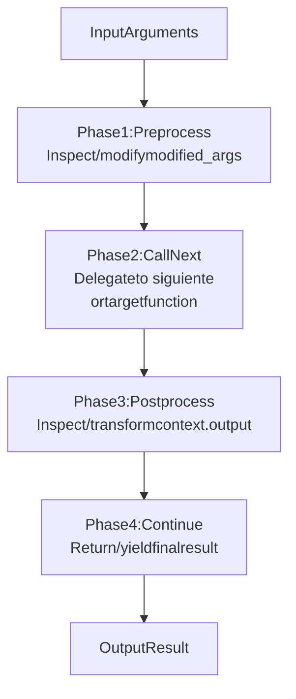
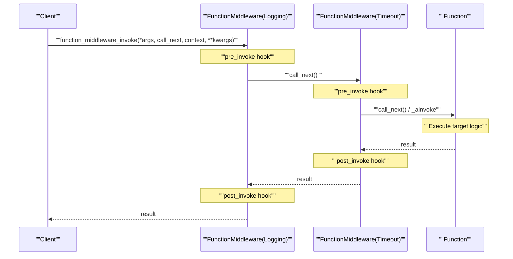
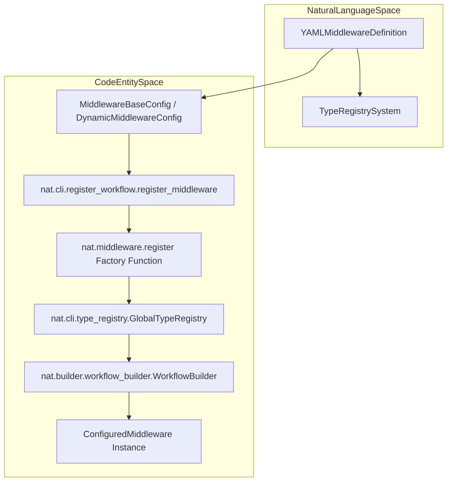

<!-- source: DeepWiki mcp.deepwiki.com · repo NVIDIA/NeMo-Agent-Toolkit · page 8.1 Middleware Architecture · fetched 2026-10-26 -->

# Middleware Architecture

<details>
<summary>Relevant source files</summary>

The following files were used as context for generating this wiki page:

- [packages/nvidia_nat_core/src/nat/builder/per_user_workflow_builder.py](packages/nvidia_nat_core/src/nat/builder/per_user_workflow_builder.py)
- [packages/nvidia_nat_core/src/nat/builder/workflow_builder.py](packages/nvidia_nat_core/src/nat/builder/workflow_builder.py)
- [packages/nvidia_nat_core/src/nat/data_models/intermediate_step.py](packages/nvidia_nat_core/src/nat/data_models/intermediate_step.py)
- [packages/nvidia_nat_core/src/nat/middleware/function_middleware.py](packages/nvidia_nat_core/src/nat/middleware/function_middleware.py)
- [packages/nvidia_nat_core/src/nat/middleware/telemetry.py](packages/nvidia_nat_core/src/nat/middleware/telemetry.py)
- [packages/nvidia_nat_core/tests/nat/middleware/test_dynamic_middleware.py](packages/nvidia_nat_core/tests/nat/middleware/test_dynamic_middleware.py)
- [packages/nvidia_nat_core/tests/nat/middleware/test_middleware_components.py](packages/nvidia_nat_core/tests/nat/middleware/test_middleware_components.py)
- [packages/nvidia_nat_core/tests/nat/middleware/test_middleware_telemetry.py](packages/nvidia_nat_core/tests/nat/middleware/test_middleware_telemetry.py)
- [packages/nvidia_nat_langchain/src/nat/plugins/langchain/callback_handler.py](packages/nvidia_nat_langchain/src/nat/plugins/langchain/callback_handler.py)
- [packages/nvidia_nat_langchain/tests/test_langchain_callback_handler.py](packages/nvidia_nat_langchain/tests/test_langchain_callback_handler.py)
- [packages/nvidia_nat_security/pyproject.toml](packages/nvidia_nat_security/pyproject.toml)
- [packages/nvidia_nat_security/src/nat/plugins/security/middleware/guardrails/callback_handler.py](packages/nvidia_nat_security/src/nat/plugins/security/middleware/guardrails/callback_handler.py)
- [packages/nvidia_nat_security/src/nat/plugins/security/middleware/guardrails/nemo_guardrails_middleware.py](packages/nvidia_nat_security/src/nat/plugins/security/middleware/guardrails/nemo_guardrails_middleware.py)
- [packages/nvidia_nat_security/tests/middleware/guardrails/test_nemo_guardrails_middleware.py](packages/nvidia_nat_security/tests/middleware/guardrails/test_nemo_guardrails_middleware.py)
- [packages/nvidia_nat_security/uv.lock](packages/nvidia_nat_security/uv.lock)

</details>


## Purpose and Scope

This document details the middleware architecture in the NVIDIA NeMo Agent Toolkit (NAT), which provides a framework-agnostic mechanism for intercepting and augmenting function and component calls across the system [packages/nvidia_nat_core/src/nat/middleware/function_middleware.py:15-28](). Middleware enables cross-cutting concerns such as timeouts, logging, caching, circuit breaking, authentication, and human-in-the-loop (HITL) gating to be applied declaratively via configuration rather than embedded directly within function implementations.

Sources: [packages/nvidia_nat_core/src/nat/middleware/function_middleware.py:15-28]()

---

## Core Architecture

### Execution Model

Middleware in NAT follows a four-phase execution pattern inspired by web framework middleware pipelines. It wraps function calls via `CallNext` and `CallNextStream` delegates, allowing custom logic to run before and after the target function executes [packages/nvidia_nat_core/src/nat/middleware/function_middleware.py:38-71]().

**Diagram: Four-Phase Middleware Execution Pattern**


Sources: [packages/nvidia_nat_core/src/nat/middleware/function_middleware.py:48-71]()

**Middleware Chain Structure ("Onion Model"):**

When multiple middleware are configured, they form an ordered chain via `FunctionMiddlewareChain`. Control flows inward through preprocessing hooks (`pre_invoke`) and outward through postprocessing hooks (`post_invoke`). A middleware can be marked as *final* (`is_final=True`), which terminates the execution chain and directly invokes the target without forwarding to subsequent middleware [packages/nvidia_nat_core/src/nat/middleware/function_middleware.py:25-28]().

**Diagram: Middleware Chain Execution Sequence**


Sources: [packages/nvidia_nat_core/src/nat/middleware/function_middleware.py:129-165]()

---

## Execution Flow and Context

The middleware lifecycle separates static metadata from dynamic runtime state using two distinct context models defined in `nat.middleware.middleware` and managed via `FunctionMiddleware` [packages/nvidia_nat_core/src/nat/middleware/function_middleware.py:38-71]().

1. **`FunctionMiddlewareContext`**: A frozen, static metadata structure containing function name, configuration, description, input schema, single output schema, and stream output schema [packages/nvidia_nat_core/tests/nat/middleware/test_dynamic_middleware.py:165-177]().
2. **`InvocationContext`**: A mutable runtime container passed to both `pre_invoke` and `post_invoke` hooks. It tracks `original_args`, `original_kwargs`, mutable `modified_args`, mutable `modified_kwargs`, and `output` [packages/nvidia_nat_core/src/nat/middleware/function_middleware.py:66-70]().

* **Pre-invoke Phase**: `context.output` is `None`. Middleware can inspect or rewrite arguments in `context.modified_args` and `context.modified_kwargs` [packages/nvidia_nat_core/src/nat/middleware/function_middleware.py:66-69]().
* **Post-invoke Phase**: `context.output` contains the result returned by the target function or subsequent middleware. Middleware can inspect or transform `context.output` [packages/nvidia_nat_core/src/nat/middleware/function_middleware.py:70-70]().

Sources: [packages/nvidia_nat_core/src/nat/middleware/function_middleware.py:38-91](), [packages/nvidia_nat_core/tests/nat/middleware/test_dynamic_middleware.py:165-177]()

---

## Configuration and Registration System

### Configuration Classes and DynamicMiddlewareConfig

All middleware configs inherit from `MiddlewareBaseConfig` or `DynamicMiddlewareConfig`, providing flags for auto-discovery across workflow components (LLMs, embedders, retrievers, memory, object stores, auth providers, and workflow functions) [packages/nvidia_nat_core/src/nat/middleware/dynamic/dynamic_function_middleware.py:42-86]().

### Registration Flow

Middleware classes are registered using the `@register_middleware` decorator, mapping a configuration class to an async builder factory function stored in the `GlobalTypeRegistry` [packages/nvidia_nat_core/tests/nat/middleware/test_middleware_components.py:102-131]().

**Diagram: Natural Language Space to Code Entity Space - Middleware Registration and Builder Resolution**


Sources: [packages/nvidia_nat_core/tests/nat/middleware/test_middleware_components.py:23-32](), [packages/nvidia_nat_core/tests/nat/middleware/test_middleware_components.py:102-131]()

---

## Dynamic Function Middleware & Policy Integration

### DynamicFunctionMiddleware

`DynamicFunctionMiddleware` extends `FunctionMiddleware` to support automatic discovery and interception of workflow components and functions without requiring manual per-component wrapping [packages/nvidia_nat_core/src/nat/middleware/dynamic/dynamic_function_middleware.py:42-46](). It leverages workflow inventory inspection to route execution through policy hooks.

### GuardrailsMiddleware Implementation

The `GuardrailsMiddleware` inherits from `DynamicFunctionMiddleware` and integrates NeMo Guardrails as an active policy engine at function boundaries [packages/nvidia_nat_security/src/nat/plugins/security/middleware/guardrails/nemo_guardrails_middleware.py:55-77]().

**Diagram: Natural Language Space to Code Entity Space - Guardrails Policy Interception**

```mermaid
graph TD
    subgraph NaturalLanguageSpace
    PolicyRule[""GuardrailsPolicyYAML""] --> InputRails[""InputGuardrailExecution""]
    PolicyRule --> OutputRails[""OutputGuardrailExecution""]
    end

    subgraph CodeEntitySpace
    PolicyRule --> Config[""nat.plugins.security.middleware.guardrails.nemo_guardrails_middleware_config.GuardrailsMiddlewareConfig""]
    Config --> GuardMiddleware[""nat.plugins.security.middleware.guardrails.nemo_guardrails_middleware.GuardrailsMiddleware""]
    GuardMiddleware --> DynMiddleware[""nat.middleware.dynamic.dynamic_function_middleware.DynamicFunctionMiddleware""]
    DynMiddleware --> LLMRailsInst[""nemoguardrails.LLMRails""]
    LLMRailsInst --> PreInvoke[""GuardrailsMiddleware.pre_invoke()""]
    LLMRailsInst --> PostInvoke[""GuardrailsMiddleware.post_invoke()""]
    end
```
Sources: [packages/nvidia_nat_security/src/nat/plugins/security/middleware/guardrails/nemo_guardrails_middleware.py:55-169](), [packages/nvidia_nat_core/src/nat/middleware/dynamic/dynamic_function_middleware.py:42-128]()

---

## Testing Middleware

Middleware components are validated using `pytest` with mocked builder contexts and function descriptors [packages/nvidia_nat_core/tests/nat/middleware/test_middleware_components.py:15-32](). 

Key testing paradigms include:
1. **Component Registration Verification**: Asserting that custom middleware configurations correctly register into `GlobalTypeRegistry` [packages/nvidia_nat_core/tests/nat/middleware/test_middleware_components.py:110-131]().
2. **Builder Integration**: Using `WorkflowBuilder` to add and retrieve middleware instances via `builder.add_middleware()` and `builder.get_middleware()` [packages/nvidia_nat_core/tests/nat/middleware/test_middleware_components.py:133-183]().
3. **Execution Chain Validation**: Verifying correct ordering and interception behavior during `function_middleware_invoke` calls [packages/nvidia_nat_core/tests/nat/middleware/test_middleware_components.py:59-65]().

Sources: [packages/nvidia_nat_core/tests/nat/middleware/test_middleware_components.py:15-195]()

---

