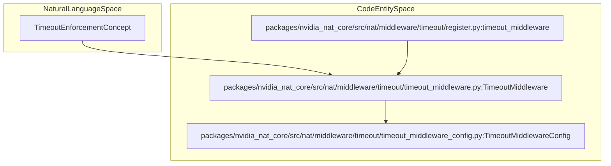
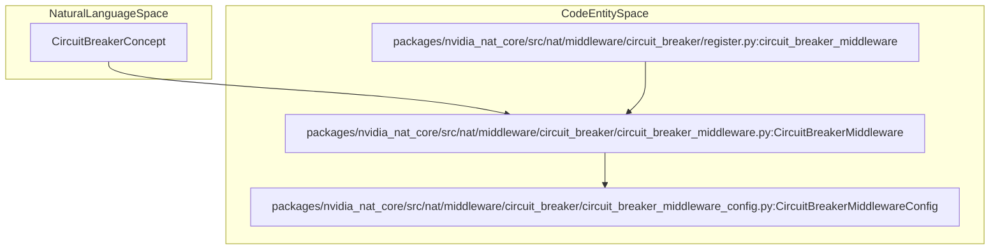
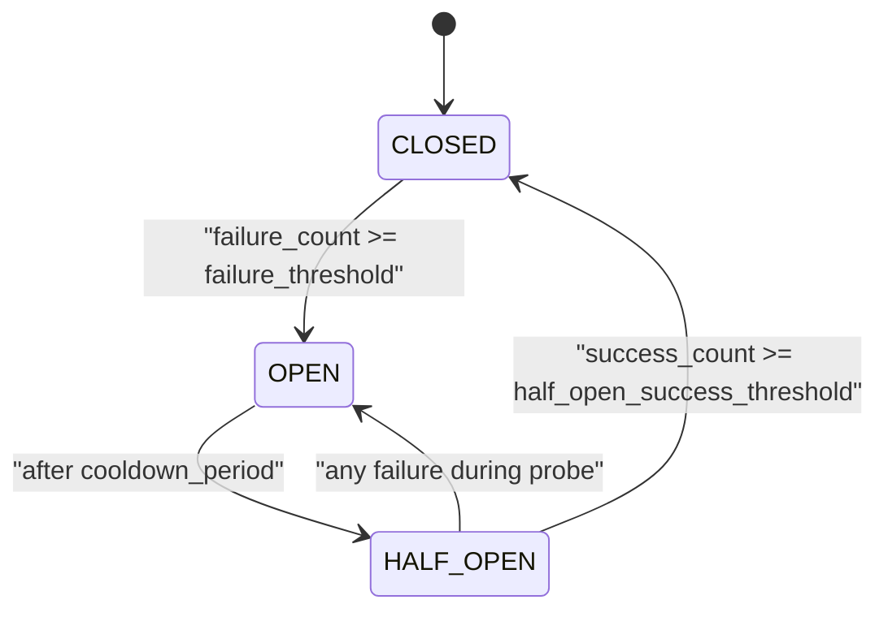
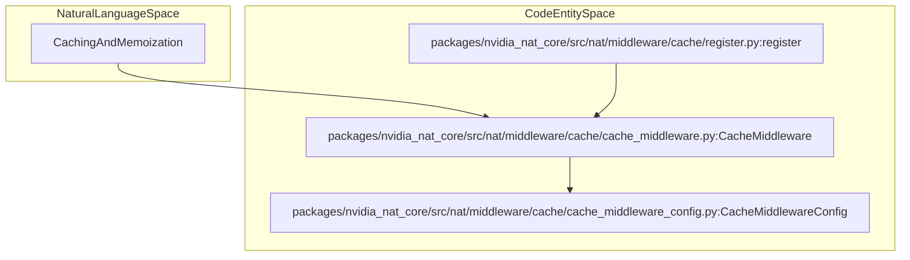

<!-- source: DeepWiki mcp.deepwiki.com · repo NVIDIA/NeMo-Agent-Toolkit · page 8.2 Built-in Middleware · fetched 2026-10-26 -->

# Built-in Middleware

<details>
<summary>Relevant source files</summary>

The following files were used as context for generating this wiki page:

- [docs/source/build-workflows/advanced/middleware.md](docs/source/build-workflows/advanced/middleware.md)
- [docs/source/extend/custom-components/telemetry-exporters.md](docs/source/extend/custom-components/telemetry-exporters.md)
- [docs/source/extend/plugin-api.md](docs/source/extend/plugin-api.md)
- [packages/nvidia_nat_core/src/nat/middleware/cache/cache_middleware.py](packages/nvidia_nat_core/src/nat/middleware/cache/cache_middleware.py)
- [packages/nvidia_nat_core/src/nat/middleware/cache/cache_middleware_config.py](packages/nvidia_nat_core/src/nat/middleware/cache/cache_middleware_config.py)
- [packages/nvidia_nat_core/src/nat/middleware/cache/register.py](packages/nvidia_nat_core/src/nat/middleware/cache/register.py)
- [packages/nvidia_nat_core/src/nat/middleware/circuit_breaker/__init__.py](packages/nvidia_nat_core/src/nat/middleware/circuit_breaker/__init__.py)
- [packages/nvidia_nat_core/src/nat/middleware/circuit_breaker/circuit_breaker_middleware.py](packages/nvidia_nat_core/src/nat/middleware/circuit_breaker/circuit_breaker_middleware.py)
- [packages/nvidia_nat_core/src/nat/middleware/circuit_breaker/circuit_breaker_middleware_config.py](packages/nvidia_nat_core/src/nat/middleware/circuit_breaker/circuit_breaker_middleware_config.py)
- [packages/nvidia_nat_core/src/nat/middleware/circuit_breaker/register.py](packages/nvidia_nat_core/src/nat/middleware/circuit_breaker/register.py)
- [packages/nvidia_nat_core/src/nat/middleware/register.py](packages/nvidia_nat_core/src/nat/middleware/register.py)
- [packages/nvidia_nat_core/src/nat/middleware/timeout/__init__.py](packages/nvidia_nat_core/src/nat/middleware/timeout/__init__.py)
- [packages/nvidia_nat_core/src/nat/middleware/timeout/register.py](packages/nvidia_nat_core/src/nat/middleware/timeout/register.py)
- [packages/nvidia_nat_core/src/nat/middleware/timeout/timeout_middleware.py](packages/nvidia_nat_core/src/nat/middleware/timeout/timeout_middleware.py)
- [packages/nvidia_nat_core/src/nat/middleware/timeout/timeout_middleware_config.py](packages/nvidia_nat_core/src/nat/middleware/timeout/timeout_middleware_config.py)
- [packages/nvidia_nat_core/src/nat/plugin_api/__init__.py](packages/nvidia_nat_core/src/nat/plugin_api/__init__.py)
- [packages/nvidia_nat_core/tests/nat/middleware/test_cache_middleware.py](packages/nvidia_nat_core/tests/nat/middleware/test_cache_middleware.py)
- [packages/nvidia_nat_core/tests/nat/middleware/test_circuit_breaker_middleware.py](packages/nvidia_nat_core/tests/nat/middleware/test_circuit_breaker_middleware.py)
- [packages/nvidia_nat_core/tests/nat/middleware/test_timeout_middleware.py](packages/nvidia_nat_core/tests/nat/middleware/test_timeout_middleware.py)
- [packages/nvidia_nat_core/tests/nat/test_plugin_api.py](packages/nvidia_nat_core/tests/nat/test_plugin_api.py)
- [skills/nat-telemetry/references/telemetry.md](skills/nat-telemetry/references/telemetry.md)

</details>


This page documents the built-in middleware components provided out-of-the-box by the NVIDIA NeMo Agent Toolkit. These components implement cross-cutting concerns—such as execution timeouts, circuit breaking, input/output caching, human-in-the-loop (HITL) coordination, and security guardrails—without requiring changes to core function or LLM implementations.

For details on the underlying execution architecture and invocation lifecycle, see [Middleware Architecture](8.1). For information on creating custom middleware plugins, see [Custom Middleware Development](8.3).

Sources: [docs/source/build-workflows/advanced/middleware.md:18-40]()

---

## Overview of Built-in Middleware

NeMo Agent Toolkit provides modular middleware components that wrap function and LLM calls using a four-phase interception pattern (Preprocess, Call Next, Postprocess, Continue) [docs/source/build-workflows/advanced/middleware.md:22-28](). All built-in middleware are registered via configuration classes and can be bound to workflows, individual functions, or function groups [docs/source/build-workflows/advanced/middleware.md:33-38]().

| Middleware Class / Type | Primary Purpose | Source Module / Registration |
|-------------------------|-----------------|-----------------------------|
| `TimeoutMiddleware` | Enforce execution time limits on calls and streams | `packages/nvidia_nat_core/src/nat/middleware/timeout/timeout_middleware.py:35-120]() |
| `CacheMiddleware` | Memoize function outputs with exact or fuzzy similarity matching | `packages/nvidia_nat_core/src/nat/middleware/cache/cache_middleware.py:48-100]() |
| `CircuitBreakerMiddleware` | Isolate failing services and prevent cascading failures | `packages/nvidia_nat_core/src/nat/middleware/circuit_breaker/circuit_breaker_middleware.py:15-70]() |
| `HITLMiddleware` | Pause execution for human approval and input prompts | `docs/source/extend/plugin-api.md:49-61]() |
| `NeMoGuardrailsMiddleware` | Enterprise-grade input and output safety policy checks | `docs/source/extend/plugin-api.md()` |

Sources: [packages/nvidia_nat_core/src/nat/middleware/register.py:18-22](), [docs/source/build-workflows/advanced/middleware.md:22-38]()

---

## Timeout Middleware

### Purpose and Implementation

`TimeoutMiddleware` enforces strict time limits on function execution. If an execution exceeds the configured duration, it raises a `TimeoutError`, protecting workflows from unbounded blocking or hung downstream services.

The middleware wraps downstream execution using `asyncio.timeout` for single invocations and asynchronous streaming generators [packages/nvidia_nat_core/src/nat/middleware/timeout/timeout_middleware.py:54-136]().

Title: "Timeout Middleware Code Entity Mapping"


Sources: [packages/nvidia_nat_core/src/nat/middleware/timeout/timeout_middleware.py:35-136](), [packages/nvidia_nat_core/src/nat/middleware/timeout/timeout_middleware_config.py](), [packages/nvidia_nat_core/src/nat/middleware/timeout/register.py:25-39]()

### Configuration

Configuration is managed through `TimeoutMiddlewareConfig`:

| Field | Type | Default | Description |
|-------|------|---------|-------------|
| `timeout` | `float` | Required | Duration in seconds before timing out (`gt=0`) |
| `timeout_message` | `str | None` | `None` | Optional message appended to the timeout error |

**Example Configuration:**
```yaml
middleware:
  llm_timeout:
    _type: timeout
    timeout: 30.0
    timeout_message: "Operation timed out after 30 seconds"
```

Sources: [packages/nvidia_nat_core/src/nat/middleware/timeout/timeout_middleware.py:35-136](), [packages/nvidia_nat_core/src/nat/middleware/timeout/timeout_middleware_config.py](), [packages/nvidia_nat_core/src/nat/middleware/timeout/register.py:25-39]()

---

## Circuit Breaker Middleware

### Purpose and Architecture

`CircuitBreakerMiddleware` implements the Circuit Breaker pattern to prevent cascading failures across distributed or external tool dependencies [packages/nvidia_nat_core/src/nat/middleware/circuit_breaker/circuit_breaker_middleware.py:15-70](). It monitors consecutive failures per target and isolates broken functions by short-circuiting calls.

Title: "Circuit Breaker Code Entity Mapping"


Sources: [packages/nvidia_nat_core/src/nat/middleware/circuit_breaker/circuit_breaker_middleware.py:15-70](), [packages/nvidia_nat_core/src/nat/middleware/circuit_breaker/circuit_breaker_middleware_config.py](), [packages/nvidia_nat_core/src/nat/middleware/circuit_breaker/register.py]()

### State Machine

The middleware tracks state per target function using `CircuitBreakerState`:

1. `CLOSED`: Normal operation; failures increment `failure_count`. If `failure_count >= failure_threshold`, the state transitions to `OPEN`.
2. `OPEN`: Calls are immediately short-circuited, raising `CircuitBreakerOpenError`. After `cooldown_period`, the state transitions to `HALF_OPEN`.
3. `HALF_OPEN`: Probe calls are admitted. If successful up to `half_open_success_threshold`, the circuit resets to `CLOSED`; any failure immediately trips it back to `OPEN`.

Title: "Circuit Breaker State Machine"


Sources: [packages/nvidia_nat_core/src/nat/middleware/circuit_breaker/circuit_breaker_middleware.py:41-70](), [packages/nvidia_nat_core/src/nat/middleware/circuit_breaker/circuit_breaker_middleware_config.py]()

---

## Cache Middleware

### Purpose and Implementation

`CacheMiddleware` memoizes function execution results based on input similarity [packages/nvidia_nat_core/src/nat/middleware/cache/cache_middleware.py:48-100]() and respects evaluation modes. It utilizes an `OrderedDict` structure to provide $O(1)$ LRU eviction when capacity exceeds `max_entries` [packages/nvidia_nat_core/src/nat/middleware/cache/cache_middleware.py:96-101]().

Title: "Cache Middleware Code Entity Mapping"


Sources: [packages/nvidia_nat_core/src/nat/middleware/cache/cache_middleware.py:48-101](), [packages/nvidia_nat_core/src/nat/middleware/cache/cache_middleware_config.py]()

### Configuration and Matching

Configuration is defined via `CacheMiddlewareConfig`:

| Field | Type | Default | Description |
|-------|------|---------|-------------|
| `enabled_mode` | `Literal["always", "eval"]` | `"eval"` | Determines if caching runs always or exclusively during evaluation modes |
| `similarity_threshold` | `float` | `1.0` | `1.0` for exact string matching; `< 1.0` for fuzzy string matching via `difflib` |
| `max_entries` | `int` | `1024` | Maximum capacity before LRU eviction |

Sources: [packages/nvidia_nat_core/src/nat/middleware/cache/cache_middleware.py:70-101](), [packages/nvidia_nat_core/src/nat/middleware/cache/cache_middleware_config.py]()

---

## HITL Middleware

### Purpose and Data Models

`HITLMiddleware` pauses workflow execution to prompt human operators for approval, notifications, or structured input prompts (text, binary, radio, checkbox, dropdown) [docs/source/extend/plugin-api.md:49-58](). It interacts with invocation context states (`Context`) to retrieve user interaction managers [docs/source/extend/plugin-api.md:59-61]().

**Key Data Structures:**
- `HumanPrompt` and `InteractionPrompt`: Encapsulate interactive requests sent to operators [docs/source/extend/plugin-api.md:51-57]().
- `HumanResponse` union types (`HumanResponseText`, `HumanResponseRadio`, `HumanResponseCheckbox`, etc.): Represent structured operator responses [docs/source/extend/plugin-api.md:51-54]().

Sources: [docs/source/extend/plugin-api.md:49-61]()

---

## Defense and Security Middleware

Security middleware components intercept execution boundaries to enforce safety policies, redact PII, and protect against prompt injection attacks.

| Middleware Identifier | Core Responsibility |
|-----------------------|---------------------|
| `nemo_guardrails` | Intercepts calls to enforce NeMo Guardrails safety policies |
| `pii_defense` | Detects and redacts Personally Identifiable Information from inputs/outputs |
| `content_safety_guard` | Applies guard models (e.g., Llama Guard) to filter toxic content |
| `output_verifier` | Verifies tool output safety against prompt injection |

Sources: [docs/source/extend/plugin-api.md]()

---

