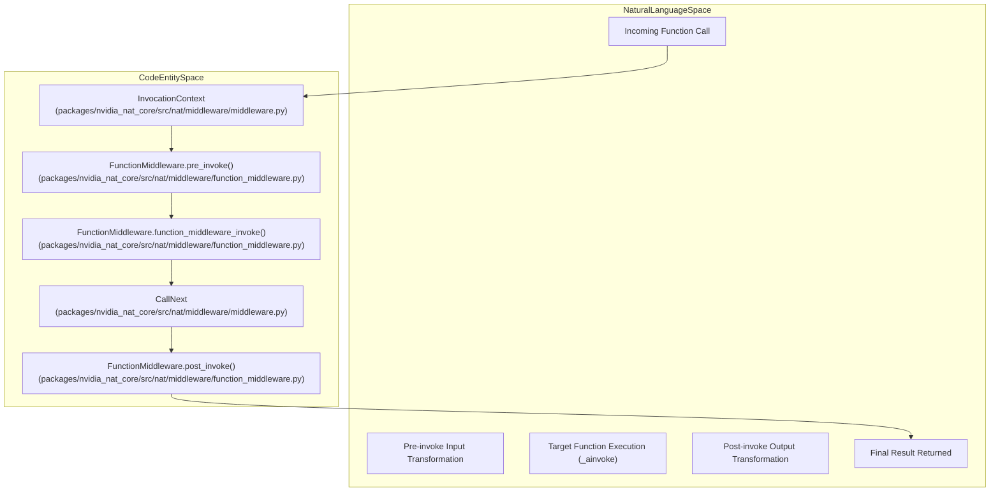
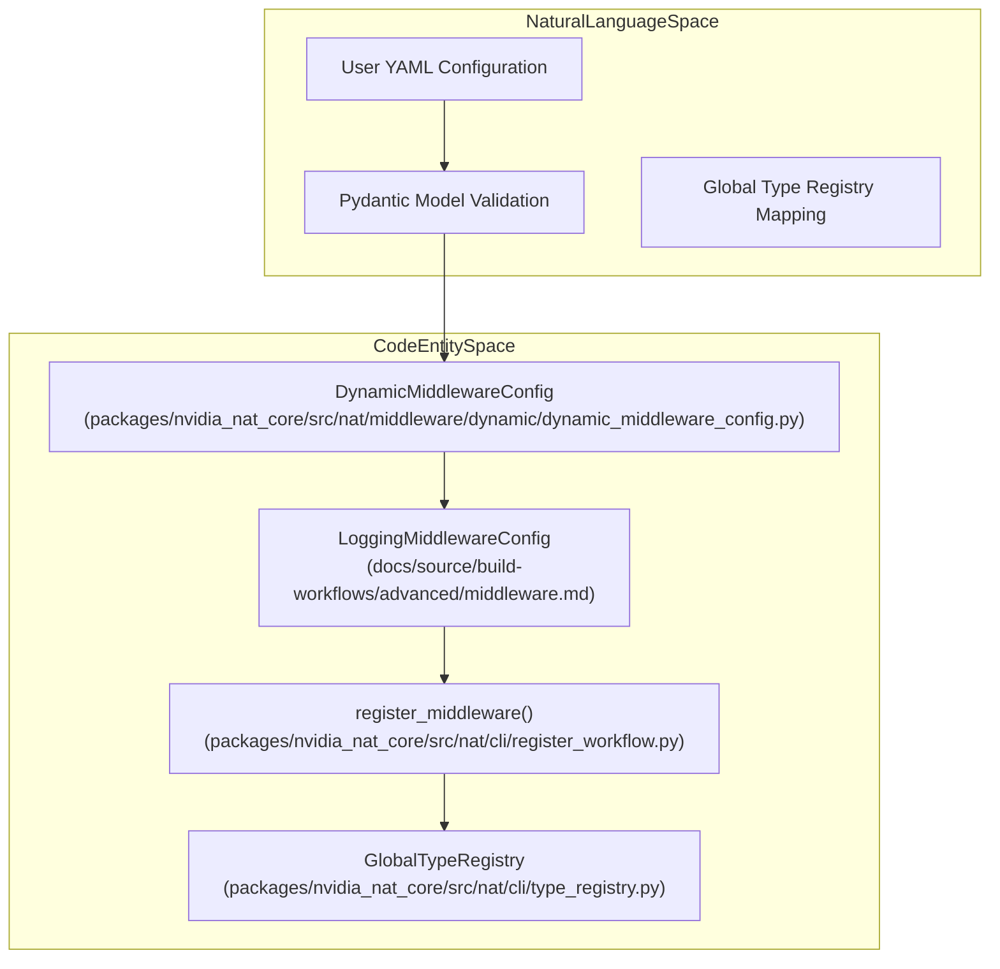
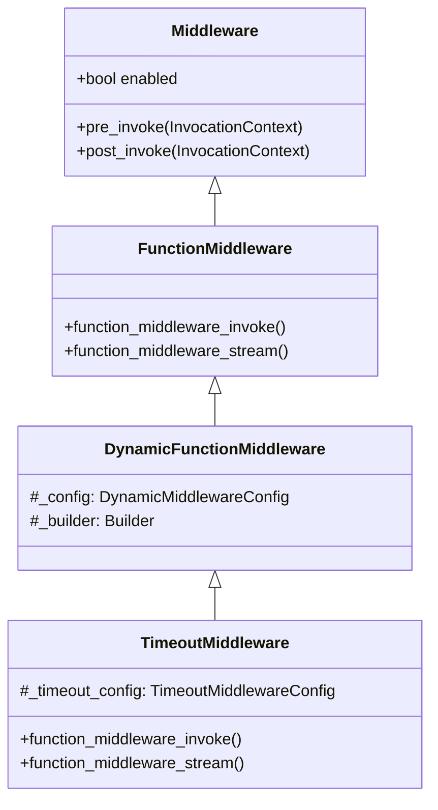

<!-- source: DeepWiki mcp.deepwiki.com · repo NVIDIA/NeMo-Agent-Toolkit · page 8.3 Custom Middleware Development · fetched 2026-10-26 -->

# Custom Middleware Development

<details>
<summary>Relevant source files</summary>

The following files were used as context for generating this wiki page:

- [docs/source/build-workflows/advanced/middleware.md](docs/source/build-workflows/advanced/middleware.md)
- [packages/nvidia_nat_core/src/nat/builder/function.py](packages/nvidia_nat_core/src/nat/builder/function.py)
- [packages/nvidia_nat_core/src/nat/builder/function_base.py](packages/nvidia_nat_core/src/nat/builder/function_base.py)
- [packages/nvidia_nat_core/src/nat/middleware/dynamic/dynamic_function_middleware.py](packages/nvidia_nat_core/src/nat/middleware/dynamic/dynamic_function_middleware.py)
- [packages/nvidia_nat_core/src/nat/middleware/register.py](packages/nvidia_nat_core/src/nat/middleware/register.py)
- [packages/nvidia_nat_core/src/nat/middleware/timeout/__init__.py](packages/nvidia_nat_core/src/nat/middleware/timeout/__init__.py)
- [packages/nvidia_nat_core/src/nat/middleware/timeout/register.py](packages/nvidia_nat_core/src/nat/middleware/timeout/register.py)
- [packages/nvidia_nat_core/src/nat/middleware/timeout/timeout_middleware.py](packages/nvidia_nat_core/src/nat/middleware/timeout/timeout_middleware.py)
- [packages/nvidia_nat_core/src/nat/middleware/timeout/timeout_middleware_config.py](packages/nvidia_nat_core/src/nat/middleware/timeout/timeout_middleware_config.py)
- [packages/nvidia_nat_core/src/nat/observability/mixin/type_introspection_mixin.py](packages/nvidia_nat_core/src/nat/observability/mixin/type_introspection_mixin.py)
- [packages/nvidia_nat_core/src/nat/utils/type_converter.py](packages/nvidia_nat_core/src/nat/utils/type_converter.py)
- [packages/nvidia_nat_core/src/nat/utils/type_utils.py](packages/nvidia_nat_core/src/nat/utils/type_utils.py)
- [packages/nvidia_nat_core/tests/nat/builder/test_function.py](packages/nvidia_nat_core/tests/nat/builder/test_function.py)
- [packages/nvidia_nat_core/tests/nat/middleware/test_timeout_middleware.py](packages/nvidia_nat_core/tests/nat/middleware/test_timeout_middleware.py)
- [packages/nvidia_nat_core/tests/nat/observability/mixin/test_type_introspection_mixin.py](packages/nvidia_nat_core/tests/nat/observability/mixin/test_type_introspection_mixin.py)
- [packages/nvidia_nat_core/tests/nat/utils/test_converter.py](packages/nvidia_nat_core/tests/nat/utils/test_converter.py)
- [packages/nvidia_nat_core/tests/nat/utils/test_type_utils.py](packages/nvidia_nat_core/tests/nat/utils/test_type_utils.py)

</details>


Custom middleware development enables developers to intercept, augment, and control function and component invocations across the NeMo Agent Toolkit without modifying the underlying function implementations [packages/nvidia_nat_core/src/nat/middleware/function_middleware.py:15-28](). This page details the creation, configuration, registration, and lifecycle management of custom middleware components.

Sources: [packages/nvidia_nat_core/src/nat/middleware/function_middleware.py:15-28]()

## Overview

Custom middleware development in the NeMo Agent Toolkit follows a component-based pattern with three primary elements:

1. **Configuration Class**: Defines middleware settings and discovery flags, inheriting from `DynamicMiddlewareConfig` or `MiddlewareBaseConfig`.
2. **Middleware Implementation**: Implements processing logic via `pre_invoke` and `post_invoke` hooks or direct method overrides like `function_middleware_invoke` [packages/nvidia_nat_core/src/nat/middleware/function_middleware.py:48-166]().
3. **Registration Function**: Registers the middleware factory with the toolkit's registry using the `@register_middleware` decorator [packages/nvidia_nat_core/src/nat/cli/register_workflow.py]().

Middleware components are first-class toolkit components, configured in YAML and built by the workflow `Builder` before functions and function groups are instantiated [packages/nvidia_nat_core/src/nat/builder/function.py:133-157]().

Sources: [packages/nvidia_nat_core/src/nat/middleware/function_middleware.py:48-166](), [packages/nvidia_nat_core/src/nat/builder/function.py:133-157](), [packages/nvidia_nat_core/src/nat/cli/register_workflow.py]()

## Middleware Execution Flow

The middleware chain forms an "onion" structure where control flows inward through preprocessing phases, executes the target function, then flows outward through postprocessing phases [packages/nvidia_nat_core/src/nat/middleware/function_middleware.py:25-28]().

Title: "Middleware Onion Execution Pipeline"


Sources: [packages/nvidia_nat_core/src/nat/middleware/function_middleware.py:15-166]()

## Step 1: Define the Configuration Class

The configuration class defines settings and must inherit from `DynamicMiddlewareConfig` or `MiddlewareBaseConfig`. This base class provides infrastructure for automatic discovery via flags like `register_llms` or `register_workflow_functions` [docs/source/build-workflows/advanced/middleware.md:83-120]().

Title: "Middleware Configuration and Registration Mapping"


Example configuration class using `DynamicMiddlewareConfig` [docs/source/build-workflows/advanced/middleware.md:83-101]():
```python
from pydantic import Field
from nat.plugin_api import DynamicMiddlewareConfig

class LoggingMiddlewareConfig(DynamicMiddlewareConfig, name="logging_middleware"):
    """Configuration for logging middleware."""

    log_level: str = Field(
        default="INFO",
        description="Logging level (DEBUG, INFO, WARNING, ERROR)"
    )
```

Sources: [docs/source/build-workflows/advanced/middleware.md:83-120](), [packages/nvidia_nat_core/src/nat/cli/register_workflow.py]()

### Default Allowed Functions by Component Type

The toolkit defines default methods that can be wrapped for each component type via `DynamicFunctionMiddleware` [packages/nvidia_nat_core/src/nat/middleware/dynamic/dynamic_function_middleware.py]():

| Component Type | Default Allowed Methods |
|---------------|------------------------|
| **LLMs** | `invoke`, `ainvoke`, `stream`, `astream` |
| **Embedders** | `embed_query`, `aembed_query` |
| **Retrievers** | `search` |
| **Memory** | `search`, `add_items`, `remove_items` |
| **Object Stores** | `put_object`, `get_object`, `delete_object`, `upsert_object` |
| **Authentication** | `authenticate` |

Sources: [packages/nvidia_nat_core/src/nat/middleware/dynamic/dynamic_function_middleware.py]()

## Step 2: Implement the Middleware Class

Implementations typically inherit from `FunctionMiddleware` or `DynamicFunctionMiddleware`, implementing lifecycle hooks such as `pre_invoke` and `post_invoke` [packages/nvidia_nat_core/src/nat/middleware/function_middleware.py:48-128]().

Title: "Middleware Implementation Hierarchy"


Sources: [packages/nvidia_nat_core/src/nat/middleware/function_middleware.py:48-128](), [packages/nvidia_nat_core/src/nat/middleware/timeout/timeout_middleware.py:35-137]()

## Step 3: Register the Component

Use the `register_middleware` decorator to register the middleware factory [packages/nvidia_nat_core/src/nat/cli/register_workflow.py](). The factory must be an `async` function yielding the middleware instance.

```python
from collections.abc import AsyncGenerator
from nat.builder.builder import Builder
from nat.cli.register_workflow import register_middleware

@register_middleware(config_type=LoggingMiddlewareConfig)
async def logging_middleware(config: LoggingMiddlewareConfig, builder: Builder):
    yield LoggingMiddleware(config=config, builder=builder)
```

Sources: [packages/nvidia_nat_core/src/nat/cli/register_workflow.py]()

## Step 4: Configure in YAML

Middleware is applied to functions or groups via the `middleware` key, or dynamically intercepted using configuration flags [packages/nvidia_nat_core/src/nat/builder/workflow_builder.py]() [docs/source/build-workflows/advanced/middleware.md:44-70]().

```yaml
middleware:
  my_logger:
    _type: logging_middleware
    log_level: "INFO"

functions:
  search_tool:
    _type: tavily_search
    middleware: ["my_logger"] # Explicit application
```

Sources: [docs/source/build-workflows/advanced/middleware.md:44-70](), [packages/nvidia_nat_core/src/nat/builder/workflow_builder.py]()

## Advanced: Direct Override Pattern & Final Middleware

For logic requiring full control over invocation (such as custom policy engines, time limits, or short-circuiting execution), override `function_middleware_invoke` or `function_middleware_stream`, as demonstrated in `TimeoutMiddleware` [packages/nvidia_nat_core/src/nat/middleware/timeout/timeout_middleware.py:47-137](). 

```python
async def function_middleware_invoke(self, *args, call_next, context, **kwargs):
    # Pre-invoke processing / timeout wrapping
    try:
        async with asyncio.timeout(self._timeout_config.timeout):
            return await super().function_middleware_invoke(*args, call_next=call_next, context=context, **kwargs)
    except TimeoutError:
        raise TimeoutError(f"Execution exceeded timeout.")
```

Sources: [packages/nvidia_nat_core/src/nat/middleware/timeout/timeout_middleware.py:47-137]()

## Testing Custom Middleware

Test middleware using mock `Builder` and `FunctionMiddlewareContext` objects to validate pre/post-invoke hooks and invocation wrappers [packages/nvidia_nat_core/tests/nat/middleware/test_timeout_middleware.py:33-73]().

```python
from unittest.mock import AsyncMock, Mock
from nat.middleware.middleware import FunctionMiddlewareContext

async def test_middleware_invoke_completes(mock_builder, function_context):
    middleware = TimeoutMiddleware(config=TimeoutMiddlewareConfig(timeout=5.0), builder=mock_builder)
    
    async def fast_function(*args, **kwargs):
        return "result"

    call_next = AsyncMock(side_effect=fast_function)
    result = await middleware.function_middleware_invoke("input", call_next=call_next, context=function_context)
    assert result == "result"
```

Sources: [packages/nvidia_nat_core/tests/nat/middleware/test_timeout_middleware.py:33-99]()

---

