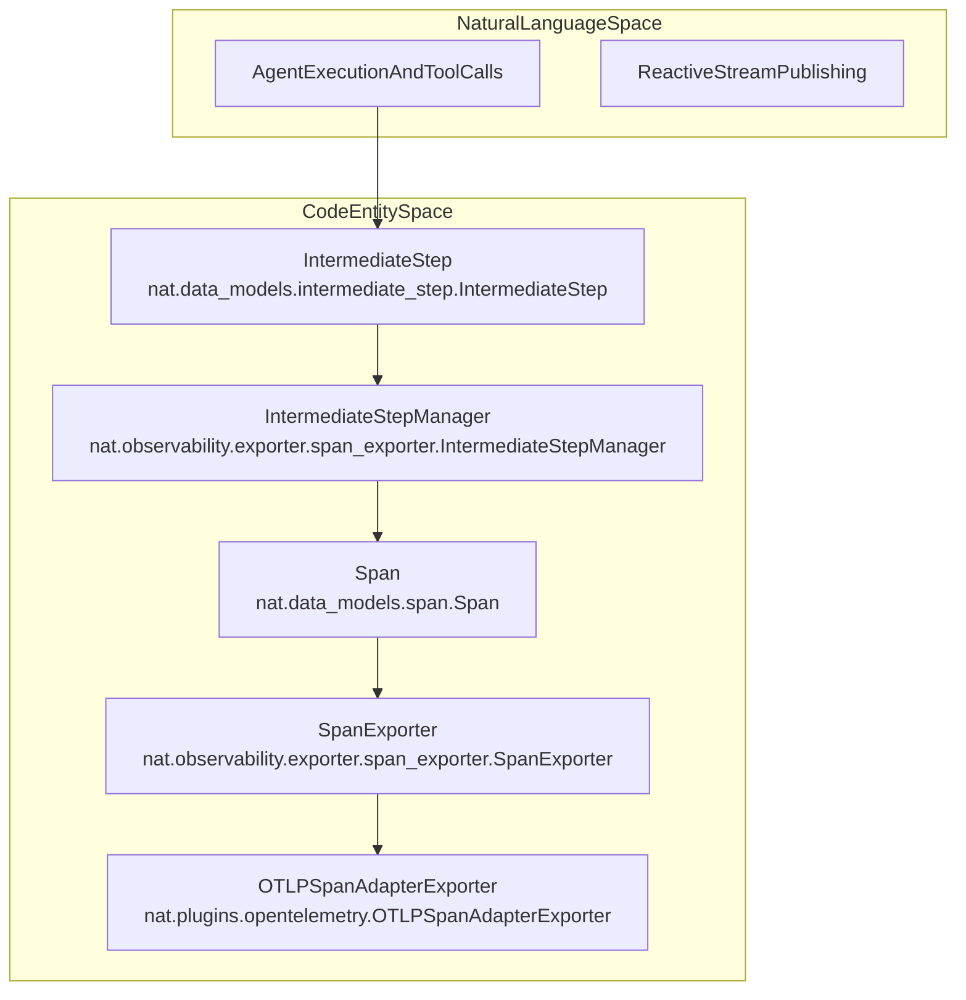
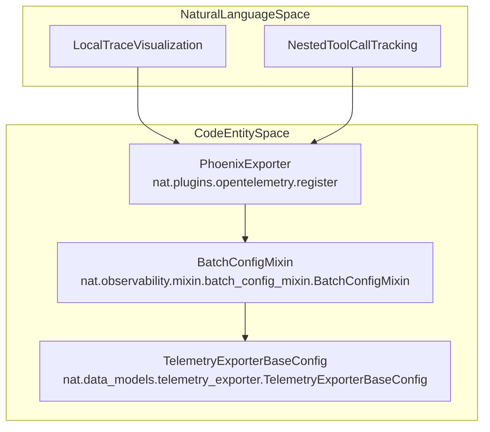
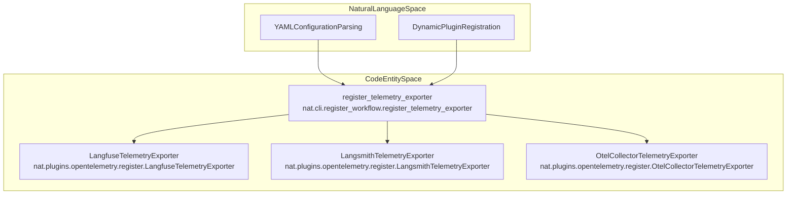

<!-- source: DeepWiki mcp.deepwiki.com · repo NVIDIA/NeMo-Agent-Toolkit · page 9 Observability and Monitoring · fetched 2026-10-26 -->

# Observability and Monitoring

Relevant source files

The following files were used as context for generating this wiki page:

- [ci/.nim_models_used.json](ci/.nim_models_used.json)
- [docs/source/run-workflows/observe/observe-workflow-with-weave.md](docs/source/run-workflows/observe/observe-workflow-with-weave.md)
- [docs/source/run-workflows/observe/observe.md](docs/source/run-workflows/observe/observe.md)
- [examples/observability/simple_calculator_observability/README.md](examples/observability/simple_calculator_observability/README.md)
- [examples/observability/simple_calculator_observability/configs/config-mlflow.yml](examples/observability/simple_calculator_observability/configs/config-mlflow.yml)
- [examples/observability/simple_calculator_observability/configs/config-weave-otel.yml](examples/observability/simple_calculator_observability/configs/config-weave-otel.yml)
- [packages/nvidia_nat_opentelemetry/src/nat/plugins/opentelemetry/register.py](packages/nvidia_nat_opentelemetry/src/nat/plugins/opentelemetry/register.py)
- [packages/nvidia_nat_opentelemetry/tests/observability/test_exporter_resource_attributes.py](packages/nvidia_nat_opentelemetry/tests/observability/test_exporter_resource_attributes.py)
- [packages/nvidia_nat_opentelemetry/tests/observability/test_mlflow_telemetry_exporter.py](packages/nvidia_nat_opentelemetry/tests/observability/test_mlflow_telemetry_exporter.py)
- [packages/nvidia_nat_weave/src/nat/plugins/weave/fastapi_plugin_worker.py](packages/nvidia_nat_weave/src/nat/plugins/weave/fastapi_plugin_worker.py)
- [packages/nvidia_nat_weave/src/nat/plugins/weave/register.py](packages/nvidia_nat_weave/src/nat/plugins/weave/register.py)
- [packages/nvidia_nat_weave/src/nat/plugins/weave/weave_exporter.py](packages/nvidia_nat_weave/src/nat/plugins/weave/weave_exporter.py)
- [packages/nvidia_nat_weave/tests/test_fastapi_plugin_worker.py](packages/nvidia_nat_weave/tests/test_fastapi_plugin_worker.py)

The NVIDIA NeMo Agent Toolkit provides a flexible, plugin-based observability and monitoring system designed to track, trace, and analyze AI agent workflows in real-time [docs/source/run-workflows/observe/observe.md:20-27](). The system captures detailed execution telemetry—including agent reasoning steps, tool invocations, LLM token usage, and latency metrics—and exports them asynchronously to various backend platforms [examples/observability/simple_calculator_observability/README.md:28-30]().

As a parent page, this guide outlines the high-level observability architecture, data flow, and available integrations. For deep technical details, refer to the respective child sections below.

Sources: [docs/source/run-workflows/observe/observe.md:20-27](), [examples/observability/simple_calculator_observability/README.md:28-30]()

---

## Telemetry Architecture

The telemetry system uses an event-driven architecture where workflow operations emit `IntermediateStep` events [packages/nvidia_nat_core/src/nat/observability/exporter/span_exporter.py:24-24]() via the `IntermediateStepManager` reactive stream [docs/source/run-workflows/observe/observe.md:20-25](). These events are converted into OpenTelemetry-compatible `Span` objects [packages/nvidia_nat_core/src/nat/observability/exporter/span_exporter.py:28-28]() and processed by asynchronous exporters like `OTLPSpanAdapterExporter` [packages/nvidia_nat_opentelemetry/src/nat/plugins/opentelemetry/register.py:74-74](). This architecture also supports standardized trajectory formats such as ATIF (Agentic Trajectory Interchange Format) and ATOF (Agentic Trajectory Observability Format) for evaluation and debugging.

Title: Telemetry Data Flow Bridge (Natural Language to Code Entity Space)

For detailed information on span collection, exporter internals, and trajectory formats, see [Telemetry Architecture](#9.1).

Sources: [docs/source/run-workflows/observe/observe.md:20-25](), [packages/nvidia_nat_core/src/nat/observability/exporter/span_exporter.py:24-84](), [packages/nvidia_nat_opentelemetry/src/nat/plugins/opentelemetry/register.py:74-74]()

---

## Phoenix Integration

Arize Phoenix is integrated natively into the toolkit for local trace visualization and analysis [examples/observability/simple_calculator_observability/README.md:58-74](). It supports advanced features such as parent-child span tracking for nested tool calls (e.g., tracking when a parent tool internally invokes another function) and export via the ATIF trajectory exporter [examples/observability/simple_calculator_observability/README.md:76-101]().

Title: Phoenix Plugin Integration Mapping

For step-by-step setup and configuration examples, see [Phoenix Integration](#9.2).

Sources: [examples/observability/simple_calculator_observability/README.md:58-101](), [packages/nvidia_nat_opentelemetry/src/nat/plugins/opentelemetry/register.py:26-27]()

---

## Weave Integration

Weights & Biases (W&B) Weave integration provides comprehensive tracking of LLM agent workflows [docs/source/run-workflows/observe/observe-workflow-with-weave.md:18-21](). The Weave telemetry plugin (`WeaveTelemetryExporter`) supports automatic Personally Identifiable Information (PII) redaction using Microsoft Presidio (`redact_pii`, `redact_pii_fields`, `redact_keys`) [packages/nvidia_nat_weave/src/nat/plugins/weave/register.py:29-48]() and features a FastAPI plugin worker (`WeaveFastAPIPluginWorker`) to bind user feedback endpoints directly to logged traces [packages/nvidia_nat_weave/src/nat/plugins/weave/fastapi_plugin_worker.py:65-176]().

For detailed configuration, PII redaction rules, and feedback worker setup, see [Weave Integration](#9.3).

Sources: [docs/source/run-workflows/observe/observe-workflow-with-weave.md:18-21](), [packages/nvidia_nat_weave/src/nat/plugins/weave/register.py:29-48](), [packages/nvidia_nat_weave/src/nat/plugins/weave/fastapi_plugin_worker.py:65-176]()

---

## OpenTelemetry and Other Platforms

In addition to Phoenix and Weave, the toolkit's plugin-based architecture supports multiple external observability platforms through OpenTelemetry protocol (OTLP) exporters [docs/source/run-workflows/observe/observe.md:20-24](). Supported platforms include LangSmith (`LangsmithTelemetryExporter`) [packages/nvidia_nat_opentelemetry/src/nat/plugins/opentelemetry/register.py:96-134](), Langfuse (`LangfuseTelemetryExporter`) [packages/nvidia_nat_opentelemetry/src/nat/plugins/opentelemetry/register.py:57-93](), Arize AX (hosted OTLP with US/EU regional endpoints) [packages/nvidia_nat_opentelemetry/src/nat/plugins/opentelemetry/register.py:33-55](), MLflow (with `x-mlflow-experiment-id` routing) [packages/nvidia_nat_opentelemetry/tests/observability/test_mlflow_telemetry_exporter.py:20-29](), as well as Galileo, Catalyst, Data Flywheel, Dynatrace, Patronus, and file-based exporters [docs/source/run-workflows/observe/observe.md:72-89]().

Title: Exporter Registration and Configuration Mapping

For configuration parameters and provider-specific setup guides, see [OpenTelemetry and Other Platforms](#9.4).

Sources: [docs/source/run-workflows/observe/observe.md:20-89](), [packages/nvidia_nat_opentelemetry/src/nat/plugins/opentelemetry/register.py:33-148](), [packages/nvidia_nat_opentelemetry/tests/observability/test_mlflow_telemetry_exporter.py:20-29]()

---

## Profiling System

The profiling system measures critical runtime performance indicators such as token usage (`prompt_tokens`, `completion_tokens`, `total_tokens`), Time-to-First-Token (TTFT), Inter-Token Latency (ITL) [examples/observability/simple_calculator_observability/README.md:28-28](), and batch processing efficiency [packages/nvidia_nat_opentelemetry/src/nat/plugins/opentelemetry/register.py:88-92](). These metrics help identify bottlenecks and inform GPU cluster sizing calculations for production deployments [examples/observability/simple_calculator_observability/README.md:28-30]().

For details on profiler decorators, latency metrics, CSV output generation, and resource estimation calculators, see [Profiling System](#9.5).

Sources: [examples/observability/simple_calculator_observability/README.md:28-30](), [packages/nvidia_nat_opentelemetry/src/nat/plugins/opentelemetry/register.py:88-92]()

---

