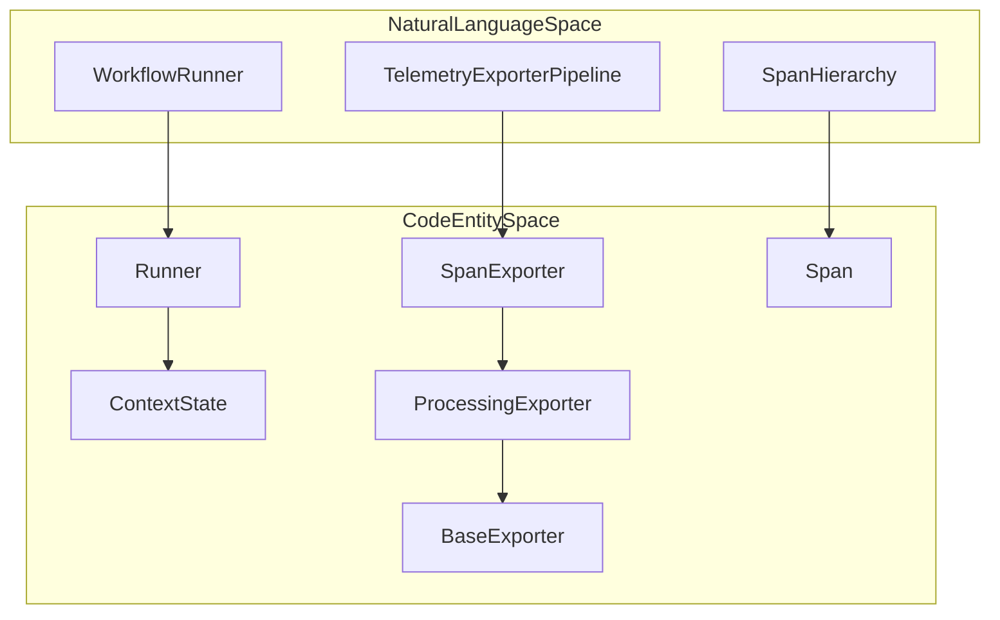
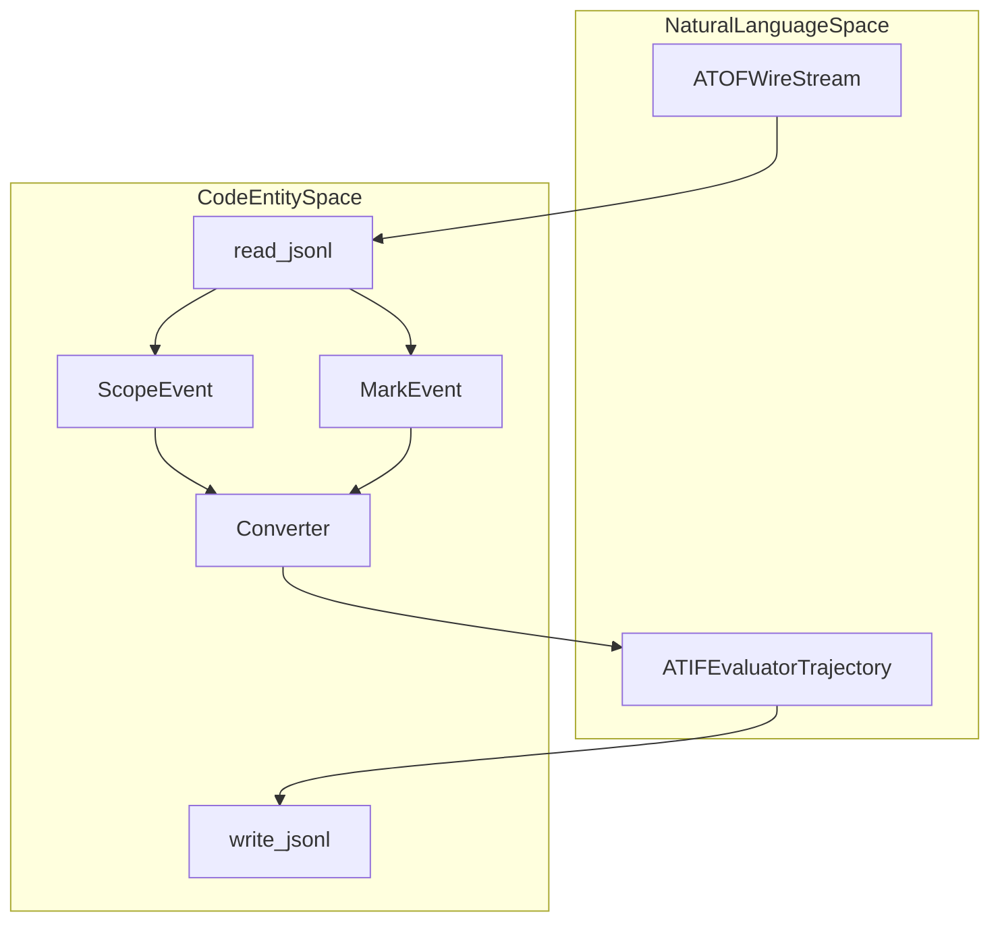

<!-- source: DeepWiki mcp.deepwiki.com · repo NVIDIA/NeMo-Agent-Toolkit · page 9.1 Telemetry Architecture · fetched 2026-10-26 -->

# Telemetry Architecture

Relevant source files

The following files were used as context for generating this wiki page:

- [docs/source/get-started/tutorials/create-a-new-workflow.md](docs/source/get-started/tutorials/create-a-new-workflow.md)
- [packages/nvidia_nat_core/src/nat/data_models/span.py](packages/nvidia_nat_core/src/nat/data_models/span.py)
- [packages/nvidia_nat_core/src/nat/observability/exporter/span_exporter.py](packages/nvidia_nat_core/src/nat/observability/exporter/span_exporter.py)
- [packages/nvidia_nat_core/src/nat/observability/register.py](packages/nvidia_nat_core/src/nat/observability/register.py)
- [packages/nvidia_nat_core/src/nat/utils/reactive/observer.py](packages/nvidia_nat_core/src/nat/utils/reactive/observer.py)
- [packages/nvidia_nat_core/src/nat/utils/reactive/subject.py](packages/nvidia_nat_core/src/nat/utils/reactive/subject.py)
- [packages/nvidia_nat_core/tests/nat/data_models/test_span.py](packages/nvidia_nat_core/tests/nat/data_models/test_span.py)
- [packages/nvidia_nat_core/tests/nat/observability/exporter/test_span_exporter.py](packages/nvidia_nat_core/tests/nat/observability/exporter/test_span_exporter.py)
- [packages/nvidia_nat_core/tests/nat/observability/test_logging_methods.py](packages/nvidia_nat_core/tests/nat/observability/test_logging_methods.py)
- [packages/nvidia_nat_core/tests/nat/reactive/test_observer.py](packages/nvidia_nat_core/tests/nat/reactive/test_observer.py)
- [packages/nvidia_nat_core/tests/nat/reactive/test_subject.py](packages/nvidia_nat_core/tests/nat/reactive/test_subject.py)
- [packages/nvidia_nat_langchain/src/nat/plugins/langchain/tool_wrapper.py](packages/nvidia_nat_langchain/src/nat/plugins/langchain/tool_wrapper.py)

## Purpose and Scope
This document explains the telemetry architecture of the NVIDIA NeMo Agent Toolkit, detailing its OpenTelemetry-based telemetry system, span collection, exporter processing pipelines, and the ATIF/ATOF trajectory formats provided by the `nvidia_nat_atif` package.

---

## Overview

The telemetry system in the NeMo Agent Toolkit uses an event-driven, plugin-based architecture capable of broadcasting workflow events to concurrent telemetry exporters. At the center of this mechanism is the `IntermediateStepManager` and the `ContextState` class, which coordinate workflow trace identifiers and span propagation across asynchronous execution boundaries [packages/nvidia_nat_core/src/nat/builder/context.py:67-100]().

The architectural components include:
- `TelemetryExporterBaseConfig`: The foundational configuration model for all telemetry exporters [packages/nvidia_nat_core/src/nat/observability/register.py:26]().
- **Registration System**: Exporters utilize the `@register_telemetry_exporter` decorator for discovery and instantiation by the `Builder` [packages/nvidia_nat_core/src/nat/observability/register.py:24]().
- **Processing Exporters**: A chain-based transformation pipeline managed via `ProcessingExporter` [packages/nvidia_nat_core/src/nat/observability/exporter/span_exporter.py:34]().
- **Span Management**: Automatic span creation and tracking via `SpanExporter` [packages/nvidia_nat_core/src/nat/observability/exporter/span_exporter.py:49-71]().

### System Component Mapping

Sources: [packages/nvidia_nat_core/src/nat/builder/context.py:67-100](), [packages/nvidia_nat_core/src/nat/observability/exporter/span_exporter.py:49-71](), [packages/nvidia_nat_core/src/nat/observability/register.py:24-26]()

---

## Processing Pipeline Architecture

The telemetry pipeline is structured around the `ProcessingExporter` class [packages/nvidia_nat_core/src/nat/observability/exporter/span_exporter.py:34](). It manages sequential processor chains that mutate, filter, or transform items before they reach the final export destination (`export_processed`).

### Key Pipeline Mechanisms
- **Processor Management**: Processors can be added, inserted at specific indexes, or positioned relatively using `before` and `after` arguments.
- **Context Isolation**: Uses `IsolatedAttribute` descriptors to keep mutable state (such as outstanding spans and processor lists) completely isolated per execution context in concurrent workflows [packages/nvidia_nat_core/src/nat/observability/exporter/span_exporter.py:87-89]().
- **Type Checking**: Validates that output types from preceding processors match input type expectations of subsequent ones.

Sources: [packages/nvidia_nat_core/src/nat/observability/exporter/span_exporter.py:34](), [packages/nvidia_nat_core/src/nat/observability/exporter/span_exporter.py:87-89]()

---

## OpenTelemetry and Span Implementation

The `SpanExporter` class specializes `ProcessingExporter` to handle span-based telemetry [packages/nvidia_nat_core/src/nat/observability/exporter/span_exporter.py:49-71](). It translates `IntermediateStep` events into structured `Span` instances.

### Span Lifecycle and Trace Linking
- **Start Events**: When an `IntermediateStepState.START` event occurs, `_process_start_event` inspects the execution stack, resolves the parent span via `parent_id`, and configures a `SpanContext` [packages/nvidia_nat_core/src/nat/observability/exporter/span_exporter.py:117-157]().
- **Trace Association**: If a `workflow_trace_id` is present in `ContextState`, it is assigned to the `SpanContext` to link all workflow operations to a unified trace [packages/nvidia_nat_core/src/nat/observability/exporter/span_exporter.py:131-156]().
- **Span Kinds**: Event types (`IntermediateStepType`) map to OpenTelemetry-compatible `SpanKind` values (e.g., `LLM`, `TOOL`, `WORKFLOW`, `AGENT`) [packages/nvidia_nat_core/src/nat/data_models/span.py:35-82]().

### Standard Span Attributes
Attributes are assigned using configurable namespaces (default prefix `nat`) [packages/nvidia_nat_core/src/nat/data_models/span.py:97-116]():
- `nat.span.kind`: The specific span classification.
- `llm.token_count.prompt`, `llm.token_count.completion`, `llm.token_count.total`: Token usage tracking.
- `input.value`, `output.value`: Input/output payload content.

Sources: [packages/nvidia_nat_core/src/nat/observability/exporter/span_exporter.py:85-163](), [packages/nvidia_nat_core/src/nat/data_models/span.py:35-116]()

---

## Trajectory Formats (ATIF/ATOF)

The `nvidia_nat_atif` package provides core data models, parsers, and conversion utilities for agentic trajectories.

### Agentic Trajectory Observability Format (ATOF)
ATOF is a JSON-Lines wire format capturing runtime observation event streams [packages/nvidia_nat_atif/src/nat/atof/io.py:15-18]().
- **Event Kinds**: `ScopeEvent` (durations like tool execution or LLM calls) and `MarkEvent` (point-in-time checkpoints such as guardrails).
- **I/O Helpers**: `read_jsonl` and `write_jsonl` parse and serialize event sequences, normalizing timestamps into microsecond integers (`ts_micros`) for reliable sorting [packages/nvidia_nat_atif/src/nat/atof/io.py:87-127]().

### Agentic Trajectory Interchange Format (ATIF)
ATIF represents completed agent trajectories used by evaluation harnesses and visualization platforms like Arize Phoenix. Converters map ATOF scopes and marks into structured `Trajectory` and `Step` objects [packages/nvidia_nat_atif/examples/atof_to_atif/generate_atof_examples.py:28-30]().

### Trajectory Conversion Architecture

Sources: [packages/nvidia_nat_atif/src/nat/atof/io.py:15-18](), [packages/nvidia_nat_atif/src/nat/atof/io.py:87-127](), [packages/nvidia_nat_atif/examples/atof_to_atif/generate_atof_examples.py:28-30]()

---

## Data Flow and Identifiers

Identifiers and time markers are managed via process-wide providers in `nat.utils.providers`, ensuring uniqueness and determinism during replay and evaluation [packages/nvidia_nat_core/src/nat/data_models/span.py:26-28]().

### Core Providers
- `IdProvider`: Generates UUID strings (default `uuid.uuid4()`).
- `generate_trace_id()` / `generate_span_id()`: Produce 128-bit trace IDs and 64-bit span IDs respectively [packages/nvidia_nat_core/src/nat/data_models/span.py:27-28]().
- `TimeProvider`: Returns fractional timestamps in seconds or nanoseconds [packages/nvidia_nat_core/src/nat/data_models/span.py:26]().

### Telemetry Execution Sequence
1. **Trace Initialization**: The runner generates a workflow-level trace identifier using `generate_trace_id()` and registers it in `ContextState`.
2. **Step Emission**: As workflows execute, `IntermediateStep` events are emitted [packages/nvidia_nat_core/src/nat/observability/exporter/span_exporter.py:114-121]().
3. **Span Conversion**: `SpanExporter` consumes events, instantiates `Span` objects, and builds parent-child hierarchies [packages/nvidia_nat_core/src/nat/observability/exporter/span_exporter.py:118-155]().
4. **Pipeline Processing**: Spans pass through the transformation pipeline [packages/nvidia_nat_core/src/nat/observability/exporter/span_exporter.py:34]().
5. **Export**: Processed spans are exported to monitoring backends or serialized into ATOF/ATIF structures.

Sources: [packages/nvidia_nat_core/src/nat/data_models/span.py:26-28](), [packages/nvidia_nat_core/src/nat/observability/exporter/span_exporter.py:34](), [packages/nvidia_nat_core/src/nat/observability/exporter/span_exporter.py:108-163]()

---

