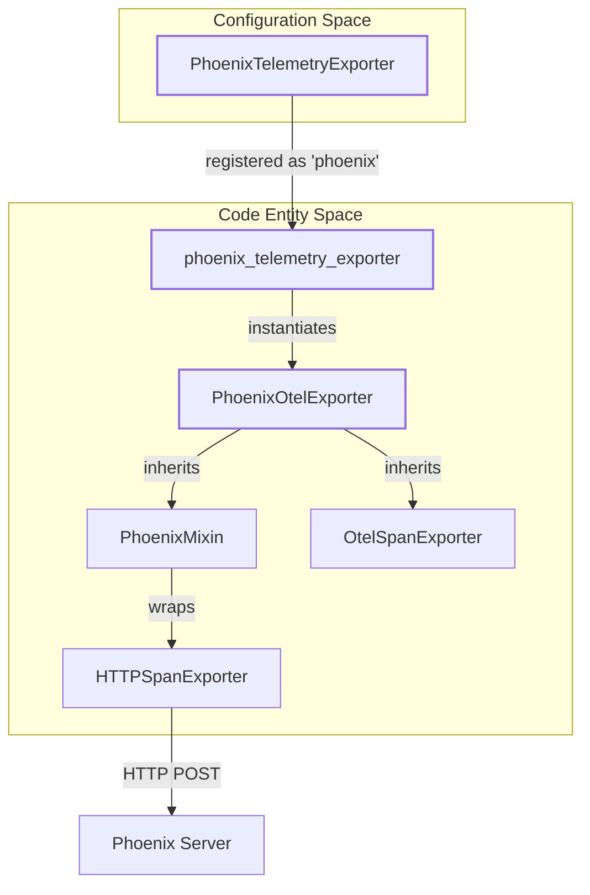
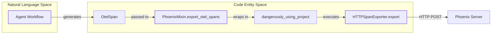

<!-- source: DeepWiki mcp.deepwiki.com · repo NVIDIA/NeMo-Agent-Toolkit · page 9.2 Phoenix Integration · fetched 2026-10-26 -->

# Phoenix Integration

<details>
<summary>Relevant source files</summary>

The following files were used as context for generating this wiki page:

- [docs/source/run-workflows/observe/observe-workflow-with-phoenix.md](docs/source/run-workflows/observe/observe-workflow-with-phoenix.md)
- [examples/frameworks/auto_wrapper/langchain_deep_research/configs/config_with_eval.yml](examples/frameworks/auto_wrapper/langchain_deep_research/configs/config_with_eval.yml)
- [examples/frameworks/auto_wrapper/langchain_deep_research/configs/config_with_llms.yml](examples/frameworks/auto_wrapper/langchain_deep_research/configs/config_with_llms.yml)
- [examples/frameworks/auto_wrapper/langchain_deep_research/configs/config_with_telemetry.yml](examples/frameworks/auto_wrapper/langchain_deep_research/configs/config_with_telemetry.yml)
- [examples/frameworks/auto_wrapper/langchain_deep_research/langgraph_deep_research.ipynb](examples/frameworks/auto_wrapper/langchain_deep_research/langgraph_deep_research.ipynb)
- [packages/nvidia_nat_phoenix/src/nat/plugins/phoenix/mixin/phoenix_mixin.py](packages/nvidia_nat_phoenix/src/nat/plugins/phoenix/mixin/phoenix_mixin.py)
- [packages/nvidia_nat_phoenix/src/nat/plugins/phoenix/register.py](packages/nvidia_nat_phoenix/src/nat/plugins/phoenix/register.py)
- [packages/nvidia_nat_phoenix/tests/test_phoenix_telemetry_exporter.py](packages/nvidia_nat_phoenix/tests/test_phoenix_telemetry_exporter.py)

</details>


## Purpose and Scope

This document details the integration of Arize Phoenix with the NVIDIA NeMo Agent Toolkit (`nvidia-nat-phoenix` package) for LLM trace collection, visualization, and trajectory analysis. Phoenix provides OpenInference-compatible observability for monitoring agent workflows, LLM calls, and tool executions. This page covers component implementations, data flows, configuration schemas, authentication handling, and usage patterns including ATIF (Agentic Trajectory Interchange Format) trajectories.

Sources: [packages/nvidia_nat_phoenix/src/nat/plugins/phoenix/mixin/phoenix_mixin.py:26-44](), [packages/nvidia_nat_phoenix/src/nat/plugins/phoenix/register.py:42-52]()

## Overview

Phoenix is an open-source observability platform designed specifically for LLM applications. The NeMo Agent Toolkit integrates Phoenix as a telemetry exporter (`PhoenixTelemetryExporter`), providing real-time tracing of complex agentic workflows.

The integration captures:
- **LLM Invocations**: Token usage, latency, prompts, and completions. [docs/source/run-workflows/observe/observe-workflow-with-phoenix.md:95-99]()
- **Agent Steps**: Tool calls, reasoning traces, and intermediate outputs. [docs/source/run-workflows/observe/observe-workflow-with-phoenix.md:95-99]()
- **Workflow Execution**: End-to-end request traces with hierarchical spans. [docs/source/run-workflows/observe/observe-workflow-with-phoenix.md:95-99]()
- **Project Scoping**: Automatic grouping of traces by project name via `PhoenixMixin` resource attributes. [packages/nvidia_nat_phoenix/src/nat/plugins/phoenix/mixin/phoenix_mixin.py:32-34]()
- **Authentication**: Support for API keys via authorization headers (`_phoenix_auth_headers`) or environment variables (`PHOENIX_API_KEY`). [packages/nvidia_nat_phoenix/src/nat/plugins/phoenix/register.py:32-40]()

Sources: [packages/nvidia_nat_phoenix/src/nat/plugins/phoenix/mixin/phoenix_mixin.py:26-44](), [docs/source/run-workflows/observe/observe-workflow-with-phoenix.md:18-23](), [packages/nvidia_nat_phoenix/src/nat/plugins/phoenix/register.py:42-52]()

## Architecture

### Component Hierarchy

The integration leverages the toolkit's plugin architecture, using the Pydantic configuration model `PhoenixTelemetryExporter` and the registration function `phoenix_telemetry_exporter` to instantiate the underlying `PhoenixOtelExporter`.

Title: "Phoenix Component Architecture"


**Component Descriptions**:

| Component | Type | Purpose |
|-----------|------|---------|
| `PhoenixTelemetryExporter` | Pydantic Config | Defines configuration schema including `endpoint`, `project`, `api_key`, and `timeout`. [packages/nvidia_nat_phoenix/src/nat/plugins/phoenix/register.py:42-52]() |
| `phoenix_telemetry_exporter` | Factory Function | Registered function (`@register_telemetry_exporter`) that instantiates the exporter using the `Builder` pattern. [packages/nvidia_nat_phoenix/src/nat/plugins/phoenix/register.py:54-56]() |
| `PhoenixOtelExporter` | Exporter Class | Concrete implementation combining Phoenix logic and OTel features. [packages/nvidia_nat_phoenix/src/nat/plugins/phoenix/register.py:59-60]() |
| `PhoenixMixin` | Mixin Class | Handles project scoping by injecting `openinference.project.name` into resource attributes and managing the `dangerously_using_project` context. [packages/nvidia_nat_phoenix/src/nat/plugins/phoenix/mixin/phoenix_mixin.py:26-44]() |
| `HTTPSpanExporter` | Phoenix SDK Client | The underlying transport client from the `phoenix.otel` module. [packages/nvidia_nat_phoenix/src/nat/plugins/phoenix/mixin/phoenix_mixin.py:21-21]() |

Sources: [packages/nvidia_nat_phoenix/src/nat/plugins/phoenix/register.py:42-74](), [packages/nvidia_nat_phoenix/src/nat/plugins/phoenix/mixin/phoenix_mixin.py:26-83]()

### Telemetry Export Flow

The data flow from a running agent workflow to the Phoenix backend involves converting toolkit telemetry spans into OpenTelemetry spans, configuring authentication headers, and dispatching batches via HTTP.

Title: "Phoenix Span Processing Flow"


**Implementation Details**:
1. **Authentication Headers**: `_phoenix_auth_headers()` ensures the API key is formatted with a `Bearer ` prefix if not already present. [packages/nvidia_nat_phoenix/src/nat/plugins/phoenix/register.py:32-40]()
2. **Project Injection**: `PhoenixMixin.__init__()` updates `resource_attributes` with `{'openinference.project.name': project}`. [packages/nvidia_nat_phoenix/src/nat/plugins/phoenix/mixin/phoenix_mixin.py:64-67]()
3. **Context Execution**: `PhoenixMixin.export_otel_spans()` invokes `dangerously_using_project(self._project)` before calling `self._exporter.export(spans)`. [packages/nvidia_nat_phoenix/src/nat/plugins/phoenix/mixin/phoenix_mixin.py:70-83]()

Sources: [packages/nvidia_nat_phoenix/src/nat/plugins/phoenix/register.py:32-40](), [packages/nvidia_nat_phoenix/src/nat/plugins/phoenix/mixin/phoenix_mixin.py:61-83]()

## Configuration

### Workflow Configuration

The Phoenix exporter is configured via YAML under the `general.telemetry.tracing` section. [docs/source/run-workflows/observe/observe-workflow-with-phoenix.md:67-79]()

```yaml
general:
  telemetry:
    tracing:
      phoenix:
        _type: phoenix
        endpoint: http://localhost:6006/v1/traces
        project: simple_calculator
        api_key: ${PHOENIX_API_KEY}
        timeout: 60.0
```

| Parameter | Type | Description |
|-----------|------|-------------|
| `_type` | string | Must be `"phoenix"`. [packages/nvidia_nat_phoenix/src/nat/plugins/phoenix/register.py:42-42]() |
| `endpoint` | string | Phoenix server OTLP trace endpoint (e.g., `http://localhost:6006/v1/traces`). [packages/nvidia_nat_phoenix/src/nat/plugins/phoenix/register.py:45-46]() |
| `project` | string | Project name used for grouping traces in the Phoenix UI. [packages/nvidia_nat_phoenix/src/nat/plugins/phoenix/mixin/phoenix_mixin.py:57-57]() |
| `api_key` | secret | Phoenix API key for authentication. Falls back to `PHOENIX_API_KEY` environment variable. [packages/nvidia_nat_phoenix/src/nat/plugins/phoenix/register.py:48-51]() |
| `timeout` | float | Timeout in seconds for HTTP requests to Phoenix (default: `30.0`). [packages/nvidia_nat_phoenix/src/nat/plugins/phoenix/register.py:47-47]() |

Sources: [docs/source/run-workflows/observe/observe-workflow-with-phoenix.md:67-79](), [packages/nvidia_nat_phoenix/src/nat/plugins/phoenix/register.py:42-52]()

## Usage and Integration

### 1. Installation and Setup
Install the Phoenix plugin subpackage alongside the toolkit:
```bash
uv pip install "nvidia-nat[phoenix]"
```
[docs/source/run-workflows/observe/observe-workflow-with-phoenix.md:42-49]()

### 2. Running Phoenix Locally
Start the Phoenix server container via Docker:
```bash
docker run -it --rm -p 4317:4317 -p 6006:6006 arizephoenix/phoenix:13.22
```
Access the Phoenix UI at `http://localhost:6006`. [docs/source/run-workflows/observe/observe-workflow-with-phoenix.md:54-60]()

### 3. Executing Workflows
Run workflows using the `nat run` command with a Phoenix-enabled configuration file:
```bash
nat run --config_file examples/observability/simple_calculator_observability/configs/config-phoenix.yml --input "What is 1*2?"
```
[docs/source/run-workflows/observe/observe-workflow-with-phoenix.md:81-93]()

### 4. ATIF Trajectory Export
The toolkit supports exporting agentic trajectories using the Agentic Trajectory Interchange Format (ATIF) to Phoenix, enabling detailed multi-step reasoning analysis. This is integrated into complex frameworks such as LangGraph Deep Research wrappers (`config_with_telemetry.yml`). [examples/frameworks/auto_wrapper/langchain_deep_research/langgraph_deep_research.ipynb:37-40](), [examples/frameworks/auto_wrapper/langchain_deep_research/configs/config_with_telemetry.yml:19-24]()

### 5. Testing and Validation
Unit and integration tests in `test_phoenix_telemetry_exporter.py` verify authorization header formatting (`_phoenix_auth_headers`), mixin behavior (`_PhoenixMixinExporter`), and factory initialization (`phoenix_telemetry_exporter`). [packages/nvidia_nat_phoenix/tests/test_phoenix_telemetry_exporter.py:27-88]()

Sources: [docs/source/run-workflows/observe/observe-workflow-with-phoenix.md:25-99](), [packages/nvidia_nat_phoenix/tests/test_phoenix_telemetry_exporter.py:1-88](), [examples/frameworks/auto_wrapper/langchain_deep_research/configs/config_with_telemetry.yml:19-24]()

---

