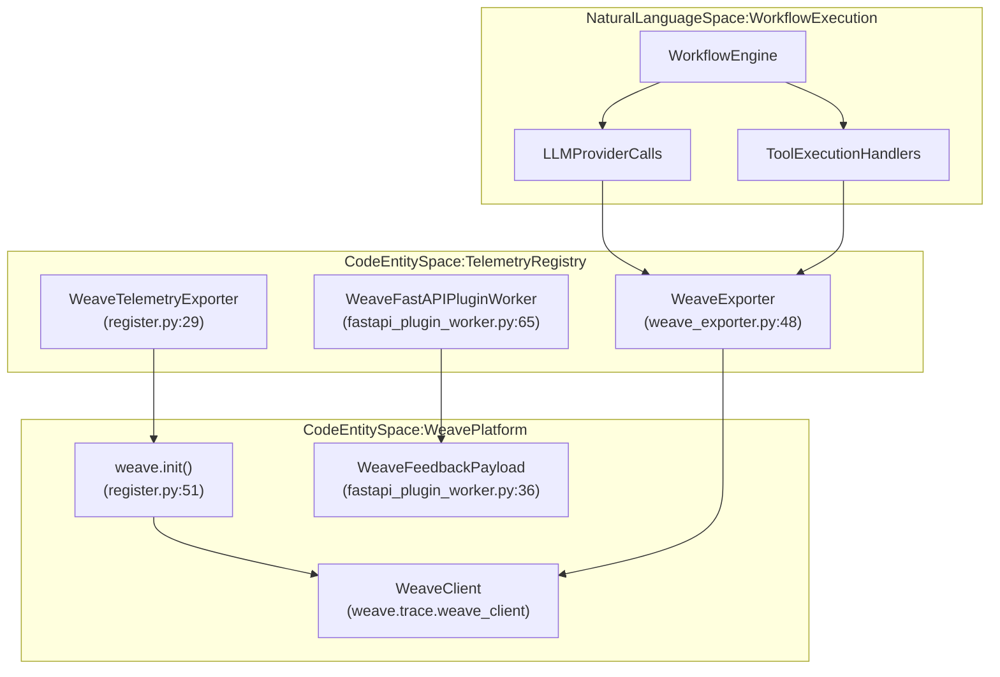
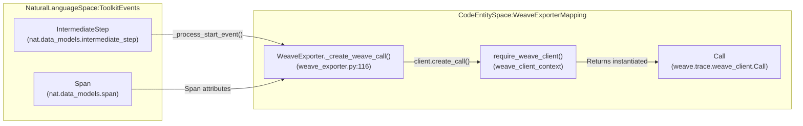
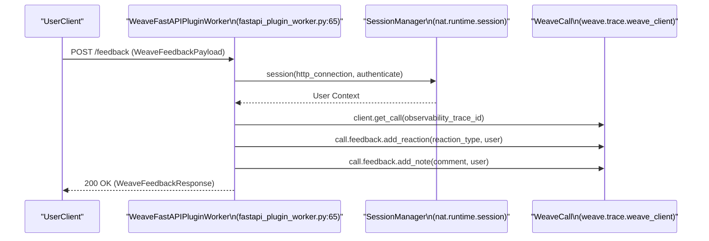

<!-- source: DeepWiki mcp.deepwiki.com · repo NVIDIA/NeMo-Agent-Toolkit · page 9.3 Weave Integration · fetched 2026-10-26 -->

# Weave Integration

<details>
<summary>Relevant source files</summary>

The following files were used as context for generating this wiki page:

- [ci/.nim_models_used.json](ci/.nim_models_used.json)
- [docs/source/run-workflows/observe/observe-workflow-with-weave.md](docs/source/run-workflows/observe/observe-workflow-with-weave.md)
- [docs/source/run-workflows/observe/observe.md](docs/source/run-workflows/observe/observe.md)
- [examples/observability/simple_calculator_observability/README.md](examples/observability/simple_calculator_observability/README.md)
- [examples/observability/simple_calculator_observability/configs/config-mlflow.yml](examples/observability/simple_calculator_observability/configs/config-mlflow.yml)
- [examples/observability/simple_calculator_observability/configs/config-weave-otel.yml](examples/observability/simple_calculator_observability/configs/config-weave-otel.yml)
- [packages/nvidia_nat_opentelemetry/src/nat/plugins/opentelemetry/register.py](packages/nvidia_nat_opentelemetry/src/nat/plugins/opentelemetry/register.py)
- [packages/nvidia_nat_opentelemetry/tests/observability/test_exporter_resource_attributes.py](packages/nvidia_nat_opentelemetry/tests/observability/test_exporter_resource_attributes.py)
- [packages/nvidia_nat_opentelemetry/tests/observability/test_mlflow_telemetry_exporter.py](packages/nvidia_nat_opentelemetry/tests/observability/test_mlflow_telemetry_exporter.py)
- [packages/nvidia_nat_weave/src/nat/plugins/weave/fastapi_plugin_worker.py](packages/nvidia_nat_weave/src/nat/plugins/weave/fastapi_plugin_worker.py)
- [packages/nvidia_nat_weave/src/nat/plugins/weave/register.py](packages/nvidia_nat_weave/src/nat/plugins/weave/register.py)
- [packages/nvidia_nat_weave/src/nat/plugins/weave/weave_exporter.py](packages/nvidia_nat_weave/src/nat/plugins/weave/weave_exporter.py)
- [packages/nvidia_nat_weave/tests/test_fastapi_plugin_worker.py](packages/nvidia_nat_weave/tests/test_fastapi_plugin_worker.py)

</details>


This page details the Weights & Biases (W&B) Weave integration within the NVIDIA NeMo Agent Toolkit (`nvidia-nat-weave` package). It covers telemetry export configuration, PII redaction capabilities, trace visualization, the FastAPI feedback worker plugin, and evaluation callback wiring.

## Architecture Overview

The Weave integration registers telemetry exporters, evaluation callbacks, and API routes via entry points and configuration registries. When a workflow executes, `WeaveExporter` (`[packages/nvidia_nat_weave/src/nat/plugins/weave/weave_exporter.py:48-48]`) intercepts OpenTelemetry-based span events and maps them to W&B Weave `Call` entities (`[packages/nvidia_nat_weave/src/nat/plugins/weave/weave_exporter.py:116-172]`).



**Weave Integration Architecture and Code Mappings**

Sources: [packages/nvidia_nat_weave/src/nat/plugins/weave/register.py:29-88](), [packages/nvidia_nat_weave/src/nat/plugins/weave/weave_exporter.py:48-63](), [packages/nvidia_nat_weave/src/nat/plugins/weave/fastapi_plugin_worker.py:36-65]()

## Configuration Model

The `WeaveTelemetryExporter` model configures the W&B Weave integration. It inherits from `TelemetryExporterBaseConfig` and registers with the discriminator name `"weave"` (`[packages/nvidia_nat_weave/src/nat/plugins/weave/register.py:29-29]()`).

| Field | Type | Default | Description |
|-------|------|---------|-------------|
| `project` | `str` | required | W&B project name for trace storage (`[packages/nvidia_nat_weave/src/nat/plugins/weave/register.py:31-31]()`) |
| `entity` | `str \| None` | `None` | W&B username or team name, deprecated (`[packages/nvidia_nat_weave/src/nat/plugins/weave/register.py:32-36]()`) |
| `redact_pii` | `bool` | `False` | Enable PII redaction from traces (`[packages/nvidia_nat_weave/src/nat/plugins/weave/register.py:37-37]()`) |
| `redact_pii_fields` | `list[str] \| None` | `None` | Custom PII entity types (`[packages/nvidia_nat_weave/src/nat/plugins/weave/register.py:38-41]()`) |
| `redact_keys` | `list[str] \| None` | `None` | Additional dictionary keys to redact (`[packages/nvidia_nat_weave/src/nat/plugins/weave/register.py:42-44]()`) |
| `verbose` | `bool` | `False` | Enable verbose logging (`[packages/nvidia_nat_weave/src/nat/plugins/weave/register.py:45-45]()`) |
| `attributes` | `dict[str, Any] \| None` | `None` | Custom attributes injected into traces (`[packages/nvidia_nat_weave/src/nat/plugins/weave/register.py:46-47]()`) |

**Example YAML Configuration:**

```yaml
general:
  telemetry:
    tracing:
      weave:
        _type: weave
        project: "nat-demo"
        redact_pii: true
        redact_pii_fields:
          - EMAIL_ADDRESS
          - PHONE_NUMBER
        redact_keys:
          - custom_secret
```

Sources: [packages/nvidia_nat_weave/src/nat/plugins/weave/register.py:29-48]()

## Implementation: WeaveExporter

The `WeaveExporter` class manages translation between toolkit spans and Weave calls (`[packages/nvidia_nat_weave/src/nat/plugins/weave/weave_exporter.py:48-48]()`).

### Trace Linking and Context
The exporter queries existing upstream framework traces using `weave.trace.context.call_context.get_current_call()` (`[packages/nvidia_nat_weave/src/nat/plugins/weave/weave_exporter.py:129-138]()`). If present, it attaches toolkit spans as child operations. Otherwise, it inspects internal stack frames to build parent-child relations (`[packages/nvidia_nat_weave/src/nat/plugins/weave/weave_exporter.py:140-147]()`).

### User Attribution
User attribution is extracted by checking `USER_ATTRIBUTION_FIELDS` in priority order: `trace_user_name`, `trace_user_email`, and `trace_user_id` (`[packages/nvidia_nat_weave/src/nat/plugins/weave/weave_exporter.py:35-36]()`).



**Mapping Toolkit Events to Weave Calls**

Sources: [packages/nvidia_nat_weave/src/nat/plugins/weave/weave_exporter.py:48-51](), [packages/nvidia_nat_weave/src/nat/plugins/weave/weave_exporter.py:116-172]()

## PII Redaction Capabilities

PII redaction relies on the `weave` sanitization framework and Microsoft Presidio (`[packages/nvidia_nat_weave/src/nat/plugins/weave/register.py:57-76]()`):
1. **Redaction Flags**: When `redact_pii` is enabled, settings are passed to `weave.init()` (`[packages/nvidia_nat_weave/src/nat/plugins/weave/register.py:57-69]()`).
2. **Key Sanitization**: Extra keys specified in `redact_keys` are registered via `weave.utils.sanitize.add_redact_key()` (`[packages/nvidia_nat_weave/src/nat/plugins/weave/register.py:72-76]()`).
3. **Log Suppression**: `presidio_filter` filters out noisy initialization messages from `presidio-analyzer` when `verbose` is `False` (`[packages/nvidia_nat_weave/src/nat/plugins/weave/weave_exporter.py:38-45]()`).

Sources: [packages/nvidia_nat_weave/src/nat/plugins/weave/register.py:57-76](), [packages/nvidia_nat_weave/src/nat/plugins/weave/weave_exporter.py:38-45]()

## User Feedback Integration

The `WeaveFastAPIPluginWorker` extends the standard FastAPI front-end worker to expose a `/feedback` endpoint (`[packages/nvidia_nat_weave/src/nat/plugins/weave/fastapi_plugin_worker.py:65-65]()`).

### Feedback Workflow
1. **Route Registration**: `WeaveFastAPIPluginWorker.add_routes` injects the `/feedback` route if `WeaveExporter` is active (`[packages/nvidia_nat_weave/src/nat/plugins/weave/fastapi_plugin_worker.py:83-103]()`).
2. **Payload Validation**: `WeaveFeedbackPayload` validates that comments do not exceed 1024 characters and requires at least one feedback mechanism (`[packages/nvidia_nat_weave/src/nat/plugins/weave/fastapi_plugin_worker.py:36-57]()`).
3. **Trace Update**: The endpoint invokes `client.get_call(observability_trace_id)` and appends reactions or notes (`[packages/nvidia_nat_weave/src/nat/plugins/weave/fastapi_plugin_worker.py:122-142]()`).



**Feedback Submission Sequence**

Sources: [packages/nvidia_nat_weave/src/nat/plugins/weave/fastapi_plugin_worker.py:36-57](), [packages/nvidia_nat_weave/src/nat/plugins/weave/fastapi_plugin_worker.py:65-150]()

## Evaluation Integration

The `WeaveEvaluationCallback` sends evaluation results to W&B Weave (`[packages/nvidia_nat_weave/src/nat/plugins/weave/register.py:84-88]()`). Registered using `register_eval_callback`, it links evaluation metrics directly to corresponding workflow traces.

Sources: [packages/nvidia_nat_weave/src/nat/plugins/weave/register.py:84-88]()

---

