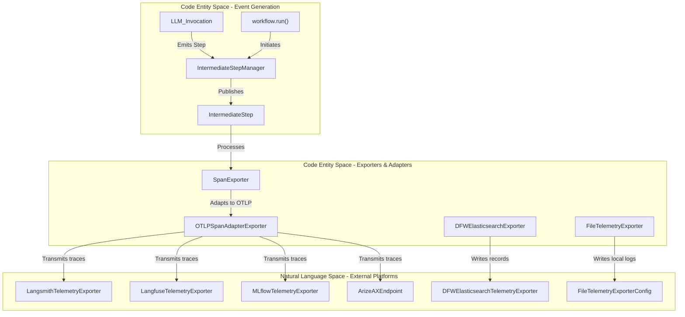
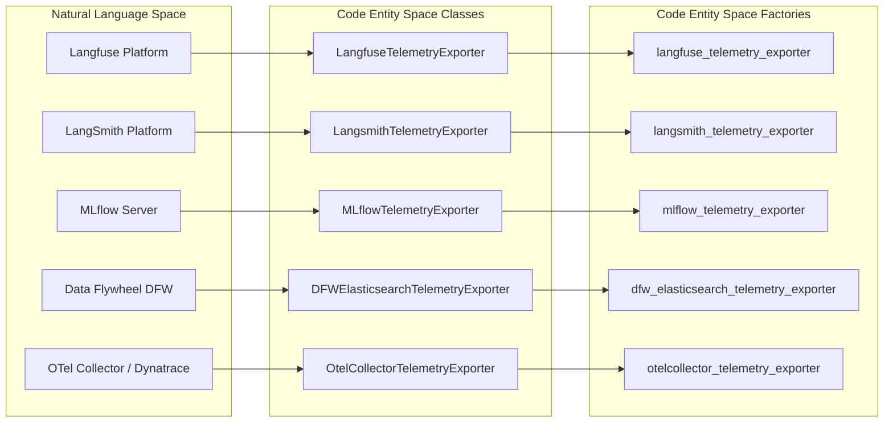
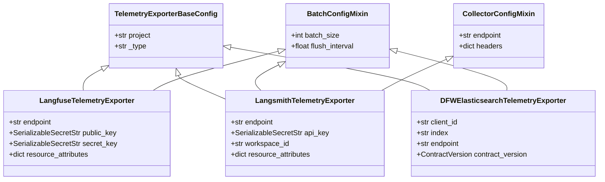

<!-- source: DeepWiki mcp.deepwiki.com · repo NVIDIA/NeMo-Agent-Toolkit · page 9.4 OpenTelemetry and Other Platforms · fetched 2026-10-26 -->

# OpenTelemetry and Other Platforms

<details>
<summary>Relevant source files</summary>

The following files were used as context for generating this wiki page:

- [ci/.nim_models_used.json](ci/.nim_models_used.json)
- [docs/source/run-workflows/observe/observe-workflow-with-weave.md](docs/source/run-workflows/observe/observe-workflow-with-weave.md)
- [docs/source/run-workflows/observe/observe.md](docs/source/run-workflows/observe/observe.md)
- [examples/observability/simple_calculator_observability/README.md](examples/observability/simple_calculator_observability/README.md)
- [examples/observability/simple_calculator_observability/configs/config-mlflow.yml](examples/observability/simple_calculator_observability/configs/config-mlflow.yml)
- [examples/observability/simple_calculator_observability/configs/config-weave-otel.yml](examples/observability/simple_calculator_observability/configs/config-weave-otel.yml)
- [packages/nvidia_nat_data_flywheel/src/nat/plugins/data_flywheel/observability/register.py](packages/nvidia_nat_data_flywheel/src/nat/plugins/data_flywheel/observability/register.py)
- [packages/nvidia_nat_data_flywheel/tests/observability/test_register.py](packages/nvidia_nat_data_flywheel/tests/observability/test_register.py)
- [packages/nvidia_nat_mysql/src/nat/plugins/mysql/object_store.py](packages/nvidia_nat_mysql/src/nat/plugins/mysql/object_store.py)
- [packages/nvidia_nat_opentelemetry/src/nat/plugins/opentelemetry/register.py](packages/nvidia_nat_opentelemetry/src/nat/plugins/opentelemetry/register.py)
- [packages/nvidia_nat_opentelemetry/tests/observability/test_exporter_resource_attributes.py](packages/nvidia_nat_opentelemetry/tests/observability/test_exporter_resource_attributes.py)
- [packages/nvidia_nat_opentelemetry/tests/observability/test_mlflow_telemetry_exporter.py](packages/nvidia_nat_opentelemetry/tests/observability/test_mlflow_telemetry_exporter.py)
- [packages/nvidia_nat_weave/src/nat/plugins/weave/fastapi_plugin_worker.py](packages/nvidia_nat_weave/src/nat/plugins/weave/fastapi_plugin_worker.py)
- [packages/nvidia_nat_weave/src/nat/plugins/weave/register.py](packages/nvidia_nat_weave/src/nat/plugins/weave/register.py)
- [packages/nvidia_nat_weave/src/nat/plugins/weave/weave_exporter.py](packages/nvidia_nat_weave/src/nat/plugins/weave/weave_exporter.py)
- [packages/nvidia_nat_weave/tests/test_fastapi_plugin_worker.py](packages/nvidia_nat_weave/tests/test_fastapi_plugin_worker.py)

</details>


This page covers the integration of OpenTelemetry (OTEL) and other enterprise observability platforms within the NVIDIA NeMo Agent Toolkit (NAT). It details how workflows export telemetry to platforms such as LangSmith, Arize AX, MLflow, Langfuse, Galileo, Catalyst, Data Flywheel, Dynatrace, and file-based targets, providing implementation details, data flows, configuration models, and architectural patterns.

Sources: [docs/source/run-workflows/observe/observe.md:18-31](), [examples/observability/simple_calculator_observability/README.md:18-31]()

## Overview

The NeMo Agent Toolkit utilizes an event-driven telemetry architecture built on OpenTelemetry standards [docs/source/run-workflows/observe/observe.md:20-25](). Workflows stream intermediate steps via `IntermediateStepManager`, allowing multiple concurrent exporters to process spans asynchronously [docs/source/run-workflows/observe/observe.md:22-24](). Beyond Phoenix and Weave, the toolkit supports:
- **LangSmith**: LangChain's tracing and evaluation platform configured via `LangsmithTelemetryExporter` [docs/source/run-workflows/observe/observe.md:79-79](), [packages/nvidia_nat_opentelemetry/src/nat/plugins/opentelemetry/register.py:99-112]().
- **Arize AX**: Hosted OTLP ingestion for production tracing with custom space and API key headers [packages/nvidia_nat_opentelemetry/src/nat/plugins/opentelemetry/register.py:32-59]().
- **MLflow**: MLflow 3.6+ OTLP ingestion routed via experiment headers (`x-mlflow-experiment-id`) using `MLflowTelemetryExporter` [docs/source/run-workflows/observe/observe.md:80-80](), [packages/nvidia_nat_opentelemetry/tests/observability/test_mlflow_telemetry_exporter.py:24-36]().
- **Langfuse**: Open-source LLM engineering platform utilizing Basic authentication with public and secret keys via `LangfuseTelemetryExporter` [packages/nvidia_nat_opentelemetry/src/nat/plugins/opentelemetry/register.py:61-71]().
- **Galileo and Catalyst**: Enterprise evaluation, debugging, and monitoring platforms connected via OTLP endpoints [docs/source/run-workflows/observe/observe.md:77-77]().
- **NVIDIA Data Flywheel**: Specialized pipeline for structuring telemetry into enterprise data flywheels via Elasticsearch using `DFWElasticsearchTelemetryExporter` [packages/nvidia_nat_data_flywheel/src/nat/plugins/data_flywheel/observability/register.py:31-44]().
- **Dynatrace and OTel Collector**: Full-stack observability via generic OTLP collector configuration (`OtelCollectorTelemetryExporter`) [docs/source/run-workflows/observe/observe.md:76-76](), [packages/nvidia_nat_opentelemetry/src/nat/plugins/opentelemetry/register.py:141-150]().
- **File-Based OTEL / Exporters**: Local JSON lines export and file rolling for debugging and offline environments [docs/source/run-workflows/observe/observe.md:86-89]().

Sources: [docs/source/run-workflows/observe/observe.md:68-91](), [packages/nvidia_nat_opentelemetry/src/nat/plugins/opentelemetry/register.py:32-150](), [packages/nvidia_nat_data_flywheel/src/nat/plugins/data_flywheel/observability/register.py:31-44]()

## Telemetry Export Architecture

The observability pipeline decouples event emission from ingestion. When an LLM invocation or workflow action executes, events are pushed to the reactive stream managed by `IntermediateStepManager` [docs/source/run-workflows/observe/observe.md:22-23](). Spans are tracked via base exporter classes and translated into OTLP-compliant payloads through `OTLPSpanAdapterExporter` [packages/nvidia_nat_opentelemetry/src/nat/plugins/opentelemetry/register.py:74-96]().

### Natural Language Space to Code Entity Space: Transmission Pipeline

The following diagram bridges high-level observability concepts to the concrete code entities handling trace serialization and transmission across supported external platforms.



Sources: [docs/source/run-workflows/observe/observe.md:20-25](), [packages/nvidia_nat_opentelemetry/src/nat/plugins/opentelemetry/register.py:74-138](), [packages/nvidia_nat_data_flywheel/src/nat/plugins/data_flywheel/observability/register.py:46-65]()

## OTLP Adapter System and Platform Configurations

Platform exporters are registered via the `@register_telemetry_exporter` decorator, binding Pydantic configuration models to asynchronous factory functions.

### LangSmith Configuration
`LangsmithTelemetryExporter` inherits from `BatchConfigMixin` and `CollectorConfigMixin`, configuring transmission headers including `x-api-key`, project names, and optional `X-Tenant-Id` workspace identifiers for LangSmith's OTEL endpoint [packages/nvidia_nat_opentelemetry/src/nat/plugins/opentelemetry/register.py:99-138]().

```yaml
general:
  telemetry:
    tracing:
      langsmith:
        _type: langsmith
        project: default
        endpoint: "https://api.smith.langchain.com/otel/v1/traces"
```

Sources: [packages/nvidia_nat_opentelemetry/src/nat/plugins/opentelemetry/register.py:99-138](), [examples/observability/simple_calculator_observability/configs/config-langsmith.yml:17-23]()

### Arize AX Configuration
Arize AX integration configures default endpoints (`_ARIZE_US_OTLP_HTTP`, `_ARIZE_EU_OTLP_HTTP`) and OTLP metadata headers (`authorization`, `api_key`, `arize-space-id`, `space_id`, `arize-interface`) using environment properties like `ARIZE_SPACE_ID` and `ARIZE_API_KEY` [packages/nvidia_nat_opentelemetry/src/nat/plugins/opentelemetry/register.py:32-59]().

### MLflow Configuration
`MLflowTelemetryExporter` leverages OTLP span ingestion routed to tracking server experiments via `x-mlflow-experiment-id` headers and supports Bearer token or Basic authentication configured through environment variables (`MLFLOW_TRACKING_TOKEN`, `MLFLOW_TRACKING_USERNAME`, `MLFLOW_TRACKING_PASSWORD`) [packages/nvidia_nat_opentelemetry/tests/observability/test_mlflow_telemetry_exporter.py:24-62]().

### Galileo, Catalyst, and Langfuse Configurations
Galileo, Catalyst, and Langfuse connect via customized OTLP HTTP/gRPC endpoints using API keys or Basic authentication credentials [packages/nvidia_nat_opentelemetry/src/nat/plugins/opentelemetry/register.py:61-96](). `LangfuseTelemetryExporter` encodes public and secret keys into a Basic authorization header [packages/nvidia_nat_opentelemetry/src/nat/plugins/opentelemetry/register.py:80-85]().

### NVIDIA Data Flywheel Elasticsearch Exporter
The `DFWElasticsearchTelemetryExporter` transmits telemetry records to NVIDIA Data Flywheel via Elasticsearch, supporting batch processing through `BatchConfigMixin`, authentication credentials, and contract version selection (`ContractVersion`) [packages/nvidia_nat_data_flywheel/src/nat/plugins/data_flywheel/observability/register.py:31-44]().

Sources: [packages/nvidia_nat_opentelemetry/src/nat/plugins/opentelemetry/register.py:32-138](), [packages/nvidia_nat_data_flywheel/src/nat/plugins/data_flywheel/observability/register.py:31-44]()

### Natural Language Space to Code Entity Space: Exporter Mapping

The following diagram associates natural language observability platforms with their exact Pydantic configuration classes and factory functions implemented in the codebase.



Sources: [packages/nvidia_nat_opentelemetry/src/nat/plugins/opentelemetry/register.py:61-150](), [packages/nvidia_nat_data_flywheel/src/nat/plugins/data_flywheel/observability/register.py:31-47]()

## Multi-Platform Component Mapping

The following class hierarchy demonstrates how configuration mixins compose across the various OTEL and telemetry exporters.



Sources: [packages/nvidia_nat_opentelemetry/src/nat/plugins/opentelemetry/register.py:61-138](), [packages/nvidia_nat_data_flywheel/src/nat/plugins/data_flywheel/observability/register.py:31-44]()

## Local and File-Based Observability

For offline debugging and air-gapped environments, traces can be directed to local sinks or rolled logs without network overhead [docs/source/run-workflows/observe/observe.md:86-89]().

| Exporter Type | Target Format | Configuration Parameter | Description |
| ------------- | ------------- | ----------------------- | ----------- |
| `file` | Local Files / JSON Lines | `output_path: ./.tmp/nat.log` | Serializes telemetry and trace logs with rolling size options (`max_file_size`, `max_files`) [docs/source/run-workflows/observe/observe.md:86-89]() |
| `console` | Standard Output | `level: DEBUG/WARN` | Prints formatted trace logs to standard streams via logging configurations [docs/source/run-workflows/observe/observe.md:134-148]() |

Sources: [docs/source/run-workflows/observe/observe.md:86-148]()

---

