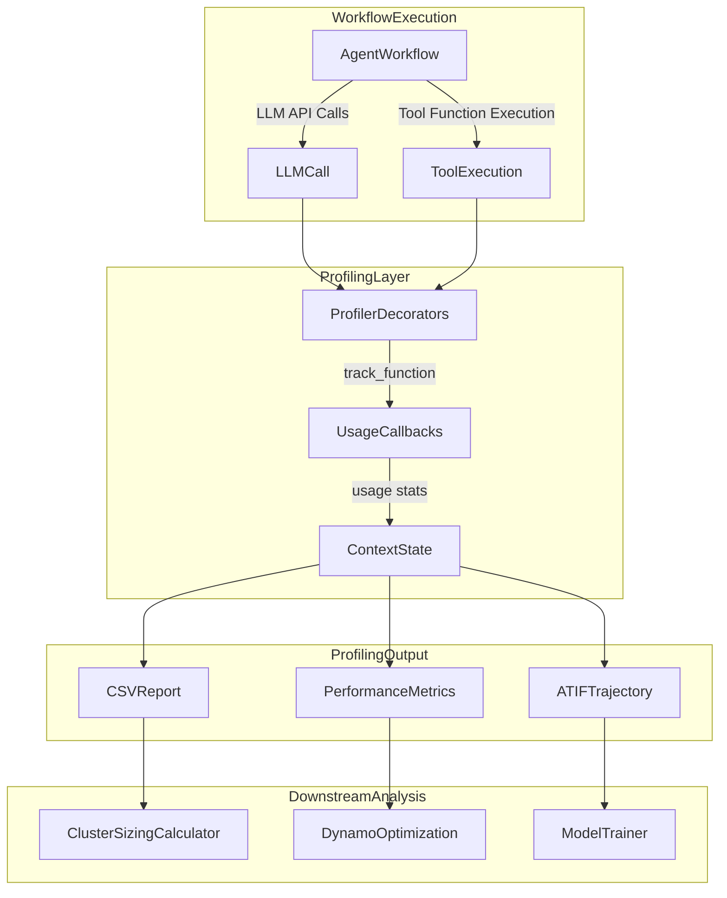
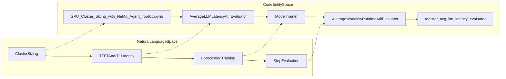
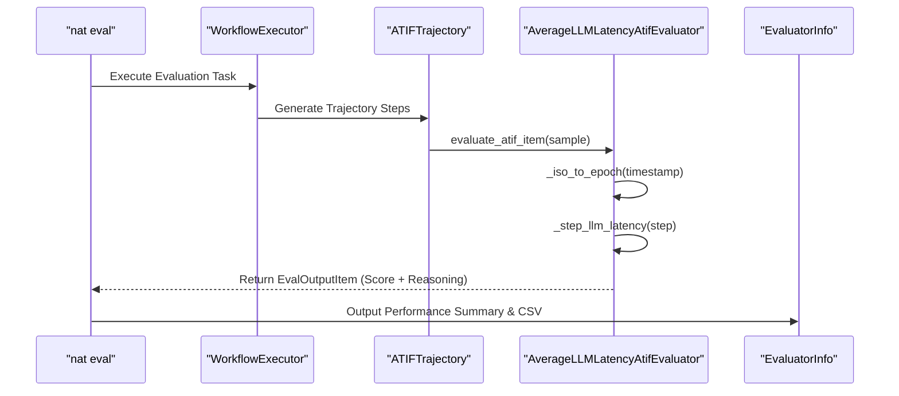

<!-- source: DeepWiki mcp.deepwiki.com · repo NVIDIA/NeMo-Agent-Toolkit · page 9.5 Profiling System · fetched 2026-10-26 -->

# Profiling System

Relevant source files

The following files were used as context for generating this wiki page:

- [.pre-commit-config.yaml](.pre-commit-config.yaml)
- [ci/release/update-version.sh](ci/release/update-version.sh)
- [docs/README.md](docs/README.md)
- [docs/source/versions1.json](docs/source/versions1.json)
- [examples/notebooks/getting_started_with_nat.ipynb](examples/notebooks/getting_started_with_nat.ipynb)
- [examples/notebooks/launchables/GPU_Cluster_Sizing_with_NeMo_Agent_Toolkit.ipynb](examples/notebooks/launchables/GPU_Cluster_Sizing_with_NeMo_Agent_Toolkit.ipynb)
- [examples/notebooks/observability_evaluation_and_profiling.ipynb](examples/notebooks/observability_evaluation_and_profiling.ipynb)
- [packages/nvidia_nat_core/src/nat/meta/pypi.md](packages/nvidia_nat_core/src/nat/meta/pypi.md)
- [packages/nvidia_nat_profiler/src/nat/plugins/profiler/runtime_evaluator/atif_evaluate.py](packages/nvidia_nat_profiler/src/nat/plugins/profiler/runtime_evaluator/atif_evaluate.py)
- [packages/nvidia_nat_profiler/src/nat/plugins/profiler/runtime_evaluator/register.py](packages/nvidia_nat_profiler/src/nat/plugins/profiler/runtime_evaluator/register.py)
- [packages/nvidia_nat_profiler/tests/forecasting/test_model_trainer.py](packages/nvidia_nat_profiler/tests/forecasting/test_model_trainer.py)
- [packages/nvidia_nat_profiler/tests/profiler/test_runtime_evaluator_atif.py](packages/nvidia_nat_profiler/tests/profiler/test_runtime_evaluator_atif.py)

## Purpose and Scope

The Profiling System in the NVIDIA NeMo Agent Toolkit provides decorator-based instrumentation and configuration-driven analysis for capturing detailed performance metrics across agent workflow execution. It is designed to collect usage statistics in real time, recording tokens, timings (including Time to First Token - TTFT and Inter-Token Latency - ITL), and LLM call metadata on a per-invocation basis [packages/nvidia_nat_core/src/nat/meta/pypi.md:29-29]().

The system supports identifying workflow bottlenecks, analyzing concurrency spikes, and exporting data for GPU cluster sizing [examples/notebooks/observability_evaluation_and_profiling.ipynb:44-48](). It outputs standardized CSV data and ATIF (Agent Trajectory Interchange Format) trajectories for offline analysis, which are used to estimate the infrastructure required to accommodate target user loads [examples/notebooks/launchables/GPU_Cluster_Sizing_with_NeMo_Agent_Toolkit.ipynb:7-13](). 

Sources: [packages/nvidia_nat_core/src/nat/meta/pypi.md:29-29](), [examples/notebooks/observability_evaluation_and_profiling.ipynb:44-48](), [examples/notebooks/launchables/GPU_Cluster_Sizing_with_NeMo_Agent_Toolkit.ipynb:7-13]()

---

## Architecture Overview

The profiling system operates as an instrumentation layer that intercepts function and LLM calls. It is deeply integrated with the toolkit's evaluation system, allowing performance metrics to be captured during evaluation runs [examples/notebooks/observability_evaluation_and_profiling.ipynb:11-11]().

Title: "Profiling System in Workflow Execution Context"

Sources: [examples/notebooks/observability_evaluation_and_profiling.ipynb:11-48](), [packages/nvidia_nat_profiler/src/nat/plugins/profiler/runtime_evaluator/atif_evaluate.py:15-25]()

---

## Implementation Details

### Event Collection and Metrics
The system captures high-fidelity timing and token usage data during execution. When integrated with the Dynamo inference stack, it collects specialized metrics:
*   **KV Efficiency (KVE)**: Token-agnostic measure of work saved via KV cache (`cached_tokens / prompt_tokens`).
*   **TTFT (Time to First Token)**: Latency from request to first token.
*   **ITL (Inter-Token Latency)**: Time between tokens during streaming.

Sources: [packages/nvidia_nat_core/src/nat/meta/pypi.md:29-29]()

### Runtime Evaluators
The `nvidia-nat-profiler` package provides ATIF-native runtime evaluators defined in `packages/nvidia_nat_profiler/src/nat/plugins/profiler/runtime_evaluator/atif_evaluate.py` that process trajectories to extract performance metrics:
*   `AverageLLMLatencyAtifEvaluator`: Calculates the mean latency between LLM start and end for agent steps [packages/nvidia_nat_profiler/src/nat/plugins/profiler/runtime_evaluator/atif_evaluate.py:71-80](). It prefers `step.extra["invocation"]` timing (epoch seconds) but falls back to ISO timestamps via `_iso_to_epoch` [packages/nvidia_nat_profiler/src/nat/plugins/profiler/runtime_evaluator/atif_evaluate.py:28-68]().
*   `AverageWorkflowRuntimeAtifEvaluator`: Computes the total workflow duration per item by finding the difference between the maximum and minimum step timestamps [packages/nvidia_nat_profiler/src/nat/plugins/profiler/runtime_evaluator/atif_evaluate.py:106-109]().
*   `AverageNumberOfLLMCallsAtifEvaluator`: Counts agent steps that contain LLM metrics [packages/nvidia_nat_profiler/src/nat/plugins/profiler/runtime_evaluator/atif_evaluate.py:130-133]().
*   `AverageTokensPerLLMEndAtifEvaluator`: Averages the sum of `prompt_tokens` and `completion_tokens` across all LLM calls in a trajectory [packages/nvidia_nat_profiler/src/nat/plugins/profiler/runtime_evaluator/atif_evaluate.py:147-150]().

Sources: [packages/nvidia_nat_profiler/src/nat/plugins/profiler/runtime_evaluator/atif_evaluate.py:28-150]()

### Profiler Registration
Evaluators are registered via the `@register_evaluator` decorator using specific configuration models like `AverageLLMLatencyConfig` and `AverageWorkflowRuntimeConfig` [packages/nvidia_nat_profiler/src/nat/plugins/profiler/runtime_evaluator/register.py:27-52](). These configurations allow users to specify `max_concurrency` for the evaluation process [packages/nvidia_nat_profiler/src/nat/plugins/profiler/runtime_evaluator/register.py:27-30]().

Sources: [packages/nvidia_nat_profiler/src/nat/plugins/profiler/runtime_evaluator/register.py:27-72]()

### CSV and ATIF Output
*   **CSV Output**: Contains flat records of tool and LLM invocations, timings, and token counts.
*   **ATIF (Agentic Trajectory Interchange Format)**: Standardized format used for exporting execution paths, enabling performance auditing and model training [packages/nvidia_nat_profiler/src/nat/plugins/profiler/runtime_evaluator/atif_evaluate.py:22-25]().

Sources: [packages/nvidia_nat_profiler/src/nat/plugins/profiler/runtime_evaluator/atif_evaluate.py:22-25]()

---

## Data Flow and Code Entities

The profiling system bridges natural language performance concepts with concrete code implementations across modules.

Title: "Natural Language to Code Entity Mapping"

Sources: [examples/notebooks/launchables/GPU_Cluster_Sizing_with_NeMo_Agent_Toolkit.ipynb:7-13](), [packages/nvidia_nat_profiler/src/nat/plugins/profiler/runtime_evaluator/atif_evaluate.py:71-103](), [packages/nvidia_nat_profiler/src/nat/plugins/profiler/runtime_evaluator/register.py:51-72]()

---

## Specialized Analysis Tools

### GPU Cluster Sizing Calculator
This utility estimates the required GPU cluster size (e.g., number of H100 or B200 GPUs) to support a target number of concurrent users. It runs the agent workflow at varying concurrency levels and measures the resulting response times and throughput [examples/notebooks/launchables/GPU_Cluster_Sizing_with_NeMo_Agent_Toolkit.ipynb:7-13]().

Sources: [examples/notebooks/launchables/GPU_Cluster_Sizing_with_NeMo_Agent_Toolkit.ipynb:7-13]()

### Forecasting and Model Training
The `ModelTrainer` class allows for training performance forecasting models using intermediate property adapters [packages/nvidia_nat_profiler/src/nat/plugins/profiler/forecasting/model_trainer.py:18-19](). This enables predicting workflow performance based on trajectory data [packages/nvidia_nat_profiler/tests/forecasting/test_model_trainer.py:26-32]().

Title: "Profiling Execution Sequence"

Sources: [packages/nvidia_nat_profiler/src/nat/plugins/profiler/runtime_evaluator/atif_evaluate.py:38-68](), [packages/nvidia_nat_profiler/src/nat/plugins/profiler/runtime_evaluator/register.py:51-72]()

---

