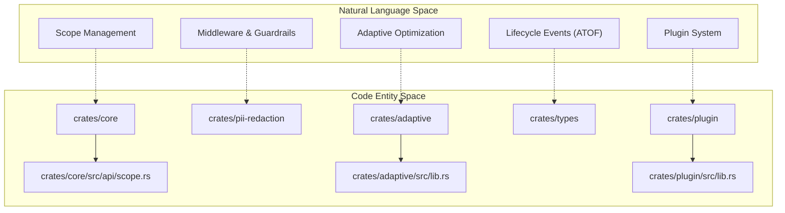
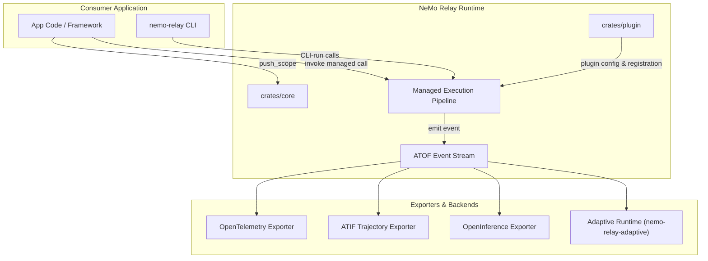

<!-- source: DeepWiki mcp.deepwiki.com · repo NVIDIA/NeMo-Relay · page 1 NeMo Relay Overview · fetched 2026-10-26 -->

# NeMo Relay Overview

Relevant source files

The following files were used as context for generating this wiki page:

- [README.md](README.md)
- [crates/cli/README.md](crates/cli/README.md)
- [docs/about-nemo-relay/agent-runtime-primer.mdx](docs/about-nemo-relay/agent-runtime-primer.mdx)
- [docs/about-nemo-relay/architecture.mdx](docs/about-nemo-relay/architecture.mdx)
- [docs/about-nemo-relay/concepts/index.mdx](docs/about-nemo-relay/concepts/index.mdx)
- [docs/about-nemo-relay/concepts/plugins.mdx](docs/about-nemo-relay/concepts/plugins.mdx)
- [docs/about-nemo-relay/ecosystem.mdx](docs/about-nemo-relay/ecosystem.mdx)
- [docs/about-nemo-relay/overview.mdx](docs/about-nemo-relay/overview.mdx)
- [docs/build-plugins/about.mdx](docs/build-plugins/about.mdx)
- [docs/configure-plugins/about.mdx](docs/configure-plugins/about.mdx)
- [docs/configure-plugins/nemo-guardrails/about.mdx](docs/configure-plugins/nemo-guardrails/about.mdx)
- [docs/configure-plugins/nemo-guardrails/configuration.mdx](docs/configure-plugins/nemo-guardrails/configuration.mdx)
- [docs/contribute/runtime-contract-docs.mdx](docs/contribute/runtime-contract-docs.mdx)
- [docs/getting-started/configuration.mdx](docs/getting-started/configuration.mdx)
- [docs/getting-started/quick-start/index.mdx](docs/getting-started/quick-start/index.mdx)
- [docs/index.yml](docs/index.yml)
- [docs/integrate-into-frameworks/about.mdx](docs/integrate-into-frameworks/about.mdx)
- [docs/nemo-relay-cli/about.mdx](docs/nemo-relay-cli/about.mdx)
- [docs/resources/glossary.mdx](docs/resources/glossary.mdx)
- [docs/supported-integrations/about.mdx](docs/supported-integrations/about.mdx)

NVIDIA NeMo Relay is a portable execution runtime designed for agent systems that already incorporate a framework, model provider, policy layer, or observability backend [README.md:19-22](). It provides a consistent, language-agnostic layer to describe, control, and observe what occurs when an agent crosses boundaries such as requests, tools, or LLM calls [docs/about-nemo-relay/overview.mdx:11-20]().

In modern production stacks, agent applications commonly combine multiple frameworks (e.g., LangChain, LangGraph, Deep Agents), various model providers, and custom harnesses. NeMo Relay operates beneath these layers as a shared runtime contract for scopes, middleware, plugins, lifecycle events, and adaptive behavior [docs/about-nemo-relay/overview.mdx:11-20]().

## Purpose and Scope

The core aim of NeMo Relay is to offer a framework-neutral substrate to unify agent execution [README.md:19-22](). Developers benefit from:

- **Owning Execution Context**: Hierarchical scopes provide parent-child relationships binding tools, LLM calls, and events within the same execution tree [docs/about-nemo-relay/architecture.mdx:131-138]().
- **Packaging Policy Once**: Guardrails and intercepts enable blocking or sanitizing work without needing to rewrite every call site [docs/about-nemo-relay/architecture.mdx:142-146]().
- **Emitting One Lifecycle Stream**: Subscribers consume canonical runtime events and export them as Agent Trajectory Interchange Format (ATIF) trajectories, OpenTelemetry, or OpenInference traces [docs/about-nemo-relay/overview.mdx:61-65]().
- **Installing Reusable Behavior**: Plugins configure middleware, subscribers, adaptive components, and other runtime behavior centrally from configuration [docs/about-nemo-relay/overview.mdx:113-114]().

For technical details on the system design and runtime model, see [Architecture and Runtime Model](#1.1). To begin using the library, visit [Getting Started](#1.2).

Sources: [README.md:19-22](), [docs/about-nemo-relay/architecture.mdx:131-146](), [docs/about-nemo-relay/overview.mdx:11-20,61-65,113-114]()

## Polyglot Architecture

NeMo Relay is powered by a performant **Rust Core Runtime** that implements fundamental logic for scope management, middleware execution, and event dispatching [docs/about-nemo-relay/architecture.mdx:43-53](). This Rust core exposes its functionality via language bindings to several ecosystems to ensure broad usability [docs/about-nemo-relay/overview.mdx:78-81]().

### Runtime Concept to Code Entity Mapping

This diagram bridges high-level runtime concepts to corresponding code entities and repository directories, facilitating grasp of how abstract ideas are realized in code:

Sources: [README.md:12-14](), [docs/about-nemo-relay/overview.mdx:78-81]()

### Language Support

NeMo Relay maintains strict semantic parity across all primary language bindings ensuring consistent runtime behavior regardless of host environment [docs/about-nemo-relay/overview.mdx:93-97]():

| Binding   | Implementation    | Status        | Source Path           |
|-----------|-------------------|---------------|-----------------------|
| **Rust**  | Native Crate      | ✅ Supported  | `crates/core`         |
| **Python**| PyO3 / Maturin   | ✅ Supported  | `crates/python`       |
| **Node.js**| NAPI-RS           | ✅ Supported  | `crates/node`         |
| **Go**    | CGo / FFI         | 🚧 Experimental| `crates/ffi`          |
| **C FFI** | Raw ABI           | 🚧 Experimental| `crates/ffi`          |

This design ensures that core logic remains implemented once, while enabling wide language accessibility without compromising correctness or concurrency models [docs/about-nemo-relay/overview.mdx:93-97]().

Sources: [README.md:10-14](), [docs/about-nemo-relay/overview.mdx:93-97]()

## Key Subsystems

The NeMo Relay runtime divides into several cooperating subsystems forming a consistent and extensible agent execution environment [docs/about-nemo-relay/architecture.mdx:25-95]():

Sources: [docs/about-nemo-relay/architecture.mdx:25-95]()

### Scopes and Events

Scopes establish hierarchical context for all runtime work, providing parent-child relationships for requests, tools, and LLM calls [docs/about-nemo-relay/architecture.mdx:131-138](). Every scope lifecycle and event is recorded as part of the canonical Agent Trajectory Observability Format (ATOF), allowing subscribers to reconstruct precise runtime behavior [docs/about-nemo-relay/overview.mdx:61-62]().

Sources: [docs/about-nemo-relay/architecture.mdx:131-138](), [docs/about-nemo-relay/overview.mdx:61-62]()

### Middleware and Plugins

Middleware wraps managed execution boundaries, enabling request interception, sanitization, conditional guardrails, and execution transformation [docs/about-nemo-relay/architecture.mdx:142-146](). Plugins serve as packaged runtime extensions that configure middleware and subscribers from declarative configuration files like `plugins.toml` [docs/about-nemo-relay/architecture.mdx:153-156]().

Relay discovers and layers `plugins.toml` to configure built-in components and record references to discoverable plugins [crates/cli/README.md:177-180]().

Sources: [crates/cli/README.md:177-180](), [docs/about-nemo-relay/architecture.mdx:142-156]()

### Observability and Adaptive Runtime

Observability subscribers translate ATOF event streams into export formats such as ATIF trajectories, OpenTelemetry traces, or OpenInference traces [docs/about-nemo-relay/overview.mdx:61-65](). The Adaptive Runtime (`nemo-relay-adaptive`) provides algorithms to learn from runtime signals and tune future execution [docs/about-nemo-relay/architecture.mdx:97-98]().

Sources: [docs/about-nemo-relay/architecture.mdx:97-98](), [docs/about-nemo-relay/overview.mdx:61-65]()

### CLI and Gateway

The `nemo-relay` CLI implements a passthrough LLM gateway, forwarding coding agent hook events into the NeMo Relay runtime [crates/cli/README.md:55-56](). This runtime wrapper enables adding observability and security policies around existing agent binaries, such as Claude Code or Codex, without source modification [docs/about-nemo-relay/overview.mdx:48]().

Note: Hermes Agent includes NeMo Relay natively; no separate observability plugin or Relay CLI setup is required when using Hermes Agent [README.md:39-41]().

Sources: [README.md:39-41](), [crates/cli/README.md:55-56](), [docs/about-nemo-relay/overview.mdx:48]()

## Documentation Map

This wiki structures documentation around the request lifecycle and integration layers to guide users of varying backgrounds:

| Section   | Focus Area           | Coverage                                                                                          |
|-----------|---------------------|-------------------------------------------------------------------------------------------------|
| **1**     | Overview and Introduction | High-level concepts, architecture summary, polyglot design, relationships between major components |
| **1.1**   | Architecture and Runtime Model | Layered runtime architecture: core, bindings, plugins, and subscribers; execution pipeline     |
| **1.2**   | Getting Started      | Installation details, prerequisites, quick-start workflows for Rust, Python, Node.js            |
| **1.3**   | Release Notes and Migration Guides | Version history, deprecations, migration guides, and the support matrix. |
| **2**     | Core Runtime (Rust)  | Rust core SDK, adaptive runtime, subsystems deep dives (Scopes, Middleware, Codecs)             |
| **3**     | Plugin System        | Overview of plugin architecture: static plugin components, plugin configuration files, dynamic native plugins, and gRPC worker plugins. |
| **4**     | Language Bindings    | Detailed Python, Node.js, Go, and C FFI API and implementation notes                |
| **5**     | Observability        | Event streaming, exporters (ATOF, ATIF, OTLP), telemetry and plugin configuration                |
| **6**     | NeMo Relay CLI       | The `nemo-relay` CLI binary, gateway request processing, coding agent support (Claude/Codex)    |
| **7**     | Integrations        | Framework integrations (LangChain, LangGraph, Deep Agents), OpenClaw, PII Redaction               |
| **8**     | CI/CD, Build System, and Release | Multi-language CI pipeline, release process, version syncing                                    |
| **9**     | Documentation and Skills | Multi-language API reference generation, consumer skills                                       |
| **10**    | Glossary             | Definitions for repository-specific terminology and concepts                                   |

---

For details on the architecture and runtime model, see [Architecture and Runtime Model](#1.1).

For installation and initial usage, start with [Getting Started](#1.2).

For version history, deprecations, and migration instructions, refer to [Release Notes and Migration Guides](#1.3).

---

Sources: [README.md:19-22,39-41](), [crates/cli/README.md:55-56,177-180](), [docs/about-nemo-relay/architecture.mdx:43-53,97-98,131-156](), [docs/about-nemo-relay/overview.mdx:11-20,48,61-65,78-81,93-97,113-114]()

---

