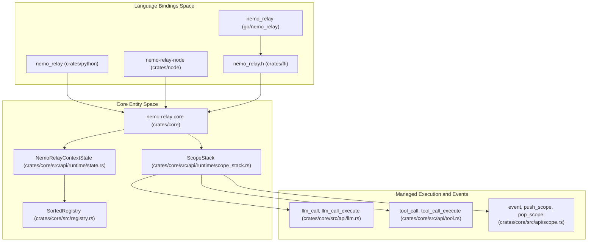
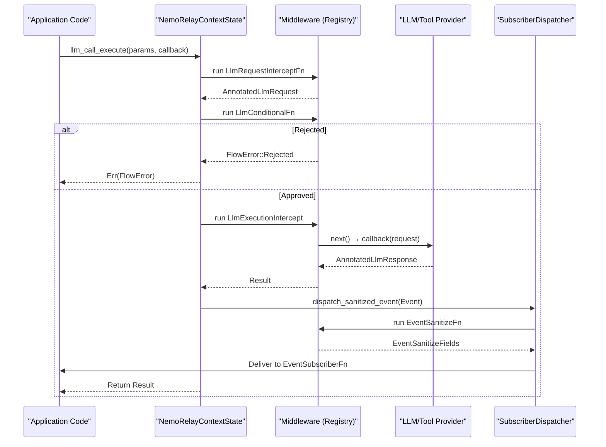
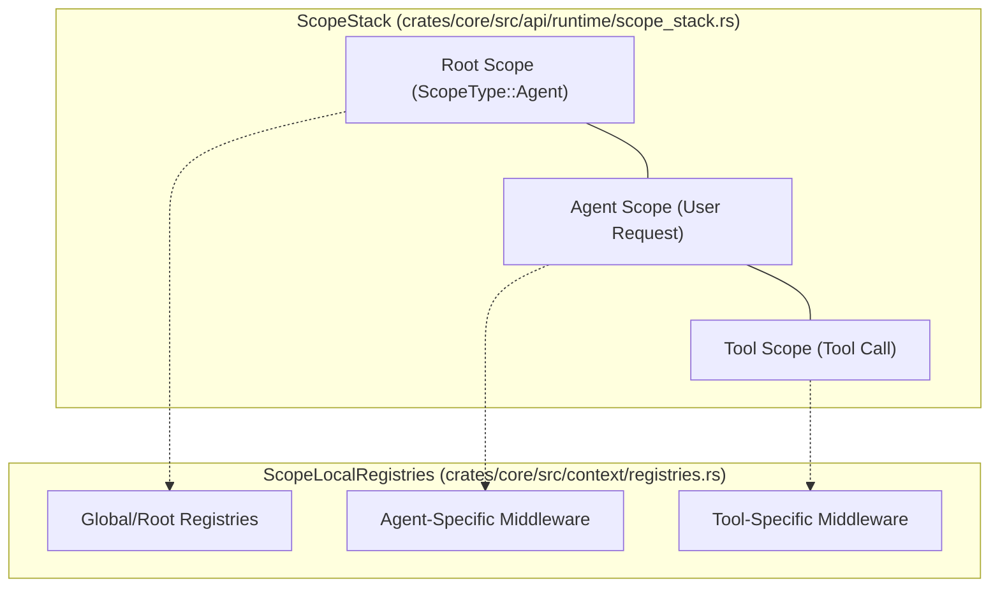

<!-- source: DeepWiki mcp.deepwiki.com · repo NVIDIA/NeMo-Relay · page 1.1 Architecture and Runtime Model · fetched 2026-10-26 -->

# Architecture and Runtime Model

Relevant source files

The following files were used as context for generating this wiki page:

- [README.md](README.md)
- [crates/cli/README.md](crates/cli/README.md)
- [crates/core/src/api/registry.rs](crates/core/src/api/registry.rs)
- [crates/core/src/api/runtime.rs](crates/core/src/api/runtime.rs)
- [crates/core/src/api/runtime/callbacks.rs](crates/core/src/api/runtime/callbacks.rs)
- [crates/core/src/api/runtime/scope_stack.rs](crates/core/src/api/runtime/scope_stack.rs)
- [crates/core/src/api/runtime/subscriber_dispatcher.rs](crates/core/src/api/runtime/subscriber_dispatcher.rs)
- [crates/core/src/api/scope.rs](crates/core/src/api/scope.rs)
- [crates/core/src/api/skill_load.rs](crates/core/src/api/skill_load.rs)
- [crates/core/src/context/registries.rs](crates/core/src/context/registries.rs)
- [crates/core/tests/integration/api_surface_tests.rs](crates/core/tests/integration/api_surface_tests.rs)
- [crates/core/tests/integration/scope_local_tests.rs](crates/core/tests/integration/scope_local_tests.rs)
- [crates/core/tests/unit/context_tests.rs](crates/core/tests/unit/context_tests.rs)
- [crates/core/tests/unit/skill_load_tests.rs](crates/core/tests/unit/skill_load_tests.rs)
- [crates/core/tests/unit/subscriber_dispatcher_tests.rs](crates/core/tests/unit/subscriber_dispatcher_tests.rs)
- [crates/ffi/src/api/scope_stack.rs](crates/ffi/src/api/scope_stack.rs)
- [crates/plugin/src/lib.rs](crates/plugin/src/lib.rs)
- [crates/plugin/tests/typed_callbacks.rs](crates/plugin/tests/typed_callbacks.rs)
- [docs/about-nemo-relay/agent-runtime-primer.mdx](docs/about-nemo-relay/agent-runtime-primer.mdx)
- [docs/about-nemo-relay/architecture.mdx](docs/about-nemo-relay/architecture.mdx)
- [docs/about-nemo-relay/concepts/conditional-middleware-guardrails.mdx](docs/about-nemo-relay/concepts/conditional-middleware-guardrails.mdx)
- [docs/about-nemo-relay/concepts/index.mdx](docs/about-nemo-relay/concepts/index.mdx)
- [docs/about-nemo-relay/concepts/scopes.mdx](docs/about-nemo-relay/concepts/scopes.mdx)
- [docs/about-nemo-relay/ecosystem.mdx](docs/about-nemo-relay/ecosystem.mdx)
- [docs/about-nemo-relay/overview.mdx](docs/about-nemo-relay/overview.mdx)
- [docs/contribute/runtime-contract-docs.mdx](docs/contribute/runtime-contract-docs.mdx)
- [docs/getting-started/quick-start/index.mdx](docs/getting-started/quick-start/index.mdx)
- [docs/integrate-into-frameworks/about.mdx](docs/integrate-into-frameworks/about.mdx)
- [docs/nemo-relay-cli/about.mdx](docs/nemo-relay-cli/about.mdx)
- [docs/supported-integrations/about.mdx](docs/supported-integrations/about.mdx)
- [go/nemo_relay/context_test.go](go/nemo_relay/context_test.go)

NeMo Relay provides a portable execution runtime designed for agentic systems, delivering a consistent abstraction to describe, observe, and manage work that spans requests, tools, and large language model (LLM) invocations. It is framework-neutral, enabling applications to retain their existing orchestration while gaining integrated support for policy enforcement, telemetry, adaptive behavior, and lifecycle event tracking [docs/about-nemo-relay/concepts/conditional-middleware-guardrails.mdx:11-18]().

## Layered Architecture

The architecture of NeMo Relay is composed of multiple layers, each adding specialized capabilities and language ecosystem support:

1.  **Rust Core (`nemo-relay`)**:
    The performant foundation implemented in Rust. It manages the active `ScopeStack`, middleware registries, and emits the canonical event stream in the Agent Trajectory Observability Format (ATOF). The core state is represented by `NemoRelayContextState`, which owns registries for middleware and subscribers used throughout the APIs [crates/core/src/api/runtime/scope_stack.rs:32-38](), [crates/core/src/api/runtime/state.rs:6-17]().

2.  **Language Bindings**:
    Native bindings expose the Rust core APIs to other languages including Python, Node.js, Go, and C FFI. These expose idiomatic access to lifecycle controls, managed calls, middleware registration, and event processing [crates/core/src/api/runtime.rs:13-20]().

3.  **Plugin and Adaptive Layer**:
    A configuration-driven plugin system enables bundling reusable runtime components. Plugins register middleware (guardrails, intercepts), event subscribers, and exporters to extend capabilities without hand-registration. Components include observability exporters, adaptive runtime "learners," and guardrail enforcement [docs/about-nemo-relay/architecture.mdx:109-110](), [crates/core/src/api/registry.rs:1-100]().

4.  **Framework Integrations**:
    Various frameworks (e.g., LangChain, DeepAgents) integrate by mapping their lifecycle hooks into NeMo Relay’s managed execution model. These adapters operate on top of the plugin and middleware layers for extensibility and observability [docs/about-nemo-relay/ecosystem.mdx:111-118]().

5.  **Subscribers and Exporters**:
    Subsystems subscribe to the canonical event stream to transform and export observability data in different formats such as OpenTelemetry traces or ATIF (Agent Trajectory Interchange Format) files. Exporters are installed as subscribers and managed by the plugin system [crates/core/src/api/runtime/subscriber_dispatcher.rs:1-50]().

Sources: [crates/core/src/api/runtime/scope_stack.rs:32-38](), [crates/core/src/api/runtime/state.rs:6-17](), [crates/core/src/api/runtime.rs:13-20](), [docs/about-nemo-relay/architecture.mdx:109-110](), [crates/core/src/api/registry.rs:1-100](), [docs/about-nemo-relay/ecosystem.mdx:111-118](), [crates/core/src/api/runtime/subscriber_dispatcher.rs:1-50]()

### NeMo Relay Code Entity Map

This diagram connects natural language system layers to Rust core code entities for easier navigation and understanding.

Sources: [crates/core/src/api/runtime/scope_stack.rs:32-38](), [crates/core/src/api/runtime/state.rs:6-17](), [crates/core/src/api/llm.rs:18-33](), [crates/core/src/api/tool.rs:18-33](), [crates/core/src/api/scope.rs:18-33]()

## Managed Execution Pipeline

The heart of NeMo Relay's runtime behavior for tool and LLM calls is the **managed execution pipeline**, enforcing consistent lifecycle management, middleware application, and observability event generation.

### Pipeline Stages

-   **1. Request Intercepts:**
    Middleware that asynchronously transforms or rewrites incoming request payloads before execution (e.g., `LlmRequestInterceptFn` for LLM calls) [crates/core/src/api/runtime/callbacks.rs:16]().

-   **2. Conditional Execution Guardrails:**
    Middleware that decides whether to proceed with execution or reject the call based on policy or runtime conditions (e.g., `LlmConditionalFn`) [crates/core/src/api/runtime/callbacks.rs:15]().

-   **3. Execution Intercepts:**
    Middleware wrappers that surround the actual call, using the provided `next()` continuation to invoke downstream middleware or the final provider. This supports retries, asynchronous wrapping, or even request branching [docs/about-nemo-relay/architecture.mdx:145-148]().

-   **4. Event Sanitization:**
    Middleware that modifies emitted observability events for privacy, redaction, or metadata enrichment, without affecting the true request or result [crates/core/src/api/runtime/callbacks.rs:14]().

-   **5. Event Stream Emission:**
    The runtime emits canonical ATOF lifecycle events (start, end, marks) asynchronously to subscribers and exporters, capturing activity metadata and results [crates/core/src/api/runtime/subscriber_dispatcher.rs:25-28]().

Sources: [crates/core/src/api/runtime/callbacks.rs:14-16](), [docs/about-nemo-relay/architecture.mdx:145-148](), [crates/core/src/api/runtime/subscriber_dispatcher.rs:25-28]()

### Managed Execution Data Flow

Sequence Diagram describing a typical managed LLM call execution:

Sources: [crates/core/src/api/runtime/state.rs:34-41](), [crates/core/src/api/llm.rs:18-33](), [docs/about-nemo-relay/architecture.mdx:145-148](), [crates/core/src/api/runtime/subscriber_dispatcher.rs:64-71]()

## Scope Stack and Isolation Model

NeMo Relay maintains a logical stack called the **`ScopeStack`** representing nested units of work (scopes) such as agents, tools, or LLM calls. The stack isolates context, middleware local to scopes, and maintains span parentage for lifecycle events.

### Scope Lifecycle and Behavior

-   **Push/Pop Scopes:**
    Scopes are explicitly pushed with `push_scope` and popped with `pop_scope`. These create paired start and end lifecycle events. Scopes record their type (`ScopeType`) and identifiers for hierarchical provenance [crates/core/src/api/runtime/scope_stack.rs:32-38](), [crates/core/tests/integration/api_surface_tests.rs:63]().

-   **Root Scope:**
    An implicit root scope of type `Agent` is always present. It is the owner of the freshness state and represents top-level unscoped work [crates/core/src/api/runtime/scope_stack.rs:136-141]().

-   **Scope-Local Registries:**
    Each active scope holds isolated middleware and subscriber registries (`ScopeLocalRegistries`) that automatically expire with the scope [crates/core/src/api/runtime/scope_stack.rs:34](), [crates/core/src/context/registries.rs:1-50]().

-   **Propagation Context:**
    For context crossing process boundaries, the `PropagationContext` encodes the `parent_uuid` and optionally a stable `root_uuid`. This enables correlating work across distributed systems [crates/core/src/api/runtime/scope_stack.rs:48-58]().

Sources: [crates/core/src/api/runtime/scope_stack.rs:32-58](), [crates/core/tests/integration/api_surface_tests.rs:63](), [crates/core/src/context/registries.rs:1-50]()

### Concurrency and Context Isolation Mechanisms

-   **Task-Local Storage:**
    The current active `ScopeStackHandle` is stored in async task-local storage (`TASK_SCOPE_STACK`), ensuring each asynchronous task carries its own logical scope chain [crates/core/src/api/runtime/scope_stack.rs:27]().

-   **Contextualized Streams:**
    Streaming LLM calls return a wrapped stream (`LlmStreamWrapper`) that preserves the scope stack at creation and enforces scope isolation when polling asynchronously from other tasks or threads. This ensures correct middleware and event dispatch context [crates/core/src/api/runtime/callbacks.rs:18]().

Sources: [crates/core/src/api/runtime/scope_stack.rs:27](), [crates/core/src/api/runtime/callbacks.rs:18]()

### Scope Hierarchy and Registry Mapping Diagram

Sources: [crates/core/src/api/runtime/scope_stack.rs:32-38](), [crates/core/src/context/registries.rs:1-50](), [docs/about-nemo-relay/concepts/scopes.mdx:47-50]()

## Runtime State and Key Components

| Entity | Role | Source |
| :----- | :--- | :----- |
| `ScopeStack` | Maintains the active hierarchy of nested scopes and their scope-local registries, enabling context isolation | [crates/core/src/api/runtime/scope_stack.rs:32]() |
| `PropagationContext` | Transport-neutral object encoding a scope's causal context for cross-process continuity | [crates/core/src/api/runtime/scope_stack.rs:48]() |
| `LlmExecutionFn` | Callback type for LLM execution intercepts, allowing custom logic around LLM calls | [crates/core/src/api/runtime/callbacks.rs:16]() |
| `ToolExecutionFn` | Callback type for tool execution intercepts, allowing custom logic around tool calls | [crates/core/src/api/runtime/callbacks.rs:19]() |
| `EventSubscriberFn` | Callback type for subscribers to receive event snapshots | [crates/core/src/api/runtime/callbacks.rs:14]() |
| `NemoRelayContextState` | Process-global state maintaining registries for middleware, subscribers and global runtime state | [crates/core/src/api/runtime/state.rs:6-9]() |

Sources: [crates/core/src/api/runtime/scope_stack.rs:32-48](), [crates/core/src/api/runtime/callbacks.rs:14-19](), [crates/core/src/api/runtime/state.rs:6-9]()

## Summary

NeMo Relay’s runtime architecture layers a core Rust implementation tracking scopes, middleware, and event streams under a rich managed execution model. Language bindings provide access in multiple languages, while the plugin system packages runtime behavior for reusability and adaptive extensions. Framework integrations plug work units into this unified system, enabling consistent telemetry, policy, and observability across the entire agent lifecycle.

Sources: [crates/core/src/api/runtime/scope_stack.rs:1-172](), [crates/core/src/api/runtime/state.rs:1-50](), [crates/core/src/api/llm.rs:1-33](), [crates/core/src/api/tool.rs:1-33](), [crates/core/src/api/runtime/subscriber_dispatcher.rs:1-195](), [crates/core/src/api/runtime/callbacks.rs:1-20](), [docs/about-nemo-relay/architecture.mdx:1-179](), [docs/about-nemo-relay/ecosystem.mdx:1-127](), [docs/about-nemo-relay/concepts/scopes.mdx:1-206]()

---

