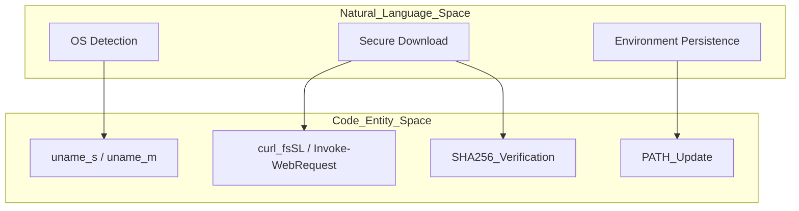
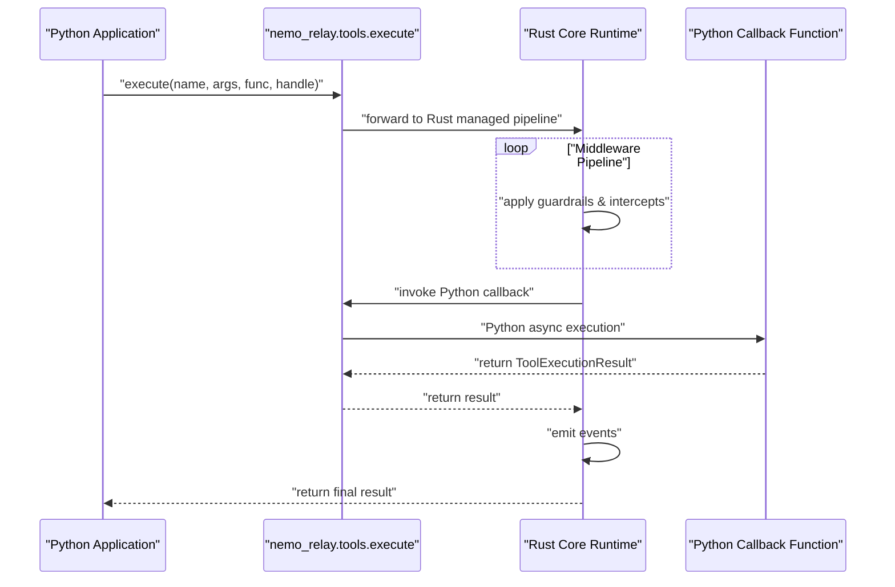
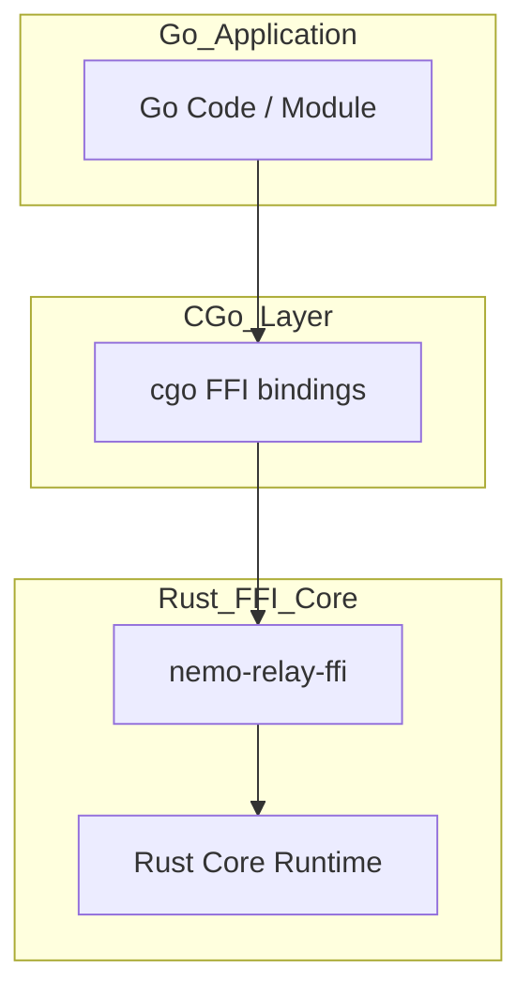

<!-- source: DeepWiki mcp.deepwiki.com · repo NVIDIA/NeMo-Relay · page 1.2 Getting Started · fetched 2026-10-26 -->

# Getting Started

<details>
<summary>Relevant source files</summary>

The following files were used as context for generating this wiki page:

- [.github/nightly-alpha-branches.yaml](.github/nightly-alpha-branches.yaml)
- [Cargo.toml](Cargo.toml)
- [crates/adaptive/README.md](crates/adaptive/README.md)
- [crates/core/README.md](crates/core/README.md)
- [crates/ffi/README.md](crates/ffi/README.md)
- [crates/node/README.md](crates/node/README.md)
- [crates/node/package.json](crates/node/package.json)
- [crates/python/README.md](crates/python/README.md)
- [docs/getting-started/installation.mdx](docs/getting-started/installation.mdx)
- [docs/getting-started/quick-start/python.mdx](docs/getting-started/quick-start/python.mdx)
- [docs/getting-started/quick-start/rust.mdx](docs/getting-started/quick-start/rust.mdx)
- [docs/reference/support-matrix.mdx](docs/reference/support-matrix.mdx)
- [docs/supported-integrations/openclaw-plugin.mdx](docs/supported-integrations/openclaw-plugin.mdx)
- [go/nemo_relay/README.md](go/nemo_relay/README.md)
- [integrations/coding-agents/claude-code/.claude-plugin/plugin.json](integrations/coding-agents/claude-code/.claude-plugin/plugin.json)
- [integrations/coding-agents/codex/.codex-plugin/plugin.json](integrations/coding-agents/codex/.codex-plugin/plugin.json)
- [python/nemo_relay/README.md](python/nemo_relay/README.md)

</details>


The purpose of this page is to outline the installation process, prerequisites, quick start guides per language binding (Rust, Python, Node.js, and Go), essential tooling (`cargo`, `uv`, `just`, and Node.js 24+), and first-run workflows for NeMo Relay `0.9.0` [Cargo.toml:23-23](), [Cargo.toml:28-37]().

NeMo Relay is a polyglot agent runtime designed to provide a consistent execution contract across different programming languages and agent frameworks [Cargo.toml:4-19](). It enables developers to observe and control agent runs—including LLM calls, tool executions, and subagent branching—without rewriting existing application logic [docs/getting-started/installation.mdx:19-22]().

---

## Tooling and Prerequisites

Before installing NeMo Relay, ensure your environment meets the following requirements. The repository uses `just` as the universal task runner and `uv` for Python dependency management.

| Tool       | Version           | Required For                                            |
|------------|-------------------|--------------------------------------------------------|
| **Rust**   | 2024 Edition      | Core runtime, native extensions, CLI [Cargo.toml:24-24]() |
| **Python** | 3.11+             | Python package, PyO3 builds, documentation [docs/getting-started/quick-start/python.mdx:20-20]() |
| **Node.js**| 24+               | Node.js bindings and WASM tests [crates/node/package.json:58-59]() |
| **uv**     | Latest            | Python environment synchronization and dependency management [docs/getting-started/quick-start/python.mdx:23-23]() |
| **just**   | 1.40+             | Canonical build and packaging recipes                   |

### Development Environment Setup

If contributing or building from source, initialize the workspace:

```bash
git clone https://github.com/NVIDIA/NeMo-Relay.git
cd NeMo-Relay

# Synchronize Python environment and build native extensions
uv sync

# Install Node.js dependencies and build the Node.js native addon
npm install
npm run build --workspace=nemo-relay-node
```

Sources: [docs/getting-started/quick-start/python.mdx:37-38](), [crates/node/package.json:65-66]()

---

## Installation Guide

NeMo Relay can be installed via standard package managers or built from source. The examples below use stable version `0.9.0` [Cargo.toml:23-23]().

### 1. Rust

Add the core crates to your `Cargo.toml` dependencies:

```bash
cargo add nemo-relay@0.9.0
cargo add nemo-relay-adaptive@0.9.0
```

- `nemo-relay`: Core Rust runtime for scopes, middleware, events [Cargo.toml:29-29]()
- `nemo-relay-adaptive`: Adaptive runtime primitives and state backends [Cargo.toml:34-34]()

Sources: [Cargo.toml:28-37]()

### 2. Python

Install the NeMo Relay Python binding via `uv` or `pip` from your application project:

```bash
uv add nemo-relay==0.9.0
```

This installs the PyO3 native extension and Python wrapper package [docs/getting-started/quick-start/python.mdx:23-29]().

### 3. Node.js

Install the Node.js binding NAPI native addon for Node.js 24+:

```bash
npm install nemo-relay-node@0.9.0
```

This package exports typed APIs including submodules for plugin support, adaptive runtime, observability, and PII redaction [crates/node/package.json:27-56](), [crates/node/package.json:58-59]().

### 4. CLI

The `nemo-relay` CLI is the primary tool for gateway observability and local coding-agent sessions [docs/getting-started/installation.mdx:28-31]().

Install via PyPI package:

```bash
pip install nemo-relay-cli-bin
```

Or combined Python API and CLI:

```bash
pip install "nemo-relay[cli]"
```

Official installer scripts are also available:

```bash
curl -fsSL https://raw.githubusercontent.com/NVIDIA/NeMo-Relay/main/install.sh | sh
```

Windows PowerShell install:

```powershell
irm https://raw.githubusercontent.com/NVIDIA/NeMo-Relay/main/install.ps1 | iex
```

#### Supported Platforms

| OS            | Architecture   | Release Target                  |
|---------------|----------------|--------------------------------|
| Linux (glibc) | x86_64         | `x86_64-unknown-linux-gnu`     |
| Linux (musl)  | x86_64         | `x86_64-unknown-linux-musl`    |
| macOS         | Apple Silicon  | `aarch64-apple-darwin`          |
| Windows       | x86_64         | `x86_64-pc-windows-msvc`        |
| Windows       | ARM64          | `aarch64-pc-windows-msvc`       |

The installer detects the OS and CPU architecture, downloads the matching binary asset, verifies its SHA-256 checksum, and updates the environment PATH when applicable [docs/getting-started/installation.mdx:67-93]().

#### CLI Installer Data Flow

This diagram illustrates the flow from natural language user steps to the executable code entities managing installation and environment setup, associating system names with code symbols.



Sources: [docs/getting-started/installation.mdx:28-64](), [docs/getting-started/installation.mdx:95-106]()

---

## Quick Start: Python

The Python binding offers an asynchronous API implemented via PyO3 that bridges into the Rust core runtime. Key modules include `nemo_relay.scope` for managing execution scopes, `nemo_relay.tools` for tool calls, and `nemo_relay.llm` for LLM calls [docs/getting-started/quick-start/python.mdx:117-130]().

### Architecture and Data Flow

- Application calls `nemo_relay.tools.execute()` or `nemo_relay.llm.execute()`, passing callbacks, arguments, and optional scope handles.
- The Rust core invokes the managed execution pipeline applying guardrails and middleware intercepts.
- The Rust runtime asynchronously calls back to the Python async function.
- Results are wrapped in `ToolExecutionResult` or JSON objects, emitting observability events using the ATOF envelope.



Sources: [docs/getting-started/quick-start/python.mdx:60-96](), [docs/getting-started/quick-start/python.mdx:99-101]()

### First-Run Python Example

```python
import asyncio
import nemo_relay

def on_event(event) -> None:
    print(f"event={event.kind} name={event.name}")

async def search(args):
    return nemo_relay.ToolExecutionResult({"echo": args["query"]})

async def model(request):
    return {"messages": request.content["messages"], "ok": True}

async def main():
    nemo_relay.subscribers.register("quickstart-printer", on_event)

    with nemo_relay.scope.scope("demo-agent", nemo_relay.ScopeType.Agent) as handle:
        nemo_relay.scope.event("initialized", handle=handle, data={"binding": "python"})

        tool_result = await nemo_relay.tools.execute("search", {"query": "hello"}, search, handle=handle)

        llm_result = await nemo_relay.llm.execute(
            "demo-provider",
            nemo_relay.LLMRequest({}, {"messages": [{"role": "user", "content": "hi"}]}),
            model,
            handle=handle,
        )

        print(tool_result.result)
        print(llm_result)

    nemo_relay.subscribers.flush()
    nemo_relay.subscribers.deregister("quickstart-printer")

asyncio.run(main())
```

This example showcases one scope, a tool call, and an LLM call emitting lifecycle events and returning typed results.

Sources: [docs/getting-started/quick-start/python.mdx:60-97]()

---

## Quick Start: Rust

The Rust binding exposes a native API for full control of scopes, events, tools, and LLM calls in a structured manner using builder patterns for typed parameter passing [docs/getting-started/quick-start/rust.mdx:60-134]().

### Core Concepts and Data Flow

- `scope::push_scope` creates a new isolated scope (e.g., agent session).
- `ScopeHandle` represents the live scope for event association.
- Subscribers receive asynchronous observable events emitted from scope and tool lifecycle activity.

```mermaid
graph TD
    subgraph "Natural_Language_Space"
        AS[""Agent Session""]
        LM[""Lifecycle Milestone""]
    end

    subgraph "Code_Entity_Space"
        PS[""scope::push_scope()""]
        PP[""PushScopeParams""]
        SH[""ScopeHandle""]
        EV[""scope::event()""]
        MP[""EmitMarkEventParams""]
    end

    AS --> PS
    PS -.-> PP
    PS --> SH
    LM --> EV
    EV -.-> MP
    SH -.-> EV
```

Sources: [Cargo.toml:29-30](), [docs/getting-started/quick-start/rust.mdx:79-131]()

### First-Run Rust Summary

The Rust quick start creates a scope called `"demo-agent"` of type `Agent`, emits an `"initialized"` mark event within that scope, executes a managed tool call named `"search"` that returns a simple echo response, and then performs a managed LLM call echoing the input messages. After execution, it flushes subscribers to dispatch all events and deregisters the subscriber used for printing event notifications.

Sources: [docs/getting-started/quick-start/rust.mdx:60-134]()

---

## Quick Start: Node.js

The Node.js binding provides idiomatic async APIs over a NAPI-based native extension linking into the Rust core runtime, enabling managed execution and consistent observability [crates/node/package.json:27-63]().

### Binding and Execution Flow

- The API exports functions such as `withScope()`, `event()`, and `registerSubscriber()` that map to Rust core calls.
- The NAPI bridge marshals data asynchronously between JavaScript and Rust.
- Events emitted by the Rust core are propagated back to JavaScript subscribers.

```mermaid
graph LR
    subgraph "JavaScript_Surface"
        JS_S[""withScope()""]
        JS_E[""event()""]
        JS_R[""registerSubscriber()""]
    end

    subgraph "NAPI_Bridge"
        NAPI[""nemo-relay native addon""]
    end

    subgraph "Rust_Core"
        R_S[""push_scope""]
        R_E[""emit_event""]
    end

    JS_S --> NAPI --> R_S
    JS_E --> NAPI --> R_E
    JS_R --> NAPI
```

Sources: [crates/node/package.json:27-56](), [crates/node/package.json:60-63]()

### First-Run Node.js Example

```javascript
const {
  ScopeType,
  registerSubscriber,
  flushSubscribers,
  withScope,
  event
} = require("nemo-relay-node");

async function main() {
  registerSubscriber("printer", (runtimeEvent) => {
    console.log(`${runtimeEvent.kind} ${runtimeEvent.name}`);
  });

  await withScope("demo-agent", ScopeType.Agent, async (handle) => {
    event("initialized", handle, { binding: "node" }, null);
  });

  await flushSubscribers();
}

main().catch(console.error);
```

This example registers a subscriber that prints events, opens a scope, emits an initialization event, then flushes all subscriber events to ensure delivery.

Sources: [crates/node/package.json:27-56]()

---

## Quick Start: Go

The Go binding exposes NeMo Relay runtime APIs through CGo and the raw `nemo-relay-ffi` library [go/nemo_relay/README.md:19-22](). Use it when a Go application or integration needs scope, middleware, lifecycle events, and observability identical to the Rust core runtime.

### Go Binding Flow



Sources: [go/nemo_relay/README.md:19-22](), [crates/ffi/README.md:19-22]()

### First-Run Go Example

```go
package main

import (
	"encoding/json"
	"log"

	nemo "github.com/NVIDIA/NeMo-Relay/go/nemo_relay"
)

func main() {
	err := nemo.RegisterEventMetadataInjector(
		"application-metadata",
		10,
		func(event nemo.Event) (nemo.EventMetadata, error) {
			return nemo.EventMetadata{
				"application.event_kind": event.Kind(),
			}, nil
		},
	)
	if err != nil {
		log.Fatal(err)
	}
	defer nemo.DeregisterEventMetadataInjector("application-metadata")

	if err := nemo.EmitEvent(
		"cache-nearly-full",
		nemo.WithEventData(json.RawMessage(`{"entries": 900}`)),
		nemo.WithEventDataSchema(nemo.DataSchema{Name: "example.cache", Version: "1"}),
		nemo.WithEventSeverity(nemo.LogSeverityWarn),
	); err != nil {
		log.Fatal(err)
	}
}
```

Sources: [go/nemo_relay/README.md:87-124]()

---

## First-Run Workflows

After installation, you can begin using NeMo Relay.

### CLI First-Run

The `nemo-relay` CLI provides an interactive setup wizard for initial configuration and a `doctor` command for diagnosing readiness.

1.  **Initial Setup**: Running `nemo-relay` without arguments will launch the setup wizard if no configuration exists [crates/cli/README.md:108-111]().
    ```bash
    nemo-relay
    ```
2.  **Enable Local Observability**: Use the `plugins edit` command to configure local observability outputs like ATOF and ATIF [README.md:92-95]().
    ```bash
    nemo-relay plugins edit
    ```
    In the editor, enable the Observability component, then enable ATOF and ATIF sections, specifying output directories and filenames [README.md:99-113]().
3.  **Diagnose Readiness**: After setup, inspect your local environment with `doctor` [crates/cli/README.md:113-116]().
    ```bash
    nemo-relay doctor
    ```
4.  **Run a Coding Agent**: Execute a supported coding agent (e.g., Codex or Claude Code) through the Relay wrapper [README.md:121-133]().
    ```bash
    nemo-relay codex -- exec "Summarize this repository."
    ```
    or
    ```bash
    nemo-relay claude -- "Summarize this repository."
    ```
    This starts a local Relay gateway, injects host-specific hooks, and then shuts down the gateway when the agent exits [README.md:137-139]().
5.  **Verify the Run**: Check the configured output directories for raw events (`events.jsonl`) and trajectory files (`trajectory-{session_id}.json`) [README.md:155-157]().

#### CLI Configuration Layers

NeMo Relay CLI configuration is layered, with user-specific settings typically residing in `~/.config/nemo-relay/config.toml` or `$XDG_CONFIG_HOME/nemo-relay/config.toml` [crates/cli/README.md:145-147](). System-wide configurations are located at `/etc/nemo-relay/config.toml` on Unix or `%ProgramData%\nemo-relay\config.toml` on Windows [crates/cli/README.md:165-167]().

The `plugins.toml` file, which configures observability exporters and other plugin components, is discovered relative to the main `config.toml` or explicitly specified [crates/cli/README.md:175-186]().

```mermaid
graph TD
    UserConfig[""UserConfig(~/.config/nemo-relay/config.toml)""]
    SystemConfig[""SystemConfig(/etc/nemo-relay/config.toml)""]
    ExplicitConfig["""--configpath/to/config.toml""]
    PluginConfig[""plugins.toml(siblingor--plugin-config-path)""]

    ExplicitConfig -->|""Highest Precedence""| ResolvedConfig[""ResolvedConfiguration""]
    UserConfig -->|""Overrides System""| ResolvedConfig
    SystemConfig --> ResolvedConfig
    PluginConfig --> ResolvedConfig
```

Sources: [README.md:92-113](), [crates/cli/README.md:108-186]()

---

## References

- [docs/getting-started/installation.mdx](docs/getting-started/installation.mdx)
- [docs/getting-started/quick-start/python.mdx](docs/getting-started/quick-start/python.mdx)
- [docs/getting-started/quick-start/rust.mdx](docs/getting-started/quick-start/rust.mdx)
- [Cargo.toml](Cargo.toml)
- [crates/node/package.json](crates/node/package.json)
- [go/nemo_relay/README.md](go/nemo_relay/README.md)
- [crates/ffi/README.md](crates/ffi/README.md)

---

Sources:
- [docs/getting-started/installation.mdx:10-180]()
- [docs/getting-started/quick-start/python.mdx:20-126]()
- [docs/getting-started/quick-start/rust.mdx:60-134]()
- [Cargo.toml:1-58]()
- [crates/node/package.json:2-85]()
- [README.md:92-157]()
- [crates/cli/README.md:108-186]()
- [go/nemo_relay/README.md:19-124]()
- [crates/ffi/README.md:19-65]()

---

