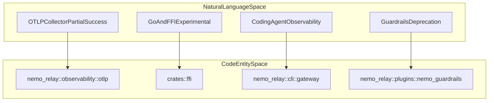
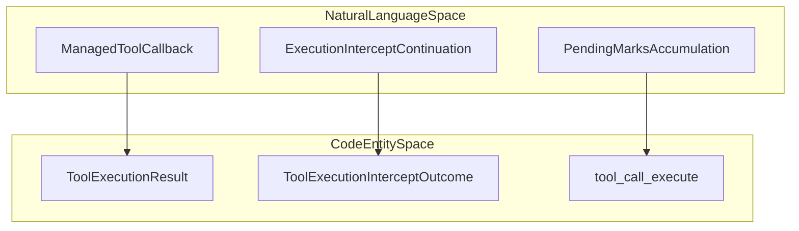

<!-- source: DeepWiki mcp.deepwiki.com · repo NVIDIA/NeMo-Relay · page 1.3 Release Notes and Migration Guides · fetched 2026-10-26 -->

# Release Notes and Migration Guides

<details>
<summary>Relevant source files</summary>

The following files were used as context for generating this wiki page:

- [docs/about-nemo-relay/release-notes/index.mdx](docs/about-nemo-relay/release-notes/index.mdx)
- [docs/instrument-applications/instrument-tool-call.mdx](docs/instrument-applications/instrument-tool-call.mdx)
- [docs/integrate-into-frameworks/wrap-tool-calls.mdx](docs/integrate-into-frameworks/wrap-tool-calls.mdx)
- [docs/reference/migration-guides.mdx](docs/reference/migration-guides.mdx)
- [docs/reference/tool-execution-intercept-outcomes.mdx](docs/reference/tool-execution-intercept-outcomes.mdx)
- [fern/docs.yml](fern/docs.yml)

</details>


This page covers the version history, release notes, deprecation schedules (such as the removal of `nemo_guardrails` and raw tool results), migration guides, and platform support matrices for NVIDIA NeMo Relay. It bridges the system-level release lifecycle with the underlying Rust core classes, binding contracts, and protocol definitions.

Sources:
- [docs/about-nemo-relay/release-notes/index.mdx:1-7]()
- [docs/reference/migration-guides.mdx:1-10]()

## Release 0.9 and Known Issues

NeMo Relay 0.9 tracks user-visible changes, compatibility updates, and known issues across the polyglot runtime stack. 


*Figure 1: Mapping high-level release items to underlying code entities.*

Sources:
- [docs/about-nemo-relay/release-notes/index.mdx:28-103]()

### Known Issues in 0.9

- **OTLP Collectors and Partial Successes**: OTLP collectors may return successful HTTP responses while rejecting individual spans, log records, or metric data points [docs/about-nemo-relay/release-notes/index.mdx:35-37](). Managed by `nemo_relay::observability::otlp`.
- **Experimental Go and C FFI**: The Go binding (`go/nemo_relay`) and raw C FFI (`crates/ffi`) remain experimental and source-first [docs/about-nemo-relay/release-notes/index.mdx:40-41]().
- **Local Coding-Agent Observability**: Relies on host hooks and loopback traffic reaching the local gateway managed in `nemo_relay::cli::gateway` [docs/about-nemo-relay/release-notes/index.mdx:42-44]().
- **`nemo_guardrails` Plugin Deprecation**: The built-in `nemo_guardrails` component kind, public Rust module `nemo_relay::plugins::nemo_guardrails`, CLI editor entry, and `guardrails-remote` Cargo feature are deprecated [docs/about-nemo-relay/release-notes/index.mdx:56-62]().
- **OpenTelemetry Endpoint Batch Queues**: Finite queues drop spans on burst without backpressure. Configure parameters independently or via `OTEL_BSP_*` [docs/about-nemo-relay/release-notes/index.mdx:81-88]().

Sources:
- [docs/about-nemo-relay/release-notes/index.mdx:28-103]()

## Previous Releases

For complete historical release notes, release artifacts, and PR-by-PR changes, refer to official GitHub releases.

Sources:
- [docs/about-nemo-relay/release-notes/index.mdx:92-95]()

## Migration Guides

Upgrading to NeMo Relay 0.9 requires addressing specific deprecations and breaking protocol changes, notably the removal of raw tool results and the retirement of the built-in guardrails plugin.

Sources:
- [docs/reference/migration-guides.mdx:1-21]()
- [docs/reference/tool-execution-intercept-outcomes.mdx:1-128]()

### Deprecation of `nemo_guardrails` Plugin

The built-in `nemo_guardrails` plugin is deprecated and scheduled for complete removal. No direct built-in replacement is included in NeMo Relay 0.9. Migration away from this plugin involves decoupling local or remote guardrail calls from the core runtime initialization.

Sources:
- [docs/about-nemo-relay/release-notes/index.mdx:56-62]()

### Raw Tool Results Migration

NeMo Relay 0.8 and later replace raw tool execution results with a canonical `ToolExecutionResult` structure across all language bindings and worker protocols [docs/reference/tool-execution-intercept-outcomes.mdx:119-125]().


*Figure 2: Tool execution data flow mapping concepts to code entities.*

Sources:
- [docs/reference/tool-execution-intercept-outcomes.mdx:1-154]()

#### Canonical Tool Execution Result Contract

Every managed tool callback and execution intercept continuation returns a strict JSON-compatible result structure:

```json
{
  "result": {},
  "annotation": {"source": "cache"},
  "pending_marks": []
}
```

- `result`: Required application-owned tool payload [docs/reference/tool-execution-intercept-outcomes.mdx:17]()
- `annotation`: Optional opaque adjacent metadata transported without schema interpretation [docs/reference/tool-execution-intercept-outcomes.mdx:18-21]()
- `pending_marks`: Relay-owned lifecycle data containing names, categories, data schemas, and severities [docs/reference/tool-execution-intercept-outcomes.mdx:35-39]()

Sources:
- [docs/reference/tool-execution-intercept-outcomes.mdx:8-39]()

#### Binding Return Types and Intercept Outcomes

| Surface | Managed Callback / Continuation Result | Execution-Intercept Outcome |
| :------ | :------------------------------------- | :-------------------------- |
| Python | `ToolExecutionResult(result, annotation=None)` [docs/reference/tool-execution-intercept-outcomes.mdx:99]() | `ToolExecutionInterceptOutcome` [docs/reference/tool-execution-intercept-outcomes.mdx:109]() |
| Rust | `ToolExecutionResult { result, annotation }` [docs/reference/tool-execution-intercept-outcomes.mdx:100]() | `ToolExecutionInterceptOutcome` [docs/reference/tool-execution-intercept-outcomes.mdx:110]() |
| Go | `ToolExecutionResult { Result, Annotation }` [docs/reference/tool-execution-intercept-outcomes.mdx:101]() | `ToolExecutionInterceptOutcome` [docs/reference/tool-execution-intercept-outcomes.mdx:111]() |
| Node.js | `{ result, annotation? }` [docs/reference/tool-execution-intercept-outcomes.mdx:102]() | `{ result, annotation?, pendingMarks? }` [docs/reference/tool-execution-intercept-outcomes.mdx:112]() |
| `grpc-v1` Worker SDKs | Protobuf `ToolExecutionResult` [docs/reference/tool-execution-intercept-outcomes.mdx:114]() | Protobuf `ToolExecutionInterceptOutcome` [docs/reference/tool-execution-intercept-outcomes.mdx:114]() |

Sources:
- [docs/reference/tool-execution-intercept-outcomes.mdx:92-117]()

## Support Matrix

The support matrix outlines release artifacts, container platforms, worker runtimes, and supported coding agents.

Sources:
- [docs/reference/support-matrix.mdx:1-70]()

### Platforms and Architectures

| Surface | Linux x86_64 | Linux ARM64 | macOS ARM64 | Windows x86_64 | Limitations |
| :------ | :----------- | :---------- | :---------- | :------------- | :---------- |
| Core Library | Required CI | Required CI | Required CI | Non-blocking CI | Rust is source of truth; Go/FFI experimental [docs/reference/support-matrix.mdx:20]() |
| CLI Application | Published GNU/musl | Published GNU/musl | Published Darwin | Published MSVC | Intel macOS has no prebuilt CLI asset [docs/reference/support-matrix.mdx:21]() |
| Native Plugins | Host ABI | Host ABI | Host ABI | Host ABI | Run in-process, un-sandboxed [docs/reference/support-matrix.mdx:22]() |
| gRPC Workers | Host process | Host process | Host process | Host process | Isolated process via `grpc-v1`, not a security sandbox [docs/reference/support-matrix.mdx:23]() |

Sources:
- [docs/reference/support-matrix.mdx:18-23]()

### Worker Runtime Compatibility

| Worker Runtime | Linux x86_64 | Linux ARM64 | macOS ARM64 | Windows x86_64 | Requirements and Limitations |
| :------------- | :----------- | :---------- | :---------- | :------------- | :----------------------------- |
| Python | E2E CI | Validated | E2E CI | E2E CI | Requires `runtime = "python"`, module entrypoint, managed virtualenv [docs/reference/support-matrix.mdx:50]() |
| Rust | Core CI | Core CI | Core CI | Core CI | Requires executable implementing `grpc-v1` [docs/reference/support-matrix.mdx:51]() |
| Command | Core CI | Core CI | Core CI | Core CI | External executable implementing `grpc-v1` [docs/reference/support-matrix.mdx:52]() |

Sources:
- [docs/reference/support-matrix.mdx:43-58]()

### Coding Agents Supported by the CLI

| Agent | Minimum Version | Supported Capabilities | Current Limitations |
| :---- | :-------------- | :--------------------- | :------------------ |
| Claude Code | 2.1.121 | Persistent install, transparent run, lifecycle hooks, gateway routing [docs/reference/support-matrix.mdx:69]() | Desktop/web sessions unsupported without local hooks [docs/reference/support-matrix.mdx:69]() |
| Codex CLI | 0.143.0 | Persistent install, transparent run, 10 plugin hooks, gateway routing [docs/reference/support-matrix.mdx:70]() | No `SessionEnd` hook in 0.143; encrypted multi-agent v2 payloads un-decryptable [docs/reference/support-matrix.mdx:70]() |

Sources:
- [docs/reference/support-matrix.mdx:61-70]()

## Versioning

NeMo Relay adheres to Semantic Versioning. The workspace version is defined in the root manifest (`0.9.0`), synchronized across language binding package files.

Sources:
- [Cargo.toml:23]()
- [crates/node/package.json:2]()

---

