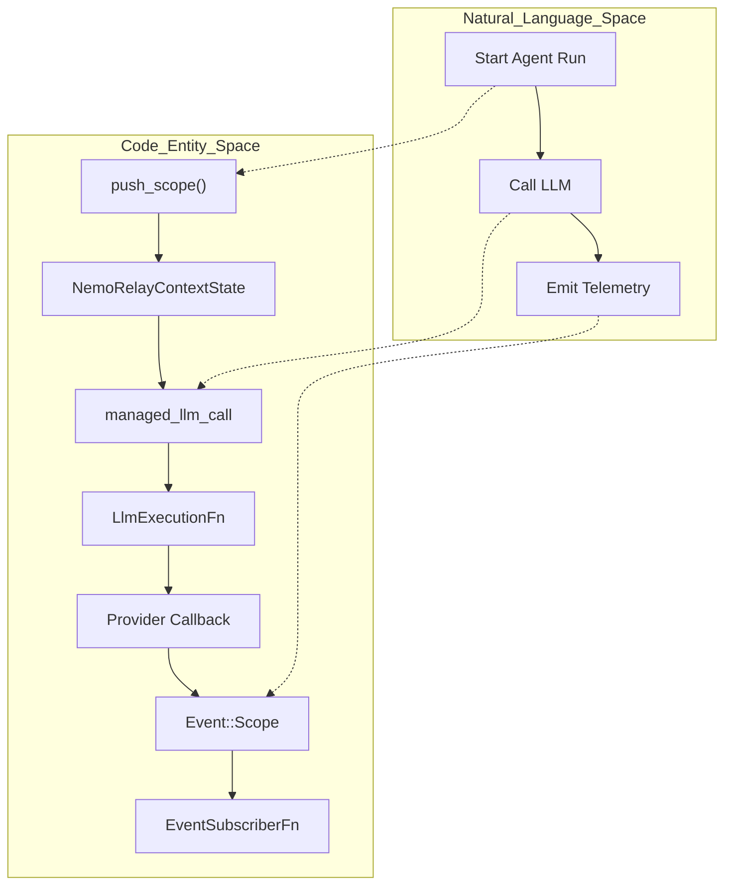

<!-- source: DeepWiki mcp.deepwiki.com · repo NVIDIA/NeMo-Relay · page 10 Glossary · fetched 2026-10-26 -->

# Glossary

<details>
<summary>Relevant source files</summary>

The following files were used as context for generating this wiki page:

- [ATTRIBUTIONS-Rust.md](ATTRIBUTIONS-Rust.md)
- [Cargo.lock](Cargo.lock)
- [about.toml](about.toml)
- [crates/cli/Cargo.toml](crates/cli/Cargo.toml)
- [crates/core/Cargo.toml](crates/core/Cargo.toml)
- [crates/core/src/observability/atif.rs](crates/core/src/observability/atif.rs)
- [crates/core/src/observability/atof.rs](crates/core/src/observability/atof.rs)
- [crates/core/src/observability/mod.rs](crates/core/src/observability/mod.rs)
- [crates/core/src/observability/openinference.rs](crates/core/src/observability/openinference.rs)
- [crates/core/src/plugin/dynamic.rs](crates/core/src/plugin/dynamic.rs)
- [crates/core/tests/integration/atif_storage_tests.rs](crates/core/tests/integration/atif_storage_tests.rs)
- [crates/core/tests/unit/atif_tests.rs](crates/core/tests/unit/atif_tests.rs)
- [crates/core/tests/unit/observability/atof_tests.rs](crates/core/tests/unit/observability/atof_tests.rs)
- [crates/core/tests/unit/observability/exporter_parity_tests.rs](crates/core/tests/unit/observability/exporter_parity_tests.rs)
- [crates/core/tests/unit/observability/openinference_tests.rs](crates/core/tests/unit/observability/openinference_tests.rs)
- [deny.toml](deny.toml)
- [docs/about-nemo-relay/concepts/events.mdx](docs/about-nemo-relay/concepts/events.mdx)
- [docs/about-nemo-relay/concepts/plugins.mdx](docs/about-nemo-relay/concepts/plugins.mdx)
- [docs/build-plugins/about.mdx](docs/build-plugins/about.mdx)
- [docs/configure-plugins/about.mdx](docs/configure-plugins/about.mdx)
- [docs/configure-plugins/nemo-guardrails/about.mdx](docs/configure-plugins/nemo-guardrails/about.mdx)
- [docs/configure-plugins/nemo-guardrails/configuration.mdx](docs/configure-plugins/nemo-guardrails/configuration.mdx)
- [docs/configure-plugins/observability/about.mdx](docs/configure-plugins/observability/about.mdx)
- [docs/configure-plugins/observability/atif.mdx](docs/configure-plugins/observability/atif.mdx)
- [docs/configure-plugins/observability/atof.mdx](docs/configure-plugins/observability/atof.mdx)
- [docs/getting-started/configuration.mdx](docs/getting-started/configuration.mdx)
- [docs/index.yml](docs/index.yml)
- [docs/instrument-applications/instrument-llm-call.mdx](docs/instrument-applications/instrument-llm-call.mdx)
- [docs/reference/atof-event-format.mdx](docs/reference/atof-event-format.mdx)
- [docs/resources/glossary.mdx](docs/resources/glossary.mdx)
- [skills/nemo-relay-plugin-observability/references/atif.md](skills/nemo-relay-plugin-observability/references/atif.md)

</details>


This wiki page defines NeMo Relay-specific terms, abbreviations, and domain concepts across the polyglot runtime (Rust core, Python, Node.js, Go bindings, and CLI gateway), complete with code pointers and data flow mappings.

## Core Runtime Concepts

### Scope
A **Scope** is the fundamental unit of work isolation. Scopes are organized in a hierarchical **Scope Stack**, preserving parent-child relationships across requests, agent runs, and tool/LLM calls [crates/core/src/api/scope.rs:12-14]().
*   **Root Scope**: The implicit bottom of every stack, typically representing an entire agent session or process [crates/core/src/api/runtime.rs:11-12]().
*   **Scope Handle**: A stable identifier (`Uuid`) and metadata container for an active scope [crates/core/src/api/scope.rs:12-13]().
*   **Scope Category**: Distinguishes between the `Start` and `End` of a logical work block [crates/core/src/api/event.rs:8-9]().

### Work
In the NeMo Relay runtime model, **Work** refers to the scoped execution path. Managed tool and LLM helpers attach work to the active scope, ensuring that lifecycle events and middleware are correctly associated with the logical context [crates/core/src/api/event.rs:54]().

### Middleware
Logic that runs around managed execution. Middleware is categorized into three families:
1.  **Execution Intercept**: Wraps or replaces the real callback (e.g., for retries or routing) [crates/core/src/api/llm.rs:31-32]().
2.  **Request Intercept**: Transforms the request payload before it reaches the provider [crates/core/src/api/llm.rs:31-32]().
3.  **Guardrail**: Middleware that blocks execution (`conditional`) or sanitizes observability data (`sanitize`) [crates/core/src/api/registry.rs:26-34]().

### Registry
A container for middleware and subscribers. Registries can be **Global** (process-wide) or **Scope-Local** (cleaned up when the owning scope closes) [crates/core/src/api/subscriber.rs:30-31]().

Sources: [crates/core/src/api/scope.rs:12-14](), [crates/core/src/api/runtime.rs:11-12](), [crates/core/src/api/event.rs:7-10](), [crates/core/src/api/subscriber.rs:30-31](), [crates/core/src/api/llm.rs:31-32]()

---

## Code Entity Mapping: Runtime Flow

The following diagram bridges the natural language concepts of "starting work" to the specific Rust code entities that manage the lifecycle.

Title: "Scope and Middleware Execution Flow"

Sources: [crates/core/src/api/scope.rs:14](), [crates/core/src/api/runtime.rs:11-12](), [crates/core/src/api/event.rs:54](), [crates/core/src/api/runtime.rs:37]()

---

## Observability Terms

### ATOF (Agent Trajectory Observability Format)
The canonical internal event format emitted by NeMo Relay. It includes fields for identifiers, timestamps, and parent linkage (the **Event Envelope**) [crates/core/src/api/event.rs:7-10](). ATOF events are exported to JSONL files or remote streams [crates/core/src/observability/atof.rs:38-40]().

### ATIF (Agent Trajectory Interchange Format)
An external-facing trajectory format (v1.7) used for offline analysis and replay. The `AtifExporter` translates ATOF event streams into structured trajectories [crates/core/src/observability/atif.rs:4-9](), [crates/core/src/observability/atif.rs:52-55]().

### OpenInference and OpenTelemetry
NeMo Relay supports industry-standard trace formats. The `openinference` projection maps internal `Event` objects to spans with semantic conventions for GenAI [crates/core/src/observability/openinference.rs:31-42](). OpenTelemetry support includes `full`, `gen_ai`, and `openinference` trace projections [crates/core/src/observability/mod.rs:133-141]().

### Subscriber vs. Exporter
*   **Subscriber**: An in-process function (`EventSubscriberFn`) that reacts to lifecycle events in real-time [crates/core/src/api/runtime.rs:37]().
*   **Exporter**: A specialized subscriber that writes data to external systems, such as OTLP backends or JSONL files [crates/core/src/observability/atif.rs:12-13](), [crates/core/src/plugin.rs:9-10]().

### Sanitize Guardrail
A specific type of middleware that redacts or transforms sensitive data (PII) in the event stream *before* it reaches subscribers [crates/core/src/plugin.rs:27-39]().

Sources: [crates/core/src/api/event.rs:7-10](), [crates/core/src/observability/atif.rs:4-9](), [crates/core/src/observability/openinference.rs:31-42](), [crates/core/src/api/runtime.rs:37](), [crates/core/src/plugin.rs:9-10](), [crates/core/src/observability/mod.rs:133-141]()

---

## Adaptive Runtime Terms

### ACG (Adaptive Cache Governor)
The subsystem responsible for analyzing prompt structure and planning provider-specific prompt-cache breakpoints to optimize latency and cost.

### Adaptive Hint
Metadata (e.g., priority, latency sensitivity) injected into an outgoing request by an adaptive intercept to signal downstream provider adapters.

### Pricing Catalog
A registry of model-specific token rates used to calculate `CostEstimate` for LLM responses [crates/core/src/codec/response.rs:20-22]().

Sources: [crates/core/src/codec/response.rs:20-22]()

---

## CLI and Gateway Concepts

### Passthrough Gateway
An `axum`-based proxy that intercepts LLM traffic from coding agents. It performs request alignment, managed execution, and event forwarding [crates/cli/src/gateway/mod.rs:59-64]().

### Coding Agent Support
Launcher logic for specific agents like `Claude Code` and `Codex`.

### Provider Route
A specific API endpoint within the gateway that handles requests for a particular LLM provider or service (e.g., `/v1/chat/completions`) [crates/cli/src/gateway/routes.rs:10-11]().

### Bootstrap Proof
A cryptographic proof (e.g., HMAC-SHA256) used by a client to authenticate with the NeMo Relay gateway during initial connection or session establishment [crates/cli/src/configuration.rs:38-39](), passed via the `x-nemo-relay-client-token` header [crates/cli/src/gateway/request.rs:102-108]().

### Tool Execution Result
Tool execution returns a canonical `ToolExecutionResult` shape containing the application-owned `result` and an optional opaque `annotation` [docs/about-nemo-relay/release-notes/index.mdx:45-49]().

Sources: [crates/cli/src/gateway/mod.rs:59-64](), [crates/cli/src/gateway/routes.rs:10-11](), [crates/cli/src/configuration.rs:38-39](), [crates/cli/src/gateway/request.rs:102-108](), [docs/about-nemo-relay/release-notes/index.mdx:45-49]()

---

## Plugin System Concepts

### Plugin
A loadable component that extends NeMo Relay's functionality, such as adding new middleware, exporters, or adaptive behaviors. Configured via `PluginConfig` [crates/core/src/plugin.rs:142-154]().

### Plugin Kind
A unique string identifier for a type of plugin, e.g., `observability` or `pii_redaction` [crates/core/src/plugin.rs:170]().

### PluginComponentSpec
A configuration entry for a single plugin instance, specifying its `kind`, `enabled` status, and component-specific `config` [crates/core/src/plugin.rs:167-181]().

### ConfigPolicy
Defines how the plugin system handles unsupported configuration values or unknown fields (`Error`, `Warn`, or `Ignore`) [crates/core/src/plugin.rs:153]().

### Dynamic Plugin
A plugin loaded at runtime from a shared library (`.so`, `.dylib`, `.dll`) managed by `PluginHostActivation` [crates/core/src/plugin/dynamic.rs:12-13]().

### Attestation Mode
A security mechanism defining how plugin integrity and authenticity are verified before loading [docs/build-plugins/about.mdx:10-11]().

### Worker Plugin
A plugin running in a separate process that communicates via gRPC (`worker-grpc`) [crates/core/Cargo.toml:40-52]().

Sources: [crates/core/src/plugin.rs:142-181](), [crates/core/src/plugin/dynamic.rs:12-13](), [crates/build-plugins/about.mdx:10-11](), [crates/core/Cargo.toml:40-52]()

---

## Code Entity Mapping: Observability & Adaptive

The following diagram bridges natural language data collection requests to the underlying observability and adaptive code entities.

Title: "Event Distribution to Exporters and Resolvers"
```mermaid
graph LR
    subgraph "Natural_Language_Space"
        CaptureEvents["Capture Execution Events"] --> ExportTelemetry["Export Telemetry & Costs"]
    end

    subgraph "Code_Entity_Space"
        EventATOF["`Event` (ATOF)"] --> register_subscriber["`register_subscriber()`"]
        register_subscriber --> AtifExporter["`AtifExporter`"]
        register_subscriber --> OpenTelemetrySubscriber["`OpenTelemetrySubscriber`"]
        register_subscriber --> PricingResolver["`PricingResolver`"]
        AtifExporter --> AtifTrajectory["`AtifTrajectory`"]
        OpenTelemetrySubscriber --> OTLPSpan["OTLP Span"]
        PricingResolver --> CostEstimate["`CostEstimate`"]
    end

    CaptureEvents -.-> EventATOF
    ExportTelemetry -.-> AtifTrajectory
    ExportTelemetry -.-> CostEstimate
```
Sources: [crates/core/src/observability/atif.rs:12-13](), [crates/core/src/observability/otel.rs:15-16](), [crates/core/src/api/subscriber.rs:50](), [crates/core/src/codec/response.rs:20-22]()

---

## Summary Table of Key Symbols

| Term | Code Symbol / Path | Description |
| :--- | :--- | :--- |
| **Scope Stack** | `NemoRelayContextState` [crates/core/src/api/runtime.rs:11]() | Manages active scope hierarchy for the current context. |
| **Event** | `Event` [crates/core/src/api/event.rs:8]() | Data structure representing a lifecycle milestone (Scope/Mark). |
| **Subscriber** | `EventSubscriberFn` [crates/core/src/api/runtime.rs:37]() | Callback type for consuming the ATOF event stream. |
| **Annotated Request** | `AnnotatedLlmRequest` [crates/core/src/codec/request.rs:10]() | Normalized representation of an LLM call for codecs and intercepts. |
| **Pricing Catalog** | `PricingCatalog` [crates/core/src/codec/response.rs:22]() | Registry of model-specific token rates for cost estimation. |
| **ATIF Step** | `AtifStep` [crates/core/src/observability/atif.rs:81]() | Single logical step in an exported trajectory. |
| **Plugin Config** | `PluginConfig` [crates/core/src/plugin.rs:142]() | Canonical plugin configuration document. |
| **Diagnostic** | `ConfigDiagnostic` [crates/core/src/plugin.rs:51]() | Reports validation issues in plugin configuration. |
| **PII Redaction Profile** | `PiiRedactionProfile` [crates/pii-redaction/src/lib.rs:34]() | Configuration profile for PII redaction rules and backends. |

Sources: [crates/core/src/api/runtime.rs](), [crates/core/src/observability/atif.rs](), [crates/core/src/api/event.rs](), [crates/core/src/codec/request.rs](), [crates/core/src/codec/response.rs](), [crates/core/src/plugin.rs](), [crates/pii-redaction/src/lib.rs]()