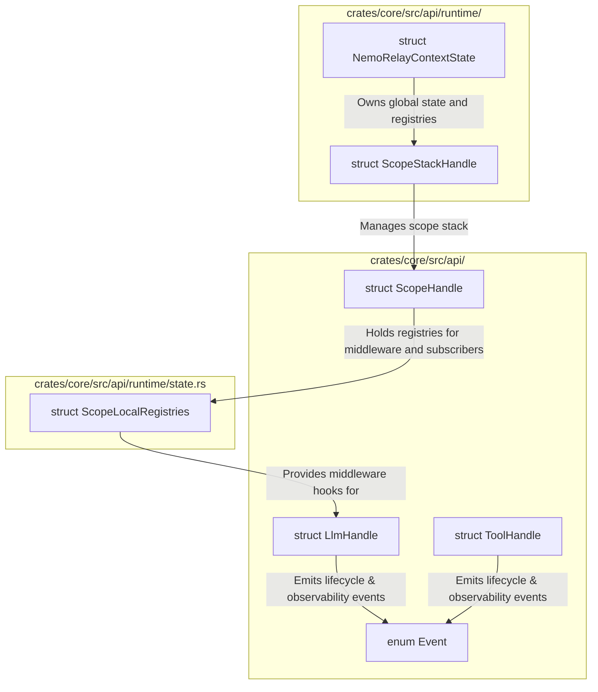
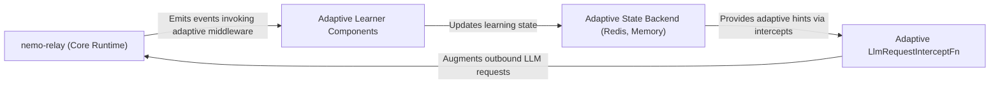

<!-- source: DeepWiki mcp.deepwiki.com · repo NVIDIA/NeMo-Relay · page 2 Core Runtime (Rust) · fetched 2026-10-26 -->

# Core Runtime (Rust)

Relevant source files

The following files were used as context for generating this wiki page:

- [ATTRIBUTIONS-Rust.md](ATTRIBUTIONS-Rust.md)
- [Cargo.lock](Cargo.lock)
- [about.toml](about.toml)
- [crates/cli/Cargo.toml](crates/cli/Cargo.toml)
- [crates/core/Cargo.toml](crates/core/Cargo.toml)
- [crates/core/src/api/llm.rs](crates/core/src/api/llm.rs)
- [crates/core/src/api/runtime/state.rs](crates/core/src/api/runtime/state.rs)
- [crates/core/src/api/shared.rs](crates/core/src/api/shared.rs)
- [crates/core/src/api/tool.rs](crates/core/src/api/tool.rs)
- [crates/core/src/plugin/dynamic.rs](crates/core/src/plugin/dynamic.rs)
- [crates/core/src/stream.rs](crates/core/src/stream.rs)
- [crates/core/tests/integration/middleware_tests.rs](crates/core/tests/integration/middleware_tests.rs)
- [crates/core/tests/integration/pipeline_tests.rs](crates/core/tests/integration/pipeline_tests.rs)
- [crates/core/tests/integration/stream_tests.rs](crates/core/tests/integration/stream_tests.rs)
- [crates/core/tests/unit/stream_tests.rs](crates/core/tests/unit/stream_tests.rs)
- [deny.toml](deny.toml)

The NeMo Relay Core Runtime is the foundational Rust implementation that underpins the entire NeMo Relay ecosystem’s runtime behavior. It delivers essential capabilities such as hierarchical scope management, an extensible managed execution pipeline for LLM and tool calls, a comprehensive observability event stream, and middleware-driven runtime customization [crates/core/Cargo.toml:5-10]().

This runtime is architected for modularity and portability, providing a stable and performant base for language bindings, plugins, and adaptive machine learning extensions implemented in Rust and other languages.

## Crate Architecture

NeMo Relay’s core Rust functionality is primarily split into core and adaptive crates [crates/core/Cargo.toml:5-10](), [crates/cli/Cargo.toml:31-32]().

| Crate | Role | Key Responsibilities |
|---|---|---|
| `nemo-relay` | **Core SDK** | Implements the core runtime engine: scope stack management, middleware registries, event emission, provider and typed codecs, and base API surface for language bindings. Serves as the foundation for all runtime behavior and instrumentation. [crates/core/Cargo.toml:5-10]() |
| `nemo-relay-adaptive` | **Adaptive Runtime** | Adds adaptive learning features: adaptive configuration, persistent state backends (in-memory, Redis), learners, adaptive hints intercept, and the Adaptive Cache Governor (ACG) for rollout management. [crates/cli/Cargo.toml:32]() |

The core crate is portable across native targets, WebAssembly modules, and C-compatible FFI, enabling multi-language and multi-platform bindings. The adaptive crate builds upon the core runtime, injecting adaptive hints and rollout policies to optimize runtime execution dynamically.

---

### Mapping Runtime Concepts to Code Entities

This diagram illustrates key natural language runtime concepts linked to their Rust code entities within `nemo-relay`:

- `NemoRelayContextState` acts as global context managing middleware registries and the scope stack [crates/core/src/api/runtime/state.rs:4-9]().
- `ScopeStackHandle` reflects the thread-local stack of active scopes [crates/core/src/api/runtime/state.rs:33]().
- `ScopeHandle` represents an individual scope with local registries for middleware, intercepts, and subscribers.
- `LlmHandle` and `ToolHandle` represent active calls that emit rich observability events [crates/core/src/api/llm.rs:89-137](), [crates/core/src/api/tool.rs:46-74]().
- `Event` enumerates the lifecycle, mark, LLM, and tool events emitted during execution.

This layered relationship enables state isolation, hierarchical instrumentation, and composable middleware execution.

Sources: [crates/core/src/api/runtime/state.rs:4-9](), [crates/core/src/api/llm.rs:89-137](), [crates/core/src/api/tool.rs:46-74](), [crates/core/Cargo.toml:5-10]()

---

## Scopes, Events, and Lifecycle

The runtime centralizes on a hierarchical **Scope Stack**, whereby every operation—LLM call, tool invocation, or user event—occurs within a named and typed scope.

- **Scope Management**: Scopes are pushed and popped dynamically, tracked via explicit `ScopeHandle` structs with rich types like agent, function, tool, and others. These operations are exposed via synchronous APIs and carefully control the context for all downstream processing.
- **Isolation Model**: Thread-local `ScopeStackHandle` instances encapsulate the scope stack, maintaining isolation via nested scope-local registries for middleware and subscribers. This enhances concurrency safety and fine-grained behavior scoping [crates/core/src/api/runtime/state.rs:33]().
- **Event Emission**: The `Event` enum models lifecycle transitions, marks, and call-specific observations for both LLM and tool scopes. Events get emitted synchronously during scope and call processing and dispatched asynchronously to subscribers.

The hierarchical stack guarantees context propagation and observability tracing across execution boundaries.

For deep technical details, see [Scopes, Events, and Lifecycle](#2.1).

Sources: [crates/core/src/api/runtime/state.rs:33](), [crates/core/src/api/llm.rs:89-137](), [crates/core/src/api/tool.rs:46-74]()

---

## Middleware: Intercepts and Guardrails

NeMo Relay uses flexible middleware registries and guardrails as the core mechanism to dynamically inject behavior into the runtime:

- **Execution Intercepts**: Middleware can register intercepts such as request intercept functions to modify or augment requests before outbound calls to providers, enabling features like request rewriting, metadata injection, or response validation.
- **Guardrails**: Guardrails provide conditional and sanitization rules that can approve, reject, or sanitize event data and execution flows. These guardrails run as ordered chains with priority-based resolution to enforce policies like PII redaction or usage limitations [crates/core/src/api/shared.rs:57-88]().
- **Priority and Ordering**: Middleware components register with explicit priorities to guarantee deterministic execution order within the managed pipeline. This priority framework ensures that requested intercepts and guardrails execute predictably and composably.

For API details and usage patterns, see [Middleware: Intercepts and Guardrails](#2.2).

Sources: [crates/core/src/api/shared.rs:57-88](), [crates/core/src/api/runtime/state.rs:4-9]()

---

## Codecs and Streaming

To unify interfacing with heterogeneous LLM service providers, the core runtime implements codec abstractions:

- **Provider Codecs**: Concrete implementations convert JSON-encoded provider messages into strongly typed `AnnotatedLlmRequest` structures and back, isolating protocol-specific details behind codec traits [crates/core/src/api/llm.rs:43-45](). Examples include codecs for OpenAI Chat and Anthropic message formats [crates/core/tests/integration/pipeline_tests.rs:37-39]().
- **Typed Value Codecs**: These codecs support serialization and deserialization of typed values for parameter passing and internal runtime data exchange.
- **Streaming Execution Helpers**: The runtime supports streaming LLM responses efficiently using patterns like the collector/finalizer, enabling partial results to be processed and emitted incrementally while maintaining scope context [`LlmStreamWrapper` and related streaming utilities] [crates/core/src/stream.rs:6-27]().
- **Cost Estimation Instrumentation**: Utilities provide runtime hooks to attach estimated cost metadata to streaming final events supporting observability and billing integrations [crates/core/src/api/llm.rs:44]().

These codecs maintain high interoperability with provider formats while enabling rich runtime features such as observability and adaptive intercept hooks.

For codec implementations and streaming details, see [Codecs and Streaming](#2.3).

Sources: [crates/core/src/api/llm.rs:43-45](), [crates/core/src/stream.rs:6-27](), [crates/core/tests/integration/pipeline_tests.rs:37-39]()

---

## Operational Logging and Errors

The core runtime provides robust mechanisms for operational logging and error handling:

- **Core Logging Configuration**: The runtime integrates with standard Rust logging frameworks, allowing flexible configuration of log levels and output sinks [crates/core/Cargo.toml:90-91]().
- **Error Type Hierarchy**: A structured error hierarchy, rooted in `FlowError`, provides detailed and actionable error information, facilitating debugging and robust error handling across the system [crates/core/src/error.rs:1-1()]().
- **Size-Rotating File Writer**: For persistent logging, the system can be configured with size-rotating file writers to manage log file growth effectively.
- **Log Level Control**: Log levels can be controlled across different components and language bindings, enabling fine-grained verbosity management.

For detailed information on logging configuration and error handling, see [Operational Logging and Errors](#2.4).

Sources: [crates/core/Cargo.toml:90-91](), [crates/core/src/error.rs:1-1]()

---

## Adaptive Runtime (`nemo-relay-adaptive`)

The `nemo-relay-adaptive` crate extends the core runtime, injecting adaptive learning and optimization via additional layers [crates/cli/Cargo.toml:32]():

- **Adaptive Learners**: Components analyze historical execution data (e.g., tool parallelism metrics) and contribute adaptive hints to future calls, shaping runtime behavior dynamically.
- **State Backends**: Persistent state storage is available via Redis or in-memory backends, enabling robust, scalable adaptive state management and rollout policies [crates/cli/Cargo.toml:32]().
- **Adaptive Cache Governor (ACG)**: Coordinated rollout of adaptive policies controlling execution experimentation and caching behavior.

The adaptive runtime exposes an additional intercept layer and configuration APIs injecting learned hints into the managed pipeline for optimization.

For comprehensive coverage, see [Adaptive Runtime (nemo-relay-adaptive)](#2.5).

Sources: [crates/cli/Cargo.toml:32]()

---

## Native and WebAssembly Support

The core Rust runtime is designed to be portable across multiple target environments:

- **C FFI Layer**: A generated C interface exports core runtime APIs for consumption by native languages like C and experimental Go bindings.
- **WebAssembly (WASM)**: The runtime builds to WASM modules enabling in-browser and JS runtime support through standard bindings. WASM exposes a nearly identical API surface with some environment-specific limitations.
- **Node.js**: Native bindings are produced via `napi-rs` to provide seamless Node.js integration and npm packaging for JavaScript clients.
- **Go**: The Go binding consumes the `nemo-relay-ffi` layer through CGo.

This multi-target design ensures the core runtime is the trusted provenance layer powering polyglot integrations.

Sources: [crates/core/Cargo.toml:5-10]()

---

