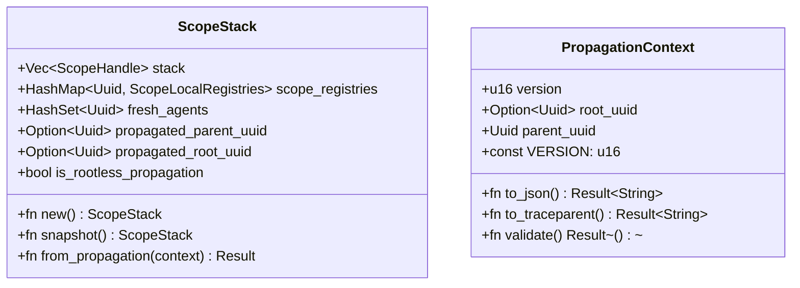
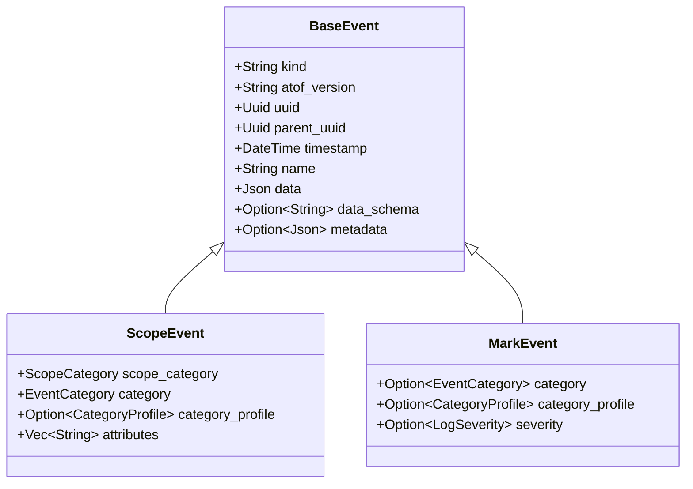
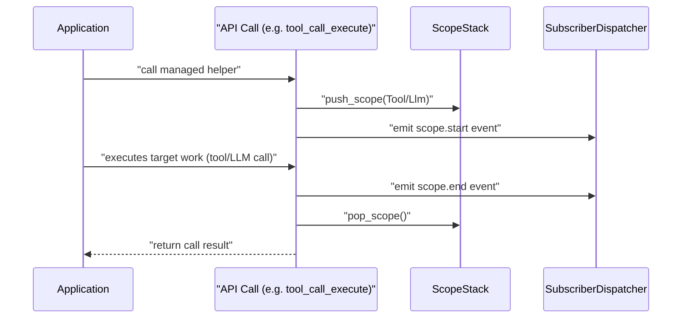
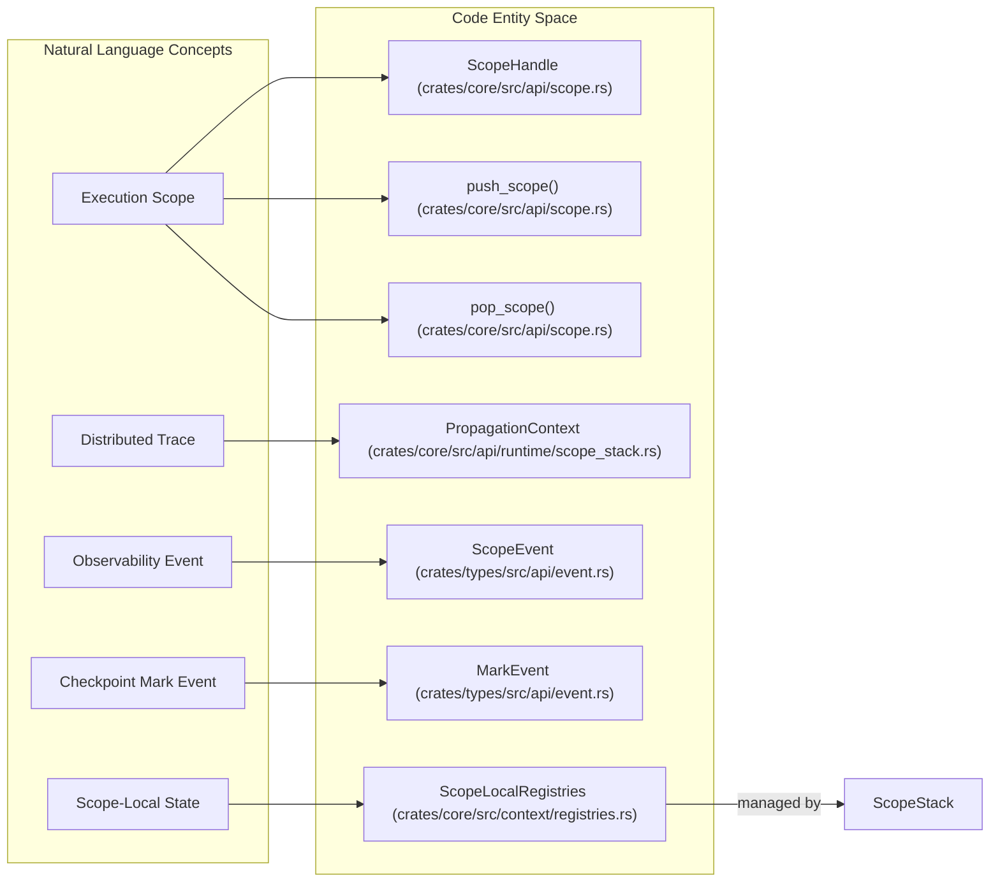
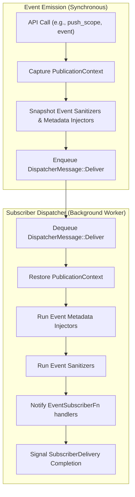

<!-- source: DeepWiki mcp.deepwiki.com · repo NVIDIA/NeMo-Relay · page 2.1 Scopes, Events, and Lifecycle · fetched 2026-10-26 -->

# Scopes, Events, and Lifecycle

Relevant source files

The following files were used as context for generating this wiki page:

- [crates/core/src/api/runtime.rs](crates/core/src/api/runtime.rs)
- [crates/core/src/api/runtime/scope_stack.rs](crates/core/src/api/runtime/scope_stack.rs)
- [crates/core/src/api/runtime/subscriber_dispatcher.rs](crates/core/src/api/runtime/subscriber_dispatcher.rs)
- [crates/core/src/api/scope.rs](crates/core/src/api/scope.rs)
- [crates/core/tests/integration/atif_storage_tests.rs](crates/core/tests/integration/atif_storage_tests.rs)
- [crates/core/tests/integration/context_isolation_tests.rs](crates/core/tests/integration/context_isolation_tests.rs)
- [crates/core/tests/unit/context_tests.rs](crates/core/tests/unit/context_tests.rs)
- [crates/core/tests/unit/plugins/nemo_guardrails/remote_coverage_tests.rs](crates/core/tests/unit/plugins/nemo_guardrails/remote_coverage_tests.rs)
- [crates/core/tests/unit/registry_tests.rs](crates/core/tests/unit/registry_tests.rs)
- [crates/core/tests/unit/subscriber_dispatcher_tests.rs](crates/core/tests/unit/subscriber_dispatcher_tests.rs)
- [crates/ffi/src/api/scope_stack.rs](crates/ffi/src/api/scope_stack.rs)
- [docs/about-nemo-relay/concepts/events.mdx](docs/about-nemo-relay/concepts/events.mdx)
- [docs/about-nemo-relay/concepts/scopes.mdx](docs/about-nemo-relay/concepts/scopes.mdx)
- [docs/about-nemo-relay/concepts/subscribers.mdx](docs/about-nemo-relay/concepts/subscribers.mdx)
- [docs/configure-plugins/observability/about.mdx](docs/configure-plugins/observability/about.mdx)
- [docs/configure-plugins/observability/atif.mdx](docs/configure-plugins/observability/atif.mdx)
- [docs/configure-plugins/observability/atof.mdx](docs/configure-plugins/observability/atof.mdx)
- [docs/instrument-applications/instrument-llm-call.mdx](docs/instrument-applications/instrument-llm-call.mdx)
- [docs/reference/atof-event-format.mdx](docs/reference/atof-event-format.mdx)
- [docs/reference/performance.mdx](docs/reference/performance.mdx)
- [go/nemo_relay/context_test.go](go/nemo_relay/context_test.go)
- [go/nemo_relay/test_helpers_test.go](go/nemo_relay/test_helpers_test.go)
- [skills/nemo-relay-plugin-observability/references/atif.md](skills/nemo-relay-plugin-observability/references/atif.md)

This page provides a deep dive into the NeMo Relay core runtime lifecycle management, focusing on the scope stack isolation model, the event system based on the Agent Trajectory Observability Format (ATOF), and the mechanics of scope push/pop operations.

## Purpose and Scope

The Core Runtime (Rust) manages the execution context of agentic workflows through a hierarchical scope system. This system ensures that middleware, guardrails, and observability subscribers are correctly isolated or inherited across different tasks and threads. All lifecycle transitions—from tool calls to LLM requests—are recorded as ATOF events, providing a standardized stream for observability exporters.

This page covers:

- Scope push/pop and scope handle concepts.
- Scope types and their roles in the stack.
- The scope stack isolation and propagation model.
- Mark events and their semantic meaning.
- The ATOF event envelope used for observability.
- The relevant API implementations located in `crates/core/src/api/`.

---

## The Scope Stack Isolation Model

NeMo Relay uses a `ScopeStack` to maintain the hierarchy of active execution spans (scopes) `[crates/core/src/api/runtime/scope_stack.rs:32-38]()`. At initialization, every thread or asynchronous context contains an implicit root scope of type `ScopeType::Agent` `[crates/core/src/api/runtime/scope_stack.rs:133-146]()`. This root acts as the foundation of the scope stack and manages freshness state for all work traces not nested under an explicit agent scope `[crates/core/src/api/runtime/scope_stack.rs:27-29]()`.

### ScopeStack Structure and Tracking

The `ScopeStack` struct holds:

- **`stack`**: a `Vec<ScopeHandle>` representing the nested active scopes `[crates/core/src/api/runtime/scope_stack.rs:33]()`.
- **`scope_registries`**: a map from each scope's UUID to its scope-local registries which include middleware and subscribers `[crates/core/src/api/runtime/scope_stack.rs:34]()`.
- **`fresh_agents`**: a hash set of agent scope UUIDs that track "freshness" for context window purposes `[crates/core/src/api/runtime/scope_stack.rs:35]()`.
- **`propagated_parent_uuid`** and **`propagated_root_uuid`**: optional UUIDs that support cross-process scope propagation `[crates/core/src/api/runtime/scope_stack.rs:36-37]()`.
- **`is_rootless_propagation`**: a boolean indicating if the stack was created from a rootless propagation context `[crates/core/src/api/runtime/scope_stack.rs:38]()`.

### Root and Implicit Scopes

A root scope is created by `ScopeStack::new()`. It is always of type `Agent`, named `"root"`, and represents the implicit root for all work `[crates/core/src/api/runtime/scope_stack.rs:133-146]()`. This root scope cannot be popped and owns the freshness lifecycle state for nested work not under explicit agent scopes:

> "The stack always contains an implicit root agent scope. It owns freshness for work that is not nested under an explicit agent; non-agent scopes inherit their nearest agent's freshness instead of creating a separate budget." `[crates/core/src/api/runtime/scope_stack.rs:27-29]()`

### Standard Scope Types

NeMo Relay defines several standard scope types enumerated in `ScopeType`:

- `Agent`
- `Function`
- `Tool`
- `Llm`
- `Retriever`
- `Embedder`
- `Reranker`
- `Guardrail`
- `Evaluator`
- `Custom`
- `Unknown`

These types help downstream subscribers and exporters understand the semantic nature of scopes `[crates/core/src/api/scope.rs:20]()`, `[docs/about-nemo-relay/concepts/scopes.mdx:54-66]()`.

### Isolation and Context Propagation

The scope stack leverages task-local and thread-local storage to maintain the current active scopes, supporting concurrency and event tree isolation:

- **Task-local storage** ensures asynchronous tasks retain correct active scopes independent of thread scheduling.
- **Forking the stack** produces isolated copies for concurrent branches that preserve event ancestry but not mutable middleware.
- **PropagationContext** is a minimal, versioned envelope that encodes root and parent UUIDs to propagate scope ancestry across process or RPC boundaries `[crates/core/src/api/runtime/scope_stack.rs:47-58]()`.

### PropagationContext Details

`PropagationContext` is a robust, transport-neutral causal context representing:

- `version`: Wire format version (currently 1) `[crates/core/src/api/runtime/scope_stack.rs:51]()`.
- `root_uuid`: Optional stable session root UUID `[crates/core/src/api/runtime/scope_stack.rs:54-56]()`.
- `parent_uuid`: Immediate Relay event or scope UUID causing the boundary crossing `[crates/core/src/api/runtime/scope_stack.rs:58]()`.

It supports JSON serialization and W3C trace-context (`traceparent`) conversion, with strict validation for UUIDs to prevent invalid ancestry `[crates/core/src/api/runtime/scope_stack.rs:48-115]()`.

---

### ScopeStack and PropagationContext Class Diagram

Title: "ScopeStack and PropagationContext Architecture"

Sources: `[crates/core/src/api/runtime/scope_stack.rs:32-145]()`, `[crates/core/src/api/runtime/scope_stack.rs:148-204]()`, `[crates/core/src/api/runtime/scope_stack.rs:47-115]()`.

---

## Scope Push/Pop Operations and Handles

The public API allows pushing and popping scopes that create lifecycle spans for work. These operations return or consume a `ScopeHandle` which encapsulates scope identity and metadata `[crates/core/src/api/scope.rs:46-63]()`.

- **`ScopeHandle`**: Represents a live active scope with identifiers (`uuid`, `parent_uuid`), type (`ScopeType`), and name. It forms the key event ancestry node for start/end pairs `[crates/core/src/api/scope.rs:32-58]()`.
- **Push operations** create an active scope, push it onto the current `ScopeStack`, and emit a start event using `push_scope` `[crates/core/src/api/scope.rs:71-96]()`.
- **Pop operations** emit a matching end event and remove the scope from the active stack using `pop_scope` `[crates/core/src/api/scope.rs:144-160]()`.

Handles enable explicit lifetime management and lifecycle enforcement.

---

## ATOF Event Envelope and Mark Events

NeMo Relay observability uses the Agent Trajectory Observability Format (ATOF) `0.1` as the canonical event interchange format `[docs/about-nemo-relay/concepts/events.mdx:14-19]()`, `[docs/reference/atof-event-format.mdx:9]()`.

### Event Kinds

- **Scope events** represent work spans with start/end paired by a UUID; their `scope_category` is `"start"` or `"end"` `[docs/about-nemo-relay/concepts/events.mdx:25-31]()`, `[docs/reference/atof-event-format.mdx:29-30]()`.
- **Mark events** represent named instantaneous checkpoints that are not paired `[docs/about-nemo-relay/concepts/events.mdx:32-35]()`, `[docs/reference/atof-event-format.mdx:31]()`. Marks embed logical semantics such as session start or checkpoints without pushing/popping scopes.

### Common Event Fields

Every event carries the following common fields `[docs/about-nemo-relay/concepts/events.mdx:57-67]()`, `[docs/reference/atof-event-format.mdx:39-57]()`:

| Field            | Description                                 |
|------------------|---------------------------------------------|
| `kind`           | `"scope"` or `"mark"`                       |
| `atof_version`   | ATOF format version string (e.g. `"0.1"`)  |
| `uuid`           | Unique event UUID (UUIDv7)                  |
| `parent_uuid`    | Parent event or scope UUID                   |
| `timestamp`      | ISO-8601 timestamp when event occurred      |
| `name`           | Event name or scope name                      |
| `data`           | Semantic input (on start) or output (on end)|
| `data_schema`    | Optional schema for `data` field            |
| `metadata`       | Optional opaque metadata                       |

Scope events also add `scope_category`, `category`, `attributes`, and optionally `category_profile`. Mark events include optional `category` and `category_profile` `[docs/about-nemo-relay/concepts/events.mdx:69-71]()`.

### Event Pairing and Parentage

Start and end events for the same scope share a `uuid` that enables pairing for duration computation and hierarchical tree reconstruction `[docs/about-nemo-relay/concepts/events.mdx:93-97]()`. `parent_uuid` provides lineage within the event tree.

Mark events are unpaired, representing atomic checkpoints or notifications under the current active scope `[docs/about-nemo-relay/concepts/events.mdx:93-105]()`.

---

### Event Class Diagram

Title: "Event Type Hierarchy"

Sources: `[docs/about-nemo-relay/concepts/events.mdx:57-73]()`, `[docs/reference/atof-event-format.mdx:39-57]()`, `[crates/core/src/api/scope.rs:5-8]()`.

---

## Marks and Semantic Use Cases

Mark events are typically used for point-in-time checkpoints not representing full lifecycle spans. For example, the coding-agent CLI emits a `"session.start"` mark to denote the start of a user session lifecycle. The mark carries the session ID and Relay-owned UUIDs but does not open a new scope `[docs/about-nemo-relay/concepts/events.mdx:44-54]()`. Another common mark is `"compaction"`, which indicates that an agent's context has been refreshed `[crates/core/src/api/scope.rs:29]()`.

Marks coexist with scope events and share parentage to active scopes, enabling subscribers to relate brief states or telemetry without managing scope lifetime.

---

## Managed Execution Lifecycle and Event Flow

NeMo Relay provides managed helpers around scope lifecycle for common execution patterns such as tool and LLM calls. These wrappers perform:

1. Pushing a specific scope.
2. Emitting start events with semantic inputs.
3. Executing the target logic.
4. Emitting end events with semantic outputs.
5. Popping the scope.

### Tool Execution Example

The managed tool call lifecycle (`tool_call_execute`) performs:

- Pushes a new `Tool` scope.
- Emits a `scope.start` event recording tool arguments.
- Runs the tool function.
- Emits a `scope.end` event with tool results.
- Pops the tool scope to complete lifetime `[crates/core/src/api/runtime/state.rs:182-192]()`.

### LLM Execution Example

LLM calls follow a similar lifecycle (`llm_call_execute`), with streaming support via a collector/finalizer pattern for chunked response assembly `[crates/core/src/api/runtime/callbacks.rs:15-18]()`.

---

### Event Dispatch and Subscriber Pipeline

Event emission is asynchronous. The `subscriber_dispatcher` module runs a background dispatch thread that:

- Applies metadata injectors to each event before publication `[crates/core/src/api/runtime/subscriber_dispatcher.rs:137-138]()`.
- Runs sanitizers that remove or mask sensitive data `[crates/core/src/api/runtime/subscriber_dispatcher.rs:139-140]()`.
- Notifies all registered `EventSubscriberFn` callbacks of the sanitized event `[crates/core/src/api/runtime/subscriber_dispatcher.rs:141]()`.
- Provides publication receipts through `SubscriberDelivery` for synchronization `[crates/core/src/api/runtime/subscriber_dispatcher.rs:92-115]()`.

The dispatcher uses `PublicationContext` to carry binding-owned task-local state from synchronous emission into queued middleware `[crates/core/src/api/runtime/subscriber_dispatcher.rs:19-24]()`. This context can be captured and propagated for spawned tasks `[crates/core/src/api/runtime/subscriber_dispatcher.rs:51-73]()`.

---

### Managed Execution Sequence Diagram

Title: "Managed Execution Lifecycle Sequence"

Sources: `[crates/core/src/api/runtime/state.rs:182-192]()`, `[crates/core/src/api/runtime/subscriber_dispatcher.rs:4-115]()`.

---

## API Surface: Scope and Lifecycle Handles

NeMo Relay uses explicit handle types for lifecycle entities available under `crates/core/src/api/`:

| Handle Type       | Role                                            | File                                    |
|-------------------|-------------------------------------------------|-----------------------------------------|
| `ScopeHandle`     | Identity of an active scope with UUIDs and metadata | `crates/core/src/api/scope.rs`          |
| `ScopeStackHandle`| Shared, thread-safe reference to the current active `ScopeStack` | `crates/core/src/api/runtime/scope_stack.rs`          |
| `LlmHandle`       | Specialized lifecycle for LLM call activities   | `crates/core/src/api/llm.rs`             |
| `ToolHandle`      | Specialized lifecycle for tool call activities  | `crates/core/src/api/tool.rs`            |

The `ScopeHandle` treats UUIDs as the core linking identity that pairs start/end events and maintains scope ancestry `[crates/core/src/api/scope.rs:32-58]()`.

---

## Summary Diagram: Natural Language Concepts to Code Entities

Title: "Natural Language to Code Entity Mapping"

Sources: `[crates/core/src/api/runtime/scope_stack.rs:32-58]()`, `[crates/core/src/api/scope.rs:46-63]()`, `[crates/core/src/api/scope.rs:71-96]()`, `[crates/core/src/api/scope.rs:144-160]()`, `[crates/core/src/api/runtime/scope_stack.rs:34]()`.

---

## Summary Diagram: Event Emission and Dispatch Flow

Title: "Event Emission and Dispatch Pipeline"

Sources: `[crates/core/src/api/runtime/subscriber_dispatcher.rs:134-160]()`, `[crates/core/src/api/runtime/subscriber_dispatcher.rs:19-24]()`, `[crates/core/src/api/runtime/subscriber_dispatcher.rs:51-73]()`, `[crates/core/src/api/runtime/subscriber_dispatcher.rs:92-115]()`.

---

## References

- `crates/core/src/api/runtime/scope_stack.rs`: Scope stack storage and propagation `[crates/core/src/api/runtime/scope_stack.rs:4-38]()`.
- `crates/core/src/api/runtime/state.rs`: Process-global runtime state and managed execution `[crates/core/src/api/runtime/state.rs:4-192]()`.
- `crates/core/src/api/runtime/subscriber_dispatcher.rs`: Asynchronous subscriber delivery implementation `[crates/core/src/api/runtime/subscriber_dispatcher.rs:4-115]()`.
- `docs/about-nemo-relay/concepts/events.mdx`: ATOF event format specification `[docs/about-nemo-relay/concepts/events.mdx:12-160]()`.
- `docs/about-nemo-relay/concepts/scopes.mdx`: Scope hierarchy and context isolation overview `[docs/about-nemo-relay/concepts/scopes.mdx:11-208]()`.
- `docs/reference/atof-event-format.mdx`: The normative ATOF 0.1 wire format `[docs/reference/atof-event-format.mdx:1-91]()`.

This page serves as the definitive technical deep dive for understanding the lifecycles of scopes and events in NeMo Relay, their runtime encapsulation, and how observability data is produced and propagated.

---

