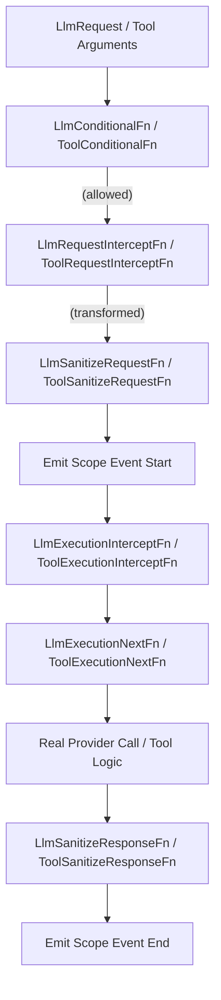
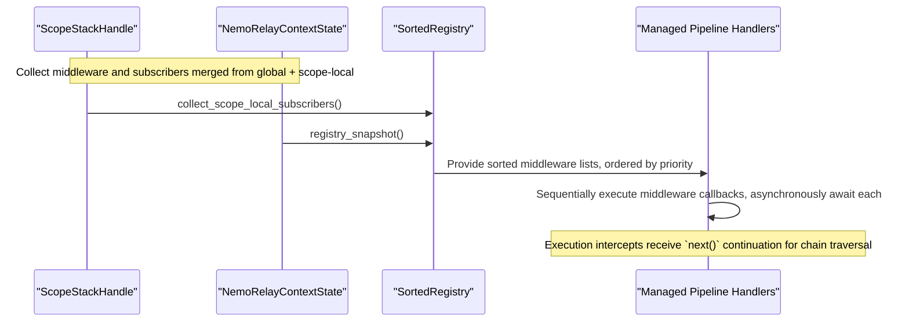
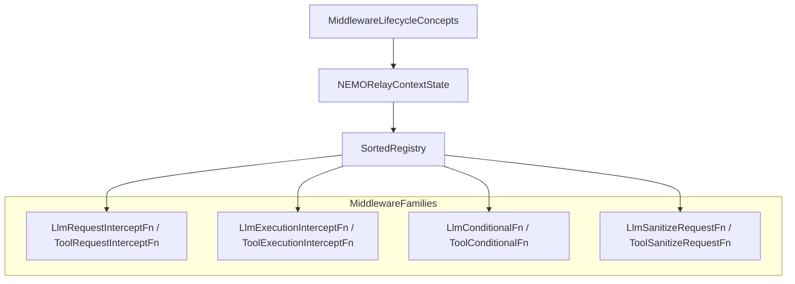
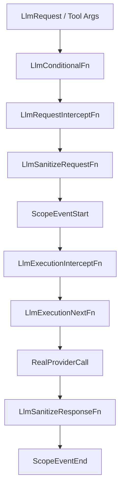

<!-- source: DeepWiki mcp.deepwiki.com · repo NVIDIA/NeMo-Relay · page 2.2 Middleware: Intercepts and Guardrails · fetched 2026-10-26 -->

# Middleware: Intercepts and Guardrails

Relevant source files

The following files were used as context for generating this wiki page:

- [crates/core/src/api/llm.rs](crates/core/src/api/llm.rs)
- [crates/core/src/api/runtime/state.rs](crates/core/src/api/runtime/state.rs)
- [crates/core/src/api/shared.rs](crates/core/src/api/shared.rs)
- [crates/core/src/api/tool.rs](crates/core/src/api/tool.rs)
- [crates/core/src/stream.rs](crates/core/src/stream.rs)
- [crates/core/tests/integration/middleware_tests.rs](crates/core/tests/integration/middleware_tests.rs)
- [crates/core/tests/integration/pipeline_tests.rs](crates/core/tests/integration/pipeline_tests.rs)
- [crates/core/tests/integration/stream_tests.rs](crates/core/tests/integration/stream_tests.rs)
- [crates/core/tests/integration/subscriber_dispatcher_tests.rs](crates/core/tests/integration/subscriber_dispatcher_tests.rs)
- [crates/core/tests/unit/llm_api_tests.rs](crates/core/tests/unit/llm_api_tests.rs)
- [crates/core/tests/unit/stream_tests.rs](crates/core/tests/unit/stream_tests.rs)
- [crates/core/tests/unit/tool_api_tests.rs](crates/core/tests/unit/tool_api_tests.rs)
- [docs/about-nemo-relay/concepts/middleware.mdx](docs/about-nemo-relay/concepts/middleware.mdx)
- [docs/instrument-applications/advanced-guide.mdx](docs/instrument-applications/advanced-guide.mdx)
- [docs/instrument-applications/code-examples.mdx](docs/instrument-applications/code-examples.mdx)
- [docs/integrate-into-frameworks/code-examples.mdx](docs/integrate-into-frameworks/code-examples.mdx)
- [docs/integrate-into-frameworks/provider-codecs.mdx](docs/integrate-into-frameworks/provider-codecs.mdx)
- [docs/reference/event-sanitizers.mdx](docs/reference/event-sanitizers.mdx)
- [docs/reference/llm-request-intercept-outcomes.mdx](docs/reference/llm-request-intercept-outcomes.mdx)

NeMo Relay implements a structured middleware model to control, transform, and observe tool and LLM execution lifecycle. Middleware is categorized by lifecycle role and effect: **intercepts** alter execution results or requests, while **guardrails** protect or sanitize observability data without changing execution outcomes.

---

## Middleware Registry Model

Middleware entries are managed in priority-ordered registries held within the runtime's central state, `NemoRelayContextState` [`crates/core/src/api/runtime/state.rs:1-10`]() (and instantiated via `NemoRelayContextState::new()` [`crates/core/tests/unit/llm_api_tests.rs:47-53`]()). Each registry contains uniquely named middleware entries sorted by ascending priority. NeMo Relay invokes middleware sequentially so later callbacks observe earlier middleware output [`docs/about-nemo-relay/concepts/middleware.mdx:28-30`]().

### Priority and Uniqueness

- **Priority Ordering:** Middleware callbacks are sorted ascending by priority number.
- **Uniqueness:** Middleware names are unique within their registry to enable deterministic registration and deregistration [`docs/reference/event-sanitizers.mdx:136-140`]().
- **Deregistration:** Entries can be removed by name dynamically without disturbing in-flight executions. Both global and scope-local deregistration APIs exist per middleware family [`crates/core/tests/integration/middleware_tests.rs:37-60`]().

### Registration Levels

Middleware and subscribers register at different levels depending on lifetime and scope visibility [`docs/about-nemo-relay/concepts/middleware.mdx:77-99`]():

| Level | Description | Lifetime |
|---|---|---|
| **Global** | Active for the entire process until explicitly removed. Used for default or broad middleware. | Process lifetime |
| **Scope-Local** | Owned by a particular active scope, these registrations automatically disappear when the scope closes. | Scope lifetime |
| **Plugin-Installed** | Middleware installed during plugin initialization via structured configuration. Cleared on plugin deactivation or config reset. | Plugin/component lifetime |

### Middleware Families and Purposes

NeMo Relay defines four principal middleware families, each serving a distinct role in lifecycle and observability management:

| Family | Effect | Changes Real Result? | Details |
|---|---|---|---|
| **Request Intercept** | Transforms incoming request payload before execution | Yes | For header injection, request shaping pre-call [`docs/about-nemo-relay/concepts/middleware.mdx:147-153`]() |
| **Execution Intercept** | Wraps or replaces execution logic around callback | Yes | Receives `next` continuation, supports retries and streaming [`docs/about-nemo-relay/concepts/middleware.mdx:154-167`]() |
| **Conditional Guardrail** | Decides if execution should proceed; can reject calls | Yes (blocks execution) | Returns rejection message to halt processing [`docs/about-nemo-relay/concepts/middleware.mdx:104-105`]() |
| **Sanitize Guardrail** | Rewrites emitted event payload (observability data) only | No | Sanitizes event payloads before delivery to subscribers/exporters [`docs/about-nemo-relay/concepts/middleware.mdx:106-108`]() |

Sources:
- `crates/core/src/api/runtime/state.rs:1-10`
- `docs/about-nemo-relay/concepts/middleware.mdx:28-167`
- `docs/reference/event-sanitizers.mdx:136-140`
- `crates/core/tests/integration/middleware_tests.rs:37-60`

---

## Intercepts vs. Guardrails

NeMo Relay clearly differentiates **intercepts** that alter execution or request flow from **guardrails** that only protect or sanitize observability data without affecting the semantic call results.

### Request Intercepts

- Intercept and modify the outbound `LlmRequest` [`crates/core/src/api/llm.rs:43-52`]() or tool invocation arguments before forwarding to the provider or tool.
- Common use cases include injection/removal of headers, stripping sensitive data (e.g., authorization/API keys) to prevent leakage into observability streams [`crates/core/tests/unit/llm_api_tests.rs:68-99`]() and normalization of requests.
- Runs asynchronously before execution but after conditional guardrails approve the call.

### Execution Intercepts

- Wrap and potentially replace the actual callback execution.
- Receive a `next` continuation that invokes the subsequent middleware chain or the base callback.
- May invoke `next` multiple times to implement retries, branching, or endpoint fallback.
- Each invocation runs with an isolated scope snapshot, preventing cross-branch state mutations [`docs/about-nemo-relay/concepts/middleware.mdx:62-74`].

**Streaming execution intercepts:**
- A streaming intercept returns a wrapped response stream whose lifetime extends until stream termination.
- Lazy stream adapters can call `next` while streaming to continue the underlying call [`docs/about-nemo-relay/concepts/middleware.mdx:70-73`]().

### Sanitize Guardrails

- Control allowed transformations of observability-relevant fields (`data`, `category_profile`, `metadata`) in emitted start and end scope events.
- Use specialized registries: mark sanitizers, scope-start sanitizers, and scope-end sanitizers [`docs/reference/event-sanitizers.mdx:19-24`]() that sanitize emitted events.
- They do **not** affect the actual request, response, or execution results, preserving the real execution semantics [`docs/reference/event-sanitizers.mdx:11-13`]().
- They operate asynchronously on queued events before subscribers and exporters see the data.

Sources:
- `crates/core/src/api/llm.rs:43-52`
- `crates/core/tests/unit/llm_api_tests.rs:68-99`
- `docs/about-nemo-relay/concepts/middleware.mdx:62-74`
- `docs/reference/event-sanitizers.mdx:11-24`

---

## Managed Execution Pipeline Overview

NeMo Relay applies middleware in a strict ordered pipeline, executing them in priority order from request reception through to observability emission.

### Conceptual Pipeline: Natural Language Space → Code Entities

Sources:
- `crates/core/src/api/runtime/state.rs:34-40`
- `docs/about-nemo-relay/concepts/middleware.mdx:101-124`
- `docs/reference/event-sanitizers.mdx:11-13`

### Middleware Registry Merging and Execution

- Global and scope-local middleware and subscribers merge at runtime.
- Scope-local registrations are bound to the active `ScopeStackHandle` [`crates/core/src/api/runtime/state.rs:33`]() and vanish automatically when the scope closes [`docs/about-nemo-relay/concepts/middleware.mdx:88-90`]().

Middleware callbacks are asynchronous in the Rust runtime. Node.js middleware callbacks may return Promises; Python callbacks accept awaitables when invoked from async APIs [`docs/about-nemo-relay/concepts/middleware.mdx:24-44`]().

Middleware is not re-entrant: callbacks must not invoke Relay middleware APIs or flush exporters recursively, but may push/pop scopes or emit events asynchronously.

Sources:
- `crates/core/src/api/runtime/state.rs:33-40`
- `docs/about-nemo-relay/concepts/middleware.mdx:24-44`
- `crates/core/src/api/shared.rs:40-49`

---

## Detailed Managed Execution Order

An example managed call flow (`llm_call_execute()` or `tool_call_execute()`) proceeds as follows:

1.  **Conditional Execution Guardrails Run**
    -   Middleware of type `LlmConditionalFn` or `ToolConditionalFn` run in ascending priority order.
    -   Any guardrail can reject execution by returning an error, stopping the pipeline, and notifying the caller [`docs/about-nemo-relay/concepts/middleware.mdx:133-135`]().

2.  **Request Intercepts Run**
    -   Intercepts transform the `LlmRequest` or tool arguments (e.g., stripping credential headers like `authorization`, `x-api-key`) to protect observability [`crates/core/src/api/llm.rs:54-62`]().

3.  **Sanitize Request Guardrails Run, Start Event Emitted**
    -   Guardrails sanitize observability fields before emission (`snapshot_event_sanitizers` [`crates/core/src/api/shared.rs:57-60`]).
    -   The sanitized start event is then queued for asynchronous publication [`docs/reference/event-sanitizers.mdx:22,93-97`]().

4.  **Execution Intercept Chain Begins**
    -   Execution intercepts wrap the callback with a provided `next()` continuation.
    -   Each `next()` call receives an isolated snapshot of scope stack state [`docs/about-nemo-relay/concepts/middleware.mdx:65-67`]().

5.  **Execution Proceeds to Real Callback**
    -   The wrapped callback or the real provider/tool call executes, returning a result or a streaming response.

6.  **Sanitize Response Guardrails Run, End Event Emitted**
    -   On completion, response guardrails sanitize observability fields on the end event.
    -   For streaming LLM responses, sanitization is deferred until stream termination using a finalizer callback [`crates/core/src/stream.rs:16-17`]().

### Tool Execution Intercept Outcomes

A tool execution intercept returns a `ToolExecutionInterceptOutcome` which includes the application-owned `result`, an optional opaque `annotation`, and `pending_marks` [`crates/core/src/api/tool.rs:32-35`].

-   `result`: The primary application-visible payload.
-   `annotation`: Optional opaque metadata that Relay transports without interpreting its schema.
-   `pending_marks`: Relay-owned lifecycle data, an empty list by default, containing marks to be materialized after the final outcome succeeds.

The `next(args)` continuation in an intercept returns `ToolExecutionResult` [`crates/core/src/api/tool.rs:32-35`], which contains the `result` and `annotation` from the downstream execution, but not `pending_marks`. An intercept can preserve, replace, or remove the annotation in its returned outcome.

Sources:
- `docs/about-nemo-relay/concepts/middleware.mdx:133-135`
- `crates/core/src/api/llm.rs:54-62`
- `crates/core/src/api/shared.rs:57-60`
- `crates/core/src/stream.rs:16-17`
- `crates/core/src/api/tool.rs:32-35`

---

## Implementation Details

### Core Data Structures

| Entity | Role | Details |
|---|---|---|
| `LlmRequest` | Request payload | Contains headers and JSON content [`crates/core/src/api/llm.rs:43-52`]() |
| `LlmHandle` | Runtime handle for an active LLM call | Stores unique call UUID, captured scope snapshot, and optimization recorder [`crates/core/src/api/llm.rs:89-131`]() |
| `ToolHandle` | Runtime handle for active tool call | Holds UUID, tool name, correlation ID, parent UUID [`crates/core/src/api/tool.rs:47-74`]() |
| `LlmStreamWrapper` | Stream adapter managing chunk collection and final event emission | Wraps raw LLM chunk stream with collector and finalizer [`crates/core/src/stream.rs:76-90`]() |

### Streaming Pipeline Middleware

Streaming LLM responses yield chunks progressively. Middleware applies as follows [`crates/core/src/stream.rs:12-26`]() :

1.  **Collector:**
    -   Per-chunk callback accumulates or transforms stream chunks.
    -   Returning `Err` causes stream termination.

2.  **Finalizer:**
    -   One-shot callback invoked upon stream termination that produces aggregated JSON response.

3.  **Sanitize Response Guardrails:**
    -   Post-aggregation, the response passes through sanitize guardrails before end event emission.
    -   `LlmStreamWrapper` preserves the originating scope stack to apply correct scope-local middleware at stream end even if polled elsewhere [`crates/core/src/stream.rs:71-75`]() (`LlmStreamWrapper::new` [`crates/core/src/stream.rs:127-156`]).

### Conditional Middleware Guardrails

A conditional middleware guardrail enables temporary exclusion of existing global subscribers or middleware from runtime snapshots without changing ownership or registration [`docs/about-nemo-relay/concepts/middleware.mdx:105-112`]().

This dynamic gating mechanism supports health-checking, feature flags, or adaptive policy-driven control of middleware activation.

Sources:
- `crates/core/src/api/llm.rs:43-131`
- `crates/core/src/api/tool.rs:47-74`
- `crates/core/src/stream.rs:12-90, 127-156`
- `docs/about-nemo-relay/concepts/middleware.mdx:105-112`

---

## Summary Diagrams

### Middleware Registry Concept to Code Entities

### Managed Execution Pipeline Coverage by Code

Sources:
- `crates/core/src/api/runtime/state.rs:1-45`
- `crates/core/src/api/llm.rs:43-52`
- `crates/core/src/api/tool.rs:47-74`
- `crates/core/src/stream.rs:12-90`

---

