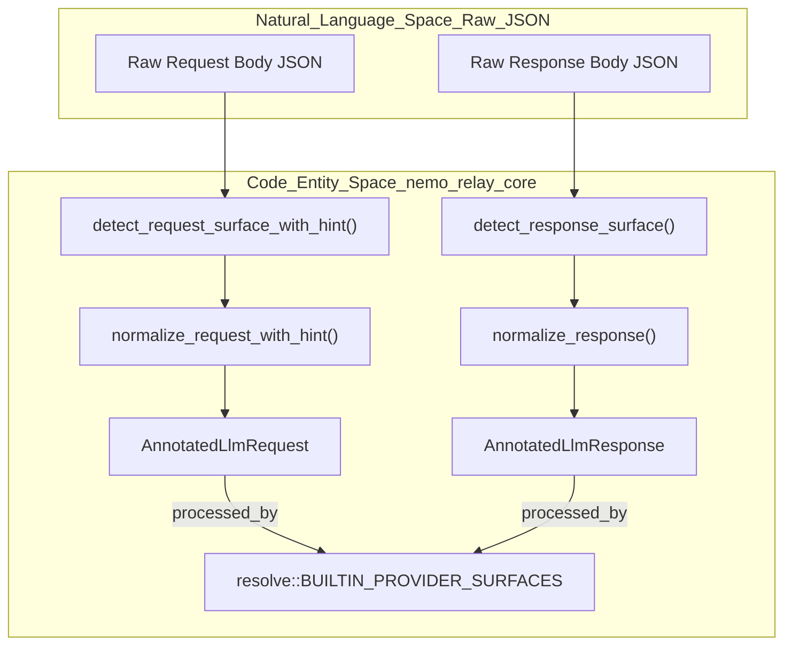

<!-- source: DeepWiki mcp.deepwiki.com · repo NVIDIA/NeMo-Relay · page 2.3 Codecs and Streaming · fetched 2026-10-26 -->

# Codecs and Streaming

Relevant source files

The following files were used as context for generating this wiki page:

- [crates/adaptive/src/acg/request_surfaces/mod.rs](crates/adaptive/src/acg/request_surfaces/mod.rs)
- [crates/cli/tests/coverage/commands/model_pricing_tests.rs](crates/cli/tests/coverage/commands/model_pricing_tests.rs)
- [crates/core/src/api/optimization.rs](crates/core/src/api/optimization.rs)
- [crates/core/src/codec/anthropic.rs](crates/core/src/codec/anthropic.rs)
- [crates/core/src/codec/gemini_generate_content.rs](crates/core/src/codec/gemini_generate_content.rs)
- [crates/core/src/codec/mod.rs](crates/core/src/codec/mod.rs)
- [crates/core/src/codec/model_pricing.rs](crates/core/src/codec/model_pricing.rs)
- [crates/core/src/codec/openai_chat.rs](crates/core/src/codec/openai_chat.rs)
- [crates/core/src/codec/openai_responses.rs](crates/core/src/codec/openai_responses.rs)
- [crates/core/src/codec/resolve.rs](crates/core/src/codec/resolve.rs)
- [crates/core/tests/unit/codec/anthropic_tests.rs](crates/core/tests/unit/codec/anthropic_tests.rs)
- [crates/core/tests/unit/codec/gemini_generate_content_tests.rs](crates/core/tests/unit/codec/gemini_generate_content_tests.rs)
- [crates/core/tests/unit/codec/openai_chat_tests.rs](crates/core/tests/unit/codec/openai_chat_tests.rs)
- [crates/core/tests/unit/codec/parity_tests.rs](crates/core/tests/unit/codec/parity_tests.rs)
- [crates/core/tests/unit/codec/resolve_tests.rs](crates/core/tests/unit/codec/resolve_tests.rs)
- [crates/core/tests/unit/codec/response_tests.rs](crates/core/tests/unit/codec/response_tests.rs)
- [crates/core/tests/unit/optimization_tests.rs](crates/core/tests/unit/optimization_tests.rs)
- [crates/pii-redaction/tests/coverage/overlay_tests.rs](crates/pii-redaction/tests/coverage/overlay_tests.rs)
- [crates/types/src/codec/response.rs](crates/types/src/codec/response.rs)
- [docs/about-nemo-relay/concepts/codecs.mdx](docs/about-nemo-relay/concepts/codecs.mdx)
- [docs/configure-plugins/model-pricing.mdx](docs/configure-plugins/model-pricing.mdx)
- [docs/integrate-into-frameworks/provider-response-codecs.mdx](docs/integrate-into-frameworks/provider-response-codecs.mdx)

## Purpose and Scope
This page details the codec and streaming subsystems in the NeMo Relay core crate (`nemo-relay-core`). It covers provider codecs (OpenAI Chat, OpenAI Responses, Anthropic Messages, Gemini generateContent, OCI GenAI), typed value codecs, automatic surface resolution, model pricing catalogs and resolvers, streaming helper architectures (the collector/finalizer pattern via `StreamingCodec`), and stream execution intercepts.

---

## Provider Codecs

Provider codecs implement the traits [`LlmCodec`](crates/core/src/codec/traits.rs#L19-L36)() (request decode/encode) and [`LlmResponseCodec`](crates/core/src/codec/traits.rs#L19-L36)() (response decode) to translate between provider-specific JSON payloads and normalized NeMo Relay entities: `AnnotatedLlmRequest` [crates/core/src/codec/request.rs#L10]() and `AnnotatedLlmResponse` [crates/types/src/codec/response.rs#L42-L43]().

The built-in provider codecs in NeMo Relay include:

| Codec | Provider API | Key Characteristics |
| :-------------------------- | :---------------------- | :------------------------------------------------------------------------------------------------------------------------------------------------------------ |
| `OpenAIChatCodec` | OpenAI Chat Completions | Standard `messages` array in requests; responses include `choices[0].message`. Handles content, tool calls, usage, and finish reasons [crates/core/src/codec/openai_chat.rs:33-45](). |
| `OpenAIResponsesCodec` | OpenAI Responses API | Distinctive heterogeneous `output` array including message, function calls, reasoning parts; finish reason derived from `status` and `incomplete_details.reason` fields [crates/core/src/codec/openai_responses.rs:9-17](), [crates/core/src/codec/openai_responses.rs:42-57](). |
| `AnthropicMessagesCodec` | Anthropic Messages | Top-level `system` prompt separate from messages; content represented as heterogeneous blocks (text, tool use, thinking); tooling uses `input_schema` [crates/core/src/codec/anthropic.rs:9-18](), [crates/core/src/codec/anthropic.rs:43-65](). |
| `GeminiGenerateContentCodec` | Google Gemini | Uses `contents` array in request and `candidates` array in response; normalizes Gemini function-call IDs to tool call IDs [crates/core/src/codec/gemini_generate_content.rs:40-53](). |
| `OCIGenAIChatCodec` | OCI Generative AI | Chat request bodies with `messages` field; positioned to detect before OpenAI chat for disambiguation [crates/core/src/codec/resolve.rs:70-79](). |

### Codec Implementation Patterns

Each codec handles:
- **Request Decoding and Encoding**: They decode raw provider requests into `AnnotatedLlmRequest` instances for middleware and encode edits back into provider payloads before forwarding upstream.
- **Response Decoding**: They decode raw provider responses into `AnnotatedLlmResponse` with normalized semantic fields (model, finish reason, usage, tool calls).
- **Field Preservation and Lossless Patch Semantics**: They preserve unknown or unmodeled fields within an `extra` map, ensuring unknown fields pass through unchanged unless explicitly edited [docs/about-nemo-relay/concepts/codecs.mdx:93-98]().
- **Provider-Specific Metadata**: Exposed in `api_specific` fields to allow provider-centric details with extended semantics [docs/about-nemo-relay/concepts/codecs.mdx:105-109]().
- **Tool Call Argument Parsing**: Many codecs parse stringified JSON arguments from tool call requests into structured JSON, with fallback to string on parse failure [crates/core/src/codec/openai_chat.rs:129-131](), [crates/core/src/codec/openai_responses.rs:133-136]().

Sources:
[crates/core/src/codec/openai_chat.rs:33-45](), [crates/core/src/codec/openai_responses.rs:9-17](), [crates/core/src/codec/openai_responses.rs:42-57](), [crates/core/src/codec/anthropic.rs:9-18](), [crates/core/src/codec/anthropic.rs:43-65](), [crates/core/src/codec/gemini_generate_content.rs:40-53](), [crates/core/src/codec/resolve.rs:70-79](), [crates/core/src/codec/traits.rs:19-36](), [crates/types/src/codec/response.rs:42-43](), [crates/core/src/codec/request.rs:10](), [docs/about-nemo-relay/concepts/codecs.mdx:93-98](), [docs/about-nemo-relay/concepts/codecs.mdx:105-109](), [crates/core/src/codec/openai_chat.rs:129-131](), [crates/core/src/codec/openai_responses.rs:133-136]()

---

## Automatic Surface Resolution and Provider Detection

NeMo Relay supports best-effort detection of the provider format from a raw JSON payload, determining which built-in codec to apply. This is managed in the `resolve` module [crates/core/src/codec/resolve.rs:4-157]().

### Detection Priorities and Logic

- **Request Detection Priority**: OpenAI Responses (keys `input` or `instructions`) > Anthropic Messages (key `system`) > OCI GenAI (early detection for `messages`) > OpenAI Chat (`messages`) > Gemini (`contents`) [crates/core/src/codec/resolve.rs:70-79]().
- **Disambiguation**: Anthropic requests without a `system` prompt are structurally identical to OpenAI Chat requests. The detection logic allows supplying a provider hint (`"anthropic"` or `"anthropic.messages"`) to clarify the intended codec [crates/core/src/codec/resolve.rs:93-102]().
- **Response Detection**: Classifies response payloads only if exactly one descriptor matches, minimizing ambiguity from minimal or overlapping JSON structures [crates/core/src/codec/resolve.rs:110-112]().

### Diagram: Natural Language Space to Code Entity Space (Surface Resolution)

Sources:
[crates/core/src/codec/resolve.rs:4-157](), [crates/core/src/codec/resolve.rs:70-79](), [crates/core/src/codec/resolve.rs:93-102](), [crates/core/src/codec/resolve.rs:110-112](), [crates/core/tests/unit/codec/resolve_tests.rs:1-210]()

---

## Typed Value Codecs

Typed value codecs translate application-facing objects into JSON-compatible values and vice versa for public wrapper APIs or rich middleware workflows [docs/about-nemo-relay/concepts/codecs.mdx:146-150](). They complement provider codecs by maintaining a stable serialized payload while exposing native types to application code.

Sources:
[docs/about-nemo-relay/concepts/codecs.mdx:146-150]()

---

## Cost Estimation and Model Pricing

When providers do not report cost data directly, Relay estimates usage cost via a model pricing system:

- **Pricing Catalogs**: Declarative JSON catalogs define pricing entries with per-provider, per-model token rates (input/output) and cache accounting rules [crates/core/src/codec/model_pricing.rs:4-150]().
- **Pricing Resolver**: The `PricingResolver` contains multiple catalogs prioritized for lookup. Lookup keys include provider and model aliases [crates/core/src/codec/model_pricing.rs:180-210]().
- **Integration**: Price estimation is layered into response codec output; clients can configure sources via the `pricing` plugin to supply inline catalogs or file-backed catalogs [docs/configure-plugins/model-pricing.mdx:10-71]().
- **Usage Cost**: The `Usage` struct in `AnnotatedLlmResponse` can include a `cost` field, which can be `ProviderReported` or `Estimated` [crates/types/src/codec/response.rs:100-101]().
- **Testing**: Unit tests verify the correct calculation of costs based on various pricing catalog configurations, including flat rates and threshold-based pricing [crates/core/tests/unit/codec/response_tests.rs:83-147]().

Sources:
[docs/configure-plugins/model-pricing.mdx:10-71](), [crates/core/src/codec/model_pricing.rs:4-150](), [crates/core/src/codec/model_pricing.rs:180-210](), [crates/types/src/codec/response.rs:100-101](), [crates/core/tests/unit/codec/response_tests.rs:83-147]()

---

## Streaming Helpers and Stream Execution Intercepts

LLM interaction often involves streaming token chunks rather than all-at-once responses. NeMo Relay manages streaming with a collector/finalizer pattern implemented by `StreamingCodec` objects, which accumulate incremental chunks and produce an aggregated final output.

### Pattern Description

- **Collector**: Invoked for each partial chunk received from the upstream API. It accumulates state like concatenated text content and partial tool call fragments.
- **Finalizer**: Called when the stream ends or closes. It produces a single `Json` object representing the full aggregated and normalized response, suitable for processing by middleware, subscribers, and exporters.

### Diagram: Streaming & Codec Architecture

```mermaid
graph TD
    subgraph "Codecs_nemo_relay_core"
        OpenAIChatCodec["OpenAIChatCodec"]
        OpenAIResponsesCodec["OpenAIResponsesCodec"]
        AnthropicMessagesCodec["AnthropicMessagesCodec"]
        GeminiGenerateContentCodec["GeminiGenerateContentCodec"]
    end

    subgraph "Execution_and_Registry_nemo_relay_core"
        LlmStreamWrapper["LlmStreamWrapper"]
        LlmStreamExecutionIntercept["LlmStreamExecutionIntercept"]
        LlmCodecTrait["LlmCodec (trait)"]
        LlmResponseCodecTrait["LlmResponseCodec (trait)"]
        StreamingCodecTrait["StreamingCodec (trait)"]
    end

    OpenAIChatCodec -- "implements" --> LlmCodecTrait
    OpenAIChatCodec -- "implements" --> LlmResponseCodecTrait
    OpenAIChatCodec -- "provides" --> StreamingCodecTrait

    OpenAIResponsesCodec -- "implements" --> LlmCodecTrait
    OpenAIResponsesCodec -- "implements" --> LlmResponseCodecTrait
    OpenAIResponsesCodec -- "provides" --> StreamingCodecTrait

    AnthropicMessagesCodec -- "implements" --> LlmCodecTrait
    AnthropicMessagesCodec -- "implements" --> LlmResponseCodecTrait
    AnthropicMessagesCodec -- "provides" --> StreamingCodecTrait

    GeminiGenerateContentCodec -- "implements" --> LlmCodecTrait
    GeminiGenerateContentCodec -- "implements" --> LlmResponseCodecTrait
    GeminiGenerateContentCodec -- "provides" --> StreamingCodecTrait

    LlmStreamWrapper -- "uses" --> StreamingCodecTrait
    LlmStreamWrapper -- "applies" --> LlmStreamExecutionIntercept
    LlmStreamExecutionIntercept -- "transforms" --> LlmStreamWrapper
```

Sources:
[crates/core/src/api/optimization.rs:10-11](), [crates/core/src/codec/openai_chat.rs:44](), [crates/core/src/codec/resolve.rs:61]()

---

