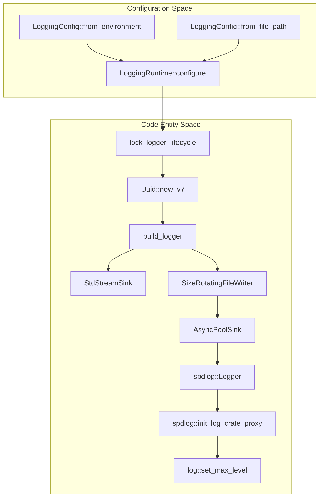
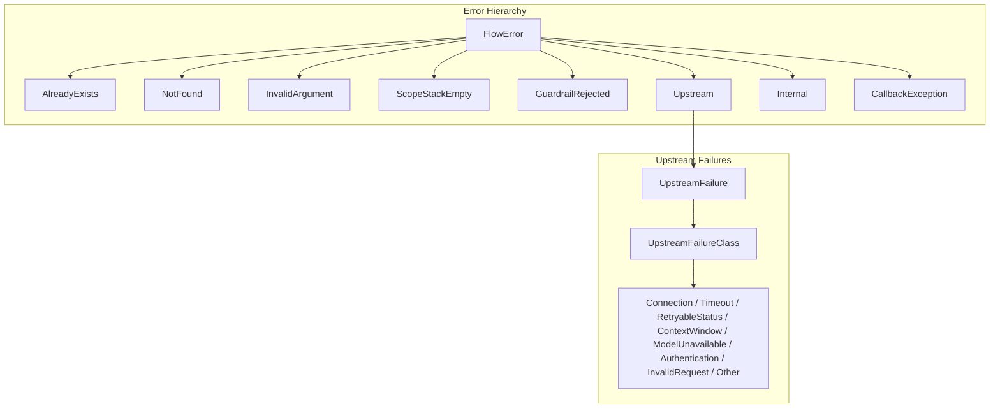

<!-- source: DeepWiki mcp.deepwiki.com · repo NVIDIA/NeMo-Relay · page 2.4 Operational Logging and Errors · fetched 2026-10-26 -->

# Operational Logging and Errors

<details>
<summary>Relevant source files</summary>

The following files were used as context for generating this wiki page:

- [crates/adaptive/src/error.rs](crates/adaptive/src/error.rs)
- [crates/adaptive/tests/coverage/error_tests.rs](crates/adaptive/tests/coverage/error_tests.rs)
- [crates/core/src/error.rs](crates/core/src/error.rs)
- [crates/core/src/logging/config.rs](crates/core/src/logging/config.rs)
- [crates/core/src/logging/mod.rs](crates/core/src/logging/mod.rs)
- [crates/core/src/logging/sink.rs](crates/core/src/logging/sink.rs)
- [crates/core/src/plugin/dynamic/manifest.rs](crates/core/src/plugin/dynamic/manifest.rs)
- [crates/core/tests/coverage/error_tests.rs](crates/core/tests/coverage/error_tests.rs)
- [crates/core/tests/coverage/logging_sink_tests.rs](crates/core/tests/coverage/logging_sink_tests.rs)
- [crates/core/tests/coverage/logging_tests.rs](crates/core/tests/coverage/logging_tests.rs)
- [crates/core/tests/unit/shared_tests.rs](crates/core/tests/unit/shared_tests.rs)
- [crates/ffi/src/error.rs](crates/ffi/src/error.rs)
- [crates/ffi/tests/coverage/error_tests.rs](crates/ffi/tests/coverage/error_tests.rs)
- [crates/node/tests/logging_tests.mjs](crates/node/tests/logging_tests.mjs)
- [docs/reference/operational-logging.mdx](docs/reference/operational-logging.mdx)
- [go/nemo_relay/logging_test.go](go/nemo_relay/logging_test.go)
- [python/tests/test_logging.py](python/tests/test_logging.py)

</details>


This page details the operational logging system within NeMo Relay, covering its configuration, various output sinks, file rotation mechanisms, and how log levels are managed across different language bindings. It also describes the error type hierarchy used throughout the codebase. Operational logging is distinct from agent observability features like ATOF, ATIF, OpenTelemetry, or OpenInference, focusing instead on diagnostics related to the Relay process itself, including startup, configuration, plugin management, gateway behavior, and runtime failures [docs/reference/operational-logging.mdx:9-12]().

## Logging Configuration

NeMo Relay's logging can be configured through several methods, with a clear precedence order for CLI processes:
1. CLI options (`--log-*` or `--log-config-path`)
2. Environment variables (`NEMO_RELAY_LOG*`)
3. `[logging]` section in the resolved `config.toml`
4. Built-in defaults [docs/reference/operational-logging.mdx:39-43]()

Language bindings (Python, Node.js, Go) typically install a process-lifetime `LoggingRuntime` [`crates/core/src/logging/mod.rs:99`] using environment configuration or built-in defaults when the binding loads [docs/reference/operational-logging.mdx:45-47](). Rust applications explicitly choose the `LoggingRuntime` initialization method [docs/reference/operational-logging.mdx:47-48]().

### Default Behavior

By default, NeMo Relay logs `error` level messages and above to `stderr` in a human-readable format, with no file sinks configured [docs/reference/operational-logging.mdx:22-25]().

### Configuration Sources

#### CLI Options

The `nemo-relay` CLI supports direct logging configuration:
* `--log-level <level>`: Sets the minimum log level (e.g., `debug`, `info`, `warn`, `error`, `trace`) [docs/reference/operational-logging.mdx:54]().
* `--log-stderr-format <format>`: Sets the `stderr` output format (e.g., `human`, `jsonl`) [docs/reference/operational-logging.mdx:54]().
* `--log-config-path <path>`: Specifies an absolute path to a TOML file for comprehensive logging configuration [docs/reference/operational-logging.mdx:59](). This option is mutually exclusive with `--log-level` and `--log-stderr-format` [docs/reference/operational-logging.mdx:64-65]().

#### Environment Variables

Logging can be controlled via environment variables, which are particularly useful for language bindings and CLI processes [docs/reference/operational-logging.mdx:68-71]():
* `NEMO_RELAY_LOG`: Sets the minimum log level [docs/reference/operational-logging.mdx:81]().
* `NEMO_RELAY_LOG_STDERR`: Enables or disables `stderr` output (`true` or `false`) [docs/reference/operational-logging.mdx:82]().
* `NEMO_RELAY_LOG_STDERR_FORMAT`: Sets the `stderr` output format (`human` or `jsonl`) [docs/reference/operational-logging.mdx:83]().
* `NEMO_RELAY_LOG_CONFIG_PATH`: Specifies an absolute path to a TOML configuration file [docs/reference/operational-logging.mdx:88](). This variable cannot be combined with the other `NEMO_RELAY_LOG` variables [docs/reference/operational-logging.mdx:90-91]().

If no logging environment variables are set, Python, Node.js, and Go bindings will install Relay's built-in default logger, unless the Rust `log` facade is already owned by another logger [docs/reference/operational-logging.mdx:94-98]().

#### TOML Configuration

A `[logging]` table in a TOML file provides comprehensive configuration options [docs/reference/operational-logging.mdx:111-112]().

```toml
[logging]
level = "info"
stderr_enabled = false
stderr_format = "human"
flush_interval_millis = 1000

[[logging.sinks]]
path = ".nemo-relay/logs/relay.log.jsonl"
format = "jsonl"
level = "debug"
queue_capacity = 1024
max_file_size_bytes = 10485760
retained_files = 5
```
[docs/reference/operational-logging.mdx:114-133]()

Key fields include:
* `level`: The process-wide minimum severity [docs/reference/operational-logging.mdx:116]().
* `stderr_enabled`: Whether to enable the `stderr` sink [docs/reference/operational-logging.mdx:117]().
* `stderr_format`: Format for `stderr` output [docs/reference/operational-logging.mdx:118]().
* `flush_interval_millis`: Periodic flush interval for file sinks (`0` disables periodic flushing) [docs/reference/operational-logging.mdx:119]().
* `sinks`: An array of file sink configurations [docs/reference/operational-logging.mdx:121]().
    * `path`: Absolute or relative path to the log file [docs/reference/operational-logging.mdx:122]().
    * `format`: Output format for the file sink [docs/reference/operational-logging.mdx:123]().
    * `level`: Minimum severity for this specific file sink [docs/reference/operational-logging.mdx:124]().
    * `queue_capacity`: Asynchronous queue capacity for the file sink. Cannot exceed `MAX_FILE_SINK_QUEUE_ENTRIES` (8,192) [crates/core/src/logging/config.rs:30-31](), [docs/reference/operational-logging.mdx:125]().
    * `max_file_size_bytes`: Maximum size of a log file before rotation. Requires `retained_files` [docs/reference/operational-logging.mdx:126]().
    * `retained_files`: Number of backup files to keep during rotation. Cannot exceed `MAX_FILE_SINK_RETAINED_FILES` (9) [crates/core/src/logging/config.rs:37](), [docs/reference/operational-logging.mdx:127]().

File sink paths are resolved relative to the process working directory [docs/reference/operational-logging.mdx:130](). When `config.toml` files are layered, distinct paths create separate sinks, while matching paths are merged [docs/reference/operational-logging.mdx:138-143]().

#### Rust Library API

Rust applications initialize logging programmatically using `LoggingRuntime` [`crates/core/src/logging/mod.rs:99`]:
* `LoggingRuntime::configure(config)` [`crates/core/src/logging/mod.rs:115`]
* `LoggingRuntime::configure_from_environment()` [`crates/core/src/logging/mod.rs:153`]
* `LoggingRuntime::configure_from_file_path(path)` [`crates/core/src/logging/mod.rs:148`]

```rust
let _logging_runtime =
    nemo_relay::logging::LoggingRuntime::configure_from_environment()?;
```
[docs/reference/operational-logging.mdx:158-160]()

Sources: [docs/reference/operational-logging.mdx:1-163](), [crates/core/src/logging/config.rs:30-37](), [crates/core/src/logging/mod.rs:99-153]()

---

### Logging Runtime and Sinks

The core logging functionality is managed by `LoggingRuntime` [`crates/core/src/logging/mod.rs:99`], which owns the `spdlog` logger instance and thread pools for asynchronous sinks [crates/core/src/logging/mod.rs:103-105]().

Diagram: Logging Initialization Flow

Sources: [crates/core/src/logging/mod.rs:115-144](), [crates/core/src/logging/sink.rs:23-165](), [crates/core/src/logging/config.rs:76-157]()

#### `LoggingRuntime` Structure and Lifecycle
`LoggingRuntime` [`crates/core/src/logging/mod.rs:99-105`] contains:
* `root_relay_id`: A unique string ID attached to all operational records [crates/core/src/logging/mod.rs:100]().
* `logger`: An `Arc<Logger>` instance [crates/core/src/logging/mod.rs:103]().
* `_thread_pools`: A vector of `Arc<ThreadPool>` instances keeping asynchronous sinks active [crates/core/src/logging/mod.rs:105]().

When dropped, `LoggingRuntime` flushes buffered sinks and detaches the logger from the global `log` facade [crates/core/src/logging/mod.rs:170-179]().

#### Size-Rotating File Writer
File sinks use `SizeRotatingFileWriter` [`crates/core/src/logging/rotation.rs:19`] when size-based rotation is configured. When active file size exceeds `max_file_size_bytes`, existing backups are rotated up to `retained_files` (max 9) [crates/core/src/logging/config.rs:37](). Individual records larger than the limit are kept intact rather than split [docs/reference/operational-logging.mdx:135-136]().

Sources: [crates/core/src/logging/mod.rs:99-179](), [crates/core/src/logging/sink.rs:23-165](), [crates/core/src/logging/rotation.rs:19]()

---

## Log Level Control and Binding Behavior

Log levels (`Error`, `Warn`, `Info`, `Debug`, `Trace`) are controlled process-wide and per-sink via `LogLevel` [`crates/core/src/logging/config.rs:162`]. The helper `log_level_filter` [`crates/core/src/logging/sink.rs:30`] maps levels to `spdlog::LevelFilter` and `log::LevelFilter`.

Binding-specific initialization and teardown:
* **Python**: Initializes on import using environment variables or defaults; drains file sinks during teardown [python/tests/test_logging.py:31-39](), [docs/reference/operational-logging.mdx:104-106]().
* **Node.js**: Initializes on import and flushes file sinks during environment cleanup [crates/node/tests/logging_tests.mjs:34-42](), [docs/reference/operational-logging.mdx:104-106]().
* **Go**: Applications configuring file sinks must explicitly call `nemo_relay.ShutdownLogging()` before `main` returns [go/nemo_relay/logging_test.go:39-42](), [docs/reference/operational-logging.mdx:106-109]().

Sources: [crates/core/src/logging/config.rs:162](), [crates/core/src/logging/sink.rs:30](), [python/tests/test_logging.py:31-78](), [crates/node/tests/logging_tests.mjs:34-88](), [go/nemo_relay/logging_test.go:39-135]()

---

## Error Type Hierarchy

NeMo Relay uses `FlowError` [`crates/core/src/error.rs:85`] as the central error type for all fallible runtime operations.

Diagram: `FlowError` and Upstream Mapping

Sources: [crates/core/src/error.rs:16-141]()

### `FlowError` Variants
* `AlreadyExists(String)`: Resource is already registered [crates/core/src/error.rs:93]().
* `NotFound(String)`: Requested resource or scope handle not found [crates/core/src/error.rs:99]().
* `InvalidArgument(String)`: Precondition violation or malformed parameter [crates/core/src/error.rs:107]().
* `ScopeStackEmpty`: Operation attempted on an empty scope stack [crates/core/src/error.rs:114]().
* `GuardrailRejected(String)`: Operation rejected by a conditional execution guardrail [crates/core/src/error.rs:122]().
* `Upstream(UpstreamFailure)`: Structured failure from an upstream provider attempt [crates/core/src/error.rs:127]().
* `Internal(String)`: Unexpected internal runtime error [crates/core/src/error.rs:131]().
* `CallbackException`: Exception raised by a language-binding callback [crates/core/src/error.rs:135-140]().

### OpenTelemetry Error Mapping
`FlowError` implements `otel_error_type()` [`crates/core/src/error.rs:153`] to map variants to stable low-cardinality strings for OpenTelemetry attributes (e.g., `already_exists`, `not_found`, `invalid_argument`, `guardrail_rejected`, `internal_error`, and upstream classes like `connection_error`, `timeout`, `context_window`) [crates/core/src/error.rs:153-172]().

Sources: [crates/core/src/error.rs:16-172](), [crates/core/tests/coverage/error_tests.rs:58-113]()

---

