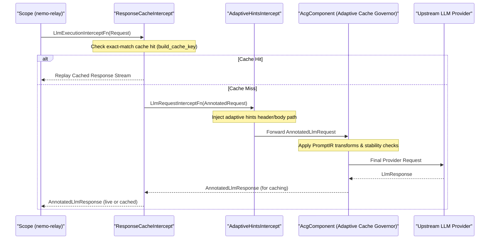
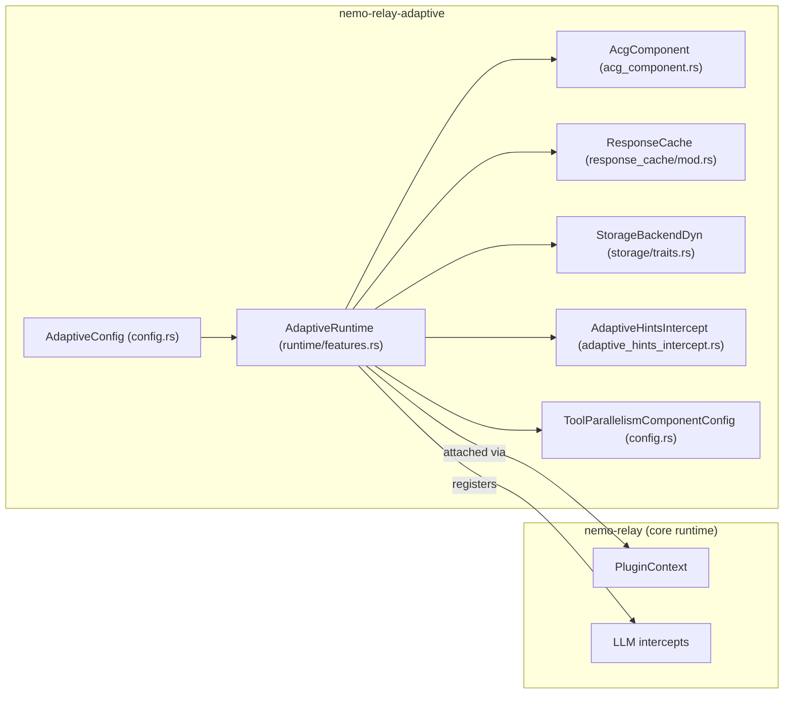

<!-- source: DeepWiki mcp.deepwiki.com · repo NVIDIA/NeMo-Relay · page 2.5 Adaptive Runtime (nemo-relay-adaptive) · fetched 2026-10-26 -->

# Adaptive Runtime (nemo-relay-adaptive)

Relevant source files

The following files were used as context for generating this wiki page:

- [crates/adaptive/Cargo.toml](crates/adaptive/Cargo.toml)
- [crates/adaptive/src/acg/ir_builder.rs](crates/adaptive/src/acg/ir_builder.rs)
- [crates/adaptive/src/acg_component.rs](crates/adaptive/src/acg_component.rs)
- [crates/adaptive/src/acg_profile.rs](crates/adaptive/src/acg_profile.rs)
- [crates/adaptive/src/config.rs](crates/adaptive/src/config.rs)
- [crates/adaptive/src/lib.rs](crates/adaptive/src/lib.rs)
- [crates/adaptive/src/response_cache/config.rs](crates/adaptive/src/response_cache/config.rs)
- [crates/adaptive/src/response_cache/intercept.rs](crates/adaptive/src/response_cache/intercept.rs)
- [crates/adaptive/src/response_cache/key.rs](crates/adaptive/src/response_cache/key.rs)
- [crates/adaptive/src/response_cache/mark.rs](crates/adaptive/src/response_cache/mark.rs)
- [crates/adaptive/src/response_cache/mod.rs](crates/adaptive/src/response_cache/mod.rs)
- [crates/adaptive/src/response_cache/tool.rs](crates/adaptive/src/response_cache/tool.rs)
- [crates/adaptive/src/runtime/features.rs](crates/adaptive/src/runtime/features.rs)
- [crates/adaptive/src/runtime/validation.rs](crates/adaptive/src/runtime/validation.rs)
- [crates/adaptive/src/subscriber.rs](crates/adaptive/src/subscriber.rs)
- [crates/adaptive/tests/coverage/subscriber_tests.rs](crates/adaptive/tests/coverage/subscriber_tests.rs)
- [crates/adaptive/tests/integration/acg_module_surface_tests.rs](crates/adaptive/tests/integration/acg_module_surface_tests.rs)
- [crates/adaptive/tests/integration/redis_tests.rs](crates/adaptive/tests/integration/redis_tests.rs)
- [crates/adaptive/tests/integration/response_cache_tests.rs](crates/adaptive/tests/integration/response_cache_tests.rs)
- [crates/adaptive/tests/integration/runtime_integration_tests.rs](crates/adaptive/tests/integration/runtime_integration_tests.rs)
- [crates/adaptive/tests/unit/acg/ir_builder_tests.rs](crates/adaptive/tests/unit/acg/ir_builder_tests.rs)
- [crates/adaptive/tests/unit/acg_component_tests.rs](crates/adaptive/tests/unit/acg_component_tests.rs)
- [crates/adaptive/tests/unit/acg_learner_tests.rs](crates/adaptive/tests/unit/acg_learner_tests.rs)
- [crates/adaptive/tests/unit/acg_profile_tests.rs](crates/adaptive/tests/unit/acg_profile_tests.rs)
- [crates/adaptive/tests/unit/cache_diagnostics_tests.rs](crates/adaptive/tests/unit/cache_diagnostics_tests.rs)
- [crates/adaptive/tests/unit/config_tests.rs](crates/adaptive/tests/unit/config_tests.rs)
- [crates/adaptive/tests/unit/plugin_component_tests.rs](crates/adaptive/tests/unit/plugin_component_tests.rs)
- [crates/adaptive/tests/unit/response_cache/intercept_tests.rs](crates/adaptive/tests/unit/response_cache/intercept_tests.rs)
- [crates/adaptive/tests/unit/response_cache/key_tests.rs](crates/adaptive/tests/unit/response_cache/key_tests.rs)
- [crates/adaptive/tests/unit/response_cache/mark_tests.rs](crates/adaptive/tests/unit/response_cache/mark_tests.rs)
- [crates/adaptive/tests/unit/response_cache/store_tests.rs](crates/adaptive/tests/unit/response_cache/store_tests.rs)
- [crates/adaptive/tests/unit/runtime_features_tests.rs](crates/adaptive/tests/unit/runtime_features_tests.rs)
- [crates/adaptive/tests/unit/runtime_tests.rs](crates/adaptive/tests/unit/runtime_tests.rs)
- [crates/node/Cargo.toml](crates/node/Cargo.toml)
- [crates/node/adaptive.d.ts](crates/node/adaptive.d.ts)
- [crates/node/adaptive.js](crates/node/adaptive.js)
- [crates/python/Cargo.toml](crates/python/Cargo.toml)
- [docs/configure-plugins/adaptive/about.mdx](docs/configure-plugins/adaptive/about.mdx)
- [docs/configure-plugins/adaptive/configuration.mdx](docs/configure-plugins/adaptive/configuration.mdx)
- [docs/configure-plugins/adaptive/response-cache.mdx](docs/configure-plugins/adaptive/response-cache.mdx)
- [go/nemo_relay/adaptive_runtime_test.go](go/nemo_relay/adaptive_runtime_test.go)

The Adaptive Runtime is a first-party plugin component (`kind: adaptive`) in NeMo Relay that enables runtime signal collection and activation of adaptive behaviors. It leverages the core runtime's scope and event system to observe agent trajectories and apply optimizations including prompt cache planning (Adaptive Cache Governor), tool parallelism, and exact-match LLM response caching.

This page covers the detailed implementation of the `nemo-relay-adaptive` crate, focusing on configuration, state backends, learners, adaptive hints, the Adaptive Cache Governor (ACG), PromptIR, response cache components, and rollout policies.

---

## Architecture and Data Flow

The adaptive crate primarily acts as middleware intercepts, event subscribers, and stateful runtime components. It maintains a pluggable state backend used by learners and adaptive intercepts to persist learned signals.

### Natural Language to Code Entity Mapping

The following diagram maps important adaptive runtime concepts to the corresponding code entities in `nemo-relay-adaptive`:

```mermaid
graph TD
    subgraph "NaturalLanguageSpace" ["Natural Language Space"]
        Learner["Learner"]
        AdaptiveState["Adaptive State Backend"]
        Optimization["Adaptive Optimizations"]
        PromptPlanning["Prompt Planning and IR"]
        ResponseCache["LLM Response Caching"]
    end

    subgraph "CodeEntitySpace" ["Code Entity Space (nemo-relay-adaptive)"]
        AcgLearner["acg_learner::AcgLearner"]
        StorageBackendDyn["storage::traits::StorageBackendDyn"]
        InMemoryBackend["storage::in_memory::InMemoryBackend"]
        RedisBackend["storage::redis::RedisBackend"]
        AdaptiveHintsIntercept["adaptive_hints_intercept::AdaptiveHintsIntercept"]
        ToolParallelismConfig["config::ToolParallelismComponentConfig"]
        AcgComponentConfig["config::AcgComponentConfig"]
        PromptIR["acg::ir_builder::PromptIR"]
        ResponseCacheConfig["response_cache::config::ResponseCacheConfig"]
        ResponseCacheIntercept["response_cache::intercept::ResponseCacheIntercept"]
        HotCache["types::cache::HotCache"]
    end

    Learner --- AcgLearner
    AdaptiveState --- StorageBackendDyn
    AdaptiveState --- InMemoryBackend
    AdaptiveState --- RedisBackend
    Optimization --- AdaptiveHintsIntercept
    Optimization --- ToolParallelismConfig
    PromptPlanning --- AcgComponentConfig
    PromptPlanning --- PromptIR
    ResponseCache --- ResponseCacheConfig
    ResponseCache --- ResponseCacheIntercept
    ResponseCache --- HotCache
```

Sources:  
[crates/adaptive/src/config.rs:13-44](), [crates/adaptive/src/acg_component.rs:38-40](), [crates/adaptive/src/storage/traits.rs:1-20](), [docs/configure-plugins/adaptive/configuration.mdx:23-51]()

---

### Adaptive Execution Data Flow

Adaptive intercepts are installed in the managed execution pipeline during plugin initialization. The flow for an LLM call with adaptive features enabled resembles:

Sources:  
[docs/configure-plugins/adaptive/response-cache.mdx:10-24](), [crates/adaptive/src/acg_component.rs:26-35](), [crates/adaptive/src/response_cache/intercept.rs:10-50](), [crates/adaptive/src/config.rs:118-133]()

---

## Adaptive Configuration (`AdaptiveConfig`)

The `AdaptiveConfig` struct is the canonical configuration for the adaptive plugin component. It controls which adaptive features and learners are active and how.

| Field | Type | Description |
|---|---|---|
| `version` | `u32` | Schema version (defaults to `1`). |
| `agent_id` | `Option<String>` | Fallback agent ID used when no Agent scope is active. Scoped runtime calls use the active Agent scope name instead. [crates/adaptive/src/config.rs:18-21]() |
| `state` | `Option<StateConfig>` | Shared state backend configuration. [crates/adaptive/src/config.rs:23-24]() |
| `telemetry` | `Option<TelemetryComponentConfig>` | Built-in adaptive telemetry settings. [crates/adaptive/src/config.rs:26-27]() |
| `adaptive_hints` | `Option<AdaptiveHintsComponentConfig>` | Built-in LLM hint injection settings. [crates/adaptive/src/config.rs:29-30]() |
| `tool_parallelism` | `Option<ToolParallelismComponentConfig>` | Built-in tool scheduling settings. [crates/adaptive/src/config.rs:32-33]() |
| `acg` | `Option<AcgComponentConfig>` | Adaptive Cache Governor settings. [crates/adaptive/src/config.rs:35-36]() |
| `response_cache` | `Option<ResponseCacheConfig>` | Opt-in LLM response and tool-result cache. When present, the adaptive plugin installs the response-cache execution intercept(s). [crates/adaptive/src/config.rs:38-41]() |
| `policy` | `ConfigPolicy` | Adaptive-local unsupported-config policy. [crates/adaptive/src/config.rs:43-44]() |

The config uses Serde for serialization and deserialization with sensible defaults.

Sources:  
[crates/adaptive/src/config.rs:13-44](), [docs/configure-plugins/adaptive/configuration.mdx:23-51]()

---

## State Backends

Adaptive features requiring persistent storage use the `StorageBackendDyn` trait abstraction and select a backend based on `BackendSpec` in the `state` section of `AdaptiveConfig`.

- **In-Memory Backend**: Provided primarily for ephemeral local use and tests. Created by default with no config. Not durable across process restarts.  
  Factory method: `BackendSpec::in_memory()` creates a spec with `"kind": "in_memory"`. [crates/adaptive/src/config.rs:86-92]()

- **Redis Backend**: Durable, shared state backend leveraging Redis, enabled via the `redis-backend` feature flag.  
  Created with `BackendSpec::redis(url, key_prefix)` specifying connection URL and optional key prefix (default `"nemo_relay:"`). [crates/adaptive/src/config.rs:94-104]()

Sources:  
[crates/adaptive/src/config.rs:70-105](), [crates/adaptive/tests/unit/config_tests.rs:56-102]()

---

## Learners

The adaptive runtime features pluggable learners that process telemetry and execution events to tune runtime behavior.
- **Latency Sensitivity Learner**: Analyzes request and response metrics to adapt latency sensitivity thresholds dynamically (`LatencySensitivityLearner`). [crates/adaptive/src/learner/latency.jl:1-30](), [crates/adaptive/src/runtime/features.rs:43-44]()
- **Tool Parallelism Learner**: Evaluates tool-call traces to recommend scheduling adjustments or parallel groups (`ToolParallelismLearner`). [crates/adaptive/src/tool_parallelism_learner.rs:1-30](), [crates/adaptive/src/runtime/features.rs:52]()
- **Learner Registration**: Learners are activated by listing their identifiers inside `telemetry.learners` in `AdaptiveConfig`. [crates/adaptive/src/config.rs:107-116]()

Sources:  
[crates/adaptive/src/config.rs:107-116](), [crates/adaptive/src/runtime/features.rs:43-52]()

---

## Adaptive Hints Intercept

The `AdaptiveHintsIntercept` is a request-level middleware intercept responsible for injecting optimization hints into LLM execution payloads.

- **Configuration**: Governed by `AdaptiveHintsComponentConfig`, which sets intercept `priority` (default `100`), `break_chain` flags, `inject_header` toggles, and `inject_body_path` (default `"nvext.agent_hints"`). [crates/adaptive/src/config.rs:119-144]()
- **Operation**: It decorates incoming or translated request payloads with metadata headers (`x-nemo-relay-agent-hints`) or JSON fields so that downstream providers or proxies can alter behavior.

Sources:  
[crates/adaptive/src/config.rs:119-144](), [crates/adaptive/src/adaptive_hints_intercept.rs:1-10]()

---

## Adaptive Cache Governor (ACG) and PromptIR

The Adaptive Cache Governor is a built-in adaptive runtime component responsible for intelligent request prefix stability learning, hint injection, and cache policy rollout.

- **PromptIR**: A concise intermediate representation of an LLM request prompt, breaking down the input into a sequence of `PromptBlock`s, each annotated by role (System, User, Assistant) and message content. This enables precise reasoning about prompt stability and cache breakpoints. [crates/adaptive/src/acg/ir_builder.rs:1-10]()
- **Stability Thresholds**: Configured by `StabilityThresholds` nested inside `AcgComponentConfig`, this defines cutoffs for classifying prompts as stable, semi-stable, or unstable based on observed runtime signals. [crates/adaptive/src/config.rs:178-181]()
- **Provider Plugins**: To support different LLM providers (e.g., Anthropic, OpenAI), ACG has provider-specific modules that translate cache intent into intercepted request forms suitable for that provider. [crates/adaptive/src/acg_component.rs:73-85]()
- **Fingerprinting Gate**: To avoid harmful or unsafe preemptive cache hits, the ACG computes and compares a `stable_prefix_fingerprint` of the request prefix. If the fingerprint mismatches a known stability profile, the system skips injection and marks that event as skipped telemetry (`build_intent_bundle_skipped`). [crates/adaptive/src/acg_component.rs:156-182]()

Sources:  
[crates/adaptive/src/acg_component.rs:109-182](), [crates/adaptive/src/config.rs:167-181](), [docs/configure-plugins/adaptive/configuration.mdx:84-93]()

---

## Response Cache

The response cache provides exact-match caching for managed LLM calls and optionally tool results, identifying cached responses by normalized request fingerprints.

- **Cache Key Derivation**: The `build_cache_key` function derives a fingerprint key from LLM requests by normalizing, canonicalizing, and removing non-answer-determining noise fields (e.g., `user`, `stream`, `metadata`, `store`). It normalizes tool-call IDs and includes allowlisted HTTP headers and Relay routing headers in the key. Field order and formatting variance do not affect the fingerprint. [crates/adaptive/src/response_cache/key.rs:50-118]()
- **Eligibility and Bypass**: By default, only deterministic requests (`temperature=0`) are cacheable unless `cache_nondeterministic = true`. Requests with stateful flags (e.g., `store`, `conversation`) bypass the cache to maintain correctness. Namespace boundaries identify trusted cache-sharing domains required for multi-tenant safety. [docs/configure-plugins/adaptive/response-cache.mdx:10-48]()
- **Store and Replay**: The response cache store manages entry storage, TTL enforcement, and stream chunk buffering or stream reconstruction (`response_cache::store`). [crates/adaptive/src/response_cache/store.rs:1-50]()
- **Marks**: Cache activities emit specific `CacheReason` marks and telemetry events to audit hits, misses, and bypasses (`response_cache::mark`). [crates/adaptive/src/response_cache/mark.rs:1-40]()

Sources:  
[docs/configure-plugins/adaptive/response-cache.mdx:10-48](), [crates/adaptive/src/response_cache/key.rs:50-118](), [crates/adaptive/src/response_cache/config.rs:4-120]()

---

## Rollout Policies

Adaptive config includes the `ConfigPolicy` field to specify behavior on unsupported config components and rollout strategies. Rollout decisions and hint injections are governed by learned stability stats and configurable thresholds.

Sources:  
[crates/adaptive/src/config.rs:43-44]()

---

## Summary Diagram: Component Interactions in Code

Sources:  
[crates/adaptive/src/config.rs:13-44](), [crates/adaptive/src/runtime/features.rs:57-77](), [crates/adaptive/src/acg_component.rs:26-35](), [crates/adaptive/src/response_cache/mod.rs:1-10](), [crates/adaptive/src/storage/traits.rs:1-20](), [crates/adaptive/src/adaptive_hints_intercept.rs:1-10](), [crates/adaptive/src/config.rs:147-155]()

---

## References to Source Files

- Adaptive configuration and defaults: [crates/adaptive/src/config.rs:13-210]()
- State backend specs: [crates/adaptive/src/config.rs:70-105]()
- Response cache backend and keying: [crates/adaptive/src/response_cache/config.rs:1-120](), [crates/adaptive/src/response_cache/key.rs:50-118]()
- Adaptive Cache Governor: [crates/adaptive/src/acg_component.rs:109-182]()
- Adaptive hints request intercept: [crates/adaptive/src/adaptive_hints_intercept.rs:1-10]()
- Tool parallelism config and learner: [crates/adaptive/src/config.rs:147-155]()
- Plugin initialization and runtime features: [crates/adaptive/src/runtime/features.rs:20-75]()

---

