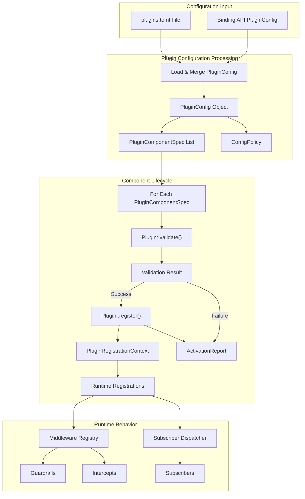
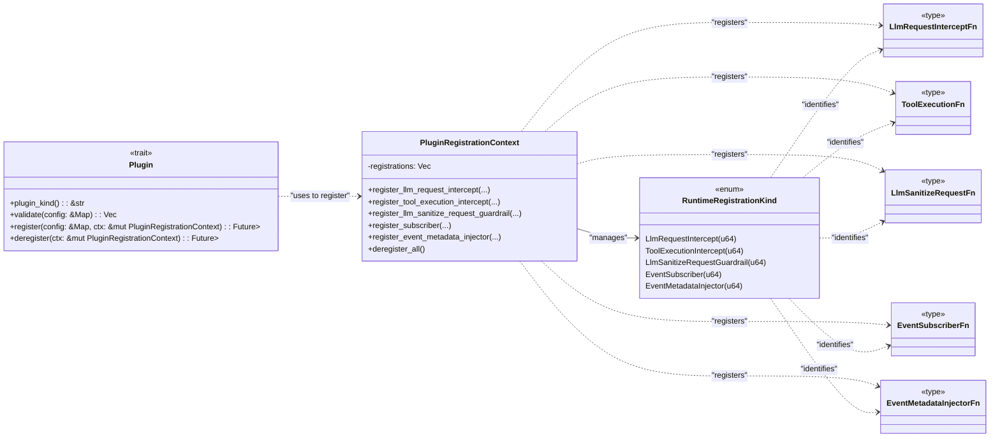

<!-- source: DeepWiki mcp.deepwiki.com · repo NVIDIA/NeMo-Relay · page 3.1 Plugin Registration and Configuration · fetched 2026-10-26 -->

# Plugin Registration and Configuration

<details>
<summary>Relevant source files</summary>

The following files were used as context for generating this wiki page:

- [crates/cli/src/events/mod.rs](crates/cli/src/events/mod.rs)
- [crates/cli/tests/coverage/shared/events_tests.rs](crates/cli/tests/coverage/shared/events_tests.rs)
- [crates/core/src/api/registry.rs](crates/core/src/api/registry.rs)
- [crates/core/src/api/runtime/callbacks.rs](crates/core/src/api/runtime/callbacks.rs)
- [crates/core/src/api/skill_load.rs](crates/core/src/api/skill_load.rs)
- [crates/core/src/context/registries.rs](crates/core/src/context/registries.rs)
- [crates/core/src/plugin.rs](crates/core/src/plugin.rs)
- [crates/core/src/plugin/dynamic/host.rs](crates/core/src/plugin/dynamic/host.rs)
- [crates/core/src/plugins/model_pricing.rs](crates/core/src/plugins/model_pricing.rs)
- [crates/core/tests/integration/api_surface_tests.rs](crates/core/tests/integration/api_surface_tests.rs)
- [crates/core/tests/integration/scope_local_tests.rs](crates/core/tests/integration/scope_local_tests.rs)
- [crates/core/tests/unit/plugin_dynamic_host_tests.rs](crates/core/tests/unit/plugin_dynamic_host_tests.rs)
- [crates/core/tests/unit/plugin_tests.rs](crates/core/tests/unit/plugin_tests.rs)
- [crates/core/tests/unit/plugins/nemo_guardrails/local_python_tests.rs](crates/core/tests/unit/plugins/nemo_guardrails/local_python_tests.rs)
- [crates/core/tests/unit/skill_load_tests.rs](crates/core/tests/unit/skill_load_tests.rs)
- [crates/plugin/src/lib.rs](crates/plugin/src/lib.rs)
- [crates/plugin/tests/typed_callbacks.rs](crates/plugin/tests/typed_callbacks.rs)
- [docs/about-nemo-relay/concepts/conditional-middleware-guardrails.mdx](docs/about-nemo-relay/concepts/conditional-middleware-guardrails.mdx)
- [docs/configure-plugins/plugin-configuration-files.mdx](docs/configure-plugins/plugin-configuration-files.mdx)
- [go/nemo_relay/scope/error_coverage_test.go](go/nemo_relay/scope/error_coverage_test.go)

</details>


## Purpose and Scope

This page details the NeMo Relay plugin system's core components and mechanisms for registration and configuration. It covers the `Plugin` trait, `PluginConfig` structure, `PluginComponentSpec`, `PluginContext`, activation reports, configuration validation, the configuration editor, and the discovery and merging behavior of `plugins.toml` files.

Sources:
* [crates/core/src/plugin.rs:4-11]()
* [docs/configure-plugins/plugin-configuration-files.mdx:10-20]()

## The Plugin Trait

The `Plugin` trait is the fundamental interface for all plugins in NeMo Relay. It defines the contract that any plugin must implement to be recognized and activated by the runtime.

```rust
pub trait Plugin: Send + Sync + 'static {
    /// Returns the canonical kind string for this plugin.
    fn plugin_kind(&self) -> &str;

    /// Validates the provided plugin configuration.
    fn validate(&self, plugin_config: &Map<String, Json>) -> Vec<ConfigDiagnostic>;

    /// Registers the plugin's runtime behavior.
    fn register<'a>(
        &'a self,
        plugin_config: &Map<String, Json>,
        ctx: &'a mut PluginRegistrationContext,
    ) -> Pin<Box<dyn Future<Output = Result<()>> + Send + 'a>>;

    /// Deregisters the plugin's runtime behavior.
    fn deregister<'a>(
        &'a self,
        ctx: &'a mut PluginRegistrationContext,
    ) -> Pin<Box<dyn Future<Output = Result<()>> + Send + 'a>>;
}
```

The key methods of the `Plugin` trait are:
*   `plugin_kind()`: Returns a unique string identifier for the plugin type [crates/core/src/plugin.rs:177-179]().
*   `validate()`: Performs structural and semantic checks on the plugin's configuration, returning a list of `ConfigDiagnostic`s [crates/core/src/plugin.rs:181-190](). This happens before any activation.
*   `register()`: Activates the plugin's runtime behavior. This method receives the plugin's configuration and a `PluginRegistrationContext` to register middleware, subscribers, and other runtime components [crates/core/src/plugin.rs:192-207]().
*   `deregister()`: Cleans up any runtime behavior registered by the plugin. This is crucial for proper shutdown and resource management.

Sources:
* [crates/core/src/plugin.rs:58-60]()
* [crates/core/src/plugin.rs:177-179]()
* [crates/core/src/plugin.rs:181-190]()
* [crates/core/src/plugin.rs:192-207]()

## PluginConfig

The `PluginConfig` struct is the canonical representation of a plugin configuration document. It defines the overall structure for configuring one or more plugin components.

```rust
#[derive(Debug, Clone, Serialize, Deserialize)]
#[cfg_attr(feature = "schema", derive(schemars::JsonSchema))]
pub struct PluginConfig {
    /// Plugin config schema version.
    #[serde(default = "default_plugin_config_version")]
    pub version: u32,
    /// Ordered list of top-level plugin components to validate and activate.
    #[serde(default)]
    pub components: Vec<PluginComponentSpec>,
    /// Plugin-level policy for unsupported plugin kinds, fields, and values.
    ///
    /// Non-default field values override the corresponding component policy.
    #[serde(default)]
    pub policy: ConfigPolicy,
}
```

A `PluginConfig` consists of:
*   `version`: The schema version of the plugin configuration [crates/core/src/plugin.rs:143-144]().
*   `components`: A list of `PluginComponentSpec`s, each defining a specific plugin instance to be activated [crates/core/src/plugin.rs:146-147]().
*   `policy`: A `ConfigPolicy` that dictates how the plugin system handles unsupported configurations, such as unknown components or fields [crates/core/src/plugin.rs:149-153]().

Sources:
* [crates/core/src/plugin.rs:139-153]()
* [crates/core/src/plugin.rs:143-144]()
* [crates/core/src/plugin.rs:146-147]()
* [crates/core/src/plugin.rs:149-153]()

## PluginComponentSpec

The `PluginComponentSpec` struct describes a single plugin component within a `PluginConfig`.

```rust
#[derive(Debug, Clone, Serialize, Deserialize)]
#[cfg_attr(feature = "schema", derive(schemars::JsonSchema))]
pub struct PluginComponentSpec {
    /// Registered plugin kind string.
    pub kind: String,
    /// Whether the component should be activated.
    pub enabled: bool,
    /// Component-local configuration object.
    pub config: Map<String, Json>,
}
```

Key fields include:
*   `kind`: The registered string identifier for the plugin type (e.g., `observability`, `adaptive`) [crates/core/src/plugin.rs:169-170]().
*   `enabled`: A boolean indicating whether the component should be activated. Even if `false`, the component's configuration is still validated [crates/core/src/plugin.rs:171-172]().
*   `config`: A JSON object containing the component-specific configuration [docs/configure-plugins/plugin-configuration-files.mdx:130]().

Sources:
* [crates/core/src/plugin.rs:166-172]()
* [docs/configure-plugins/plugin-configuration-files.mdx:130]()

## PluginContext

The `PluginRegistrationContext` is the API provided to plugins during their `register()` and `deregister()` methods [crates/core/src/plugin.rs:192-207](). It allows plugins to interact with the NeMo Relay runtime and install or remove various runtime behaviors.

Plugins use the `PluginRegistrationContext` to:
*   Register LLM request intercepts [crates/core/src/plugin.rs:198-207]().
*   Register LLM execution intercepts [crates/core/src/plugin.rs:32]().
*   Register tool request intercepts [crates/core/src/plugin.rs:33]().
*   Register tool execution intercepts [crates/core/src/plugin.rs:32]().
*   Register various guardrails (e.g., `llm_sanitize_request_guardrail`, `tool_conditional_execution_guardrail`) [crates/core/src/plugin.rs:28-42]().
*   Register event subscribers [crates/core/src/plugin.rs:50]().
*   Register event metadata injectors [crates/core/src/plugin.rs:45]().

Each registration method in `PluginRegistrationContext` returns a unique `RuntimeRegistrationKind` [crates/core/src/plugin.rs:26](), which is then used by the `deregister()` methods to clean up specific registrations.

Sources:
* [crates/core/src/plugin.rs:26-43]()
* [crates/core/src/plugin.rs:45-50]()
* [crates/core/src/plugin.rs:192-207]()

## Activation Reports

An `ActivationReport` provides structured diagnostics about the outcome of plugin validation and activation [docs/resources/glossary.mdx:43-46](). It distinguishes between configuration problems and runtime behavior issues.

The report includes:
*   `diagnostics`: A list of `ConfigDiagnostic`s, which can be warnings or errors related to the configuration itself [crates/core/src/plugin.rs:146-155]().
*   `runtime_diagnostics`: Diagnostics specifically from the runtime during activation.

The `has_errors()` method on `ConfigReport` indicates if any errors were found during validation or activation [crates/core/tests/unit/plugin_tests.rs:145]().

Sources:
* [crates/core/src/plugin.rs:146-155]()
* [crates/core/tests/unit/plugin_tests.rs:145]()

## Configuration Validation

Plugin configuration undergoes a two-stage validation process:
1.  **Static Validation**: The `validate()` method of each `Plugin` implementation is called with its specific configuration [crates/core/src/plugin.rs:181-190](). This checks the structural and semantic correctness of the component's `config` object.
2.  **Policy-based Validation**: The global `ConfigPolicy` and component-specific policies determine how to handle unknown fields, unsupported values, or unrecognized plugin kinds [crates/core/src/plugin.rs:149-153](). This allows for flexible error handling, from warnings to hard errors [crates/core/tests/unit/plugin_tests.rs:158-167]().

The `ConfigDiagnostic` struct captures validation issues, including their `DiagnosticLevel` (Warning or Error), a `code`, and a `message` [crates/core/src/plugin.rs:51]().

Sources:
* [crates/core/src/plugin.rs:51]()
* [crates/core/src/plugin.rs:149-153]()
* [crates/core/src/plugin.rs:181-190]()
* [crates/core/tests/unit/plugin_tests.rs:158-167]()

## Configuration Editor

The NeMo Relay CLI provides an interactive configuration editor for `plugins.toml` files. This editor leverages static metadata defined by the `EditorConfig` trait and associated structs like `EditorFieldSpec` and `EditorSchema` [crates/core/src/config_editor.rs:44-66]() [crates/core/src/config_editor.rs:146-150]() [crates/core/src/config_editor.rs:160-162]().

The `editor_config!` macro is used to define this metadata directly within the Rust configuration structs, ensuring that the editor's understanding of the configuration is always in sync with the code [crates/core/src/config_editor.rs:170-194]().

The editor supports various field kinds, including `Boolean`, `String`, `Integer`, `Enum`, `List`, `Map`, `Section`, and `TaggedUnion` [crates/core/src/config_editor.rs:13-41](). This allows the CLI to present a user-friendly interface for modifying complex plugin configurations.

Sources:
* [crates/core/src/config_editor.rs:13-41]()
* [crates/core/src/config_editor.rs:44-66]()
* [crates/core/src/config_editor.rs:146-150]()
* [crates/core/src/config_editor.rs:160-162]()
* [crates/core/src/config_editor.rs:170-194]()

## `plugins.toml` Discovery and Merge Behavior

The `plugins.toml` file is the primary mechanism for configuring plugins from a file [docs/configure-plugins/plugin-configuration-files.mdx:10-14](). NeMo Relay discovers and layers these files for direct Rust, Python, and Node.js integrations, as well as for the `nemo-relay` CLI gateway.

### Discovery Locations and Precedence

The runtime searches for `plugins.toml` in several locations, with a defined precedence:
1.  **Explicit Path**: If an explicit path is provided (e.g., via `--config` in the CLI), that file is used [docs/configure-plugins/plugin-configuration-files.mdx:64-68]().
2.  **User Configuration Directory**: The user's XDG configuration directory (e.g., `~/.config/nemo-relay/plugins.toml` on Linux) [docs/configure-plugins/plugin-configuration-files.mdx:75]().
3.  **System Configuration Directory**: A system-wide configuration directory (e.g., `/etc/xdg/nemo-relay/plugins.toml` on Linux).

### Merge Behavior

When multiple `plugins.toml` files are discovered, their contents are merged. The merge strategy prioritizes configurations from higher-precedence files. For `components`, the order in the `plugins.toml` file is significant [crates/core/src/plugin.rs:146-147]().

### Dynamic Plugin Records

`plugins.toml` can also contain `[[plugins.dynamic]]` sections to configure dynamic plugins (native shared libraries or gRPC worker plugins) [docs/configure-plugins/plugin-configuration-files.mdx:145-146](). These records specify the `manifest` file for the dynamic plugin and optional `config` specific to that dynamic plugin instance [docs/configure-plugins/plugin-configuration-files.mdx:147-153]().

Sources:
* [crates/core/src/plugin.rs:146-147]()
* [docs/configure-plugins/plugin-configuration-files.mdx:10-14]()
* [docs/configure-plugins/plugin-configuration-files.mdx:64-68]()
* [docs/configure-plugins/plugin-configuration-files.mdx:75]()
* [docs/configure-plugins/plugin-configuration-files.mdx:145-153]()

## Plugin System Architecture and Flows

### Diagram: Plugin Configuration and Activation Flow



Sources:
* [crates/core/src/plugin.rs:139-153]()
* [crates/core/src/plugin.rs:166-172]()
* [crates/core/src/plugin.rs:181-190]()
* [crates/core/src/plugin.rs:192-207]()

### Diagram: Plugin Trait and Registration Context Code Entity Mapping



Sources:
* [crates/core/src/plugin.rs:26-43]()
* [crates/core/src/plugin.rs:45-50]()
* [crates/core/src/plugin.rs:58-60]()

---

