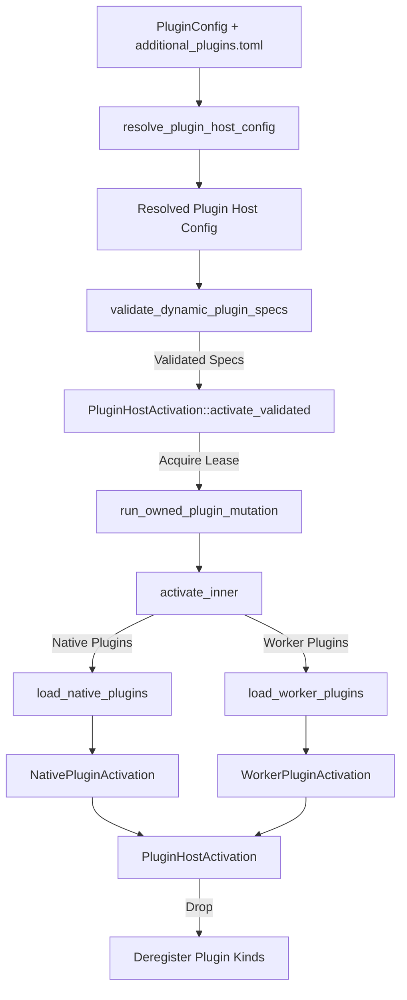
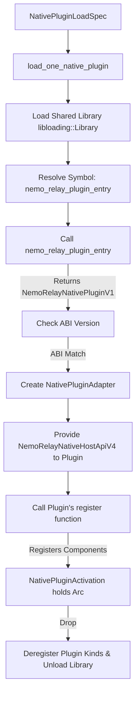

<!-- source: DeepWiki mcp.deepwiki.com · repo NVIDIA/NeMo-Relay · page 3.2 Dynamic Plugins (Native) · fetched 2026-10-26 -->

# Dynamic Plugins (Native)

Relevant source files

The following files were used as context for generating this wiki page:

- [ATTRIBUTIONS-Rust.md](ATTRIBUTIONS-Rust.md)
- [Cargo.lock](Cargo.lock)
- [about.toml](about.toml)
- [crates/cli/Cargo.toml](crates/cli/Cargo.toml)
- [crates/cli/src/plugins/lifecycle/responses.rs](crates/cli/src/plugins/lifecycle/responses.rs)
- [crates/core/Cargo.toml](crates/core/Cargo.toml)
- [crates/core/src/plugin/dynamic.rs](crates/core/src/plugin/dynamic.rs)
- [crates/core/src/plugin/dynamic/native.rs](crates/core/src/plugin/dynamic/native.rs)
- [crates/core/src/plugin/dynamic/registry.rs](crates/core/src/plugin/dynamic/registry.rs)
- [crates/core/tests/fixtures/native_plugin/src/lib.rs](crates/core/tests/fixtures/native_plugin/src/lib.rs)
- [crates/core/tests/integration/native_plugin_tests.rs](crates/core/tests/integration/native_plugin_tests.rs)
- [crates/core/tests/unit/native_plugin_tests.rs](crates/core/tests/unit/native_plugin_tests.rs)
- [crates/core/tests/unit/plugin_dynamic_tests.rs](crates/core/tests/unit/plugin_dynamic_tests.rs)
- [crates/plugin/src/async_sdk.rs](crates/plugin/src/async_sdk.rs)
- [crates/plugin/tests/unit/async_sdk_tests.rs](crates/plugin/tests/unit/async_sdk_tests.rs)
- [crates/types/src/codec/identity.rs](crates/types/src/codec/identity.rs)
- [crates/types/src/codec/mod.rs](crates/types/src/codec/mod.rs)
- [crates/types/tests/codec_identity_tests.rs](crates/types/tests/codec_identity_tests.rs)
- [crates/worker/tests/unit/codec_identity_tests.rs](crates/worker/tests/unit/codec_identity_tests.rs)
- [deny.toml](deny.toml)

Purpose and scope: This page details the implementation of native dynamic plugins within NeMo Relay. It covers the `DynamicPluginRecord` control plane, `relay-plugin.toml` manifests, compatibility contracts, attestation modes, startup classes, the reconciliation process between the registry and the host, and the in-process loading of native shared libraries.

## DynamicPluginRecord Control Plane

The `DynamicPluginRecord` [crates/core/tests/unit/plugin_dynamic_tests.rs:23-74]() is the canonical identifier for a dynamic plugin. It encapsulates all metadata, source information, specification, compatibility, load contract, and runtime status of a dynamic plugin. This record is central to how NeMo Relay manages and tracks dynamic plugins throughout their lifecycle.

The `DynamicPluginRecord` includes:
*   `metadata`: Basic information like `id`, `name`, `version`, `kind` (e.g., `Native` or `Worker`), `generation`, and timestamps. [crates/core/tests/unit/plugin_dynamic_tests.rs:24-32]()
*   `source`: Details about where the plugin artifacts are located, including `manifest_ref`, `artifact_ref`, `environment_ref`, and `artifact_digest`. [crates/core/tests/unit/plugin_dynamic_tests.rs:33-37]()
*   `spec`: User-defined configuration for the plugin, such as `present`, `enabled`, and `config_ref`. [crates/core/tests/unit/plugin_dynamic_tests.rs:38-41]()
*   `compatibility`: Defines the compatibility requirements of the plugin with the Relay runtime, specific to its `kind`. For native plugins, this is `DynamicPluginRustCompatibility`. [crates/core/src/plugin/dynamic.rs:16-17]()
*   `load`: Specifies how the plugin should be loaded and executed. For native plugins, this is `DynamicPluginNativeLoadContract`. [crates/core/src/plugin/dynamic.rs:16-17]()
*   `status`: Tracks the current validation and runtime state of the plugin, including `validation` checks (manifest, compatibility, integrity, environment, authenticity, policy) and `runtime` state (running, stopped, observed generation). [crates/core/tests/unit/plugin_dynamic_tests.rs:52-73]()

The `DynamicPluginRegistry` [crates/core/tests/unit/plugin_dynamic_tests.rs:129-130]() manages these records, allowing for addition, listing, and reconciliation of dynamic plugins. It ensures that only one live plugin with a given ID is registered at a time [crates/core/tests/unit/plugin_dynamic_tests.rs:141-155]().

### DynamicPluginRecord Structure

```mermaid
graph TD
    A["DynamicPluginRecord"] --> B["metadata: DynamicPluginMetadata"]
    A --> C["source: DynamicPluginSource"]
    A --> D["spec: DynamicPluginSpec"]
    A --> E["compatibility: DynamicPluginCompatibility"]
    A --> F["load: DynamicPluginLoadContract"]
    A --> G["status: DynamicPluginStatus"]

    B --> B1["id: String"]
    B --> B2["name: Option<String>"]
    B --> B3["version: Option<String>"]
    B --> B4["kind: DynamicPluginKind"]
    B --> B5["generation: u64"]
    B --> B6["created_at: Option<String>"]
    B --> B7["updated_at: Option<String>"]

    C --> C1["manifest_ref: Option<String>"]
    C --> C2["artifact_ref: Option<String>"]
    C --> C3["environment_ref: Option<String>"]
    C --> C4["artifact_digest: Option<String>"]

    D --> D1["present: bool"]
    D --> D2["enabled: bool"]
    D --> D3["config_ref: Option<String>"]

    E --> E1["Native: DynamicPluginRustCompatibility"]
    E --> E2["Worker: DynamicPluginWorkerCompatibility"]

    F --> F1["Native: DynamicPluginNativeLoadContract"]
    F --> F2["Worker: DynamicPluginWorkerLoadContract"]

    G --> G1["validation: DynamicPluginValidationStatus"]
    G --> G2["runtime: DynamicPluginRuntimeStatus"]
    G --> G3["startup_class: Option<DynamicPluginStartupClass>"]
    G --> G4["attestation_mode: Option<DynamicPluginAttestationMode>"]
    G --> G5["last_error: Option<String>"]

    G1 --> G1a["manifest: DynamicPluginCheckState"]
    G1 --> G1b["compatibility: DynamicPluginCheckState"]
    G1 --> G1c["integrity: DynamicPluginCheckState"]
    G1 --> G1d["environment: DynamicPluginCheckState"]
    G1 --> G1e["authenticity: DynamicPluginCheckState"]
    G1 --> G1f["policy_satisfied: DynamicPluginCheckState"]
    G1 --> G1g["checked_at: Option<String>"]
    G1 --> G1h["message: Option<String>"]

    G2 --> G2a["state: DynamicPluginRuntimeState"]
    G2 --> G2b["observed_generation: u64"]
    G2 --> G2c["started_at: Option<String>"]
    G2 --> G2d["updated_at: Option<String>"]
    G2 --> G2e["message: Option<String>"]
```

Title: DynamicPluginRecord Structure
Sources: [crates/core/tests/unit/plugin_dynamic_tests.rs:23-74]()

## `relay-plugin.toml` Manifests

Dynamic plugins are defined by `relay-plugin.toml` manifest files [crates/core/src/plugin/dynamic.rs:24](). These TOML files specify the plugin's metadata, compatibility requirements, and how it should be loaded. The `DynamicPluginManifest` struct [crates/core/src/plugin/dynamic/manifest.rs:19-30]() represents the parsed content of this file.

Key fields in `relay-plugin.toml` include:
*   `id`: A unique identifier for the plugin.
*   `name`: A human-readable name.
*   `version`: The plugin's version.
*   `kind`: Specifies if it's a `Native` or `Worker` plugin.
*   `compat`: Defines compatibility requirements, notably `relay` version and `native_api` version for native plugins. [crates/core/src/plugin/dynamic/manifest.rs:26-27]()
*   `load`: Specifies the `artifact` path and `entrypoint` for native plugins. [crates/core/src/plugin/dynamic/manifest.rs:28-29]()

The `DynamicPluginManifestLoad` [crates/core/src/plugin/dynamic/manifest.rs:100-104]() struct is used to load and parse these manifests, handling potential errors during deserialization.

Sources: [crates/core/src/plugin/dynamic.rs:24](), [crates/core/src/plugin/dynamic/manifest.rs:19-30](), [crates/core/src/plugin/dynamic/manifest.rs:100-104]()

## Compatibility Contracts

Compatibility contracts ensure that a dynamic plugin can safely interact with the NeMo Relay runtime. For native plugins, this is primarily defined by the `compat.relay` and `compat.native_api` fields in the `relay-plugin.toml` manifest.

*   **`compat.relay`**: This field specifies the semantic version range of the NeMo Relay core runtime that the plugin is compatible with. The `parse_dynamic_plugin_relay_requirement` function [crates/core/src/plugin/dynamic.rs:132-155]() validates this requirement, ensuring it declares a minimum version of `>=0.8.0`.
*   **`compat.native_api`**: This field indicates the version of the native ABI (Application Binary Interface) that the plugin was built against. The `NEMO_RELAY_NATIVE_ABI_VERSION` constant [crates/plugin/src/async_sdk.rs:20]() defines the current ABI version. The `validate_dynamic_plugin_relay_compatibility` function [crates/core/src/plugin/dynamic/native.rs:88]() checks if the plugin's declared ABI version matches the host's.

If a plugin declares an `LLM` request intercept, it must declare `compat.relay = ">=0.6,<1.0"` or a similar range that excludes Relay 0.5, due to changes in the `AnnotatedLlmRequest` structure [crates/core/src/plugin/dynamic.rs:117-128]().

Sources: [crates/core/src/plugin/dynamic.rs:117-155](), [crates/core/src/plugin/dynamic/native.rs:88](), [crates/plugin/src/async_sdk.rs:20]()

## Attestation Modes

Attestation modes define the level of trust and verification applied to dynamic plugins. The `DynamicPluginAttestationMode` enum [crates/core/tests/unit/plugin_dynamic_tests.rs:71]() is part of the `DynamicPluginStatus` and indicates how the plugin's integrity and authenticity are verified. Examples include `IntegrityOnly` [crates/core/tests/unit/plugin_dynamic_tests.rs:71]() which involves checking artifact digests (e.g., SHA256 hashes [crates/core/src/plugin/dynamic/manifest.rs:117-120]()), and additional validation modes for runtime security.

Sources: [crates/core/tests/unit/plugin_dynamic_tests.rs:71](), [crates/core/src/plugin/dynamic/manifest.rs:117-120]()

## Startup Classes

The `DynamicPluginStartupClass` [crates/core/tests/unit/plugin_dynamic_tests.rs:70]() enum, also part of `DynamicPluginStatus`, indicates the plugin's startup behavior. An `Optional` startup class [crates/core/tests/unit/plugin_dynamic_tests.rs:70]() suggests that the plugin can be loaded and activated if available, but its absence won't prevent the system from starting. Other startup classes dictate mandatory loading semantics.

Sources: [crates/core/tests/unit/plugin_dynamic_tests.rs:70]()

## Registry/Host Reconciliation

The reconciliation process ensures that the active plugin configuration in the host matches the desired state defined in the `DynamicPluginRegistry`.

1.  **Configuration Resolution**: The `resolve_plugin_host_config` function [crates/core/src/plugin/dynamic/host.rs:28]() takes the current `PluginConfig` and any additional `plugins.toml` files to determine the set of dynamic plugins to be loaded.
2.  **Validation**: Before activation, dynamic plugin specifications are validated using `validate_dynamic_plugin_specs` [crates/core/src/plugin/dynamic/host.rs:122](). This includes checking compatibility contracts and other manifest details.
3.  **Activation**: The `PluginHostActivation::activate_validated` method [crates/core/src/plugin/dynamic/host.rs:45-49]() orchestrates the loading of native and worker plugins. It acquires a process-wide lease to ensure only one activation is active at a time [crates/core/src/plugin/dynamic/host.rs:156]().
4.  **Native Plugin Loading**: For native plugins, `load_native_plugins` [crates/core/src/plugin/dynamic/host.rs:29]() is called. This function iterates through `NativePluginLoadSpec` [crates/core/src/plugin/dynamic/native.rs:93-98]() entries, loads each shared library, and registers its components.
5.  **Registration Tracking**: The `NativePluginActivation` [crates/core/src/plugin/dynamic/native.rs:105-108]() struct tracks the loaded native plugins and their registrations. When `NativePluginActivation` is dropped, it automatically deregisters the plugin kinds [crates/core/src/plugin/dynamic/native.rs:133-137](), ensuring a clean shutdown.
6.  **Reconciliation Status**: The `DynamicPluginRecord::is_reconciled` method [crates/core/tests/unit/plugin_dynamic_tests.rs:100-105]() checks if the `observed_generation` in the runtime status matches the `generation` in the metadata, indicating whether the host's state is synchronized with the registry.

### Plugin Host Activation Flow

Title: Plugin Host Activation Flow
Sources: [crates/core/src/plugin/dynamic/host.rs:39-56](), [crates/core/src/plugin/dynamic/host.rs:115-142](), [crates/core/src/plugin/dynamic/native.rs:144-155]()

## In-Process Native Shared-Library Loading

Native dynamic plugins are loaded as shared libraries (e.g., `.so` on Linux, `.dll` on Windows, `.dylib` on macOS) directly into the NeMo Relay process. This is handled by the `libloading` crate [crates/core/Cargo.toml:75]().

The `load_one_native_plugin` function [crates/core/src/plugin/dynamic/native.rs:144-155]() is responsible for:
1.  **Loading the Library**: It uses `libloading::Library::new` to load the shared library specified by `artifact_ref` in the manifest.
2.  **Symbol Resolution**: It then resolves specific symbols from the loaded library, such as `nemo_relay_plugin_entry` [crates/plugin/src/async_sdk.rs:100](), which is the entry point for the native plugin.
3.  **ABI Version Check**: The plugin's declared ABI version is checked against the host's `NEMO_RELAY_NATIVE_ABI_VERSION` [crates/plugin/src/async_sdk.rs:20]() to ensure compatibility.
4.  **Plugin Initialization**: The `NemoRelayNativePluginEntry` function is called, which returns a `NemoRelayNativePluginV1` [crates/plugin/src/async_sdk.rs:73]() struct containing function pointers for `plugin_kind`, `validate`, and `register`.
5.  **Host API Provision**: The host provides a `NemoRelayNativeHostApiV4` [crates/plugin/src/async_sdk.rs:69]() (or earlier versions like `V1` [crates/plugin/src/async_sdk.rs:67()] or `V3` [crates/plugin/src/async_sdk.rs:68()]) to the plugin, allowing the plugin to interact with the Relay runtime (e.g., registering subscribers, middleware, or emitting events).
6.  **Registration**: The plugin's `register` function is invoked, allowing it to register its components (e.g., LLM codecs, tool intercepts, subscribers) with the Relay runtime.
7.  **Activation Tracking**: The `NativePluginActivation` [crates/core/src/plugin/dynamic/native.rs:105-108]() struct holds `Arc<NativePluginInstance>` [crates/core/src/plugin/dynamic/native.rs:106]() references, ensuring the loaded library remains in memory as long as the activation is alive.

The `NativePluginAdapter` [crates/core/src/plugin/dynamic/native.rs:153]() wraps the native plugin's functions, providing a safe Rust interface to the C ABI. This adapter handles conversions between Rust types and the C-compatible types defined in `nemo-relay-plugin` [crates/plugin/src/async_sdk.rs:1-78]().

### Native Plugin Loading Process

Title: Native Plugin Loading Process
Sources: [crates/core/src/plugin/dynamic/native.rs:144-155](), [crates/plugin/src/async_sdk.rs:1-78](), [crates/core/src/plugin/dynamic/native.rs:105-108]()

Sources:
*   [Cargo.lock:1-257]()
*   [crates/core/Cargo.toml:1-160]()
*   [ATTRIBUTIONS-Rust.md:1-135]()
*   [crates/cli/Cargo.toml:1-90]()
*   [crates/core/src/plugin/dynamic/native.rs:1-155]()
*   [crates/core/tests/integration/native_plugin_tests.rs:1-210]()
*   [crates/core/tests/fixtures/native_plugin/src/lib.rs:1-167]()
*   [deny.toml:1-44]()
*   [crates/core/src/plugin/dynamic/host.rs:1-169]()
*   [crates/core/tests/unit/native_plugin_tests.rs:1-195]()
*   [crates/core/src/plugin/dynamic.rs:1-199]()
*   [crates/core/tests/unit/plugin_dynamic_tests.rs:1-188]()
*   [crates/core/src/plugin/dynamic/registry.rs]()
*   [crates/plugin/src/async_sdk.rs]()

---

