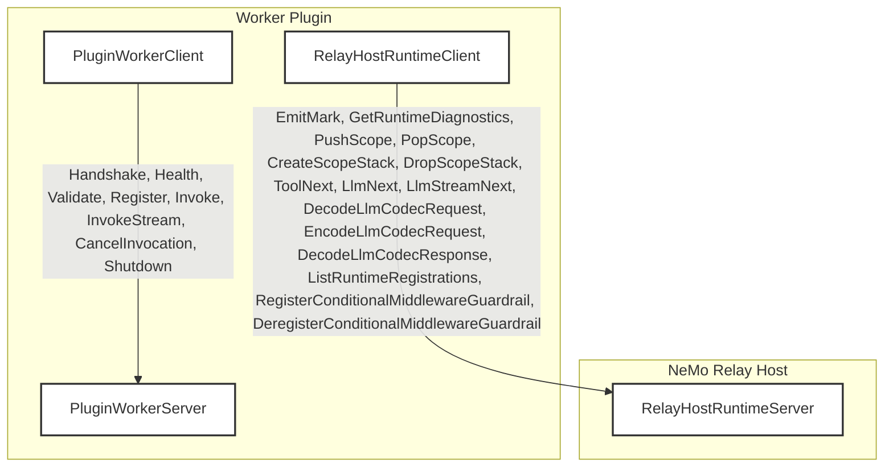
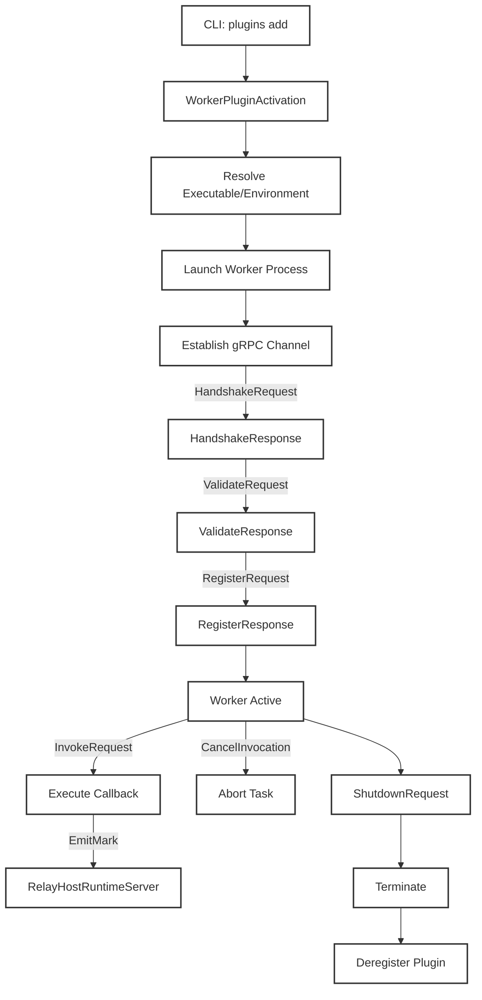
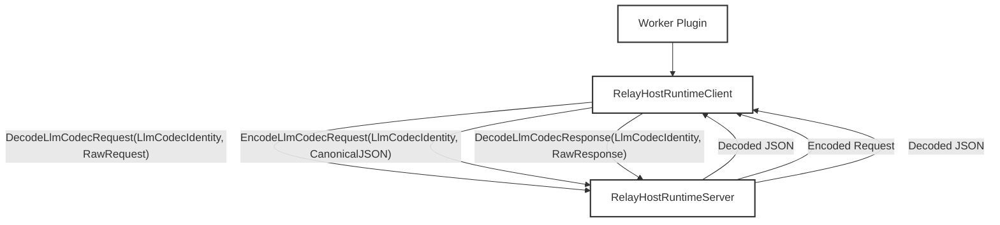

<!-- source: DeepWiki mcp.deepwiki.com · repo NVIDIA/NeMo-Relay · page 3.3 Worker Plugins and the gRPC Protocol · fetched 2026-10-26 -->

# Worker Plugins and the gRPC Protocol

<details>
<summary>Relevant source files</summary>

The following files were used as context for generating this wiki page:

- [crates/core/src/plugin/dynamic/worker.rs](crates/core/src/plugin/dynamic/worker.rs)
- [crates/core/tests/fixtures/worker_plugin/Cargo.lock](crates/core/tests/fixtures/worker_plugin/Cargo.lock)
- [crates/core/tests/fixtures/worker_plugin/src/main.rs](crates/core/tests/fixtures/worker_plugin/src/main.rs)
- [crates/core/tests/integration/worker_plugin_tests.rs](crates/core/tests/integration/worker_plugin_tests.rs)
- [crates/core/tests/unit/dynamic_worker_tests.rs](crates/core/tests/unit/dynamic_worker_tests.rs)
- [crates/worker-proto/README.md](crates/worker-proto/README.md)
- [crates/worker-proto/proto/nemo/relay/worker/v1/plugin_worker.proto](crates/worker-proto/proto/nemo/relay/worker/v1/plugin_worker.proto)
- [crates/worker-proto/tests/proto_tests.rs](crates/worker-proto/tests/proto_tests.rs)
- [crates/worker/src/lib.rs](crates/worker/src/lib.rs)
- [crates/worker/tests/worker_sdk_tests.rs](crates/worker/tests/worker_sdk_tests.rs)
- [docs/build-plugins/workers/about.mdx](docs/build-plugins/workers/about.mdx)
- [python/plugin/README.md](python/plugin/README.md)
- [python/plugin/src/nemo_relay_plugin/__init__.py](python/plugin/src/nemo_relay_plugin/__init__.py)
- [python/plugin/src/nemo_relay_plugin/_api.py](python/plugin/src/nemo_relay_plugin/_api.py)
- [python/tests/plugin/test_worker_sdk.py](python/tests/plugin/test_worker_sdk.py)

</details>


This page details the NeMo Relay gRPC worker plugin system, focusing on the `grpc-v1` worker protocol, the Rust `crates/worker` SDK, the Python `nemo-relay-plugin` SDK, and the lifecycle and codec identity mechanisms. Worker plugins allow extending NeMo Relay's functionality by running custom logic in a separate process, communicating with the core runtime via gRPC.

Sources:
- [crates/worker/tests/worker_sdk_tests.rs:1-3509]()
- [crates/core/tests/unit/dynamic_worker_tests.rs:1-3119]()
- [crates/core/src/plugin/dynamic/worker.rs:1-3890]()
- [crates/core/tests/integration/worker_plugin_tests.rs:1-1878]()
- [crates/worker/src/lib.rs:1-3412]()
- [python/tests/plugin/test_worker_sdk.py:1-3456]()
- [python/plugin/src/nemo_relay_plugin/_api.py:1-3065]()
- [python/plugin/src/nemo_relay_plugin/__init__.py:1-209]()
- [crates/core/tests/fixtures/worker_plugin/src/main.rs:1-454]()
- [python/plugin/README.md:1-195]()
- [crates/worker-proto/proto/nemo/relay/worker/v1/plugin_worker.proto:1-491]()

## gRPC-v1 Worker Protocol

The `grpc-v1` worker protocol (`nemo.relay.worker.v1`) defines the communication contract between the NeMo Relay host and worker plugins. This protocol is specified using Protocol Buffers and gRPC, enabling polyglot worker implementations. The core services are `PluginWorker` (worker-to-host) and `RelayHostRuntime` (host-to-worker).

The `PluginWorker` service exposes methods for the host to interact with the worker, including:
- `Handshake`: Initiates communication and verifies compatibility. [crates/worker-proto/proto/nemo/relay/worker/v1/plugin_worker.proto:9]()
- `Health`: Checks the worker's health status. [crates/worker-proto/proto/nemo/relay/worker/v1/plugin_worker.proto:10]()
- `Validate`: Requests the worker to validate its configuration. [crates/worker-proto/proto/nemo/relay/worker/v1/plugin_worker.proto:11]()
- `Register`: Instructs the worker to register its capabilities with the host. [crates/worker-proto/proto/nemo/relay/worker/v1/plugin_worker.proto:12]()
- `Invoke` / `InvokeStream`: Triggers a unary or streaming invocation of a worker-defined callback. [crates/worker-proto/proto/nemo/relay/worker/v1/plugin_worker.proto:13-14]()
- `CancelInvocation`: Notifies the worker to cancel an ongoing invocation. [crates/worker-proto/proto/nemo/relay/worker/v1/plugin_worker.proto:15]()
- `Shutdown`: Requests the worker to shut down. [crates/worker-proto/proto/nemo/relay/worker/v1/plugin_worker.proto:16]()

The `RelayHostRuntime` service allows the worker to call back into the host for runtime operations, such as:
- `EmitMark`: Emits a mark event. [crates/worker-proto/proto/nemo/relay/worker/v1/plugin_worker.proto:20]()
- `GetRuntimeDiagnostics`: Retrieves host runtime diagnostics. [crates/worker-proto/proto/nemo/relay/worker/v1/plugin_worker.proto:21]()
- `PushScope` / `PopScope`: Manages the scope stack. [crates/worker-proto/proto/nemo/relay/worker/v1/plugin_worker.proto:22-23]()
- `CreateScopeStack` / `DropScopeStack`: Manages scope stack instances. [crates/worker-proto/proto/nemo/relay/worker/v1/plugin_worker.proto:24-25]()
- `ToolNext` / `LlmNext` / `LlmStreamNext`: Continues middleware execution for tools and LLMs. [crates/worker-proto/proto/nemo/relay/worker/v1/plugin_worker.proto:26-28]()
- `DecodeLlmCodecRequest` / `EncodeLlmCodecRequest` / `DecodeLlmCodecResponse`: Handles LLM codec operations. [crates/worker-proto/proto/nemo/relay/worker/v1/plugin_worker.proto:29-31]()
- `ListRuntimeRegistrations`: Lists active runtime registrations. [crates/worker-proto/proto/nemo/relay/worker/v1/plugin_worker.proto:32-33]()
- `RegisterConditionalMiddlewareGuardrail` / `DeregisterConditionalMiddlewareGuardrail`: Manages conditional middleware guardrails. [crates/worker-proto/proto/nemo/relay/worker/v1/plugin_worker.proto:34-37]()

Data is exchanged using `JsonEnvelope` and `JsonValue` messages, which encapsulate JSON data with an optional schema identifier. [crates/worker-proto/proto/nemo/relay/worker/v1/plugin_worker.proto:40-46]()

### Diagram: gRPC Worker Protocol Services


Sources:
- [crates/worker-proto/proto/nemo/relay/worker/v1/plugin_worker.proto:8-38]()

## Rust Worker SDK (`crates/worker`)

The `crates/worker` crate provides a Rust SDK for authoring gRPC worker plugins. It abstracts away the gRPC communication details, allowing plugin developers to focus on implementing their business logic.

Key components of the Rust worker SDK include:
- `WorkerPlugin` trait: Defines the contract for a worker plugin, including `plugin_id`, `validate`, and `register` methods. [crates/core/tests/fixtures/worker_plugin/src/main.rs:19-24]()
- `PluginContext`: Provides methods for registering various callbacks (subscribers, middleware, guardrails) with the host. [crates/worker/src/lib.rs:62]()
- `PluginRuntime`: An interface to interact with the Relay host runtime, offering functions like `emit_mark`, `push_scope`, `pop_scope`, and `runtime_diagnostics`. [crates/worker/src/lib.rs:62]()
- `serve_plugin`: A function to start the gRPC worker server, listening for requests from the Relay host. [crates/worker/src/lib.rs:27]()

The SDK handles authentication using an `activation_id` and `auth_token` provided by the host. [crates/worker/tests/worker_sdk_tests.rs:64-65]() It also manages invocation cancellation, aborting async tasks when a `CancelInvocation` request is received. [crates/worker/src/lib.rs:8-20]()

### Example: Rust Worker Plugin Structure

```rust
struct MyWorkerPlugin;

impl WorkerPlugin for MyWorkerPlugin {
    fn plugin_id(&self) -> &str {
        "my_worker_plugin"
    }

    fn validate(&self, config: &Json) -> Vec<ConfigDiagnostic> {
        // Validate plugin configuration
        Vec::new()
    }

    fn register(&self, ctx: &mut PluginContext, config: &Json) -> Result<()> {
        // Register callbacks and middleware
        ctx.register_subscriber("my_subscriber", |event| async move {
            // Handle event
        });
        Ok(())
    }
}

#[tokio::main]
async fn main() -> Result<()> {
    serve_plugin(MyWorkerPlugin).await
}
```
Sources:
- [crates/core/tests/fixtures/worker_plugin/src/main.rs:19-163]()
- [crates/worker/src/lib.rs:27]()

## Python Plugin SDK (`nemo-relay-plugin`)

The `nemo-relay-plugin` package provides a high-level Python API for authoring `grpc-v1` worker plugins. It wraps the underlying gRPC communication and provides Pythonic interfaces for interacting with the Relay host.

Key features of the Python SDK:
- `WorkerPlugin` class: The base class for Python worker plugins, similar to its Rust counterpart, defining `plugin_id`, `validate`, and `register` methods. [python/plugin/src/nemo_relay_plugin/__init__.py:76]()
- `PluginContext`: Provides methods to register various callbacks (e.g., `register_tool_request_intercept`, `register_subscriber`). [python/plugin/src/nemo_relay_plugin/__init__.py:77]()
- `PluginRuntime`: An object accessible via `ctx.runtime` that allows workers to interact with the host, e.g., `emit_mark`, `runtime_diagnostics`. [python/plugin/src/nemo_relay_plugin/__init__.py:78]()
- `serve_plugin`: A function to start the AsyncIO gRPC server for the worker plugin. [python/plugin/src/nemo_relay_plugin/__init__.py:84]()
- Typed runtime helpers: The SDK exposes Python types for JSON, events, scopes, middleware, continuations, and diagnostics, ensuring type safety and clarity. [python/plugin/README.md:38]()

The Python SDK handles the lifecycle of the worker process, including authentication, JSON serialization/deserialization, and task-local scope-stack propagation. [python/plugin/src/nemo_relay_plugin/__init__.py:7-9]()

### Example: Python Worker Plugin Structure

```python
from nemo_relay_plugin import Json, PluginContext, WorkerPlugin, serve_plugin

class PolicyPlugin(WorkerPlugin):
    plugin_id = "acme.policy"

    def register(self, ctx: PluginContext, config: Json) -> None:
        async def tag_tool_request(tool_name: str, args: Json) -> Json:
            await ctx.runtime.emit_mark("acme.policy.tool_request", {"tool_name": tool_name})
            if isinstance(args, dict):
                return {**args, "policy": "checked"}
            return {"value": args, "policy": "checked"}

        ctx.register_tool_request_intercept("tag_tool_request", tag_tool_request)

async def main() -> None:
    await serve_plugin(PolicyPlugin())
```
Sources:
- [python/plugin/README.md:77-96]()
- [python/plugin/src/nemo_relay_plugin/__init__.py:76-84]()

## Worker Lifecycle

The lifecycle of a worker plugin is managed by the NeMo Relay host.

1.  **Installation**: Worker plugins are installed via the CLI using `nemo-relay plugins add`. This command provisions a managed virtual environment for Python workers and records the environment for activation. [python/plugin/README.md:60-67]()
2.  **Loading**: When the host activates a worker plugin, it creates a `WorkerPluginActivation` instance. This involves:
    *   Resolving the worker's executable and environment. For Python workers, this includes ensuring the executable is within a lifecycle-managed path and not a symlink. [crates/core/tests/unit/dynamic_worker_tests.rs:130-163]()
    *   Launching the worker process. For Python, a bootstrap script (`PYTHON_WORKER_BOOTSTRAP`) is used to invoke the plugin's entrypoint. [crates/core/src/plugin/dynamic/worker.rs:116-131]()
    *   Establishing a gRPC channel to the worker.
    *   Performing a `Handshake` with the worker to verify compatibility and exchange metadata. [crates/worker/tests/worker_sdk_tests.rs:125-136]()
3.  **Validation**: The host calls the worker's `Validate` method, passing the plugin's configuration. The worker returns `ConfigDiagnostic` messages for any issues. [crates/worker-proto/proto/nemo/relay/worker/v1/plugin_worker.proto:187-197]()
4.  **Registration**: The host calls the worker's `Register` method. The worker uses its `PluginContext` to register its various callbacks (e.g., subscribers, intercepts, guardrails) with the host. [crates/worker-proto/proto/nemo/relay/worker/v1/plugin_worker.proto:199-210]()
5.  **Invocation**: Once registered, the worker's callbacks can be invoked by the host for events, LLM requests, tool executions, etc. These invocations can be unary (`Invoke`) or streaming (`InvokeStream`). [crates/worker-proto/proto/nemo/relay/worker/v1/plugin_worker.proto:13-14]()
6.  **Cancellation**: The host can send `CancelInvocation` to terminate an ongoing worker invocation. [crates/worker-proto/proto/nemo/relay/worker/v1/plugin_worker.proto:15]()
7.  **Shutdown**: When the plugin is disabled or the host shuts down, the host sends a `Shutdown` request to the worker. [crates/worker-proto/proto/nemo/relay/worker/v1/plugin_worker.proto:16]() The `WorkerPluginActivation` is responsible for deregistering worker plugin kinds and shutting down worker processes. [crates/core/src/plugin/dynamic/worker.rs:148-153]()

### Diagram: Worker Plugin Lifecycle


Sources:
- [crates/cli/tests/coverage/shared/plugins_lifecycle_tests.rs:19-202]()
- [crates/core/src/plugin/dynamic/worker.rs:148-153]()
- [crates/core/tests/unit/dynamic_worker_tests.rs:130-163]()
- [crates/worker-proto/proto/nemo/relay/worker/v1/plugin_worker.proto:9-16]()
- [crates/worker-proto/proto/nemo/relay/worker/v1/plugin_worker.proto:187-197]()
- [crates/worker-proto/proto/nemo/relay/worker/v1/plugin_worker.proto:199-210]()
- [python/plugin/README.md:60-67]()

## Codec Identity

LLM codecs are crucial for translating between different LLM provider formats and NeMo Relay's internal representations. Worker plugins can interact with these codecs through the `RelayHostRuntime` service.

The `LlmCodecIdentity` struct (Rust) or class (Python) represents the structured identity of the codec active for a particular worker invocation. It consists of a `kind` (e.g., `Builtin`, `Runtime`, `Opaque`) and an optional `id`. [crates/worker/src/lib.rs:49]() [python/plugin/src/nemo_relay_plugin/_api.py:110-113]()

Worker plugins can request the host to perform codec operations:
- `DecodeLlmCodecRequest`: Decodes an LLM request from a specific codec format into a canonical JSON representation. [crates/worker-proto/proto/nemo/relay/worker/v1/plugin_worker.proto:29]()
- `EncodeLlmCodecRequest`: Encodes a canonical JSON LLM request into a specific codec format. [crates/worker-proto/proto/nemo/relay/worker/v1/plugin_worker.proto:30]()
- `DecodeLlmCodecResponse`: Decodes an LLM response from a specific codec format. [crates/worker-proto/proto/nemo/relay/worker/v1/plugin_worker.proto:31]()

This allows worker plugins to work with LLM requests and responses in a standardized way, regardless of the underlying provider's specific API.

### Diagram: LLM Codec Interaction


Sources:
- [crates/worker/src/lib.rs:49]()
- [crates/worker-proto/proto/nemo/relay/worker/v1/plugin_worker.proto:29-31]()
- [python/plugin/src/nemo_relay_plugin/_api.py:110-113]()

---

