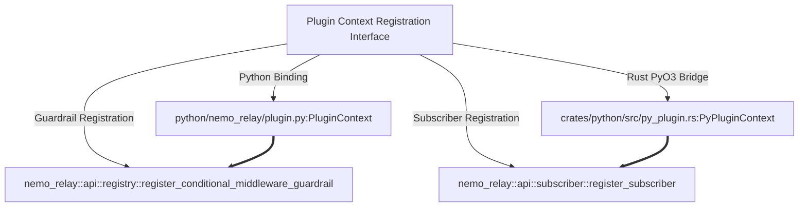

<!-- source: DeepWiki mcp.deepwiki.com · repo NVIDIA/NeMo-Relay · page 3.4 Plugin Examples and Language-Binding Plugins · fetched 2026-10-26 -->

# Plugin Examples and Language-Binding Plugins

<details>
<summary>Relevant source files</summary>

The following files were used as context for generating this wiki page:

- [crates/plugin/Cargo.toml](crates/plugin/Cargo.toml)
- [crates/python/src/py_plugin.rs](crates/python/src/py_plugin.rs)
- [crates/python/tests/coverage/nemo_guardrails_coverage_tests.rs](crates/python/tests/coverage/nemo_guardrails_coverage_tests.rs)
- [crates/python/tests/coverage/py_plugin_coverage_tests.rs](crates/python/tests/coverage/py_plugin_coverage_tests.rs)
- [docs/build-plugins/language-binding/about.mdx](docs/build-plugins/language-binding/about.mdx)
- [docs/build-plugins/language-binding/advanced-configuration.mdx](docs/build-plugins/language-binding/advanced-configuration.mdx)
- [docs/build-plugins/language-binding/code-examples.mdx](docs/build-plugins/language-binding/code-examples.mdx)
- [docs/build-plugins/language-binding/register-behavior.mdx](docs/build-plugins/language-binding/register-behavior.mdx)
- [docs/build-plugins/native/runtime-events-and-scopes.mdx](docs/build-plugins/native/runtime-events-and-scopes.mdx)
- [docs/build-plugins/plugin-context.mdx](docs/build-plugins/plugin-context.mdx)
- [docs/configure-plugins/adaptive/acg.mdx](docs/configure-plugins/adaptive/acg.mdx)
- [docs/configure-plugins/adaptive/adaptive-hints.mdx](docs/configure-plugins/adaptive/adaptive-hints.mdx)
- [docs/instrument-applications/adding-scopes-and-marks.mdx](docs/instrument-applications/adding-scopes-and-marks.mdx)
- [examples/language-binding-plugin/node/main.mjs](examples/language-binding-plugin/node/main.mjs)
- [examples/language-binding-plugin/node/test-plugin.mjs](examples/language-binding-plugin/node/test-plugin.mjs)
- [examples/python-grpc-worker-plugin/README.md](examples/python-grpc-worker-plugin/README.md)
- [examples/python-grpc-worker-plugin/nemo_relay_python_grpc_worker_example/worker.py](examples/python-grpc-worker-plugin/nemo_relay_python_grpc_worker_example/worker.py)
- [examples/python-grpc-worker-plugin/relay-plugin.toml](examples/python-grpc-worker-plugin/relay-plugin.toml)
- [examples/python-grpc-worker-plugin/tests/test_worker.py](examples/python-grpc-worker-plugin/tests/test_worker.py)
- [examples/rust-grpc-worker-plugin/README.md](examples/rust-grpc-worker-plugin/README.md)
- [examples/rust-grpc-worker-plugin/src/lib.rs](examples/rust-grpc-worker-plugin/src/lib.rs)
- [examples/rust-grpc-worker-plugin/tests/lifecycle.rs](examples/rust-grpc-worker-plugin/tests/lifecycle.rs)
- [examples/rust-native-plugin/Cargo.toml](examples/rust-native-plugin/Cargo.toml)
- [examples/rust-native-plugin/README.md](examples/rust-native-plugin/README.md)
- [examples/rust-native-plugin/relay-plugin.toml](examples/rust-native-plugin/relay-plugin.toml)
- [examples/rust-native-plugin/src/lib.rs](examples/rust-native-plugin/src/lib.rs)
- [python/nemo_relay/plugin.py](python/nemo_relay/plugin.py)
- [python/nemo_relay/plugin.pyi](python/nemo_relay/plugin.pyi)
- [python/tests/test_adaptive.py](python/tests/test_adaptive.py)
- [python/tests/test_dynamic_plugin_host.py](python/tests/test_dynamic_plugin_host.py)

</details>


This section walks through the reference plugin examples provided in the `examples/` directory of the codebase: `rust-native-plugin` [examples/rust-native-plugin/src/lib.rs:1-103](), `rust-grpc-worker-plugin` [examples/rust-grpc-worker-plugin/src/lib.rs](), `python-grpc-worker-plugin` [examples/python-grpc-worker-plugin/nemo_relay_python_grpc_worker_example/worker.py](), and the polyglot `language-binding-plugin` implementations (Rust, Python, Node.js). It also covers registration behavior mechanics as detailed in `docs/build-plugins/language-binding/register-behavior.mdx` [docs/build-plugins/language-binding/register-behavior.mdx:1-355]().

---

## 1. Rust Native Plugin Example (`rust-native-plugin`)

The `rust-native-plugin` example demonstrates how to author a dynamic native shared library plugin in Rust [examples/rust-native-plugin/README.md:6-13](). Native plugins load directly into the Relay host process via `libloading`, offering zero-copy telemetry and direct in-process middleware registration.

### Implementation and Manifest Structure

The core plugin logic is implemented in `examples/rust-native-plugin/src/lib.rs` [examples/rust-native-plugin/src/lib.rs:10-103]() by implementing the `NativePlugin` trait [examples/rust-native-plugin/src/lib.rs:25-86](). The exported symbol is generated using the `nemo_relay_plugin!` macro [examples/rust-native-plugin/src/lib.rs:103]():

- `plugin_kind()`: Returns the unique identifier `"examples.rust_native_policy"` [examples/rust-native-plugin/src/lib.rs:26-29]().
- `executor_config()`: Configures a `NativeExecutorConfig` with `worker_threads: 2` [examples/rust-native-plugin/src/lib.rs:30-33]().
- `allows_multiple_components()`: Returns `false` to enforce a singleton constraint [examples/rust-native-plugin/src/lib.rs:34-37]().
- `validate()`: Delegates component-local configuration checks to `config::validate()` [examples/rust-native-plugin/src/lib.rs:38-49]().
- `register()`: Invokes registration submodules for observation, requests, and execution [examples/rust-native-plugin/src/lib.rs:51-86]().

The manifest file `examples/rust-native-plugin/relay-plugin.toml` [examples/rust-native-plugin/relay-plugin.toml:1-35]() defines the metadata:
- `plugin.kind = "rust_dynamic"` [examples/rust-native-plugin/relay-plugin.toml:8]()
- `compat.relay = ">=0.8.0,<1.0"` [examples/rust-native-plugin/relay-plugin.toml:11]()
- `load.symbol = "nemo_relay_register_plugin"` [examples/rust-native-plugin/relay-plugin.toml:35]()

### Diagram: Native Plugin Natural Language to Code Entity Mapping

Title: "Rust Native Plugin Architecture Entity Mapping"

```mermaid
graph TD
    NL_Host[""Relay Host Process""] -->|""Loads Shared Library""| CE_Lib[""examples/rust-native-plugin/src/lib.rs""]
    NL_Macro[""Plugin Registration Macro""] -->|""Expands To""| CE_Macro[""nemo_relay_plugin!() macro""]
    NL_Trait[""Native Plugin Definition""] -->|""Implements Trait""| CE_Trait[""ExampleNativePlugin struct""]
    NL_Register[""Runtime Registration Function""] -->|""Executes Method""| CE_Reg[""ExampleNativePlugin::register()""]
    
    CE_Lib ==> CE_Macro
    CE_Macro ==> CE_Trait
    CE_Trait ==> CE_Reg
```

Sources:
- `examples/rust-native-plugin/src/lib.rs`
- `examples/rust-native-plugin/relay-plugin.toml`
- `examples/rust-native-plugin/README.md`

---

## 2. Rust gRPC Worker Plugin Example (`rust-grpc-worker-plugin`)

The `rust-grpc-worker-plugin` demonstrates process isolation via gRPC worker plugins [examples/rust-grpc-worker-plugin/README.md](). Unlike native plugins that run within the host process, worker plugins execute as external subprocesses and communicate using the `grpc-v1` worker protocol (`nemo.relay.worker.v1`) [examples/python-grpc-worker-plugin/README.md:14]().

### Implementation Mechanics

- The worker implements the SDK-provided worker interfaces (`WorkerPlugin`) [examples/rust-grpc-worker-plugin/src/lib.rs]().
- Lifecycle integration, handshake, and test assertions are verified via `examples/rust-grpc-worker-plugin/tests/lifecycle.rs` [examples/rust-grpc-worker-plugin/tests/lifecycle.rs]().
- Configuration validation ensures that worker capabilities align with the host's expected protocol version [examples/rust-grpc-worker-plugin/README.md]().

### Diagram: gRPC Worker Process Lifecycle

Title: "gRPC Worker Process Data Flow and Initialization"

```mermaid
graph TD
    Host[""Relay Host Process""] -->|""Spawns Process""| WorkerProc[""rust-grpc-worker-plugin Binary""]
    WorkerProc -->|""gRPC Handshake""| Protocol[""grpc-v1 Protocol (nemo.relay.worker.v1)""]
    Protocol -->|""Initialize Request""| Reg[""WorkerPlugin::register()""]
    Reg -->|""Registers Intercepts""| HostState[""Host Middleware Registry""]
```

Sources:
- `examples/rust-grpc-worker-plugin/README.md`
- `examples/rust-grpc-worker-plugin/src/lib.rs`
- `examples/rust-grpc-worker-plugin/tests/lifecycle.rs`

---

## 3. Python gRPC Worker Plugin Example (`python-grpc-worker-plugin`)

The `python-grpc-worker-plugin` package provides a reference implementation of a gRPC worker written in Python [examples/python-grpc-worker-plugin/README.md:6-12]().

### Configuration and Entry Point

The manifest `examples/python-grpc-worker-plugin/relay-plugin.toml` specifies:
- `kind = "worker"` [examples/python-grpc-worker-plugin/relay-plugin.toml]()
- `worker_protocol = "grpc-v1"` [examples/python-grpc-worker-plugin/README.md:14]()
- `load.runtime = "python"` [examples/python-grpc-worker-plugin/relay-plugin.toml]()
- `load.entrypoint = "nemo_relay_python_grpc_worker_example.worker:main"` [examples/python-grpc-worker-plugin/relay-plugin.toml]()

The worker logic in `examples/python-grpc-worker-plugin/nemo_relay_python_grpc_worker_example/worker.py` validates shared configuration, registers safe `grpc-v1` surfaces, preserves annotations and Relay-owned accounting, and manages isolated task scopes [examples/python-grpc-worker-plugin/README.md:8-12](). Comprehensive tests reside in `examples/python-grpc-worker-plugin/tests/test_worker.py` [examples/python-grpc-worker-plugin/tests/test_worker.py]().

### Diagram: Python Worker Process Execution Flow

Title: "Python gRPC Worker Execution Model"

```mermaid
graph TD
    Host[""Relay Host Process""] -->|""Invokes Python Interpreter""| WorkerScript[""nemo_relay_python_grpc_worker_example/worker.py""]
    WorkerScript -->|""Initializes SDK""| SDK[""nemo-relay-plugin SDK""]
    SDK -->|""gRPC Callbacks""| Reg[""register(plugin_config, context)""]
    Reg -->|""Tool Intercepts""| ToolExec[""ToolExecutionResult""]
```

Sources:
- `examples/python-grpc-worker-plugin/README.md`
- `examples/python-grpc-worker-plugin/relay-plugin.toml`
- `examples/python-grpc-worker-plugin/nemo_relay_python_grpc_worker_example/worker.py`
- `examples/python-grpc-worker-plugin/tests/test_worker.py`

---

## 4. Language-Binding Plugins (Rust, Python, Node.js)

The `examples/language-binding-plugin` directory contains language-specific plugin hosts that share a common configuration and behavior model [docs/build-plugins/language-binding/code-examples.mdx:9-12]().

### Shared Workflow across Bindings
1. **Validation**: Validate JSON-compatible component settings against schema [docs/build-plugins/language-binding/code-examples.mdx:34-36]().
2. **Registration**: Install equivalent event subscribers, request intercepts, tool conditional execution guardrails, and stream execution intercepts via `PluginContext` [docs/build-plugins/language-binding/register-behavior.mdx:32-70]().
3. **Execution**: Exercise managed tool execution results, LLM header rewrites, and stream chunk transformations [docs/build-plugins/language-binding/code-examples.mdx:111-125]().
4. **Teardown**: Await pending flush operations, close the activation handle, and deregister the plugin kind [docs/build-plugins/language-binding/code-examples.mdx:75-78]().

Sources:
- `docs/build-plugins/language-binding/code-examples.mdx`
- `examples/language-binding-plugin/node/main.mjs`
- `examples/language-binding-plugin/node/test-plugin.mjs`

---

## 5. Register Behavior and Registration Mechanics

Registration converts a valid component configuration document into owned runtime behavior through `PluginContext` [docs/build-plugins/language-binding/register-behavior.mdx:9-13]().

### Key Registration Surfaces

- **Activation-Owned Conditional Middleware Guardrails**: Registered via `context.register_conditional_middleware_guardrail()` [docs/build-plugins/language-binding/register-behavior.mdx:34-39](). These gates are automatically removed upon plugin rollback or teardown.
- **Event Metadata Injectors**: Registered via `context.register_event_metadata_injector()` [docs/build-plugins/language-binding/register-behavior.mdx:89-93]() to inject flat metadata dictionaries into events before sanitizers execute.
- **Request and Stream Intercepts**: Installed using `context.register_llm_request_intercept()` [docs/build-plugins/language-binding/register-behavior.mdx:185-190](), `context.register_tool_request_intercept()` [docs/build-plugins/language-binding/register-behavior.mdx:170-175](), and `context.register_llm_stream_execution_intercept()` [docs/build-plugins/language-binding/register-behavior.mdx:196]().

### Diagram: Registration Context Mapping to Code Entities

Title: "Plugin Context API Entity Mapping"



Sources:
- `docs/build-plugins/language-binding/register-behavior.mdx`
- `python/nemo_relay/plugin.py`
- `crates/python/src/py_plugin.rs`

---

