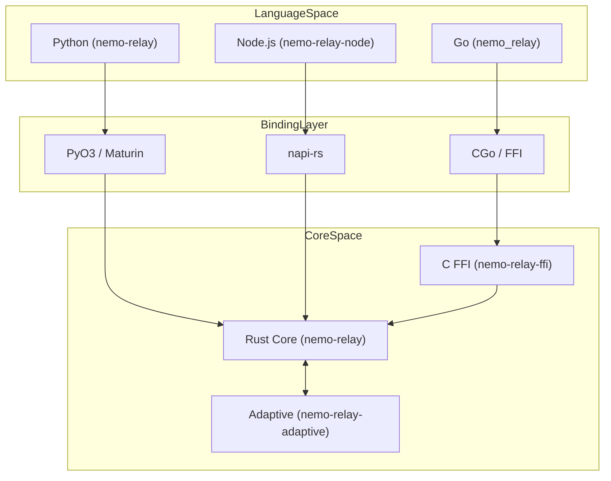
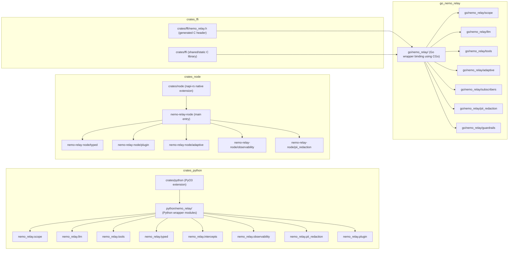

<!-- source: DeepWiki mcp.deepwiki.com · repo NVIDIA/NeMo-Relay · page 4 Language Bindings · fetched 2026-10-26 -->

# Language Bindings

Relevant source files

The following files were used as context for generating this wiki page:

- [.pre-commit-config.yaml](.pre-commit-config.yaml)
- [ATTRIBUTIONS-Node.md](ATTRIBUTIONS-Node.md)
- [ATTRIBUTIONS-Python.md](ATTRIBUTIONS-Python.md)
- [crates/adaptive/README.md](crates/adaptive/README.md)
- [crates/core/README.md](crates/core/README.md)
- [crates/ffi/README.md](crates/ffi/README.md)
- [crates/node/README.md](crates/node/README.md)
- [crates/python/README.md](crates/python/README.md)
- [fern/fern.config.json](fern/fern.config.json)
- [go/nemo_relay/README.md](go/nemo_relay/README.md)
- [integrations/openclaw/package.json](integrations/openclaw/package.json)
- [integrations/openclaw/scripts/check-pack-payload.mjs](integrations/openclaw/scripts/check-pack-payload.mjs)
- [package-lock.json](package-lock.json)
- [package.json](package.json)
- [pyproject.toml](pyproject.toml)
- [python/nemo_relay/README.md](python/nemo_relay/README.md)
- [python/plugin/pyproject.toml](python/plugin/pyproject.toml)
- [uv.lock](uv.lock)

The NeMo Relay project provides a multi-language ecosystem built around a central Rust core. By using native extensions and FFI layers, the project ensures that Python, Node.js, and Go applications can access the same execution scopes, middleware registries, and observability models without reimplementing the core runtime logic [crates/node/README.md:19-21](), [python/nemo_relay/README.md:24-25]().

The Rust core (`nemo-relay`) serves as the source of truth for all runtime behavior [crates/ffi/README.md:19-21](). Language-specific bindings wrap this core to provide idiomatic APIs tailored for their ecosystems.

Sources: [crates/node/README.md:19-21](), [python/nemo_relay/README.md:24-25](), [crates/ffi/README.md:19-21]()

---

## Binding Architecture Overview

The following diagram illustrates how the various language bindings interface with the Rust core and the C FFI layer. It clarifies the roles of native extension crates, packaging layers, and the shared runtime:

**System Binding Topology**

This layered architecture ensures all language surfaces share a consistent, robust, and high-performance runtime while enabling idiomatic exposure and integration patterns per ecosystem.

Sources: [python/nemo_relay/README.md:24-25](), [crates/node/README.md:23-25](), [crates/ffi/README.md:19-25](), [go/nemo_relay/README.md:19-22]()

---

## Python Binding

The Python binding is designed for Python applications and AI frameworks seeking native integration with the NeMo Relay runtime. It uses **PyO3** and **Maturin** to create a native Rust extension that owns the scope stack, lifecycle handles, events, middleware registries, and adaptive runtime hooks [python/nemo_relay/README.md:24-25]().

- **Distribution**: Published as the `nemo-relay` package on PyPI, installable via `pip` or `uv` package manager [python/nemo_relay/README.md:65-77]().
- **Capabilities**: Provides managed execution scopes, tool and LLM call boundaries, middleware APIs (guardrails, intercepts, sanitization), event subscribers, exporters, and optional integrations with LangChain, LangGraph, and DeepAgents [python/nemo_relay/README.md:43-63]().
- **Implementation**: The native Rust extension (`nemo_relay._native`) underpins the Python API surface, with higher-level Python wrapper modules exposing idiomatic access [python/nemo_relay/README.md:24-25](), [pyproject.toml:101-104]().

For detailed technical coverage, see [Python Binding](#4.1).

Sources: [python/nemo_relay/README.md:24-63](), [pyproject.toml:101-104]()

---

## Node.js Binding

The Node.js binding exposes NeMo Relay functionality through a native extension built with **napi-rs**, targeting Node.js v24 or later. It is packaged as the `nemo-relay-node` module on npm [crates/node/README.md:23-25, 44-45]().

- **Distribution**: Installable from npm as `nemo-relay-node` [crates/node/README.md:61-67]().
- **Entry Points & Features**:
  - Main runtime API exposing scope stack, lifecycle events, and middleware [crates/node/README.md:19-22]().
  - Submodules for typed helpers (`/typed`), plugin integration (`/plugin`), adaptive runtime (`/adaptive`), and observability (`/observability`) [crates/node/README.md:55-59]().
- **Use Cases**: Aggregate agent, tool, and LLM work under coherent scopes, apply guardrails and intercepts around calls, and produce unified lifecycle event streams for observability [crates/node/README.md:28-38]().

For full technical details, see [Node.js Binding](#4.2).

Sources: [crates/node/README.md:19-67]()

---

## Go Binding and C FFI

Native applications and the Go ecosystem can access NeMo Relay via a C-compatible FFI layer and a Go wrapper:

- **C FFI (`nemo-relay-ffi`)**: Provides C ABI symbols for the full runtime API surface—scope stack, tool/LLM calls, middleware, subscribers, and observability. The crate produces a generated C header (`nemo_relay.h`) and static/shared libraries for consumption [crates/ffi/README.md:42-65]().
- **Go Binding (`go/nemo_relay`)**: Wraps the C ABI with idiomatic Go APIs via CGo. This exposes the same hierarchical scope management, middleware registration, event subscribers, and typed OpenTelemetry export helpers [go/nemo_relay/README.md:19-22, 47-70]().
- **Integration**: The Go binding is experimental and source-first, requiring building the underlying FFI library before usage [go/nemo_relay/README.md:71-72]().

Together, the C FFI and Go wrapper enable native, source-first reuse of the NeMo Relay runtime in non-Rust hosting environments, preserving the JSON payload contract for structured data exchange [crates/ffi/README.md:42-65]().

For comprehensive instructions and design notes, see [Go Binding and C FFI](#4.3).

Sources: [crates/ffi/README.md:42-65](), [go/nemo_relay/README.md:19-72]()

---

## Binding Entity Map

This diagram maps code artifacts and modules to their respective language ecosystems, illustrating the multi-layered binding structure:

**Binding Entity Map**

This structure elucidates:
- The Python binding uses a Rust native extension built with PyO3, wrapped by Python modules [python/nemo_relay/README.md:24-25]().
- The Node.js binding uses a Rust napi-rs native extension exposing multiple npm entry points [crates/node/README.md:55-59]().
- The Go binding leverages the C FFI via CGo with its wrapper API [go/nemo_relay/README.md:19-22]().
- The raw C FFI forms an implementation foundation linking tightly to the Rust core [crates/ffi/README.md:19-21]().

Sources: [python/nemo_relay/README.md:24-25](), [crates/node/README.md:55-59](), [crates/ffi/README.md:19-21](), [go/nemo_relay/README.md:19-22]()

---

For technical depth, usage instructions, build guidance, and testing details, consult the respective child pages:

- [Python Binding](#4.1)
- [Node.js Binding](#4.2)
- [Go Binding and C FFI](#4.3)

---

# References

- Python Binding: [python/nemo_relay/README.md](), [pyproject.toml](), [crates/python/README.md]()
- Node.js Binding: [crates/node/README.md]()
- Go Binding and C FFI: [go/nemo_relay/README.md](), [crates/ffi/README.md]()

---

