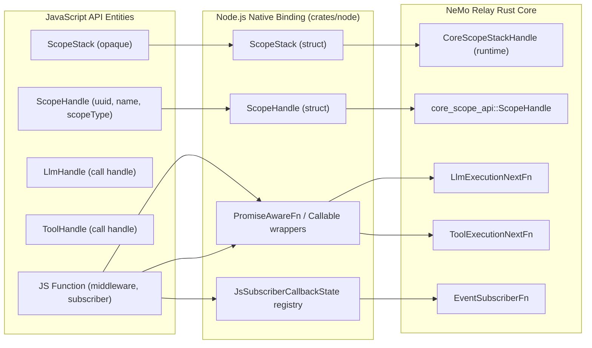
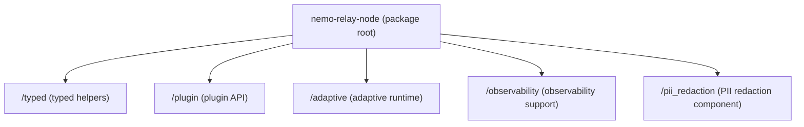

<!-- source: DeepWiki mcp.deepwiki.com · repo NVIDIA/NeMo-Relay · page 4.2 Node.js Binding · fetched 2026-10-26 -->

# Node.js Binding

<details>
<summary>Relevant source files</summary>

The following files were used as context for generating this wiki page:

- [crates/ffi/Cargo.toml](crates/ffi/Cargo.toml)
- [crates/ffi/tests/integration/plugin_activation_tests.rs](crates/ffi/tests/integration/plugin_activation_tests.rs)
- [crates/node/plugin.d.ts](crates/node/plugin.d.ts)
- [crates/node/plugin.js](crates/node/plugin.js)
- [crates/node/src/api/mod.rs](crates/node/src/api/mod.rs)
- [crates/node/src/callable.rs](crates/node/src/callable.rs)
- [crates/node/src/callback_factory.rs](crates/node/src/callback_factory.rs)
- [crates/node/src/promise_call.rs](crates/node/src/promise_call.rs)
- [crates/node/src/types/mod.rs](crates/node/src/types/mod.rs)
- [crates/node/tests/adaptive_tests.mjs](crates/node/tests/adaptive_tests.mjs)
- [crates/node/tests/dynamic_plugin_tests.mjs](crates/node/tests/dynamic_plugin_tests.mjs)
- [crates/node/tests/event_sanitizers_tests.mjs](crates/node/tests/event_sanitizers_tests.mjs)
- [crates/node/tests/llm_tests.mjs](crates/node/tests/llm_tests.mjs)
- [crates/node/tests/scope_local_tests.mjs](crates/node/tests/scope_local_tests.mjs)
- [crates/node/tests/scope_tests.mjs](crates/node/tests/scope_tests.mjs)
- [crates/node/tests/tools_tests.mjs](crates/node/tests/tools_tests.mjs)
- [crates/node/tests/types_tests.mjs](crates/node/tests/types_tests.mjs)
- [crates/python/src/py_callable.rs](crates/python/src/py_callable.rs)
- [crates/python/tests/coverage/py_callable_coverage_tests.rs](crates/python/tests/coverage/py_callable_coverage_tests.rs)
- [go/nemo_relay/plugin_activation_test.go](go/nemo_relay/plugin_activation_test.go)
- [python/tests/test_tools.py](python/tests/test_tools.py)

</details>


The Node.js binding provides a comprehensive integration layer exposing the full NeMo Relay Rust core runtime API to JavaScript and TypeScript environments. It is implemented as a native extension using `napi-rs` to ensure performance and seamless interoperability between Node.js’s event loop and the async Rust runtime. This binding supports management of the scope stack lifecycle, registration and deregistration of middleware and subscribers, execution of tools and LLMs, plugin component activation, and observability features [crates/node/src/api/mod.rs:4-10]().

---

## Architecture and Package Structure

The Node.js binding is published as the `nemo-relay-node` npm package. It provides multiple entry points aggregated in a modular manner, enabling fine-grained imports and lean dependency surfaces.

| Entry Point       | Description                                        | Key Contents                                                                                                     |
|-------------------|----------------------------------------------------|-----------------------------------------------------------------------------------------------------------------|
| `nemo-relay-node` | Core runtime primitives                            | Scope stack management, event lifecycle, LLM and tool handles, subscriber APIs [crates/node/src/api/mod.rs:6-10]() |
| `/typed`          | Typed helpers                                      | Codec-specific wrappers and utilities such as `JsonPassthrough`                                                |
| `/plugin`         | Plugin system API                                 | Plugin lifecycle, configurations, `DynamicPluginActivationSpec`, and host activation [crates/node/src/api/mod.rs:60-71]() |
| `/adaptive`       | Adaptive runtime extensions                       | Adaptive Runtime configuration, ACG settings, learners, and state backends [crates/node/src/api/mod.rs:73-78]() |
| `/observability`  | Observability API                                 | Helpers for event subscribers and exporters (ATOF, ATIF, OTLP) [crates/node/src/api/mod.rs:34-36]()             |
| `/pii_redaction`  | PII Redaction Component                           | PII detection and redaction component registration [crates/node/src/api/mod.rs:79]()                             |

The package is built via the `napi-rs` Rust-to-Node native interface, generating the compiled extension. The workspace configuration mandates Node.js version 24 or higher for compatibility.

### Initialization and Environment Lifecycle

- The native extension initializes shared runtime ownership during module load via `initialize_shared_runtime_binding("node")` [crates/node/src/api/mod.rs:150-151]().

- Registers adaptive and PII redaction components immediately after initialization [crates/node/src/api/mod.rs:152-156]().

- Maintains reference counting of active Node.js environments for safe global state management:

  - `register_node_environment()` initializes logging and increments environment count [crates/node/src/api/mod.rs:101-108]().

  - `cleanup_node_environment()` decrements the count and cleans up logging resources on the last exit [crates/node/src/api/mod.rs:110-119]().

This lifecycle orchestration provides a stable Node.js binding environment across multiple runtime instantiations.

Sources: [crates/node/src/api/mod.rs:101-156]()

---

## Data Flow: JavaScript to Rust Core

The binding uses `#[napi]` annotated Rust functions (in `crates/node/src/api/mod.rs`) to expose native API surfaces callable from JavaScript. These low-level functions manage scope stacks, Tool/LLM lifecycle calls, intercepts, and subscribers.

Middleware and subscriber callbacks from JavaScript are wrapped in `napi::ThreadsafeFunction` structures to enable safe asynchronous invocation from Rust’s multi-threaded async runtime context [crates/node/src/callable.rs:7-30](). The layers handle serialization of function arguments and results, ensure JS Promise-aware call bridging via `crates/node/src/promise_call.rs`, and guard against callback exceptions crossing mode boundaries.

### Diagram: JavaScript to Rust Core Request Flow

```mermaid
graph TD
    subgraph "Node.js (V8)"
        JSApp["JS Application Code"]
        JSBinding["index.js (npm package entry)"]
    end

    subgraph "Native Extension (crates/node)"
        ApiMod["src/api/mod.rs"]
        Callable["src/callable.rs"]
        PromiseCall["src/promise_call.rs"]
        Convert["src/convert.rs"]
    end

    subgraph "Rust Core (nemo-relay)"
        CoreRuntime["nemo_relay::api::runtime"]
        TaskStack["TASK_SCOPE_STACK (thread-local)"]
    end

    JSApp -->|Calls API| JSBinding
    JSBinding -->|#[napi] fn calls| ApiMod
    ApiMod -->|Wraps JS callbacks| Callable
    Callable -->|Async bridge & Promise handling| PromiseCall
    PromiseCall -->|Serialization & type conversions| Convert
    Convert -->|Invokes core runtime| CoreRuntime
    CoreRuntime --> TaskStack
```

This architecture ensures non-blocking, thread-safe asynchronous execution of the NeMo Relay runtime with full event tracking, middleware chaining, and interpolated callbacks originating from JavaScript.

Sources: [crates/node/src/api/mod.rs:31-51](), [crates/node/src/callable.rs:7-30](), [crates/node/src/promise_call.rs:1-20]()

---

## Core Runtime Surface

### Scope Stack and Handle

- `ScopeStack`: Represents an isolated execution context stack, allowing nested logical scopes. Created via the Rust `create_scope_stack` API, exposed in Node.js wrapper as `ScopeStack` [crates/node/src/api/mod.rs:46-46]().
- `ScopeHandle`: JavaScript-visible reference to individual scope instances. Properties include `uuid`, `name`, and `scopeType` (e.g., Agent, Function, Tool, LLM) [crates/node/src/api/mod.rs:94-96]().
- `ScopeType`: Enum that covers predefined scope kinds to categorize lifecycles and event emissions [crates/node/tests/llm_tests.mjs:43-43]().

### Tool and LLM Execution Handles

The binding provides JavaScript-facing APIs to manage Tool and LLM calls lifecycle:

- `toolCall`, `toolCallEnd`, `toolCallExecute`, `toolCallExecuteAsync` for tool executions with optional attributes and metadata [crates/node/tests/tools_tests.mjs:15-18]().
- `llmCall`, `llmCallEnd`, `llmCallExecute`, `llmCallExecuteAsync` for LLM execution flows supporting streaming, attributes, and parent scopes [crates/node/tests/llm_tests.mjs:19-24]().

Handles encapsulate runtime state, UUIDs, and hierarchical parent-child relationships.

### Middleware and Guardrails

Supports registering middleware callbacks from Node.js to implement sanitization, intercepts, and conditional guards over scopes, tools, and LLMs:

- Sanitize guardrails operate on requests/responses to clean or redact sensitive data [crates/node/tests/llm_tests.mjs:26-37](), [crates/node/tests/tools_tests.mjs:21-30]().
- Execution intercepts and conditional guards intervene in call execution or alter arguments.
- Callbacks wrap JavaScript functions safely using `safe_middleware_callback` to trap errors as data, ensuring Node stability [crates/node/src/callable.rs:183-196]().

### Subscriber Management

JavaScript code can register subscribers to receive runtime events:

- `registerSubscriber` and `deregisterSubscriber` manage subscriber callback lifecycle [crates/node/tests/llm_tests.mjs:38-39]().
- `flushSubscribers` allows awaiting completion of all pending subscriber callbacks, useful for graceful shutdown and deterministic event processing [crates/node/tests/llm_tests.mjs:40-40]().
- Internal synchronization tracks subscriber callback IDs and pending status to avoid race conditions [crates/node/src/callable.rs:52-90]().

Sources: [crates/node/src/api/mod.rs:31-57](), [crates/node/src/callable.rs:52-196](), [crates/node/tests/llm_tests.mjs:15-44](), [crates/node/tests/tools_tests.mjs:15-37]()

---

## Plugin System Integration

The binding exposes full plugin system features compatible with the Rust core:

- Defines `DynamicPluginActivationSpec` objects representing dynamic plugins with kinds such as `rust_dynamic` and `worker` [crates/node/plugin.d.ts:86-88]().
- Provides API surface for plugin initialization, validation, list retrieval, and deregistration via `crates/node/src/api/mod.rs` [crates/node/src/api/mod.rs:60-71]().
- Registered plugins receive full contextual access to middleware registrations and manage their lifecycle through `PluginContext` arguments during activation.
- Supports promise-based asynchronous resource cleanup leveraging `Symbol.asyncDispose` interface (`PluginHostActivation`), ensuring safe lifecycle management in Node.js environments [crates/node/plugin.d.ts:89-98]().

Sources: [crates/node/src/api/mod.rs:60-71](), [crates/node/plugin.d.ts:86-98]()

---

## Package Build, Multi-Platform Targets, and Tests

- The package builds as a Rust crate (`crates/node`) compiled into a native Node.js extension using `napi-rs`.
- Enforces Node.js v24+ compatibility to avail modern V8 and N-API guarantees.
- The workspace contains parallel bindings for Python and other target languages, ensuring consistent versioning and dependency resolution.
- Automated CI/CD ensures native build reproducibility, integration test coverage, and release packaging.

### Test Suites

The Node.js binding includes extensive test suites using the built-in `node:test` harness:

- **Scope Lifecycle:** Creation, nesting, attributes, parent-child relations, and metadata merging scenarios are tested [crates/node/tests/scope_tests.mjs:116-185]().
- **Tool Lifecycle:** Validates tool call creation, execution paths, synchronous and asynchronous providers, error handling, and event generation [crates/node/tests/tools_tests.mjs:73-236]().
- **LLM Lifecycle:** Ensures LLM call lifecycle, streaming calls, callback error isolation, and Promise handling correctness [crates/node/tests/llm_tests.mjs:114-247]().
- **Subscriber Isolation:** Confirms subscriber callback exceptions propagate as recorded errors without destabilizing the host process [crates/node/src/callable.rs:183-196]().

Test coverage includes helper utilities like `flushSubscribers()` to await async subscriber callbacks and verify lifecycle event emission order.

Sources: [crates/node/src/callable.rs:183-196](), [crates/node/tests/scope_tests.mjs:116-185](), [crates/node/tests/tools_tests.mjs:73-236](), [crates/node/tests/llm_tests.mjs:114-247]()

---

## Summary Diagrams Bridging Language and Code Entities

### Node.js Binding API Entities to Rust Core Types



Sources: [crates/node/src/api/mod.rs:31-57](), [crates/node/src/callable.rs:52-90]()

### Package Entry Points and Modules in `nemo-relay-node`



Sources: [crates/node/src/api/mod.rs:6-79]()

---

