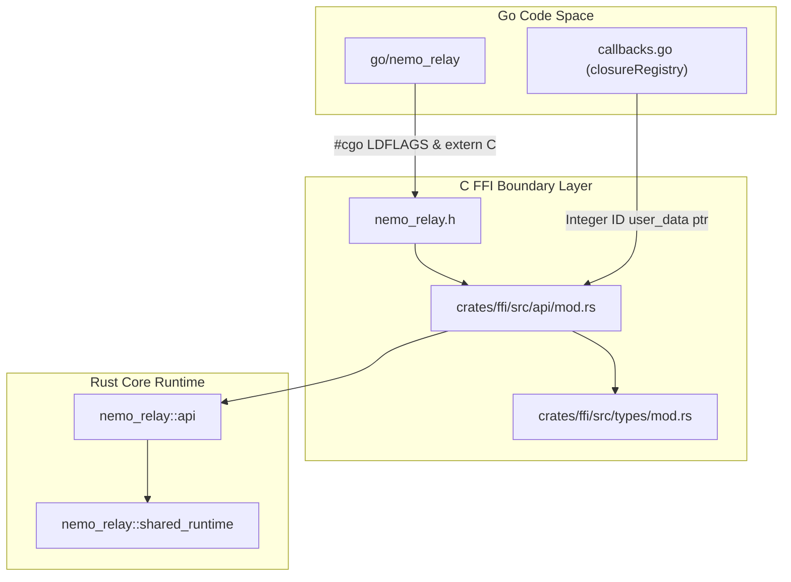
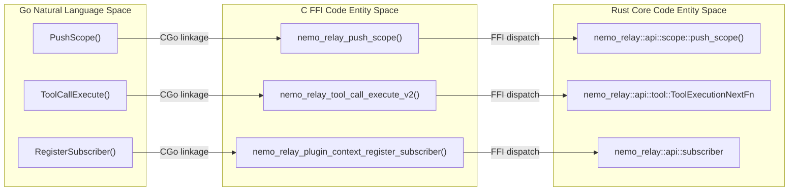
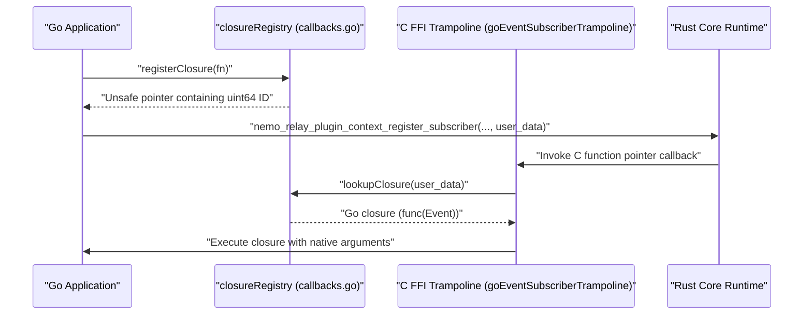

<!-- source: DeepWiki mcp.deepwiki.com · repo NVIDIA/NeMo-Relay · page 4.3 Go Binding and C FFI · fetched 2026-10-26 -->

# Go Binding and C FFI

Relevant source files

The following files were used as context for generating this wiki page:

- [crates/ffi/nemo_relay.h](crates/ffi/nemo_relay.h)
- [crates/ffi/src/api/event_registry.rs](crates/ffi/src/api/event_registry.rs)
- [crates/ffi/src/api/mod.rs](crates/ffi/src/api/mod.rs)
- [crates/ffi/src/api/plugin.rs](crates/ffi/src/api/plugin.rs)
- [crates/ffi/src/api/scope.rs](crates/ffi/src/api/scope.rs)
- [crates/ffi/src/callable.rs](crates/ffi/src/callable.rs)
- [crates/ffi/src/types/mod.rs](crates/ffi/src/types/mod.rs)
- [crates/ffi/tests/integration/api_tests.rs](crates/ffi/tests/integration/api_tests.rs)
- [crates/ffi/tests/unit/api/core_tests.rs](crates/ffi/tests/unit/api/core_tests.rs)
- [crates/ffi/tests/unit/api/plugin_tests.rs](crates/ffi/tests/unit/api/plugin_tests.rs)
- [crates/ffi/tests/unit/api/registry_tests.rs](crates/ffi/tests/unit/api/registry_tests.rs)
- [crates/ffi/tests/unit/api_tests.rs](crates/ffi/tests/unit/api_tests.rs)
- [crates/ffi/tests/unit/callable_tests.rs](crates/ffi/tests/unit/callable_tests.rs)
- [go/nemo_relay/adaptive_plugin_test.go](go/nemo_relay/adaptive_plugin_test.go)
- [go/nemo_relay/callbacks.go](go/nemo_relay/callbacks.go)
- [go/nemo_relay/coverage_gap_test.go](go/nemo_relay/coverage_gap_test.go)
- [go/nemo_relay/event_sanitizers_test.go](go/nemo_relay/event_sanitizers_test.go)
- [go/nemo_relay/nemo_relay.go](go/nemo_relay/nemo_relay.go)
- [go/nemo_relay/otel_signals_test.go](go/nemo_relay/otel_signals_test.go)
- [go/nemo_relay/plugin.go](go/nemo_relay/plugin.go)
- [go/nemo_relay/scope/scope.go](go/nemo_relay/scope/scope.go)
- [go/nemo_relay/scope/shorthand_test.go](go/nemo_relay/scope/shorthand_test.go)
- [go/nemo_relay/scope_test.go](go/nemo_relay/scope_test.go)
- [go/nemo_relay/subscribers/subscribers_test.go](go/nemo_relay/subscribers/subscribers_test.go)
- [go/nemo_relay/timestamp_test.go](go/nemo_relay/timestamp_test.go)
- [go/nemo_relay/top_level_coverage_test.go](go/nemo_relay/top_level_coverage_test.go)
- [go/nemo_relay/wrapper_coverage_test.go](go/nemo_relay/wrapper_coverage_test.go)

### Purpose and Scope

This section covers the Go CGo binding (`go/nemo_relay`) and the underlying C Foreign Function Interface (FFI) layer (`crates/ffi`, `nemo_relay.h`) for NeMo Relay. It details the hierarchical scope stack, tool and LLM call lifecycle execution, adaptive runtime wrappers, event subscribers, PII redaction integration, priority-ordered guardrails, the callback trampoline mechanism, FFI error handling, status code translation, and the test coverage strategy.

Sources: [go/nemo_relay/nemo_relay.go:4-23](), [crates/ffi/src/api/mod.rs:1-165](), [crates/ffi/nemo_relay.h:1-60]()

---

### Architectural Overview

The NeMo Relay polyglot architecture relies on a compiled Rust core (`crates/core`), exposed through a C-compatible FFI abi (`crates/ffi`), which is consumed by the Go binding via CGo (`go/nemo_relay`). 

Sources: [go/nemo_relay/nemo_relay.go:25-52](), [crates/ffi/src/api/mod.rs:1-165](), [crates/ffi/nemo_relay.h:1-50]()

---

### The C FFI Layer (`crates/ffi`)

The FFI layer wraps internal Rust types in opaque pointer wrappers (`Box`-allocated structures) and exposes synchronous and asynchronous execution paths. All functions return an `NemoRelayStatus` status code [crates/ffi/src/api/mod.rs:6-8]().

#### Opaque Handles and Type Mapping

| C Handle Type | Rust Core Equivalent | Description |
| :--- | :--- | :--- |
| `FfiScopeHandle` | `ScopeHandle` | Represents an active execution scope [crates/ffi/src/types/mod.rs:43-43]() |
| `FfiScopeStack` | `ScopeStackHandle` | Isolated scope stack for thread/task isolation [crates/ffi/src/types/mod.rs:57-57]() |
| `FfiToolHandle` | `ToolHandle` | Active tool invocation [crates/ffi/src/types/mod.rs:45-45]() |
| `FfiLLMHandle` | `LlmHandle` | Active LLM model call [crates/ffi/src/types/mod.rs:47-47]() |
| `FfiCodecHandle` | `Arc<dyn LlmCodec>` / `Arc<dyn LlmResponseCodec>` | LLM provider codec container [crates/ffi/src/types/mod.rs:99-103]() |
| `FfiAdaptiveRuntime` | `AdaptiveRuntime` | Owned adaptive runtime instance [crates/ffi/src/types/mod.rs:75-75]() |
| `FfiPluginContext` | `PluginRegistrationContext` | Borrowed pointer for plugin registration [crates/ffi/src/types/mod.rs:91-91]() |

Sources: [crates/ffi/src/types/mod.rs:38-103](), [crates/ffi/nemo_relay.h:135-247]()

#### Memory Management and Thread Safety

- **String Returns:** Foreign callers must release allocated C strings by calling `nemo_relay_string_free` [crates/ffi/src/convert.go]().
- **Handle Destructors:** Each opaque handle exposes a dedicated release function (e.g., `nemo_relay_scope_handle_free`, `nemo_relay_llm_handle_free`) [crates/ffi/src/types/mod.rs:8-11]().
- **SIGPIPE Handling:** On Linux, `ignore_sigpipe` prevents closed worker sockets from crashing the embedding Go process [crates/ffi/src/api/mod.rs:115-121]().

Sources: [crates/ffi/src/api/mod.rs:99-125](), [crates/ffi/src/types/mod.rs:4-12]()

---

### Go Binding Subsystems (`go/nemo_relay`)

The Go binding package organizes features across specialized sub-packages and files:

- **`scope`**: Manages push/pop hierarchies, attributes, timestamps, and thread-local scope stack binding [go/nemo_relay/nemo_relay.go:56-61]().
- **`llm`**: Wraps LLM invocation handles, streaming, request/response codecs, and token accounting [go/nemo_relay/nemo_relay.go:97-113]().
- **`tools`**: Provides tool registration, tool execution, and argument sanitization [go/nemo_relay/nemo_relay.go:63-80]().
- **`adaptive`**: Interfaces with the Adaptive Cache Governor (ACG) and PromptIR layers.
- **`subscribers`**: Handles OpenTelemetry and event subscription routing.
- **`pii_redaction`**: Exposes redaction profiles and scrubbing integrations.
- **`guardrails`**: Registers sanitize and conditional-execution interceptors [go/nemo_relay/nemo_relay.go:48-52]().

Sources: [go/nemo_relay/nemo_relay.go:4-23](), [go/nemo_relay/nemo_relay.go:48-113]()

---

### Entity Association Across Layers (Natural Language Space to Code Entity Space)

The following diagram bridges the abstract concepts of scopes and tool execution in Go to their exact C FFI declarations and Rust core implementations.

Sources: [go/nemo_relay/nemo_relay.go:57-80](), [go/nemo_relay/plugin.go:47-63](), [crates/ffi/src/api/mod.rs:51-64]()

---

### Callback Trampoline and Closure Registry

Because C function pointers cannot directly reference Go stack allocations or closures with captured variables, the Go binding employs an integer-keyed global closure registry and C export trampolines.

Sources: [go/nemo_relay/callbacks.go:100-152](), [go/nemo_relay/plugin.go:64-69]()

---

### Registry, Error Handling, and Status Codes

Every FFI function returns a `NemoRelayStatus` integer. Thread-local error messages are managed via `set_last_error` and retrieved using `nemo_relay_last_error`.

| Status Enum | Value | Description |
| :--- | :--- | :--- |
| `NEMO_RELAY_STATUS_OK` | 0 | Operation completed successfully [crates/ffi/nemo_relay.h:21-21]() |
| `NEMO_RELAY_STATUS_ALREADY_EXISTS` | 1 | Resource already exists [crates/ffi/nemo_relay.h:25-25]() |
| `NEMO_RELAY_STATUS_NOT_FOUND` | 2 | Requested resource not found [crates/ffi/nemo_relay.h:29-29]() |
| `NEMO_RELAY_STATUS_SCOPE_STACK_EMPTY` | 3 | Scope stack is empty [crates/ffi/nemo_relay.h:33-33]() |
| `NEMO_RELAY_STATUS_GUARDRAIL_REJECTED` | 4 | Guardrail rejected operation [crates/ffi/nemo_relay.h:37-37]() |
| `NEMO_RELAY_STATUS_INTERNAL` | 5 | Internal runtime error [crates/ffi/nemo_relay.h:41-41]() |
| `NEMO_RELAY_STATUS_NULL_POINTER` | 6 | Null pointer argument received [crates/ffi/nemo_relay.h:45-45]() |
| `NEMO_RELAY_STATUS_INVALID_JSON` | 7 | JSON parsing failure [crates/ffi/nemo_relay.h:49-49]() |
| `NEMO_RELAY_STATUS_INVALID_UTF8` | 8 | Invalid UTF-8 in C string [crates/ffi/nemo_relay.h:53-53]() |
| `NEMO_RELAY_STATUS_INVALID_ARG` | 9 | Invalid argument value [crates/ffi/nemo_relay.h:57-57]() |

Sources: [crates/ffi/nemo_relay.h:17-59](), [crates/ffi/src/error.rs:1-80]()

---

### Coverage Test Strategy

The test suite ensures robust boundary validation between Go, CGo, FFI, and the Rust core:
- **`coverage_gap_test.go`**: Tests nil pointer fallbacks, malformed JSON serialization payloads, closed exporter handle behavior, and error paths [go/nemo_relay/coverage_gap_test.go:1-192]().
- **`event_sanitizers_test.go`**: Validates event sanitizer chains, scope-local sanitizer inheritance, and deregistration correctness [go/nemo_relay/event_sanitizers_test.go:1-197]().
- **FFI Unit Tests (`crates/ffi/tests/unit/api/registry_tests.rs`)**: Exercises callback registration, metadata injection failure paths, and OTLP collector mock loops [crates/ffi/tests/unit/api/registry_tests.rs:1-194]().

Sources: [go/nemo_relay/coverage_gap_test.go:1-192](), [go/nemo_relay/event_sanitizers_test.go:1-197](), [crates/ffi/tests/unit/api/registry_tests.rs:1-194]()

---

