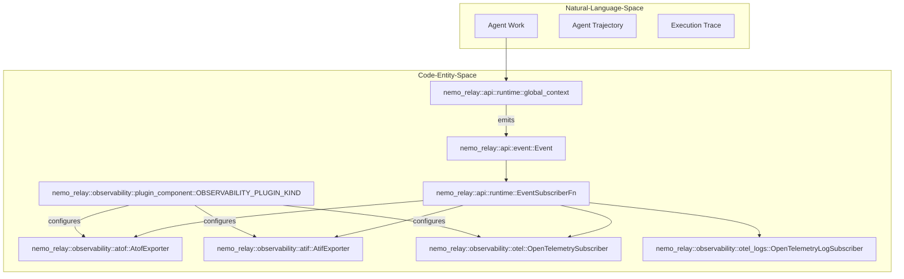
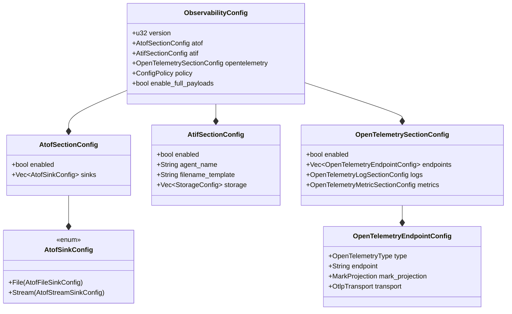

<!-- source: DeepWiki mcp.deepwiki.com · repo NVIDIA/NeMo-Relay · page 5 Observability · fetched 2026-10-26 -->

# Observability

Relevant source files

The following files were used as context for generating this wiki page:

- [crates/core/src/observability/atif.rs](crates/core/src/observability/atif.rs)
- [crates/core/src/observability/atof.rs](crates/core/src/observability/atof.rs)
- [crates/core/src/observability/mod.rs](crates/core/src/observability/mod.rs)
- [crates/core/src/observability/openinference.rs](crates/core/src/observability/openinference.rs)
- [crates/core/tests/integration/atif_storage_tests.rs](crates/core/tests/integration/atif_storage_tests.rs)
- [crates/core/tests/unit/atif_tests.rs](crates/core/tests/unit/atif_tests.rs)
- [crates/core/tests/unit/observability/atof_tests.rs](crates/core/tests/unit/observability/atof_tests.rs)
- [crates/core/tests/unit/observability/exporter_parity_tests.rs](crates/core/tests/unit/observability/exporter_parity_tests.rs)
- [crates/core/tests/unit/observability/openinference_tests.rs](crates/core/tests/unit/observability/openinference_tests.rs)
- [docs/about-nemo-relay/concepts/events.mdx](docs/about-nemo-relay/concepts/events.mdx)
- [docs/configure-plugins/observability/about.mdx](docs/configure-plugins/observability/about.mdx)
- [docs/configure-plugins/observability/atif.mdx](docs/configure-plugins/observability/atif.mdx)
- [docs/configure-plugins/observability/atof.mdx](docs/configure-plugins/observability/atof.mdx)
- [docs/instrument-applications/instrument-llm-call.mdx](docs/instrument-applications/instrument-llm-call.mdx)
- [docs/reference/atof-event-format.mdx](docs/reference/atof-event-format.mdx)
- [skills/nemo-relay-plugin-observability/references/atif.md](skills/nemo-relay-plugin-observability/references/atif.md)

NeMo Relay provides a unified observability subsystem designed to capture agent activity at the execution boundary. Instead of manual instrumentation scattered across application code, NeMo Relay emits a canonical event stream that can be consumed in-process or exported to various industry-standard backends.

The observability system starts with **Events** generated by the core runtime during the lifecycle of scopes, tools, and LLM calls [crates/core/src/api/event.rs:7-10](). These events follow the **Agent Trajectory Observability Format (ATOF)**, providing a framework-neutral representation of agent work [crates/core/src/observability/plugin_component.rs:11-19]().

### System Architecture

The following diagram illustrates the flow from runtime execution to various observability exporters.

**Observability Data Flow**

**Sources:** [crates/core/src/api/runtime/mod.rs:1-30](), [crates/core/src/observability/plugin_component.rs:4-19](), [crates/core/src/observability/otel.rs:12-17]()

---

### Core Components

#### 1. ATOF Event Stream
The **Agent Trajectory Observability Format (ATOF)** is the internal canonical representation of all lifecycle events [crates/core/src/observability/plugin_component.rs:11-19](). Every managed tool call, LLM interaction, and scope change emits an ATOF record via the `Event` enum [crates/core/src/api/event.rs:7-10]().
*   **Purpose**: Provides a single source of truth for what happened during execution.
*   **Consumption**: Subscribers receive these native objects asynchronously via a background dispatcher on native targets [crates/core/src/api/runtime/mod.rs:1-30]().

#### 2. Subscribers and Exporters
**Subscribers** are the primary mechanism for watching the event stream without affecting execution.
*   **Global Subscribers**: Registered via `register_subscriber`, these are active process-wide [crates/core/src/api/subscriber.zrs:1-50]() (or `crates/core/src/api/subscriber.rs`).
*   **Scope-Local Subscribers**: Tied to a specific `Scope` and automatically removed when the scope closes.
*   **Exporters**: Specialized subscribers that translate ATOF events into external formats like JSONL, ATIF, or OTLP [crates/core/src/observability/plugin_component.rs:51-68]().

#### 3. The Observability Plugin
The `observability` plugin component allows users to activate and configure multiple exporters through a single TOML or JSON configuration [crates/core/src/observability/plugin_component.rs:85-91](). This avoids the need for manual registration code in the application, simplifying adoption across bindings.

**Observability Plugin Configuration Structure**

**Sources:** [crates/core/src/observability/plugin_component.rs:133-168]()

---

### Exporter Formats

NeMo Relay supports four primary export formats, each serving different downstream analysis or observability needs:

| Format | Purpose | Details |
| :--- | :--- | :--- |
| **ATOF (JSONL)** | Raw, line-delimited lifecycle events for local debugging or streaming to HTTP/WebSocket endpoints | Emits the original lifecycle event stream for inspection or ingestion [crates/core/src/observability/atof.rs:4-10](). Read more in [ATOF and ATIF Exporters](#5.1). |
| **ATIF** | High-level agent trajectories for evaluation, replay, and storage, conforming to ATIF v1.7 schema | Processes lifecycle events into structured trajectories with step-level messages, tool calls, and observations [crates/core/src/observability/atif.rs:4-14](). See [ATOF and ATIF Exporters](#5.1) for details. |
| **OpenTelemetry** | OTLP spans for integration with standard APM backends using GenAI semantics | Adapts lifecycle events into OTLP spans with `full`, `gen_ai`, or `openinference` semantic projections [crates/core/src/observability/mod.rs:133-142](). See [OpenTelemetry and OpenInference Exporters](#5.2). |
| **OpenInference** | LLM-specific semantic spans formatted per OpenInference conventions | A semantic projection layered on top of OpenTelemetry focusing on detailed LLM request/response attributes [crates/core/src/observability/openinference.rs:4-7](). Covered in [OpenTelemetry and OpenInference Exporters](#5.2). |

---

### Correlation and Context

A key feature of the observability subsystem is the ability to correlate data across different formats using unique identifiers:

*   **UUIDs**: Every event and scope has a unique deterministic UUID v7 used as the canonical identity [crates/core/src/api/event.rs:7-10]().
*   **Lineage**: Parent-child relationships are preserved in the event hierarchy and translated to span and trace structures in OTLP exporters [crates/core/src/observability/otel.rs:27-30]().
*   **Session Identification**: The top-level agent scope UUID typically corresponds to a `session_id` used for grouping trajectories in ATIF exporters [crates/core/src/observability/atif.rs:50-55]().
*   **Deterministic Trace and Span IDs**: The `RelayIdGenerator` derives OTLP-compliant trace and span IDs from these UUIDs to ensure consistent correlation across different observability backends [crates/core/src/observability/mod.rs:151-158]().

---

### Child Pages

- **[ATOF and ATIF Exporters](#5.1)**  
  Deep dive into the Agent Trajectory Observability Format (ATOF) event stream and the Agent Trajectory Interchange Format (ATIF) export. Covers file sinks, streaming endpoints, session/window correlation, and ATIF v1.7 schema details.  
  [crates/core/src/observability/atif.rs:4-13](), [crates/core/src/observability/atof.rs:4-20]()

- **[OpenTelemetry and OpenInference Exporters](#5.2)**  
  Explains OpenTelemetry Protocol (OTLP) trace export, semantic convention selections (full, gen_ai, openinference), span attribute mappings including `nemo_relay.uuid` and `nemo_relay.parent_uuid`, and how to correlate ATIF trajectories with OTLP spans.  
  [crates/core/src/observability/otel.rs:4-17](), [crates/core/src/observability/openinference.rs:4-17](), [crates/core/src/observability/mod.rs:128-140]()

- **[Observability Plugin Configuration](#5.3)**  
  Documents the `observability` plugin component configuration including its TOML schema, how to enable and customize ATOF, ATIF, OTLP, and OpenInference exporters, as well as sanitize guardrails for PII. Also covers the discovery and merge behavior of `plugins.toml`.  
  [crates/core/src/observability/plugin_component.rs:133-154]()

- **[PII Redaction Plugin](#5.4)**  
  Details the `nemo-relay-pii-redaction` crate, its configuration (`PiiRedactionConfig`), built-in detectors, redaction actions, and how it integrates with the observability subsystem to sanitize sensitive data.

---

**Sources:**
* `crates/core/src/api/event.rs` [7-10]()
* `crates/core/src/observability/atif.rs` [4-14](), [50-55]()
* `crates/core/src/observability/atof.rs` [4-20]()
* `crates/core/src/observability/otel.rs` [4-17](), [27-30]()
* `crates/core/src/observability/openinference.rs` [4-7]()
* `crates/core/src/observability/mod.rs` [128-140](), [133-142](), [151-158]()
* `crates/core/src/observability/plugin_component.rs` [4-19](), [11-19](), [51-68](), [85-91](), [133-168]()

---

