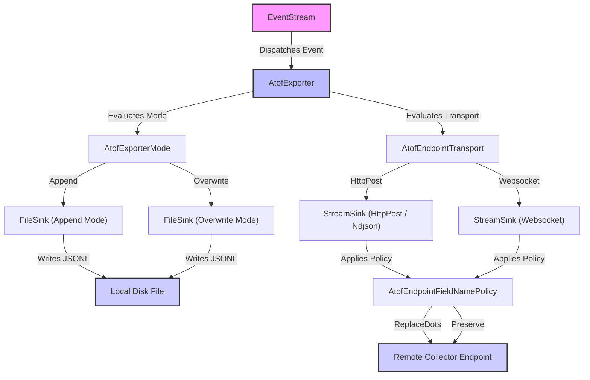
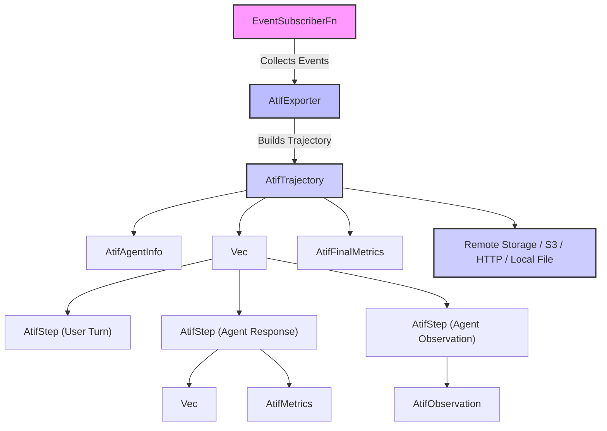

<!-- source: DeepWiki mcp.deepwiki.com · repo NVIDIA/NeMo-Relay · page 5.1 ATOF and ATIF Exporters · fetched 2026-10-26 -->

# ATOF and ATIF Exporters

Relevant source files

The following files were used as context for generating this wiki page:

- [crates/core/src/observability/atif.rs](crates/core/src/observability/atif.rs)
- [crates/core/src/observability/atof.rs](crates/core/src/observability/atof.rs)
- [crates/core/src/observability/mod.rs](crates/core/src/observability/mod.rs)
- [crates/core/src/observability/openinference.rs](crates/core/src/observability/openinference.rs)
- [crates/core/tests/integration/atif_storage_tests.rs](crates/core/tests/integration/atif_storage_tests.rs)
- [crates/core/tests/unit/atif_tests.rs](crates/core/tests/unit/atif_tests.rs)
- [crates/core/tests/unit/observability/atof_tests.rs](crates/core/tests/unit/observability/atof_tests.rs)
- [crates/core/tests/unit/observability/exporter_parity_tests.rs](crates/core/tests/unit/observability/exporter_parity_tests.rs)
- [crates/core/tests/unit/observability/openinference_tests.rs](crates/core/tests/unit/observability/openinference_tests.rs)
- [docs/about-nemo-relay/concepts/events.mdx](docs/about-nemo-relay/concepts/events.mdx)
- [docs/configure-plugins/observability/about.mdx](docs/configure-plugins/observability/about.mdx)
- [docs/configure-plugins/observability/atif.mdx](docs/configure-plugins/observability/atif.mdx)
- [docs/configure-plugins/observability/atof.mdx](docs/configure-plugins/observability/atof.mdx)
- [docs/instrument-applications/instrument-llm-call.mdx](docs/instrument-applications/instrument-llm-call.mdx)
- [docs/reference/atof-event-format.mdx](docs/reference/atof-event-format.mdx)
- [skills/nemo-relay-plugin-observability/references/atif.md](skills/nemo-relay-plugin-observability/references/atif.md)

This page details the Agent Trajectory Observability Format (ATOF) and Agent Trajectory Interchange Format (ATIF) exporters within NeMo Relay core and plugin subsystems [docs/about-nemo-relay/concepts/events.mdx:15-19](), [crates/core/src/observability/atif.rs:4-8](). It covers how these exporters capture and format runtime events, including JSONL/stream export for ATOF, trajectory export for ATIF v1.7, collection windows, session correlation, cost estimation, token accounting, and supported storage backends.

## ATOF JSONL/Stream Export

The Agent Trajectory Observability Format (ATOF) is the canonical event format used by NeMo Relay to record runtime activities [docs/about-nemo-relay/concepts/events.mdx:15-19](). The `AtofExporter` is an event subscriber that writes each canonical ATOF event as a single JSON object per line in a JSONL file [crates/core/src/observability/atof.rs:7-9](). ATOF events represent the runtime record of what happened, including lifecycle events from scopes, managed execution helpers, manual lifecycle APIs, and more [docs/about-nemo-relay/concepts/events.mdx:12-15]().

ATOF defines two primary event kinds [docs/about-nemo-relay/concepts/events.mdx:23-35]():
*   **Scope Events**: Emitted when lifecycle work starts or ends, identified by `scope_category` (either `start` or `end`) and `category` (e.g., `agent`, `tool`, `llm`) [docs/about-nemo-relay/concepts/events.mdx:26-30](). Scope events have a duration and are paired by a shared `uuid` [docs/about-nemo-relay/concepts/events.mdx:38-40]().
*   **Mark Events**: Emitted for named runtime checkpoints that are not full start/end lifecycle pairs [docs/about-nemo-relay/concepts/events.mdx:34-35](). Marks represent a single point in time and do not have a paired event [docs/about-nemo-relay/concepts/events.mdx:39-40]().

Every ATOF event includes a shared envelope with fields such as `kind`, `atof_version`, `uuid`, `parent_uuid`, `timestamp`, `name`, `data`, `data_schema`, and `metadata` [docs/about-nemo-relay/concepts/events.mdx:56-67]().

The ATOF exporter is configured via the `atof` section within the observability plugin configuration [docs/configure-plugins/observability/atof.mdx:10-11](). It supports both file sinks and stream sinks [docs/configure-plugins/observability/atof.mdx:68-69]().

File sinks write the raw event stream to a JSONL file [docs/configure-plugins/observability/atof.mdx:72-73](). Key fields include `output_directory`, `filename`, and `mode` (which can be `append` or `overwrite`) [crates/core/src/observability/atof.rs:79-82](), [docs/configure-plugins/observability/atof.mdx:78-81]().

Stream sinks send events to collectors in near real-time and can transform dotted object keys before delivery [docs/configure-plugins/observability/atof.mdx:98-101](). Configuration fields include `url`, `transport` (`http_post`, `websocket`, or `ndjson`), `headers`, `header_env`, `timeout_millis`, and `field_name_policy` (`preserve` or `replace_dots`) [crates/core/src/observability/atof.rs:109-190]().

Diagram: ATOF Code Entity Architecture and Data Flow

Sources:
*   [crates/core/src/observability/atof.rs:7-9]()
*   [crates/core/src/observability/atof.rs:79-82]()
*   [crates/core/src/observability/atof.rs:109-190]()
*   [docs/about-nemo-relay/concepts/events.mdx:12-15]()
*   [docs/about-nemo-relay/concepts/events.mdx:15-19]()
*   [docs/about-nemo-relay/concepts/events.mdx:23-35]()
*   [docs/about-nemo-relay/concepts/events.mdx:26-30]()
*   [docs/about-nemo-relay/concepts/events.mdx:34-35]()
*   [docs/about-nemo-relay/concepts/events.mdx:38-40]()
*   [docs/about-nemo-relay/concepts/events.mdx:56-67]()
*   [docs/configure-plugins/observability/atof.mdx:10-11]()
*   [docs/configure-plugins/observability/atof.mdx:68-69]()
*   [docs/configure-plugins/observability/atof.mdx:72-73]()
*   [docs/configure-plugins/observability/atof.mdx:78-81]()
*   [docs/configure-plugins/observability/atof.mdx:98-101]()

## ATIF v1.7 Trajectory Export

The Agent Trajectory Interchange Format (ATIF) exporter collects lifecycle events and converts them into ATIF trajectories conforming to the ATIF v1.7 schema [crates/core/src/observability/atif.rs:6-8](). The `AtifExporter` registers as an event subscriber, collects all events, and can export them as an `AtifTrajectory` via `AtifExporter::export` [crates/core/src/observability/atif.rs:12-13](). The ATIF schema version constant is `ATIF_SCHEMA_VERSION` (`"ATIF-v1.7"`) [crates/core/src/observability/atif.rs:51-55]().

The core conversion from NeMo Relay events to ATIF steps follows specific rules [crates/core/src/observability/atif.rs:15-27]():
*   **LLM Start**: Maps to a `user` step for fresh user turns [crates/core/src/observability/atif.rs:19-21]().
*   **LLM End**: Maps to an `agent` step, promoting response content and tool calls [crates/core/src/observability/atif.rs:22]().
*   **Tool Start**: Skipped (tool calls come from LLM End instead) [crates/core/src/observability/atif.rs:23]().
*   **Tool End**: Maps to an agent observation, correlated by `source_call_id` [crates/core/src/observability/atif.rs:24]().
*   **Mark / Scope Start/End**: Skipped as structural or point-in-time telemetry [crates/core/src/observability/atif.rs:25-26]().

An `AtifTrajectory` contains `AtifAgentInfo` (agent name, version, model, tool definitions, extra) [crates/core/src/observability/atif.rs:61-77]() and a sequence of `AtifStep` objects [crates/core/src/observability/atif.rs:80-117](). Each `AtifStep` includes fields like `step_id`, `source`, `message`, `timestamp`, `model_name`, `tool_calls`, `observation`, and `metrics` [crates/core/src/observability/atif.rs:80-117]().

Diagram: ATIF Code Entity Architecture and Data Flow

Sources:
*   [crates/core/src/observability/atif.rs:6-8]()
*   [crates/core/src/observability/atif.rs:12-13]()
*   [crates/core/src/observability/atif.rs:15-27]()
*   [crates/core/src/observability/atif.rs:51-55]()
*   [crates/core/src/observability/atif.rs:61-77]()
*   [crates/core/src/observability/atif.rs:80-117]()

## Collection Windows and Session Correlation

ATIF trajectories are collected per top-level Agent scope or supported coding-agent turn scope [docs/configure-plugins/observability/atif.mdx:14-16](). The plugin-managed ATIF dispatcher creates a scope-local exporter for each such scope and writes the trajectory when that root scope ends [docs/configure-plugins/observability/atif.mdx:14-17](). Nested Agent scopes remain within the parent trajectory [docs/configure-plugins/observability/atif.mdx:17-18]().

Session correlation is managed through several identifiers exposed under `extra.nemo_relay` and trajectory fields [docs/configure-plugins/observability/atif.mdx:51-55]():
*   `session_id`: The logical harness session ID, derived from the propagation root when a run identifier like an upstream UUID `request_id` is present [docs/configure-plugins/observability/atif.mdx:51-53]().
*   `session_instance_id`: Relay's root scope UUID [docs/configure-plugins/observability/atif.mdx:49]().
*   `trajectory_id`: The top-level ATIF `trajectory_id` is the Agent scope UUID, ensuring unique artifact identities [docs/configure-plugins/observability/atif.mdx:53-55]().
*   `user_id`: Present if session metadata contains a top-level string value [docs/configure-plugins/observability/atif.mdx:49-50]().

The `filename_template` for ATIF export can use `{session_id}` and `{metadata.<path>}` placeholders for dynamic routing and naming of trajectory files [docs/configure-plugins/observability/atif.mdx:71-72](). For example, `trajectory-{session_id}.json` or `{metadata.atif_prefix:-unassigned}/trajectory-{session_id}.json` [docs/configure-plugins/observability/atif.mdx:39, 103]().

Sources:
*   [docs/configure-plugins/observability/atif.mdx:14-16]()
*   [docs/configure-plugins/observability/atif.mdx:14-17]()
*   [docs/configure-plugins/observability/atif.mdx:17-18]()
*   [docs/configure-plugins/observability/atif.mdx:39]()
*   [docs/configure-plugins/observability/atif.mdx:49]()
*   [docs/configure-plugins/observability/atif.mdx:49-50]()
*   [docs/configure-plugins/observability/atif.mdx:51-53]()
*   [docs/configure-plugins/observability/atif.mdx:53-55]()
*   [docs/configure-plugins/observability/atif.mdx:71-72]()
*   [docs/configure-plugins/observability/atif.mdx:103]()

## Cost Estimation and Token Accounting

Both ATOF and ATIF exporters provide mechanisms for cost estimation and token accounting.

Each `AtifStep` can include `AtifMetrics` detailing token usage and cost [crates/core/src/observability/atif.rs:106-107]():
*   `prompt_tokens`: Number of prompt tokens [crates/core/src/observability/atif.rs:124]().
*   `completion_tokens`: Number of completion tokens [crates/core/src/observability/atif.rs:126]().
*   `cached_tokens`: Number of cached tokens [crates/core/src/observability/atif.rs:128]().
*   `cost_usd`: Estimated cost in USD [crates/core/src/observability/atif.rs:130]().
*   `prompt_token_ids`, `completion_token_ids`, `logprobs`: Detailed token tracking arrays [crates/core/src/observability/atif.rs:135-143]().

`AtifFinalMetrics` provides aggregate statistics for the entire trajectory, including `total_prompt_tokens`, `total_completion_tokens`, and `total_cached_tokens` [crates/core/src/observability/atif.rs:151-163]().

NeMo Relay uses `PricingCatalog` and `PricingResolver` to determine costs [crates/core/tests/unit/atif_tests.rs:37-61](). The `PricingCatalog` defines rates for input, output, and cache read tokens per million associated with models and providers [crates/core/tests/unit/atif_tests.rs:37-59](). Cost estimates can come from `CostSource::ProviderReported` or be calculated from pricing catalogs [crates/core/tests/unit/atif_tests.rs:117-130]().

The observability module provides helper functions for token accounting across providers:
*   `input_tokens_including_cache`: Returns provider-independent input totals, accounting for how different providers (e.g., Anthropic vs. OpenAI) report cached tokens [crates/core/src/observability/mod.rs:60-73]().
*   `total_tokens_including_cache`: Returns provider-independent prompt-plus-completion totals [crates/core/src/observability/mod.rs:77-91]().
*   `uses_separate_anthropic_cache_tokens`: Determines if a provider reports cache tokens separately [crates/core/src/observability/mod.rs:94-107]().

Sources:
*   [crates/core/src/observability/atif.rs:106-107]()
*   [crates/core/src/observability/atif.rs:124]()
*   [crates/core/src/observability/atif.rs:126]()
*   [crates/core/src/observability/atif.rs:128]()
*   [crates/core/src/observability/atif.rs:130]()
*   [crates/core/src/observability/atif.rs:135-143]()
*   [crates/core/src/observability/atif.rs:151-163]()
*   [crates/core/src/observability/mod.rs:60-73]()
*   [crates/core/src/observability/mod.rs:77-91]()
*   [crates/core/src/observability/mod.rs:94-107]()
*   [crates/core/tests/unit/atif_tests.rs:37-59]()
*   [crates/core/tests/unit/atif_tests.rs:37-61]()
*   [crates/core/tests/unit/atif_tests.rs:117-130]()

## Storage Backends

Both ATOF and ATIF exporters support various storage backends for their output.

For ATOF, events can be written to local JSONL files via file sinks or streamed to remote endpoints via stream sinks using `http_post`, `websocket`, or `ndjson` transports [crates/core/src/observability/atof.rs:44-56](), [crates/core/src/observability/atof.rs:109-117]().

For ATIF, trajectories can be uploaded to remote storage destinations configured under the `storage` field [docs/configure-plugins/observability/atif.mdx:73-74](). If `storage` is non-empty, trajectories are uploaded to every configured backend [docs/configure-plugins/observability/atif.mdx:136-137](). If all remote writes fail for a trajectory, Relay writes a local recovery copy to `output_directory` [docs/configure-plugins/observability/atif.mdx:137-140]().

Supported remote storage types include:
*   **S3-Compatible Storage**: Configured with `type = "s3"`, `bucket`, and `key_prefix` [docs/configure-plugins/observability/atif.mdx:156-159]().
*   **HTTP Endpoint Storage**: Configured with `type = "http"`, `endpoint`, `headers`, `header_env`, and `timeout_millis` [crates/core/tests/integration/atif_storage_tests.rs:139-145]().

Sources:
*   [crates/core/src/observability/atof.rs:44-56]()
*   [crates/core/src/observability/atof.rs:109-117]()
*   [crates/core/tests/integration/atif_storage_tests.rs:139-145]()
*   [docs/configure-plugins/observability/atif.mdx:73-74]()
*   [docs/configure-plugins/observability/atif.mdx:136-137]()
*   [docs/configure-plugins/observability/atif.mdx:137-140]()
*   [docs/configure-plugins/observability/atif.mdx:156-159]()

---

