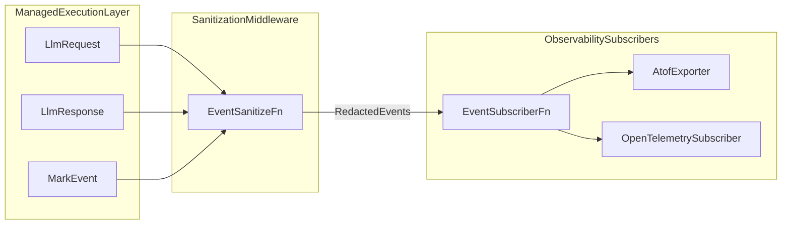
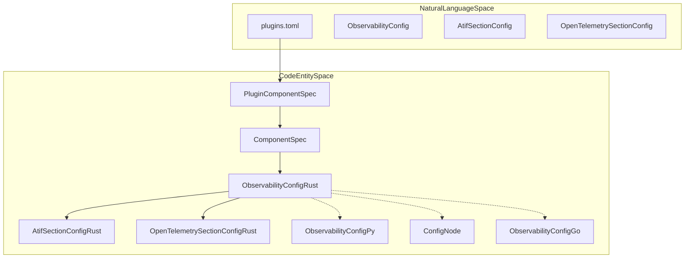

<!-- source: DeepWiki mcp.deepwiki.com · repo NVIDIA/NeMo-Relay · page 5.3 Observability Plugin Configuration · fetched 2026-10-26 -->

# Observability Plugin Configuration

<details>
<summary>Relevant source files</summary>

The following files were used as context for generating this wiki page:

- [crates/core/src/observability/otel.rs](crates/core/src/observability/otel.rs)
- [crates/core/src/observability/plugin_component.rs](crates/core/src/observability/plugin_component.rs)
- [crates/core/tests/unit/observability/otel_tests.rs](crates/core/tests/unit/observability/otel_tests.rs)
- [crates/core/tests/unit/observability/plugin_component_tests.rs](crates/core/tests/unit/observability/plugin_component_tests.rs)
- [crates/node/observability.d.ts](crates/node/observability.d.ts)
- [crates/node/observability.js](crates/node/observability.js)
- [crates/node/tests/observability_plugin_tests.mjs](crates/node/tests/observability_plugin_tests.mjs)
- [crates/python/src/py_types/observability.rs](crates/python/src/py_types/observability.rs)
- [docs/configure-plugins/observability/configuration.mdx](docs/configure-plugins/observability/configuration.mdx)
- [docs/configure-plugins/observability/opentelemetry.mdx](docs/configure-plugins/observability/opentelemetry.mdx)
- [go/nemo_relay/observability_plugin.go](go/nemo_relay/observability_plugin.go)
- [go/nemo_relay/observability_plugin_test.go](go/nemo_relay/observability_plugin_test.go)
- [go/nemo_relay/openinference_test.go](go/nemo_relay/openinference_test.go)
- [go/nemo_relay/otel_test.go](go/nemo_relay/otel_test.go)
- [python/nemo_relay/_native.pyi](python/nemo_relay/_native.pyi)
- [python/nemo_relay/observability.py](python/nemo_relay/observability.py)
- [python/nemo_relay/observability.pyi](python/nemo_relay/observability.pyi)
- [python/tests/test_observability_plugin.py](python/tests/test_observability_plugin.py)
- [python/tests/test_types.py](python/tests/test_types.py)

</details>


The **observability plugin** (plugin kind: `observability`) is a built-in NeMo Relay component designed to export internal runtime telemetry data [crates/core/src/observability/plugin_component.rs:85-86](). It transforms lifecycle and instrumentation events into standardized downstream formats including:

- **Agent Trajectory Observability Format (ATOF)**: Raw event stream export, file- or streaming-based [crates/core/src/observability/plugin_component.rs:52-56]().
- **Agent Trajectory Interchange Format (ATIF)**: Structured trajectory export per agent session or turn [crates/core/src/observability/plugin_component.rs:51-51]().
- **OpenTelemetry (OTLP)**: Exported traces, logs, and metrics in typed semantic projections including `full`, `gen_ai`, and `openinference` [crates/core/src/observability/plugin_component.rs:57-68]().

This component consolidates multi-exporter support behind a unified plugin configuration, allows transactional activation, and integrates sanitization guardrails for PII redaction [crates/core/src/observability/plugin_component.rs:6-20]().

Sources: [crates/core/src/observability/plugin_component.rs:6-20](), [crates/core/src/observability/plugin_component.rs:51-68](), [crates/core/src/observability/plugin_component.rs:85-86]()

---

## Plugin Discovery and Merge Behavior

### Discovery Paths and Precedence

NeMo Relay discovers and layers configuration from system and user locations. The typical precedence is:
1. **System Config**: Platform-specific system path.
2. **User Config**: User XDG config (e.g., `~/.config/nemo-relay/plugins.toml`).
3. **Explicit Overrides**: CLI flags or programmatic initialization.

### Merging Component and Destination Lists

- The top-level plugin document merges the `components` array by concatenating arrays from different layers in precedence order.
- Within the observability plugin's config section, destination lists (e.g., `atof.sinks`, `opentelemetry.endpoints`, and `atif.storage`) concatenate: higher-precedence entries come first [docs/configure-plugins/observability/configuration.mdx:128-132]().
- Nested objects inside destination entries are replaced, not merged item-by-item [docs/configure-plugins/observability/configuration.mdx:137-138]().
- An explicitly empty higher-precedence log or metric `endpoints` list clears inherited explicit endpoints for that signal [docs/configure-plugins/observability/configuration.mdx:134-136]().

Sources: [docs/configure-plugins/observability/configuration.mdx:128-138]()

---

## Configuration Shape and Versions (v3 / v4)

The observability plugin configuration adheres to schema version **4**, while version **3** remains supported for trace-only backwards compatibility [crates/core/src/observability/plugin_component.rs:136-139](), [docs/configure-plugins/observability/configuration.mdx:18-19](). It is identified by the constant `OBSERVABILITY_PLUGIN_KIND = "observability"` [crates/core/src/observability/plugin_component.rs:85-86]().

### Top-Level Plugin Component Structure

```toml
[[components]]
kind = "observability"
enabled = true

[components.config]
version = 4
enable_full_payloads = false
# Sections: atof, atif, opentelemetry
```

Here, `enabled` enables or disables the entire observability component, while `enable_full_payloads` toggles whether LLM start events carry complete sanitized request payloads (defaults to `false`) [crates/core/src/observability/plugin_component.rs:152-154]().

Sources: [crates/core/src/observability/plugin_component.rs:85-86](), [crates/core/src/observability/plugin_component.rs:136-154](), [docs/configure-plugins/observability/configuration.mdx:18-19]()

---

## Exporter Sections

### ATOF Section (Agent Trajectory Observability Format)
Exports raw lifecycle events in JSONL format or streams them to HTTP or WebSocket sinks [crates/core/src/observability/plugin_component.rs:52-56]().

```toml
[components.config.atof]
enabled = true

[[components.config.atof.sinks]]
type = "file"                   # AtofFileSinkConfig
output_directory = "./logs"
filename = "events.jsonl"
mode = "append"                 # "append" or "overwrite"

[[components.config.atof.sinks]]
type = "stream"                 # AtofStreamSinkConfig
url = "http://stream-endpoint"
transport = "http_post"         # "http_post", "websocket", "ndjson"
field_name_policy = "preserve"  # "preserve" or "replace_dots"
```

Sources: [python/nemo_relay/observability.py](), [crates/node/observability.d.ts:16-32](), [go/nemo_relay/observability_plugin.go]()

### ATIF Section (Agent Trajectory Interchange Format)
Reconstructs full trajectories scoped per top-level agent or turn [crates/core/src/observability/plugin_component.rs:51-51]().

```toml
[components.config.atif]
enabled = true
agent_name = "NeMo Relay"
model_name = "unknown"
output_directory = "./observability"
filename_template = "trajectory-{session_id}.json"
```

Sources: [python/nemo_relay/observability.py](), [crates/node/observability.d.ts:57-67]()

### OpenTelemetry Section (OTLP)
Configures independent OTLP trace, log, and metric pipelines [crates/core/src/observability/plugin_component.rs:57-68]().

```toml
[components.config.opentelemetry]
enabled = true

[[components.config.opentelemetry.endpoints]]
type = "full" | "gen_ai" | "openinference"
endpoint = "http://localhost:4318/v1/traces"
transport = "http_binary"       # or "grpc"
service_name = "agent-service"
promote_metadata_prefixes = ["app."]

[components.config.opentelemetry.logs]
enabled = true
minimum_severity = "info"

[components.config.opentelemetry.metrics]
enabled = true
temporality = "cumulative"
```

Sources: [crates/core/src/observability/plugin_component.rs:57-68](), [crates/node/observability.d.ts:69-128]()

---

## Sanitize Guardrails and PII Redaction

Before data reaches observability exporters, it passes through sanitizers. The plugin respects `enable_full_payloads` to determine if LLM start events retain the complete request or just the latest turn, but credential removal and PII sanitizers always apply [docs/configure-plugins/observability/configuration.mdx:93-98]().

### PII Redaction Interception Data Flow


Sources: [crates/core/src/observability/plugin_component.rs:38-44](), [crates/core/src/api/runtime.rs:37-38]()

---

## Implementation and Data Flow

### Configuration to Code Entity Mapping

The configuration maps directly to Rust structs, with mirrored definitions in Python, Node.js, and Go bindings.


Sources: [crates/core/src/observability/plugin_component.rs:93-164](), [python/nemo_relay/observability.py](), [crates/node/observability.d.ts:130-138](), [go/nemo_relay/observability_plugin.go:12-20]()

### Observability Signal Routing

NeMo Relay classifies events before OTLP fan-out [docs/configure-plugins/observability/opentelemetry.mdx:13-19]():

| Signal | Relay Input | OTLP Destination |
|---|---|---|
| **Traces** | Scope lifecycles and non-metric marks | `/v1/traces` |
| **Logs** | Non-metric marks | `/v1/logs` |
| **Metrics** | Marks with `nemo.relay.metric_measurements` schema | `/v1/metrics` |

Relay derives `/v1/logs` and `/v1/metrics` from the trace endpoint if they are enabled but lack explicit endpoints [docs/configure-plugins/observability/opentelemetry.mdx:117-122]().

Sources: [docs/configure-plugins/observability/opentelemetry.mdx:13-19](), [docs/configure-plugins/observability/opentelemetry.mdx:117-122]()

---

## Binding-Level APIs

The observability configuration structures are exposed across all supported language bindings, allowing programmatic component construction alongside TOML configuration files.

- **Python**: Provided via the `nemo_relay.observability` module, exposing dataclasses such as `ObservabilityConfig`, `AtofConfig`, `AtifConfig`, and `OpenTelemetrySectionConfig` [python/nemo_relay/observability.pyi:32-154]().
- **Node.js**: Provided via the TypeScript declarations in `crates/node/observability.d.ts`, mirroring the configuration interfaces and builder functions (`opentelemetryConfig`, `atofConfig`, etc.) [crates/node/observability.d.ts:9-174]().
- **Go**: Provided via `go/nemo_relay/observability_plugin.go`, exposing builder functions like `NewObservabilityConfig()` and component wrappers [go/nemo_relay/observability_plugin.go:12-20]().

Sources: [python/nemo_relay/observability.pyi:32-154](), [crates/node/observability.d.ts:9-174](), [go/nemo_relay/observability_plugin.go:12-20]()

---

## Validation and Diagnostics

- **Structural Validation**: Ensures required fields (like `type` and `endpoint` for OTLP) are present and valid [crates/core/src/observability/plugin_component.rs:70-75]().
- **Activation Lifecycle**: Construction is isolated; one invalid endpoint produces a warning but doesn't block valid endpoints from activating [crates/core/src/observability/plugin_component.rs:77-83]().
- **Teardown**: Relay attempts to shut down every endpoint sequentially during teardown, observing SDK shutdown bounds [crates/core/tests/unit/observability/plugin_component_tests.rs:48-65]().

Sources: [crates/core/src/observability/plugin_component.rs:70-83](), [crates/core/tests/unit/observability/plugin_component_tests.rs:48-65]()

---

