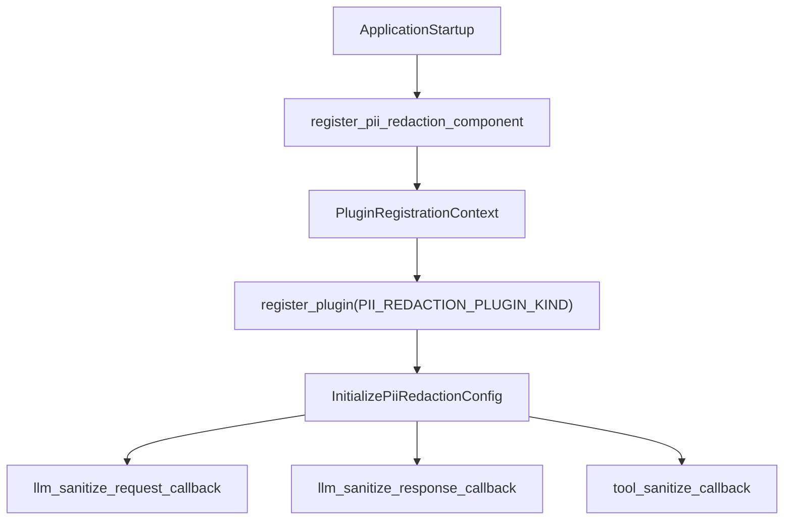
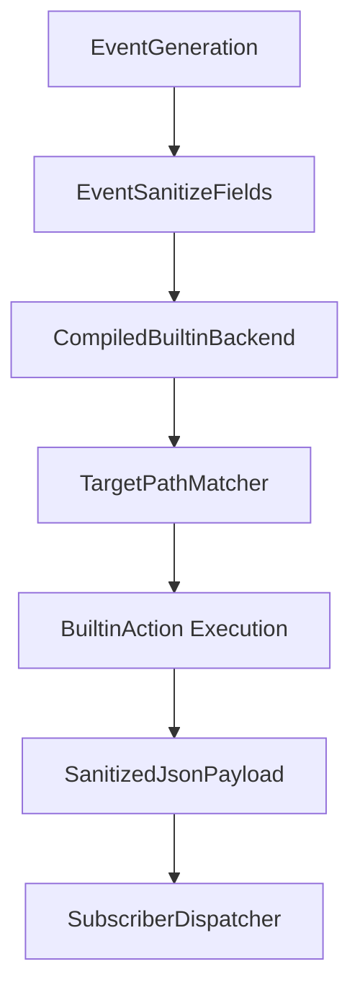
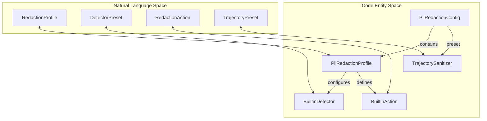
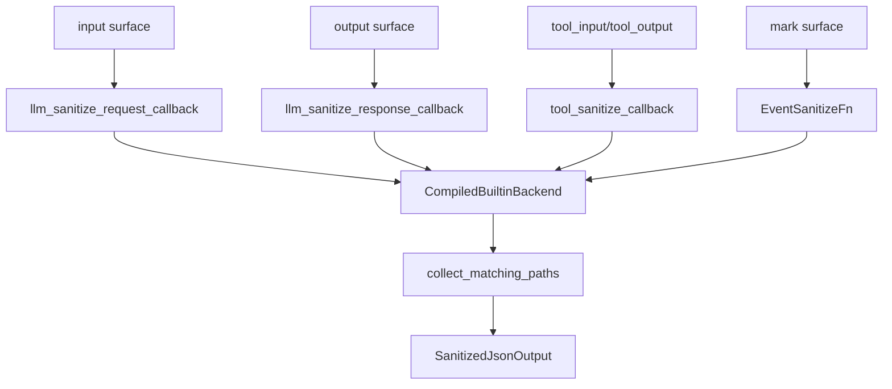

<!-- source: DeepWiki mcp.deepwiki.com · repo NVIDIA/NeMo-Relay · page 5.4 PII Redaction Plugin · fetched 2026-10-26 -->

# PII Redaction Plugin

Relevant source files

The following files were used as context for generating this wiki page:

- [crates/node/pii_redaction.d.ts](crates/node/pii_redaction.d.ts)
- [crates/node/tests/pii_redaction_tests.mjs](crates/node/tests/pii_redaction_tests.mjs)
- [crates/pii-redaction/Cargo.toml](crates/pii-redaction/Cargo.toml)
- [crates/pii-redaction/README.md](crates/pii-redaction/README.md)
- [crates/pii-redaction/src/builtin.rs](crates/pii-redaction/src/builtin.rs)
- [crates/pii-redaction/src/component.rs](crates/pii-redaction/src/component.rs)
- [crates/pii-redaction/src/detectors.rs](crates/pii-redaction/src/detectors.rs)
- [crates/pii-redaction/src/lib.rs](crates/pii-redaction/src/lib.rs)
- [crates/pii-redaction/src/local.rs](crates/pii-redaction/src/local.rs)
- [crates/pii-redaction/src/trajectory.rs](crates/pii-redaction/src/trajectory.rs)
- [crates/pii-redaction/src/trajectory_projection.rs](crates/pii-redaction/src/trajectory_projection.rs)
- [crates/pii-redaction/tests/unit/component_tests.rs](crates/pii-redaction/tests/unit/component_tests.rs)
- [crates/types/src/api/registry.rs](crates/types/src/api/registry.rs)
- [crates/types/tests/registry_tests.rs](crates/types/tests/registry_tests.rs)
- [docs/configure-plugins/pii-redaction/about.mdx](docs/configure-plugins/pii-redaction/about.mdx)
- [docs/configure-plugins/pii-redaction/configuration.mdx](docs/configure-plugins/pii-redaction/configuration.mdx)
- [go/nemo_relay/pii_redaction.go](go/nemo_relay/pii_redaction.go)
- [go/nemo_relay/pii_redaction/pii_redaction_test.go](go/nemo_relay/pii_redaction/pii_redaction_test.go)
- [go/nemo_relay/pii_redaction_test.go](go/nemo_relay/pii_redaction_test.go)
- [python/nemo_relay/pii_redaction.py](python/nemo_relay/pii_redaction.py)
- [python/nemo_relay/pii_redaction.pyi](python/nemo_relay/pii_redaction.pyi)
- [python/tests/test_pii_redaction_plugin.py](python/tests/test_pii_redaction_plugin.py)

The `nemo-relay-pii-redaction` crate provides a declarative, config-driven privacy redaction mechanism for LLM, tool, mark, and generic scope observability payloads in NeMo Relay [crates/pii-redaction/README.md:8-12](). It uses NeMo Relay's underlying sanitize-guardrail middleware system to offer a standardized privacy policy without requiring custom callback code [docs/configure-plugins/pii-redaction/about.mdx:45-50]().

Sources:
- [crates/pii-redaction/README.md:8-12]()
- [docs/configure-plugins/pii-redaction/about.mdx:10-15]()
- [docs/configure-plugins/pii-redaction/about.mdx:45-50]()

---

## PiiRedactionConfig

The primary configuration contract for the plugin is `PiiRedactionConfig` [crates/pii-redaction/src/component.rs:72-120](). It governs backend modes, redaction surfaces, profiles, priorities, and per-backend settings.

| Field | Purpose |
| --- | --- |
| `version` | PII redaction config schema version. Defaults to `1` [crates/pii-redaction/src/component.rs:75](). |
| `mode` | Backend mode: `"builtin"` (deterministic Rust backend) or `"local_model"` (future model-backed backend) [crates/pii-redaction/src/component.rs:79](). |
| `input` | Enables managed LLM request sanitization and non-tool, non-LLM scope-start field sanitization [crates/pii-redaction/src/component.rs:82](). |
| `output` | Enables managed LLM response sanitization and non-tool, non-LLM scope-end field sanitization [crates/pii-redaction/src/component.rs:85](). |
| `mark` | Enables mark `data`, `category_profile`, and `metadata` sanitization [crates/pii-redaction/src/component.rs:88](). |
| `tool_input` | Enables sanitization of emitted tool request payloads [crates/pii-redaction/src/component.rs:91](). |
| `tool_output` | Enables sanitization of emitted tool response results and annotations [crates/pii-redaction/src/component.rs:94](). |
| `priority` | Guardrail priority. Lower values run earlier. Defaults to `100` [crates/pii-redaction/src/component.rs:100](). |
| `codec` | Compatibility fallback codec for LLM-managed surfaces without an active per-call codec [crates/pii-redaction/src/component.rs:105](). |
| `profiles` | Ordered redaction profiles covering all supported sanitization surfaces [crates/pii-redaction/src/component.rs:110](). |
| `builtin` | Built-in backend settings used when `mode = "builtin"` [crates/pii-redaction/src/component.rs:113](). |
| `local` | Local-backend settings used when `mode = "local_model"` [crates/pii-redaction/src/component.rs:116](). |
| `policy` | Component-local handling for unknown fields and unsupported values [crates/pii-redaction/src/component.rs:119](). |

Users can specify either legacy single-policy fields or an array of `profiles`, but not both simultaneously [docs/configure-plugins/pii-redaction/configuration.mdx:83-86]().

Sources:
- [crates/pii-redaction/src/component.rs:72-120]()
- [docs/configure-plugins/pii-redaction/configuration.mdx:63-82]()
- [docs/configure-plugins/pii-redaction/configuration.mdx:83-86]()

---

### PiiRedactionProfile

`PiiRedactionProfile` configures individual ordered redaction policies within the singleton PII component [crates/pii-redaction/src/component.rs:145-162]().

| Field | Description |
| --- | --- |
| `enabled` | Whether this profile registers runtime sanitizers. Defaults to `true` [crates/pii-redaction/src/component.rs:148](). |
| `mode` | Backend mode: `"builtin"` or `"local_model"` [crates/pii-redaction/src/component.rs:152](). |
| `priority` | Guardrail priority. Ascending execution order [crates/pii-redaction/src/component.rs:155](). |
| `builtin` | Built-in backend settings when `mode = "builtin"` [crates/pii-redaction/src/component.rs:158](). |
| `local` | Local-backend settings when `mode = "local_model"` [crates/pii-redaction/src/component.rs:161](). |

Profiles execute by ascending priority, using array order to break ties [docs/configure-plugins/pii-redaction/configuration.mdx:87-92](). Disabled profiles undergo validation but do not register runtime guardrail callbacks.

Sources:
- [crates/pii-redaction/src/component.rs:145-162]()
- [crates/pii-redaction/src/component.rs:109-110]()
- [docs/configure-plugins/pii-redaction/configuration.mdx:87-92]()

---

### BuiltinBackendConfig and LocalBackendConfig

`BuiltinBackendConfig` specifies deterministic redaction rules and parameters:

| Field | Purpose |
| --- | --- |
| `preset` | Optional semantic preset such as `"trajectory_context"` [crates/pii-redaction/src/component.rs:183](). |
| `action` | Action on matching leaves: `"remove"`, `"redact"`, `"regex_replace"`, `"hash"`, `"mask"` [crates/pii-redaction/src/component.rs:187](). |
| `detector` | Optional detector preset such as `"email"` or `"api_key"` [crates/pii-redaction/src/component.rs:192](). |
| `pattern` | Optional regular expression pattern [crates/pii-redaction/src/component.rs:196](). |
| `target_paths` | JSON Pointer paths to target for redaction [crates/pii-redaction/src/component.rs:200](). |
| `replacement` | Replacement string for applicable actions [crates/pii-redaction/src/component.rs:204](). |
| `mask_char` | Character used for masking [crates/pii-redaction/src/component.rs:208](). |
| `unmasked_prefix` | Number of prefix characters left unmasked [crates/pii-redaction/src/component.rs:212](). |
| `unmasked_suffix` | Number of suffix characters left unmasked [crates/pii-redaction/src/component.rs:216](). |
| `custom_mark_payload_policy` | Policy controlling custom mark payload redaction: `"preserve"` or `"redact_all_leaves"` [crates/pii-redaction/src/component.rs:220](). |

`LocalBackendConfig` acts as an extension schema for future model-backed detection engines [crates/pii-redaction/src/component.rs:222-232]().

Sources:
- [crates/pii-redaction/src/component.rs:179-232]()
- [crates/pii-redaction/src/component.rs:390-400]()

---

## Redaction Actions

The `BuiltinAction` enum implements five deterministic actions executed on matching JSON leaves [crates/pii-redaction/src/builtin.rs:169-189]():

| Action | Behavior |
| --- | --- |
| `remove` | Deletes the matching leaf from the JSON payload [crates/pii-redaction/src/builtin.rs:170](). |
| `redact` | Replaces the matching string leaf with a static replacement string (default `[REDACTED]`) [crates/pii-redaction/src/builtin.rs:181](). |
| `regex_replace` | Replaces regular expression matches within the string [crates/pii-redaction/src/builtin.rs:185](). |
| `hash` | Computes a SHA256 hex digest of the string leaf [crates/pii-redaction/src/builtin.rs:174](). |
| `mask` | Partially masks characters using `mask_char`, preserving prefix and suffix lengths [crates/pii-redaction/src/builtin.rs:177](). |

Sources:
- [crates/pii-redaction/README.md:172-178]()
- [crates/pii-redaction/src/builtin.rs:169-189]()

---

## Built-in Detector Presets

The plugin provides pre-compiled detector regex patterns via `BuiltinDetector` [crates/pii-redaction/src/detectors.rs:19-40]() and `detector_regex_pattern()` [crates/pii-redaction/src/detectors.rs:100-136]():

| Category | Detector Presets |
| --- | --- |
| Common PII | `email`, `phone`, `ip_address`, `ipv6`, `url` |
| Structured Secrets | `api_key`, `uuid`, `bearer_token`, `jwt`, `credit_card` |
| Cloud Credentials | `aws_access_key_id`, `aws_secret_access_key`, `gcp_api_key`, `azure_storage_account_key` |

Sources:
- [crates/pii-redaction/README.md:180-188]()
- [crates/pii-redaction/src/detectors.rs:19-40]()
- [crates/pii-redaction/src/detectors.rs:100-136]()

---

## Trajectory Context Preset

The `trajectory_context` preset is implemented by `TrajectorySanitizer` [crates/pii-redaction/src/trajectory.rs:49-60]() to strip conversational, reasoning, and tool payload data while preserving analytical metadata, usage metrics, model identifiers, and cost calculations.

- **Structure Preservation**: Strips message text while maintaining structural annotations and execution counts [crates/pii-redaction/src/trajectory.rs:83-113]().
- **Custom Mark Policy**: `custom_mark_payload_policy` supports `"preserve"` (default) or `"redact_all_leaves"` for unknown custom mark payloads [crates/pii-redaction/src/trajectory.rs:33-46]().

Sources:
- [crates/pii-redaction/README.md:113-118]()
- [crates/pii-redaction/src/trajectory.rs:33-60]()
- [crates/pii-redaction/src/trajectory.rs:83-113]()

---

## Surface Flags and Overlay

Surface flags (`input`, `output`, `mark`, `tool_input`, `tool_output`) control which event streams receive sanitization guardrails [crates/pii-redaction/src/component.rs:82-96](). Managed LLM codecs (`openai_chat`, `openai_responses`, `anthropic_messages`, `oci_genai`, `gemini_generate_content`) use overlay resolution to normalize provider payloads prior to redaction targeting [docs/configure-plugins/pii-redaction/about.mdx:94-98]().

Sources:
- [crates/pii-redaction/src/component.rs:82-96]()
- [docs/configure-plugins/pii-redaction/about.mdx:94-98]()

---

## Registration and Implementation Data Flow

The PII redaction plugin registers component hooks via `register_pii_redaction_component()` [crates/pii-redaction/src/component.rs:15-31]().

Title: "PII Redaction Registration Flow"

Sources:
- [crates/pii-redaction/src/component.rs:15-31]()
- [crates/pii-redaction/src/lib.rs:25-45]()

Title: "Redaction Data Flow"

Sources:
- [crates/pii-redaction/src/builtin.rs:35-42]()
- [crates/pii-redaction/src/builtin.rs:104-149]()

---

## Entity and Architecture Mapping

Title: "Natural Language to Code Entity Space"

Sources:
- [crates/pii-redaction/src/component.rs:72-162]()
- [crates/pii-redaction/src/builtin.rs:169-189]()
- [crates/pii-redaction/src/detectors.rs:19-40]()
- [crates/pii-redaction/src/trajectory.rs:49-60]()

Title: "Sanitization Surface Binding"

Sources:
- [crates/pii-redaction/src/builtin.rs:15-25]()
- [crates/pii-redaction/src/builtin.rs:117-149]()
- [crates/pii-redaction/src/component.rs:82-96]()

---

## Binding Wrappers

Language bindings (Go, Node.js, Python) expose type-safe wrappers for configuration and validation [go/nemo_relay/pii_redaction.go:32-67](), [crates/node/pii_redaction.d.ts:34-47]():
- **Go**: `PiiRedactionConfig`, `PiiRedactionBuiltinConfig`, `NewPiiRedactionConfig()` [go/nemo_relay/pii_redaction.go:32-67]()
- **Node.js**: `Config`, `BuiltinConfig`, `ComponentSpec` [crates/node/pii_redaction.d.ts:34-53]()
- **Python**: `PiiRedactionConfig` module helpers.

Sources:
- [go/nemo_relay/pii_redaction.go:32-67]()
- [crates/node/pii_redaction.d.ts:34-53]()

---

