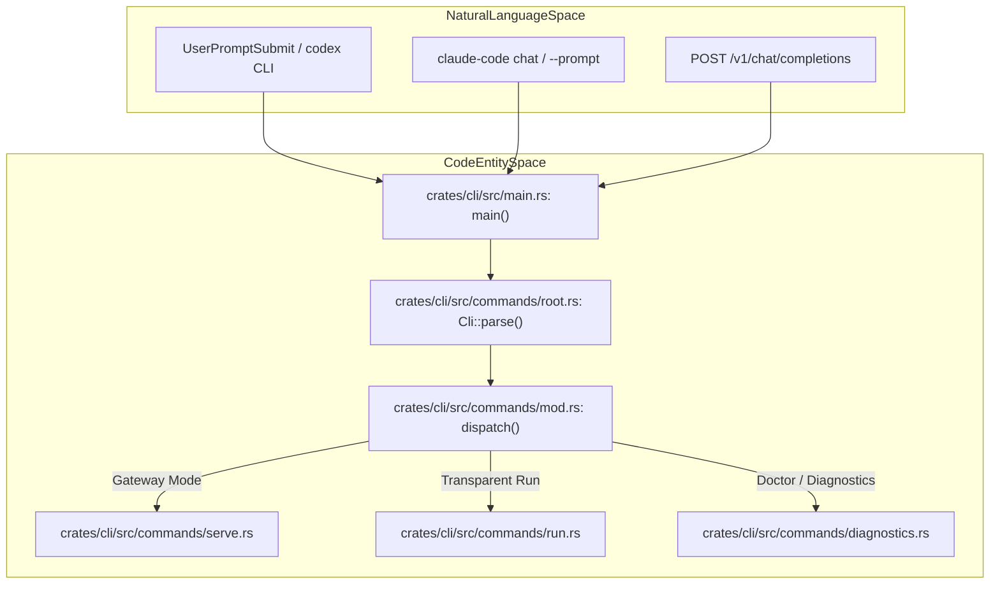
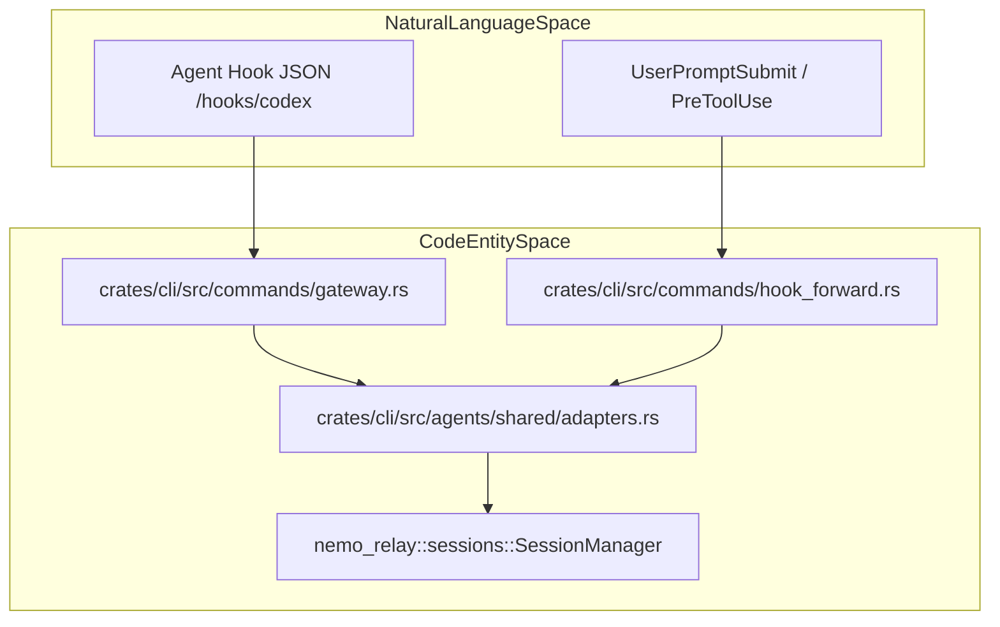

<!-- source: DeepWiki mcp.deepwiki.com · repo NVIDIA/NeMo-Relay · page 6 NeMo Relay CLI · fetched 2026-10-26 -->

# NeMo Relay CLI

Relevant source files

The following files were used as context for generating this wiki page:

- [crates/cli/src/commands/diagnostics.rs](crates/cli/src/commands/diagnostics.rs)
- [crates/cli/src/commands/install.rs](crates/cli/src/commands/install.rs)
- [crates/cli/src/commands/logging.rs](crates/cli/src/commands/logging.rs)
- [crates/cli/src/commands/mod.rs](crates/cli/src/commands/mod.rs)
- [crates/cli/src/commands/root.rs](crates/cli/src/commands/root.rs)
- [crates/cli/src/installation/mod.rs](crates/cli/src/installation/mod.rs)
- [crates/cli/src/main.rs](crates/cli/src/main.rs)
- [crates/cli/tests/coverage/commands/main_tests.rs](crates/cli/tests/coverage/commands/main_tests.rs)
- [docs/nemo-relay-cli/basic-usage.mdx](docs/nemo-relay-cli/basic-usage.mdx)
- [docs/nemo-relay-cli/claude-code.mdx](docs/nemo-relay-cli/claude-code.mdx)
- [docs/nemo-relay-cli/codex.mdx](docs/nemo-relay-cli/codex.mdx)
- [integrations/coding-agents/README.md](integrations/coding-agents/README.md)
- [integrations/coding-agents/claude-code/README.md](integrations/coding-agents/claude-code/README.md)
- [integrations/coding-agents/codex/README.md](integrations/coding-agents/codex/README.md)

The `nemo-relay` binary is the primary Rust-based execution and management entry point for NeMo Relay. It provides a local passthrough gateway proxy for LLM requests, embeds native lifecycle support for coding agents (such as Claude Code and Codex), handles layered configuration management, and drives diagnostic verification. By bridging natural language interactions from coding agents with structured runtime execution, the CLI acts as a unified orchestrator for observability, guardrails, and plugin ecosystems [docs/nemo-relay-cli/basic-usage.mdx:10-17]().

Conceptually, the CLI bridges the "Natural Language Space"—where developers and coding agents express prompts and tool directives—with the "Code Entity Space," where the Rust core runtime executes middleware, streams responses, and records structured ATIF trajectories and ATOF events [docs/nemo-relay-cli/basic-usage.mdx:10-17]().

---

## CLI Architecture and Command Dispatch

The command-line interface is structured using `clap` [crates/cli/src/main.rs:8-10](), mapping high-level user commands to specific operational modules under `crates/cli/src/commands/`. The CLI supports running as a long-lived server/gateway daemon, transparent agent wrappers (`nemo-relay codex`, `nemo-relay claude`, `nemo-relay pi`), configuration wizards (`nemo-relay config`), interactive plugin editors (`nemo-relay plugins edit`), and diagnostic suites (`nemo-relay doctor`) [docs/nemo-relay-cli/basic-usage.mdx:64-169](), [crates/cli/src/commands/root.rs:40-139]().

### Diagram: Natural Language Space to Code Entity Space (CLI Dispatch)

Sources: [crates/cli/src/main.rs:8-10](), [crates/cli/src/commands/root.rs:40-139](), [crates/cli/src/commands/mod.rs:131-191]()

---

## Passthrough Gateway and Server

The gateway mode runs an `axum`-based HTTP server that acts as a transparent proxy for LLM endpoints (such as OpenAI `/v1/chat/completions`, `/v1/responses`, and Anthropic `/v1/messages`) [docs/nemo-relay-cli/basic-usage.mdx:45-55](). It forwards raw provider JSON without rewriting schemas while stripping hop-by-hop transport headers, streaming Server-Sent Events (SSE), and emitting NeMo Relay LLM start and end events under active session scopes [docs/nemo-relay-cli/basic-usage.mdx:57-61]().

For details on the `axum` server lifecycle, routing states, provider authentication, bootstrap challenges, and idle session sweeping, see [Passthrough Gateway and Server](#6.1).

Sources: [docs/nemo-relay-cli/basic-usage.mdx:45-61]()

---

## Coding Agent Support

NeMo Relay integrates with coding agents like Claude Code, Codex, and pi via specialized hook endpoints (`POST /hooks/codex`, `POST /hooks/claude-code`, `POST /hooks/pi`) and transparent launchers (`nemo-relay codex`, `nemo-relay claude`) [docs/nemo-relay-cli/basic-usage.mdx:18-34, 58-78](). These wrappers inject gateway configurations, handle process-tree lifecycle management, and collect agent transcripts without mutating user profile states [docs/nemo-relay-cli/basic-usage.mdx:64-73]().

### Diagram: Natural Language Space to Code Entity Space (Agent Hooks & Adapters)

Sources: [docs/nemo-relay-cli/basic-usage.mdx:18-34](), [crates/cli/src/commands/root.rs:40-121]()

For details on launchers, plugin hosts, hook forwarding, filesystem snapshots, and bootstrap state, see [Coding Agent Support](#6.2).

Sources: [docs/nemo-relay-cli/basic-usage.mdx:18-78](), [crates/cli/src/commands/root.rs:40-121]()

---

## CLI Configuration, Diagnostics, and Plugin Editor

Configuration management is handled through layered TOML files (system, user, and project scopes) resolved via `load_shared_config` and `resolve_server_config` [docs/nemo-relay-cli/basic-usage.mdx:157-177](). The CLI provides `nemo-relay config` for interactive setup, `nemo-relay plugins edit` for editing component configurations (`plugins.toml`), and `nemo-relay doctor` for running comprehensive diagnostic checks [crates/cli/src/commands/diagnostics.rs:14-42](), [crates/cli/src/commands/root.rs:124-137]().

For details on config precedence resolution, logging configuration, the doctor diagnostic report, atomic config I/O, and the interactive plugin editor, see [CLI Configuration, Diagnostics, and Plugin Editor](#6.3).

Sources: [docs/nemo-relay-cli/basic-usage.mdx:157-177](), [crates/cli/src/commands/diagnostics.rs:14-42](), [crates/cli/src/commands/root.rs:124-137]()

---

## Plugin Installation and Marketplace

The `nemo-relay install` command configures persistent host integration for coding agents by generating marketplace manifests, establishing MCP communication, and provisioning provider routing [docs/nemo-relay-cli/basic-usage.mdx:141-164](), [crates/cli/src/commands/install.rs:12-24](). It verifies host prerequisites and supports uninstallation (`nemo-relay uninstall`) and integrity checks (`nemo-relay doctor --plugin`) [docs/nemo-relay-cli/basic-usage.mdx:165-170](), [crates/cli/src/commands/install.rs:26-37]().

For details on the marketplace host, install generations, operation locks, integrity checks, and installation state commands, see [Plugin Installation and Marketplace](#6.4).

Sources: [docs/nemo-relay-cli/basic-usage.mdx:141-170](), [crates/cli/src/commands/install.rs:12-37]()

---

## Summary

The NeMo Relay CLI provides an integrated control plane for LLM gateway operations, coding agent observation, configuration governance, and plugin deployment.

- [Passthrough Gateway and Server](#6.1) — Axum proxy server lifecycle, routing, and session management.
- [Coding Agent Support](#6.2) — Launchers, adapters, and hook handlers for Claude Code, Codex, and pi.
- [CLI Configuration, Diagnostics, and Plugin Editor](#6.3) — Layered configuration resolution, logging, doctor reports, and plugins editor.
- [Plugin Installation and Marketplace](#6.4) — Persistent host installation flows, attestation checks, and CLI commands.

Sources: [docs/nemo-relay-cli/basic-usage.mdx:10-182](), [crates/cli/src/commands/root.rs:40-139]()

---

