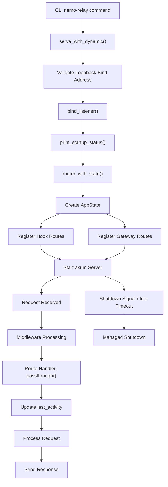
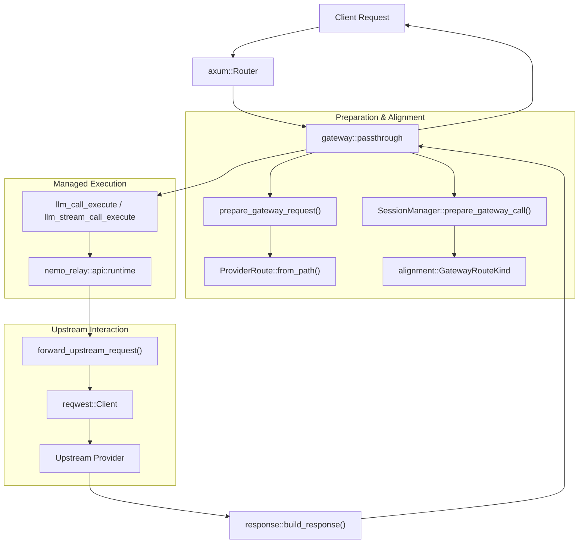
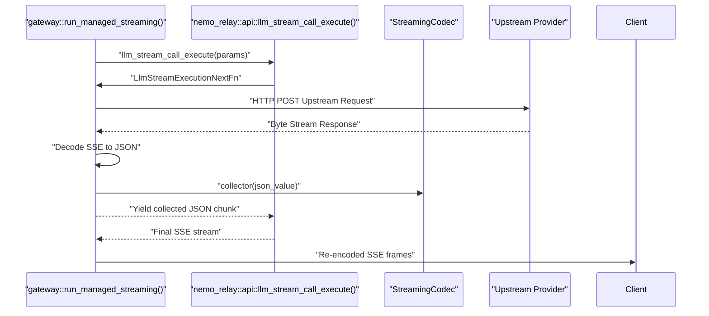

<!-- source: DeepWiki mcp.deepwiki.com · repo NVIDIA/NeMo-Relay · page 6.1 Passthrough Gateway and Server · fetched 2026-10-26 -->

# Passthrough Gateway and Server

Relevant source files

The following files were used as context for generating this wiki page:

- [crates/cli/src/agents/pi/alignment.rs](crates/cli/src/agents/pi/alignment.rs)
- [crates/cli/src/agents/shared/adapters.rs](crates/cli/src/agents/shared/adapters.rs)
- [crates/cli/src/bootstrap/mod.rs](crates/cli/src/bootstrap/mod.rs)
- [crates/cli/src/bootstrap/state.rs](crates/cli/src/bootstrap/state.rs)
- [crates/cli/src/commands/integrations.rs](crates/cli/src/commands/integrations.rs)
- [crates/cli/src/configuration/types.rs](crates/cli/src/configuration/types.rs)
- [crates/cli/src/gateway/client.rs](crates/cli/src/gateway/client.rs)
- [crates/cli/src/gateway/mod.rs](crates/cli/src/gateway/mod.rs)
- [crates/cli/src/gateway/request.rs](crates/cli/src/gateway/request.rs)
- [crates/cli/src/gateway/response.rs](crates/cli/src/gateway/response.rs)
- [crates/cli/src/gateway/routes.rs](crates/cli/src/gateway/routes.rs)
- [crates/cli/src/installation/operation_lock.rs](crates/cli/src/installation/operation_lock.rs)
- [crates/cli/src/mcp/mod.rs](crates/cli/src/mcp/mod.rs)
- [crates/cli/src/mcp_environment.rs](crates/cli/src/mcp_environment.rs)
- [crates/cli/src/provider_auth.rs](crates/cli/src/provider_auth.rs)
- [crates/cli/src/server/mod.rs](crates/cli/src/server/mod.rs)
- [crates/cli/src/sessions/idle.rs](crates/cli/src/sessions/idle.rs)
- [crates/cli/src/sessions/mod.rs](crates/cli/src/sessions/mod.rs)
- [crates/cli/src/sessions/routing.rs](crates/cli/src/sessions/routing.rs)
- [crates/cli/tests/coverage/agents/adapters_tests.rs](crates/cli/tests/coverage/agents/adapters_tests.rs)
- [crates/cli/tests/coverage/shared/bootstrap_state_tests.rs](crates/cli/tests/coverage/shared/bootstrap_state_tests.rs)
- [crates/cli/tests/coverage/shared/gateway_client_tests.rs](crates/cli/tests/coverage/shared/gateway_client_tests.rs)
- [crates/cli/tests/coverage/shared/gateway_tests.rs](crates/cli/tests/coverage/shared/gateway_tests.rs)
- [crates/cli/tests/coverage/shared/mcp_tests.rs](crates/cli/tests/coverage/shared/mcp_tests.rs)
- [crates/cli/tests/coverage/shared/server_tests.rs](crates/cli/tests/coverage/shared/server_tests.rs)
- [crates/cli/tests/coverage/shared/session_tests.rs](crates/cli/tests/coverage/shared/session_tests.rs)
- [integrations/coding-agents/codex/.mcp.json](integrations/coding-agents/codex/.mcp.json)

The Passthrough Gateway and Server component of NeMo Relay provides an `axum`-based HTTP server that acts as an LLM proxy. Its primary purpose is to intercept and manage large language model (LLM) traffic originating from coding agents (e.g., Claude Code, Codex, Pi) and destined for upstream LLM providers (e.g., OpenAI, Anthropic). This component integrates NeMo Relay's core runtime into the request flow, offering managed execution, rich observability, guardrails, and alignment adapters without requiring modifications to client applications [crates/cli/src/gateway/mod.rs:145-163]().

---

## Axum Server Lifecycle

The NeMo Relay CLI server is built on the `axum` web framework. The server lifecycle involves binding to a network address, registering dynamic plugins, and serving HTTP requests.

### `serve_with_dynamic`

The `serve_with_dynamic` function is the entry point for starting the HTTP server [crates/cli/src/server/mod.rs:85-91](). It performs initial setup, including:
- Validating that the configured bind address is a loopback address for security [crates/cli/src/server/mod.rs:92-97]().
- Binding a `TcpListener` to the specified address, with error handling for common issues like `AddrInUse` via `bind_listener` [crates/cli/src/server/mod.rs:105-146]().
- Printing startup status via `print_startup_status` [crates/cli/src/server/mod.rs:148-178]().
- Activating any enabled dynamic plugins before serving requests [crates/cli/src/server/mod.rs:85-91]().

### `router_with_state`

The router constructs the `axum::Router` that defines the server's HTTP endpoints. It attaches the `AppState` to the router, making shared state available to all handlers [crates/cli/src/server/mod.rs:20-22]().

### `AppState`

The `AppState` struct holds the shared, immutable, and mutable state required by the server's request handlers [crates/cli/src/server/mod.rs:50-67](). Key fields include:
- `config`: The `GatewayConfig` containing server settings [crates/cli/src/server/mod.rs:51-51]().
- `bootstrap_challenge_key`: An optional key used for bootstrap authentication [crates/cli/src/server/mod.rs:54-54]().
- `transparent_proxy_credential`: An optional credential for transparent proxy authentication [crates/cli/src/server/mod.rs:56-57]().
- `http`, `http_no_redirect`: `reqwest::Client` instances for making upstream HTTP requests [crates/cli/src/server/mod.rs:58-60]().
- `sessions`: A `SessionManager` for managing LLM sessions [crates/cli/src/server/mod.rs:61-61]().
- `last_activity`: An `Arc<Mutex<Instant>>` to track the last activity time for idle sweeping [crates/cli/src/server/mod.rs:62-62]().
- `bootstrap_shutdown`: An optional `BootstrapShutdown` struct for managed server shutdown [crates/cli/src/server/mod.rs:63-63]().

### Server Lifecycle Diagram

Sources: [crates/cli/src/server/mod.rs:85-146](), [crates/cli/src/server/mod.rs:148-178](), [crates/cli/src/server/mod.rs:50-67]()

---

## Request Lifecycle

The Passthrough Gateway employs a multi-stage lifecycle to ensure that each request is prepared, aligned, executed, and forwarded with correct telemetry and security.

### 1. Prepare
- The gateway resolves the `ProviderRoute` enum based on the request URI path [crates/cli/src/gateway/request.rs:50-52]().
- It buffers the entire request body using `axum::body::to_bytes` up to `max_passthrough_body_bytes` [crates/cli/src/gateway/request.rs:53-55]().
- If the request includes `Content-Encoding: zstd`, the body is decoded for observability inspection while keeping the compressed payload intact [crates/cli/src/gateway/request.rs:150-157]().
- The streaming flag is extracted from the JSON payload (`"stream": true`) [crates/cli/src/gateway/request.rs:128-131]().

### 2. Align
- Alignment adapters recover contextual identity such as session IDs, turn indices, and subagent IDs from HTTP headers or request body fields [crates/cli/src/gateway/request.rs:20-24]().
- The `SessionManager` prepares a scoped metadata structure capturing task scope stacks (`TASK_SCOPE_STACK`) [crates/cli/src/gateway/mod.rs:28-30](), [crates/cli/src/sessions/mod.rs:45-46]().

### 3. Managed Execution
- Requests are executed under the NeMo Relay runtime via `llm_call_execute` or `llm_stream_call_execute` [crates/cli/src/gateway/mod.rs:24-27]().
- The runtime receives callback functions (`LlmExecutionNextFn` or `LlmStreamExecutionNextFn`) that perform upstream forwarding when invoked [crates/cli/src/gateway/mod.rs:28-30]().

### 4. Upstream Forwarding
- Requests are forwarded using `reqwest::Client` [crates/cli/src/server/mod.rs:58-58]().
- Hop-by-hop headers are stripped, and provider authentication tokens are injected [crates/cli/src/gateway/request.rs:49-50](), [crates/cli/src/gateway/request.rs:119-124]().
- Streaming responses are re-encoded from parsed JSON events to preserve telemetry granularity [crates/cli/src/gateway/mod.rs:66-70]().

### Gateway Request Flow (Code Entity Space)

Sources: [crates/cli/src/gateway/mod.rs:158-163](), [crates/cli/src/gateway/request.rs:43-144](), [crates/cli/src/gateway/mod.rs:24-30]()

---

## Provider Routing and Alignment

The gateway uses the `ProviderRoute` enum to categorize inbound requests into well-known LLM API endpoint variants.

### Supported `ProviderRoute` Variants

| Variant | Example Path | Alignment Kind |
| :--- | :--- | :--- |
| `OpenAiChatCompletions` | `/v1/chat/completions` | `GatewayRouteKind::OpenAiChatCompletions` |
| `OpenAiResponses` | `/v1/responses` | `GatewayRouteKind::OpenAiResponses` |
| `AnthropicMessages` | `/v1/messages` | `GatewayRouteKind::AnthropicMessages` |
| `AnthropicCountTokens` | `/v1/messages/count_tokens` | `GatewayRouteKind::AnthropicCountTokens` |

Sources: [crates/cli/src/gateway/routes.rs:8-16](), [crates/cli/src/gateway/routes.rs:160-165]()

---

## Managed Execution Pipeline

The gateway integrates NeMo Relay's managed execution runtime into the LLM proxy path.

### Streaming (SSE) Execution Handling
Streaming responses use an "Option B" re-encoding approach:
1. Upstream byte stream chunks are parsed into JSON events [crates/cli/src/gateway/mod.rs:66-70]().
2. Structured JSON values are passed to the runtime collector for aggregate observability [crates/cli/src/gateway/mod.rs:66-70]().
3. Outbound SSE frames are re-encoded from the processed JSON values and streamed to the client [crates/cli/src/gateway/mod.rs:66-70]().

### Managed Streaming Logic (Code Entity Space)

Sources: [crates/cli/src/gateway/mod.rs:60-70](), [crates/cli/tests/coverage/shared/gateway_tests.rs:124-155]()

---

## Provider Authentication and Proxy Credentials

### Bootstrap Challenge
The `BootstrapChallengeKey` authenticates clients connecting to the NeMo Relay gateway [crates/cli/src/server/mod.rs:54-54](). Clients sign a server-provided nonce to prove their identity [crates/cli/src/gateway/client.rs:108-112]().

### Transparent Proxy Credential
For transparent runs, a `TransparentProxyCredential` authenticates requests originating from wrapped agents [crates/cli/src/provider_auth.rs:29-39](). It is passed via environment variables (`NEMO_RELAY_PROXY_CREDENTIAL`) or custom headers (`x-nemo-relay-proxy-token`) [crates/cli/src/provider_auth.rs:19-20]().

### Header Sanitization
- Hop-by-hop headers (`connection`, `host`, `upgrade`, `keep-alive`, `x-nemo-relay-bootstrap-client-token`) are stripped before forwarding [crates/cli/tests/coverage/shared/gateway_tests.rs:41-53]().
- Sensitive credential headers (`authorization`, `x-api-key`, `anthropic-api-key`, `cookie`) are sanitized from telemetry exports [crates/cli/tests/coverage/shared/gateway_tests.rs:58-82]().

Sources: [crates/cli/src/provider_auth.rs:29-39](), [crates/cli/src/server/mod.rs:54-54](), [crates/cli/tests/coverage/shared/gateway_tests.rs:41-82]()

---

## Sessions and Idle Sweeping

- The `SessionManager` tracks active sessions, client ownership, and subagent correlations [crates/cli/src/sessions/mod.rs:45-46]().
- An idle sweeping mechanism monitors `last_activity` timestamps in `AppState` and closes inactive sessions to reclaim resources [crates/cli/src/sessions/idle.rs:10-10](), [crates/cli/src/server/mod.rs:62-62]().

Sources: [crates/cli/src/sessions/mod.rs:45-46](), [crates/cli/src/sessions/idle.rs:10-10](), [crates/cli/src/server/mod.rs:50-67]()

---

## Gateway Client and MCP

- The `gateway::client` module provides health probes (`probe`) and verified HTTP request mechanics for administrative commands and managed shutdown [crates/cli/src/gateway/client.rs:29-34]().
- The MCP protocol implementation handles initialization, tool listing, and agent-gateway interactions over standard I/O or loopback channels [crates/cli/src/mcp/mod.rs:10-10](), [crates/cli/tests/coverage/shared/mcp_tests.rs:144-201]().

Sources: [crates/cli/src/gateway/client.rs:29-34](), [crates/cli/src/mcp/mod.rs:10-10](), [crates/cli/tests/coverage/shared/mcp_tests.rs:144-201]()

---

