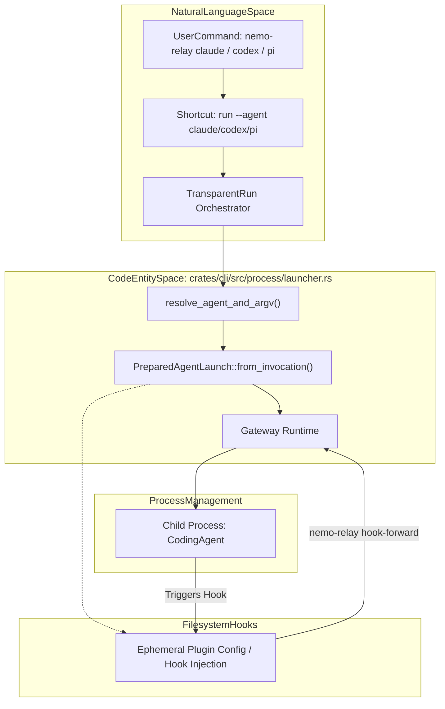
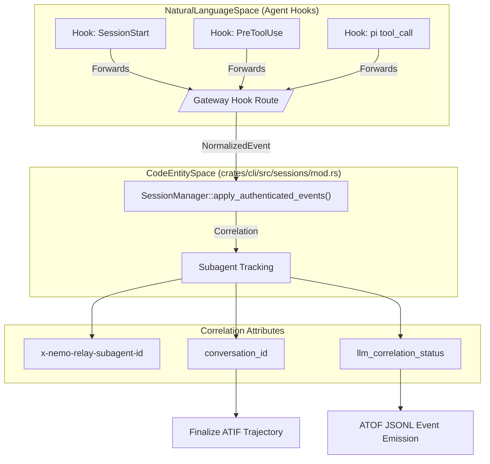

<!-- source: DeepWiki mcp.deepwiki.com · repo NVIDIA/NeMo-Relay · page 6.2 Coding Agent Support · fetched 2026-10-26 -->

# Coding Agent Support

Relevant source files

The following files were used as context for generating this wiki page:

- [crates/cli/src/agents/claude/host.rs](crates/cli/src/agents/claude/host.rs)
- [crates/cli/src/agents/claude/launch.rs](crates/cli/src/agents/claude/launch.rs)
- [crates/cli/src/agents/codex/alignment.rs](crates/cli/src/agents/codex/alignment.rs)
- [crates/cli/src/agents/codex/host.rs](crates/cli/src/agents/codex/host.rs)
- [crates/cli/src/agents/codex/launch.rs](crates/cli/src/agents/codex/launch.rs)
- [crates/cli/src/agents/codex/mod.rs](crates/cli/src/agents/codex/mod.rs)
- [crates/cli/src/agents/shared/alignment.rs](crates/cli/src/agents/shared/alignment.rs)
- [crates/cli/src/agents/shared/host.rs](crates/cli/src/agents/shared/host.rs)
- [crates/cli/src/commands/hook_forward.rs](crates/cli/src/commands/hook_forward.rs)
- [crates/cli/src/commands/install.rs](crates/cli/src/commands/install.rs)
- [crates/cli/src/commands/logging.rs](crates/cli/src/commands/logging.rs)
- [crates/cli/src/diagnostics/model.rs](crates/cli/src/diagnostics/model.rs)
- [crates/cli/src/diagnostics/render.rs](crates/cli/src/diagnostics/render.rs)
- [crates/cli/src/filesystem/mod.rs](crates/cli/src/filesystem/mod.rs)
- [crates/cli/src/filesystem/snapshots.rs](crates/cli/src/filesystem/snapshots.rs)
- [crates/cli/src/hooks/delivery.rs](crates/cli/src/hooks/delivery.rs)
- [crates/cli/src/hooks/encoding.rs](crates/cli/src/hooks/encoding.rs)
- [crates/cli/src/hooks/mod.rs](crates/cli/src/hooks/mod.rs)
- [crates/cli/src/hooks/types.rs](crates/cli/src/hooks/types.rs)
- [crates/cli/src/installation/mod.rs](crates/cli/src/installation/mod.rs)
- [crates/cli/src/process/launcher.rs](crates/cli/src/process/launcher.rs)
- [crates/cli/tests/coverage/agents/launcher_tests.rs](crates/cli/tests/coverage/agents/launcher_tests.rs)
- [crates/cli/tests/coverage/agents/plugin_host_tests.rs](crates/cli/tests/coverage/agents/plugin_host_tests.rs)
- [crates/cli/tests/coverage/shared/file_io_tests.rs](crates/cli/tests/coverage/shared/file_io_tests.rs)
- [crates/cli/tests/coverage/shared/installer_tests.rs](crates/cli/tests/coverage/shared/installer_tests.rs)
- [docs/nemo-relay-cli/basic-usage.mdx](docs/nemo-relay-cli/basic-usage.mdx)
- [docs/nemo-relay-cli/claude-code.mdx](docs/nemo-relay-cli/claude-code.mdx)
- [docs/nemo-relay-cli/codex.mdx](docs/nemo-relay-cli/codex.mdx)
- [integrations/coding-agents/README.md](integrations/coding-agents/README.md)
- [integrations/coding-agents/claude-code/README.md](integrations/coding-agents/claude-code/README.md)
- [integrations/coding-agents/codex/README.md](integrations/coding-agents/codex/README.md)

The NeMo Relay CLI provides specialized support for autonomous coding agents, specifically **Claude Code**, **Codex**, and **pi**. This integration includes launcher logic, plugin hosts, hook forwarding/delivery, agent-specific alignment adapters, filesystem snapshots, bootstrap state, and the pi extension assets to ensure smooth observability and lifecycle management.

**Note:** Hermes Agent support was removed in version 0.8 as NeMo Relay is now built directly into Hermes Agent, eliminating the need for a separate Relay CLI integration [integrations/coding-agents/README.md:33-35]().

---

## Launcher Architecture and Execution Flow

The `nemo-relay run` command and its shortcuts `nemo-relay claude`, `nemo-relay codex`, and `nemo-relay pi` leverage a `TransparentRun` orchestrator [crates/cli/src/process/launcher.rs:47-56]() that wraps the agent process transparently. This orchestrator configures ephemeral local gateway routing, injects hooks, and supervises the agent process lifecycle.

### Launch Lifecycle Detailed Steps
1. **Configuration Resolution**  
   The CLI merges runtime overrides (CLI arguments and environment) with persistent configurations to determine launch parameters.
2. **Ephemeral Gateway Binding**  
   A `TcpListener` binds to a dynamic loopback port (`127.0.0.1:0`) [crates/cli/src/process/launcher.rs:95-98](), guaranteeing session isolation and preventing port conflicts.
3. **Hook Injection and Setup**  
   Agent-specific configuration adapters generate temporary plugin or config directories with hooks wired to route lifecycle events back to the ephemeral gateway URL. For Claude Code, environment variables like `ANTHROPIC_BASE_URL` are overridden to point to the gateway [integrations/coding-agents/claude-code/README.md:58-62](). For Codex, `--config` arguments are injected to enable hooks and configure the provider [crates/cli/src/agents/codex/launch.rs:36-51](). For pi, the `NEMO_RELAY_PI_GATEWAY_URL` environment variable is set, and the pi extension is loaded.
4. **Agent Process Spawn**  
   The target agent process is spawned with the injected configuration and environment. The launcher supervises this process, capturing its lifecycle and termination.
5. **Cleanup on Exit**  
   Once the agent exits, the launcher cleans up ephemeral artifacts like cache or temporary plugin directories to maintain system hygiene [integrations/coding-agents/claude-code/README.md:63-65]().

### Agent Inference
The `resolve_agent_and_argv` function [crates/cli/tests/coverage/agents/launcher_tests.rs:88-88]() determines the `CodingAgent` type (e.g., `CodingAgent::Codex`, `CodingAgent::ClaudeCode`, `CodingAgent::Pi`) based on the command-line arguments or an explicit `--agent` flag. This allows `nemo-relay run -- codex` or `nemo-relay run -- pi` to automatically infer the agent type [crates/cli/tests/coverage/agents/launcher_tests.rs:76-90](), [crates/cli/tests/coverage/agents/launcher_tests.rs:106-112]().

### Diagram: Launcher Execution Flow Bridging Natural Language to Code Entities

Sources:  
[crates/cli/src/process/launcher.rs:38-112](), [crates/cli/tests/coverage/agents/launcher_tests.rs:76-112](), [integrations/coding-agents/claude-code/README.md:52-67](), [integrations/coding-agents/codex/README.md:134-148](), [crates/cli/src/agents/codex/launch.rs:36-51]()

---

## Persistent Integration and MCP Lifecycle

Users preferring persistent integration install the coding agents via `nemo-relay install <agent>` [integrations/coding-agents/README.md:15-17](). This approach launches a Model Context Protocol (MCP) lifecycle client (`nemo-relay mcp`) that manages the local gateway lifecycle and plugin hooks persistently.

### MCP Lifecycle Client Attributes
- Starts or reuses a dedicated Relay sidecar gateway bound to a fixed address (`127.0.0.1:47632`) [integrations/coding-agents/claude-code/README.md:183-186]().
- Performs health checks against the local gateway to verify identity, version, and bootstrap protocol readiness before accepting connections [integrations/coding-agents/codex/README.md:64-70]().
- Enforces a lease model—the sidecar remains available for an idle timeout (300 seconds) after the last client closes and can restart automatically if needed [integrations/coding-agents/codex/README.md:78-82]().

| Agent         | Install Command                | Hook Route           | Lifecycle Manager                   |
|---------------|-------------------------------|----------------------|-----------------------------------|
| Claude Code   | `nemo-relay install claude-code` | `/hooks/claude-code`  | `nemo-relay mcp` (alwaysLoad=true) [integrations/coding-agents/claude-code/README.md:79-84]() |
| Codex         | `nemo-relay install codex`        | `/hooks/codex`        | `nemo-relay mcp` [integrations/coding-agents/codex/README.md:64-67]() |
| pi            | `nemo-relay install pi`           | `/hooks/pi`           | pi extension (no MCP) [docs/nemo-relay-cli/basic-usage.mdx:153-155]() |

Sources:  
[integrations/coding-agents/claude-code/README.md:179-190](), [integrations/coding-agents/codex/README.md:64-82](), [integrations/coding-agents/README.md:8-17](), [docs/nemo-relay-cli/basic-usage.mdx:147-156]()

---

## Agent Adapters and Hook Forwarding

NeMo Relay uses an **adapter pattern** to translate unique agent hook JSON payloads into normalized Relay events and integrate them into the observability pipeline.

### Hook Forwarding Command

The `nemo-relay hook-forward <agent>` command acts as the primary entry point for agent lifecycle hooks, received as shell hook triggers:

- Hooks authenticate to the gateway before forwarding payloads, preventing duplication and ensuring trust [integrations/coding-agents/codex/README.md:106-110]().
- The gateway translates these canonical hooks—such as `SessionStart`, `PreToolUse`, or `SubagentStart`—into standard internal scope, tool call, or mark events [integrations/coding-agents/claude-code/README.md:27-32]().
- For pi, the extension acts as a thin HTTP client, forwarding pi's lifecycle events to `/hooks/pi` and gating tool calls based on the gateway's verdict [docs/nemo-relay-cli/basic-usage.mdx:28-33]().

### Correlation and Turn-Oriented Tracing

Coding agent sessions are turn-oriented, correlating user inputs and agent lifecycle events efficiently.

- For example, **Claude Code** creates a root span called `claude-code-turn` per user turn [integrations/coding-agents/claude-code/README.md:39-41]().
- Relay filters out startup probes and uncorrelatable late stop-hooks to avoid generating "null" or empty turns [integrations/coding-agents/claude-code/README.md:41-44]().
- Correlation leverages header fields like `x-nemo-relay-subagent-id` or shared identifiers (`conversation_id`, `generation_id`) between hook payloads and provider requests [integrations/coding-agents/claude-code/README.md:150-154]().

### Diagram: Session Correlation Logic Bridging Hooks to Observability

Sources:  
[integrations/coding-agents/claude-code/README.md:27-48](), [integrations/coding-agents/claude-code/README.md:150-163](), [integrations/coding-agents/codex/README.md:106-110](), [docs/nemo-relay-cli/basic-usage.mdx:23-34]()

---

## Filesystem Management and Snapshots

To ensure safe configuration of coding agents, NeMo Relay employs a filesystem snapshot and restore mechanism. This is critical for persistent installations where Relay modifies agent configuration files like `config.toml` (Codex) or installs extensions.

- **Snapshotting**: Before modification, Relay takes a `FileSnapshot` of the current state via `snapshot_codex_setup()` [crates/cli/src/agents/codex/host.rs:45-59]() or `snapshot_optional_file()` [crates/cli/src/filesystem/mod.rs:24-27]().
- **Restoration**: If an installation fails or during uninstallation, `restore_codex_setup()` [crates/cli/src/agents/codex/host.rs:61-86]() or `restore_file_snapshot()` [crates/cli/src/filesystem/mod.rs:24-27]() reverts the files to their original state.
- **Atomic Writes**: All configuration updates use atomic write operations to prevent file corruption, such as `atomic_write()` [crates/cli/src/filesystem/mod.rs:15-15]() and `atomic_write_preserving_symlink()` [crates/cli/src/filesystem/mod.rs:24-27]().
- **Backup**: The `backup()` function [crates/cli/src/filesystem/mod.rs:24-27]() creates backups of files before modifications, and `backup_path()` [crates/cli/src/filesystem/mod.rs:24-27]() determines the backup location.

Sources:
[crates/cli/src/agents/codex/host.rs:45-86](), [crates/cli/src/filesystem/mod.rs:14-27]()

---

## Bootstrap State

The bootstrap module handles the lifecycle of the Relay gateway, especially for persistent installations. It manages the state of the gateway, including instance identification and compatibility verification.

- **State Management**: Gateway lifecycle and bootstrap fingerprints ensure that active persistent clients connect to compatible sidecar instances [docs/nemo-relay-cli/codex.mdx:146-152]().
- **Recovery**: Automatic recovery and sidecar supervision handle unhealthy or expired gateway instances under bounded idle timeouts [integrations/coding-agents/codex/README.md:78-82]().

Sources:
[docs/nemo-relay-cli/codex.mdx:146-152](), [integrations/coding-agents/codex/README.md:78-82]()

---

## pi Extension Assets

The pi integration is implemented as an extension shipped directly within the `nemo-relay` binary.

- **Extension Installation**: `nemo-relay install pi` copies this extension into pi's auto-discovery directory [docs/nemo-relay-cli/basic-usage.mdx:153-156]().
- **Gateway Client & Redirect**: The extension handles communication with the Relay gateway for lifecycle events and redirects model traffic to observe and potentially gate LLM calls [docs/nemo-relay-cli/basic-usage.mdx:28-33]().

Sources:
[docs/nemo-relay-cli/basic-usage.mdx:28-33](), [docs/nemo-relay-cli/basic-usage.mdx:153-156]()

---

## Diagnostic Command (`doctor`)

The CLI offers the `nemo-relay doctor` command to perform a comprehensive health check of the environment, configuration, agent readiness, and observability plugin states.

### Key Features
- **Agent Scope Support**  
  Users can limit diagnostics to a specific coding agent or plugin via flags such as `--plugin codex` [docs/nemo-relay-cli/basic-usage.mdx:167-170]().
- **Integration Readiness Verification**  
  The command verifies the presence of persistent integration metadata, including MCP lifecycle client entries and hook trust states [crates/cli/src/agents/codex/host.rs:52-58]().
- **Generation Fencing**  
  Confirms the presence of internal version consistency markers for installed plugins [integrations/coding-agents/codex/README.md:112-116]().

Sources:  
[docs/nemo-relay-cli/basic-usage.mdx:167-170](), [crates/cli/src/agents/codex/host.rs:52-58](), [integrations/coding-agents/codex/README.md:112-116]()

---

# Summary Table of Key Code Entities

| Feature                  | Code Entity/Function/Path                       | Role/Description                                  |
|--------------------------|------------------------------------------------|---------------------------------------------------|
| Launcher Entrypoint      | `TransparentRun` [crates/cli/src/process/launcher.rs:47-56]() | Orchestrator for ephemeral agent runs             |
| Agent Inference          | `resolve_agent_and_argv` [crates/cli/tests/coverage/agents/launcher_tests.rs:88-88]() | Determines agent type from command or flag        |
| Codex Hook Metadata      | `CodexHookMetadata` [crates/cli/src/agents/codex/app_server.rs]() | Data structure for Codex plugin hook registration |
| Hook Trust Management    | `auto_trust_codex_hooks` [crates/cli/src/agents/codex/host.rs:109-109]() | Automatically trusts Relay hooks in Codex         |
| Agent Hook Forwarding    | `hook-forward` [docs/nemo-relay-cli/claude-code.mdx:23-23]() | CLI command branch for hook payload delivery      |
| Filesystem Snapshots     | `FileSnapshot` [crates/cli/src/filesystem/snapshots.rs:24-27]() | Captures file state for rollback safety           |

Sources:  
[crates/cli/src/process/launcher.rs:47-56](), [crates/cli/tests/coverage/agents/launcher_tests.rs:88-88](), [crates/cli/src/agents/codex/host.rs:109-109](), [docs/nemo-relay-cli/claude-code.mdx:23-23](), [crates/cli/src/filesystem/snapshots.rs:24-27]()

---

