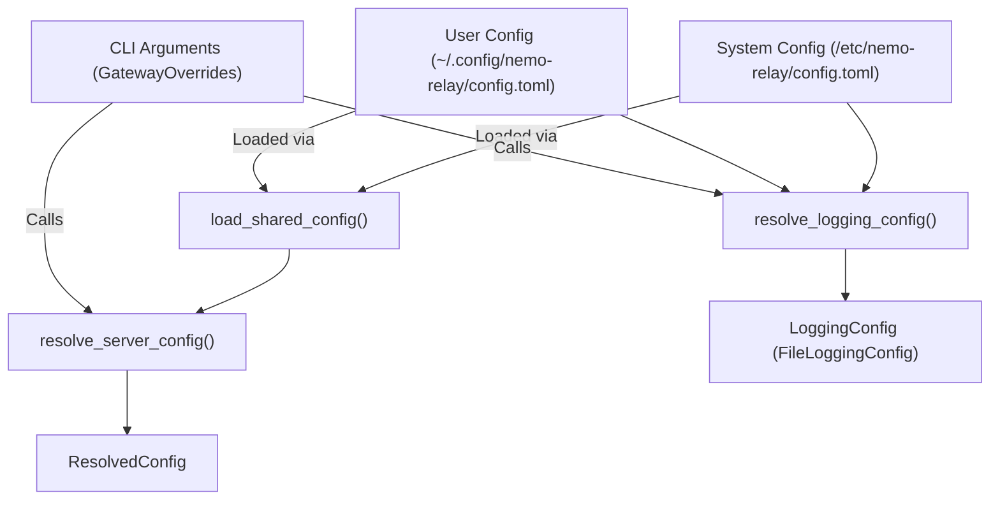
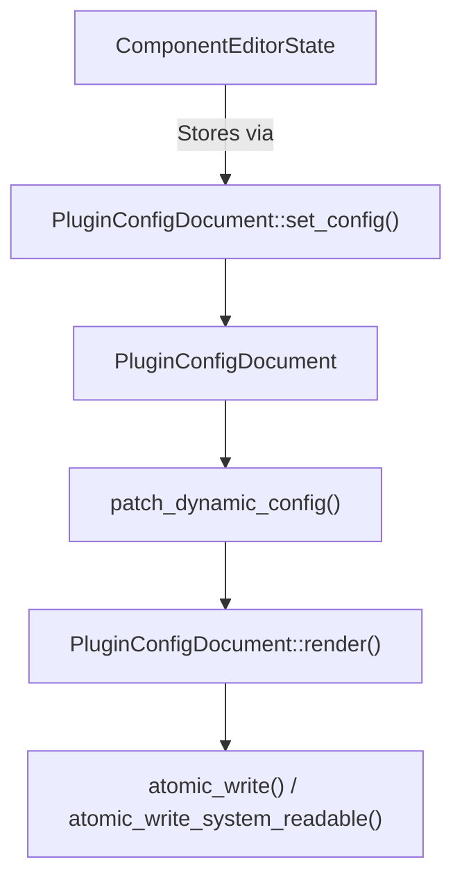

<!-- source: DeepWiki mcp.deepwiki.com · repo NVIDIA/NeMo-Relay · page 6.3 CLI Configuration, Diagnostics, and Plugin Editor · fetched 2026-10-26 -->

# CLI Configuration, Diagnostics, and Plugin Editor

Relevant source files

The following files were used as context for generating this wiki page:

- [codecov.yml](codecov.yml)
- [crates/cli/src/commands/configure/editor.rs](crates/cli/src/commands/configure/editor.rs)
- [crates/cli/src/commands/configure/mod.rs](crates/cli/src/commands/configure/mod.rs)
- [crates/cli/src/commands/configure/model.rs](crates/cli/src/commands/configure/model.rs)
- [crates/cli/src/commands/configure/wizard.rs](crates/cli/src/commands/configure/wizard.rs)
- [crates/cli/src/configuration/logging.rs](crates/cli/src/configuration/logging.rs)
- [crates/cli/src/configuration/mod.rs](crates/cli/src/configuration/mod.rs)
- [crates/cli/src/diagnostics/mod.rs](crates/cli/src/diagnostics/mod.rs)
- [crates/cli/src/filesystem/atomic.rs](crates/cli/src/filesystem/atomic.rs)
- [crates/cli/src/hooks/config.rs](crates/cli/src/hooks/config.rs)
- [crates/cli/src/plugins/config_io.rs](crates/cli/src/plugins/config_io.rs)
- [crates/cli/src/plugins/dynamic_editor.rs](crates/cli/src/plugins/dynamic_editor.rs)
- [crates/cli/src/plugins/editor_model.rs](crates/cli/src/plugins/editor_model.rs)
- [crates/cli/src/plugins/mod.rs](crates/cli/src/plugins/mod.rs)
- [crates/cli/src/plugins/prompt.rs](crates/cli/src/plugins/prompt.rs)
- [crates/cli/tests/cli_tests.rs](crates/cli/tests/cli_tests.rs)
- [crates/cli/tests/coverage/commands/configure_editor_tests.rs](crates/cli/tests/coverage/commands/configure_editor_tests.rs)
- [crates/cli/tests/coverage/shared/config_tests.rs](crates/cli/tests/coverage/shared/config_tests.rs)
- [crates/cli/tests/coverage/shared/doctor_tests.rs](crates/cli/tests/coverage/shared/doctor_tests.rs)
- [crates/cli/tests/coverage/shared/plugins_tests.rs](crates/cli/tests/coverage/shared/plugins_tests.rs)
- [crates/cli/tests/coverage/shared/setup_tests.rs](crates/cli/tests/coverage/shared/setup_tests.rs)
- [crates/core/src/config_editor.rs](crates/core/src/config_editor.rs)
- [crates/core/src/logging/rotation.rs](crates/core/src/logging/rotation.rs)

The NeMo Relay CLI (`nemo-relay`) provides a robust system for managing runtime configuration, interactive editing of static and dynamic plugins, and executing diagnostic probes via `nemo-relay doctor`. This page details the configuration scoping model, precedence resolution algorithms (`load_shared_config`, `resolve_server_config`), operational logging configurations, diagnostic health check reports, the interactive plugin editor, schema definitions, and atomic configuration I/O operations.

## Setup Wizard and Configuration Scoping

The setup wizard command `nemo-relay config` provides users an interactive approach to bootstrap and modify `config.toml` files that define gateway and upstream settings, including coding agent shortcuts. The wizard manages file discovery, layered config merges, and user interaction for configuration creation or reset.

### Configuration Scope Model

NeMo Relay supports at most two main configuration scopes:

| Scope | Location | Description |
|---|---|---|
| **User** | `~/.config/nemo-relay/config.toml` (XDG config home) | Per-user default scope for config and plugins. Primary user-level path starting from version 0.8. [crates/cli/src/diagnostics/mod.rs:168-171]() |
| **Global** | `/etc/nemo-relay/config.toml` (or system equivalent) | System-wide config accessible to all users. [crates/cli/src/diagnostics/mod.rs:172-172]() |

The deprecated project-scoped configuration under `.nemo-relay/config.toml` relative to a project directory was removed in release 0.8 [crates/cli/tests/coverage/shared/config_tests.rs:156-182](). The runtime ignores project-local configuration files, warning users about legacy fallbacks but no longer auto-activating or discovering them [crates/cli/src/diagnostics/mod.rs:190-198]().

The CLI uses strict validation to ensure only one scope is targeted per operation [crates/cli/tests/coverage/shared/plugins_tests.rs:169-187](). Explicit configuration paths and plugin configuration files resolve following this precedence hierarchy:

1. Explicit CLI-provided configuration path via `--config` [crates/cli/src/configuration/mod.rs:118-120]()
2. User XDG configuration path (default) [crates/cli/src/configuration/mod.rs:172-175]()
3. System configuration path [crates/cli/src/configuration/mod.rs:179-181]()

Sources:
[crates/cli/src/configuration/mod.rs:95-182]()
[crates/cli/tests/coverage/shared/config_tests.rs:156-182]()
[crates/cli/src/diagnostics/mod.rs:168-198]()
[crates/cli/tests/coverage/shared/plugins_tests.rs:169-187]()

---

## Config Resolution and Logging

The CLI provides specific functions for resolving configuration, particularly for server mode and logging.

### Config Resolution Precedence (`load_shared_config`, `resolve_server_config`)

The `nemo-relay` CLI resolves configuration from multiple sources with a defined precedence:

1.  **Explicit CLI arguments**: Overrides specified directly on the command line [crates/cli/src/configuration/mod.rs:100-102]().
2.  **User configuration**: Files located in the user's XDG config directory (e.g., `~/.config/nemo-relay/config.toml`) [crates/cli/src/configuration/mod.rs:172-175]().
3.  **System configuration**: Files located in the system-wide config directory (e.g., `/etc/nemo-relay/config.toml`) [crates/cli/src/configuration/mod.rs:179-181]().

The `resolve_server_config` function [crates/cli/src/configuration/mod.rs:100-114]() loads shared configuration using `load_shared_config` and applies server-specific overrides from `GatewayOverrides`. It also enforces required dynamic plugin startup configurations.

### Logging Configuration

Operational logging configuration is resolved separately using `resolve_logging_config` [crates/cli/src/configuration/mod.rs:163-182](), ensuring logging can be initialized prior to operational command dispatch. If no `[logging]` section is found, built-in defaults are applied.

The logging configuration is defined by `FileLoggingConfig` [crates/cli/src/configuration/logging.rs:20-29]`, which parses `level`, `stderr_enabled`, `stderr_format`, `flush_interval_millis`, and structured sinks (`[[logging.sinks]]`) containing `path`, `level`, `format`, `queue_capacity`, and rotation policies (`max_file_size_bytes`, `retained_files`) [crates/cli/src/configuration/logging.rs:31-43]().

Diagram: Configuration Resolution and Logging Flow (Natural Language to Code Space)

Sources:
[crates/cli/src/configuration/mod.rs:100-182]()
[crates/cli/src/configuration/logging.rs:20-73]()

---

## Doctor Diagnostic Report

The `nemo-relay doctor` command executes health checks across the NeMo Relay environment, configuration layers, agent bindings, and observability pipelines, producing a structured `DoctorReport` [crates/cli/src/diagnostics/mod.rs:74-154]().

### Report Structure and Collection

The `collect_report` function [crates/cli/src/diagnostics/mod.rs:74-154]() aggregates diagnostic sections:
- **Environment**: OS architecture and shell environment details [crates/cli/src/diagnostics/mod.rs:139]().
- **Configuration**: Validation of explicit, user, and system config layers alongside plugin manifests [crates/cli/src/diagnostics/mod.rs:140-148]().
- **Agents**: Verification of target coding agent readiness [crates/cli/src/diagnostics/mod.rs:149]().
- **Observability**: Probing observability sinks and OTLP/ATOF endpoints under bounded network timeouts (`NETWORK_TIMEOUT`) [crates/cli/src/diagnostics/mod.rs:46]().

### Doctor Probe Modes

`DoctorProbeMode` controls network check execution [crates/cli/src/diagnostics/mod.rs:49-53]():
- `Live`: Performs live network checks and HTTP/TCP probes.
- `Offline`: Bypasses external network probes for air-gapped environments.

Sources:
[crates/cli/src/diagnostics/mod.rs:46-154]()
[crates/cli/tests/coverage/shared/doctor_tests.rs:135-149]()

---

## Plugin Configuration Editor

`plugins.toml` files specify static components (observability, adaptive runtime, guardrails). The CLI provides a TTY interactive editor backed by type-safe reflection.

### Editor Model and Key Types

- **`EditorConfig` trait**: Implemented by config structs (e.g., `ObservabilityConfig`, `AdaptiveConfig`) to return static `EditorSchema` metadata via `editor_schema()` [crates/core/src/config_editor.rs:160-163]().
- **`EditorFieldSpec` & `EditorFieldKind`**: Define control shapes (Boolean, String, Integer, Section, List, Map, TaggedUnion) [crates/core/src/config_editor.rs:13-41]().
- **`EditableComponent` enum**: Wraps state instances for component types keyed by plugin kind strings [crates/cli/src/plugins/editor_model.rs:47-52]().

### Interactive Editor Workflow

When invoking `nemo-relay plugins edit`, the CLI executes the following pipeline:
1. Resolves target plugin configuration path based on user scope [crates/cli/tests/coverage/shared/plugins_tests.rs:191-200]().
2. Reads and parses `plugins.toml` into a `PluginConfigDocument` [crates/cli/src/plugins/config_io.rs:50-58]().
3. Displays a main menu loop navigating editable component sections.
4. Validates modifications against `validate_static_plugin_config` [crates/cli/src/plugins/config_io.rs:9]().
5. Prunes undefined fields, patches updates, and writes back atomically.

Diagram: Plugin Editor Persistence Data Flow (Code Entities)

Sources:
[crates/cli/src/plugins/editor_model.rs:36-186]()
[crates/core/src/config_editor.rs:14-163]()
[crates/cli/src/plugins/config_io.rs:9-171]()

---

## Dynamic Plugin Editor

Dynamic plugins declared under `[[plugins.dynamic]]` in `plugins.toml` are managed via `DynamicPluginConfigEntry` and `DynamicPluginEditorState` [crates/cli/src/plugins/config_io.rs:38-46]().

### Dynamic Plugin Operations

- `PluginConfigDocument::dynamic_entries()`: Discovers and parses dynamic plugin references and resolved manifest paths [crates/cli/src/plugins/config_io.rs:76-107]().
- `PluginConfigDocument::patch_dynamic_config()`: Updates specific dynamic plugin configurations while retaining raw TOML structure and native formatting [crates/cli/src/plugins/config_io.rs:131-157]().

Sources:
[crates/cli/src/plugins/config_io.rs:38-157]()
[crates/cli/src/plugins/dynamic_editor.rs:26-33]()

---

## Schema and Atomic Config IO

To prevent partial writes or data corruption, configuration persistence relies on atomic file replacement primitives provided in `crates/cli/src/filesystem/atomic.rs`.

### Atomic Write Implementations

- **`atomic_write`**: Standard atomic replacement creating parent directories and utilizing temporary files in the same directory (`.filename.<uuid>.tmp`) before replacing the target [crates/cli/src/filesystem/atomic.rs:13-19]().
- **`atomic_write_private`**: Sets secret-bearing files (e.g., API keys, auth tokens) with strict owner-only access (`0o600` on Unix) at creation time [crates/cli/src/filesystem/atomic.rs:26-47]().
- **`atomic_write_system_readable`**: Sets system configuration files with owner-writable and world-readable permissions (`0o644`) [crates/cli/src/filesystem/atomic.rs:50-67]().

Sources:
[crates/cli/src/filesystem/atomic.rs:6-110]()

---

