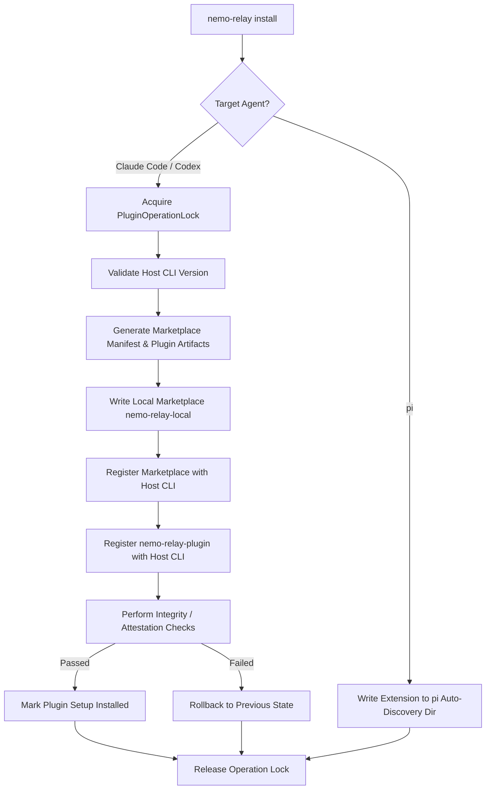
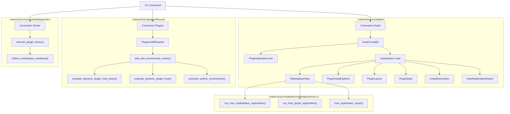

<!-- source: DeepWiki mcp.deepwiki.com · repo NVIDIA/NeMo-Relay · page 6.4 Plugin Installation and Marketplace · fetched 2026-10-26 -->

# Plugin Installation and Marketplace

<details>
<summary>Relevant source files</summary>

The following files were used as context for generating this wiki page:

- [crates/cli/src/agents/mod.rs](crates/cli/src/agents/mod.rs)
- [crates/cli/src/installation/generation.rs](crates/cli/src/installation/generation.rs)
- [crates/cli/src/installation/marketplace/host.rs](crates/cli/src/installation/marketplace/host.rs)
- [crates/cli/src/installation/marketplace/mod.rs](crates/cli/src/installation/marketplace/mod.rs)
- [crates/cli/src/installation/marketplace/state.rs](crates/cli/src/installation/marketplace/state.rs)
- [crates/cli/src/plugins/lifecycle/mod.rs](crates/cli/src/plugins/lifecycle/mod.rs)
- [crates/cli/tests/coverage/agents/plugin_install_tests.rs](crates/cli/tests/coverage/agents/plugin_install_tests.rs)
- [crates/cli/tests/coverage/shared/install_generation_tests.rs](crates/cli/tests/coverage/shared/install_generation_tests.rs)
- [crates/cli/tests/coverage/shared/plugins_lifecycle_tests.rs](crates/cli/tests/coverage/shared/plugins_lifecycle_tests.rs)
- [docs/build-plugins/native/build-and-package.mdx](docs/build-plugins/native/build-and-package.mdx)
- [docs/build-plugins/workers/python.mdx](docs/build-plugins/workers/python.mdx)
- [docs/build-plugins/workers/rust.mdx](docs/build-plugins/workers/rust.mdx)
- [docs/nemo-relay-cli/plugin-installation.mdx](docs/nemo-relay-cli/plugin-installation.mdx)
- [scripts/test-claude-plugin-e2e.sh](scripts/test-claude-plugin-e2e.sh)
- [scripts/test-codex-plugin-e2e.sh](scripts/test-codex-plugin-e2e.sh)

</details>


This page details the installation and management of NeMo Relay plugins, focusing on the CLI commands and underlying mechanisms for integrating with coding agents like Claude Code, Codex, and pi. It covers marketplace host interactions, generation of install artifacts, operation locks, integrity and attestation checks, and the overall state management of installed plugins.

## Persistent Integration Installation

NeMo Relay provides CLI commands to install persistent integrations with coding agents. These integrations allow agents to load NeMo Relay without requiring a `nemo-relay` wrapper command. The installation process differs based on the target agent.

For Claude Code and Codex, the installation involves generating a marketplace plugin that includes an MCP (Managed Control Plane) server to carry the gateway. This process leverages the host's plugin marketplace mechanisms. For `pi`, which lacks a plugin marketplace, `nemo-relay install pi` writes an extension directly into pi's auto-discovery directory, communicating with the gateway over plain HTTP [docs/nemo-relay-cli/plugin-installation.mdx:10-21]().

The installed integrations forward lifecycle signals from the host agent (e.g., agent, subagent, tool, prompt, compaction, stop events) to the shared NeMo Relay gateway [docs/nemo-relay-cli/plugin-installation.mdx:22-26](). Model-provider routing, when configured, directs LLM traffic through this local gateway [docs/nemo-relay-cli/plugin-installation.mdx:28-36]().

### Requirements

To install a persistent integration, `nemo-relay` must be installed and available on the system's `PATH`. The installer does not download a separate Relay binary or install a daemon [docs/nemo-relay-cli/plugin-installation.mdx:42-47]().

The target coding agent's CLI must also be available and meet specific version requirements [docs/nemo-relay-cli/plugin-installation.mdx:48-52]():
* Claude Code 2.1.121 or newer (via `claude`) [docs/nemo-relay-cli/plugin-installation.mdx:50-50]().
* `codex-cli` 0.143.0 or newer (via `codex`) [docs/nemo-relay-cli/plugin-installation.mdx:51-51]().
* pi 0.84.x (via `pi`) [docs/nemo-relay-cli/plugin-installation.mdx:52-52]().

For Claude Code and Codex, Relay validates the CLI version before modifying agent configuration [docs/nemo-relay-cli/plugin-installation.mdx:54-56](). `nemo-relay install pi` does not perform version checks on `pi` itself during installation, as it only writes files to an auto-discovery location [docs/nemo-relay-cli/plugin-installation.mdx:58-60](). Version checks for `pi` occur during `nemo-relay doctor pi` or transparent launch [docs/nemo-relay-cli/plugin-installation.mdx:60-61]().

Sources: [docs/nemo-relay-cli/plugin-installation.mdx:10-62]()

### CLI Commands

To install a persistent integration, use the `nemo-relay install` command followed by the agent name [docs/nemo-relay-cli/plugin-installation.mdx:63-71]():

```bash
nemo-relay install claude-code
nemo-relay install codex
nemo-relay install pi
```

To install all supported agents detected on the machine [docs/nemo-relay-cli/plugin-installation.mdx:73-77]():

```bash
nemo-relay install all
```

`install all` only targets supported agents whose CLI is present. It will fail if no supported agents are found [docs/nemo-relay-cli/plugin-installation.mdx:79-80]().

The `--dry-run` flag can be used to preview the installation without making any changes [docs/nemo-relay-cli/plugin-installation.mdx:88-94]():

```bash
nemo-relay install codex --dry-run
```

For Claude Code and Codex, a non-default installation directory can be specified using `--install-dir`. The default plugin directories are platform-specific [docs/nemo-relay-cli/plugin-installation.mdx:95-104]():

| Platform | Default Plugin Install Directory |
| --- | --- |
| macOS | `~/Library/Application Support/nemo-relay/plugins` |
| Linux | `${XDG_DATA_HOME:-~/.local/share}/nemo-relay/plugins` |
| Windows | `%LOCALAPPDATA%\nemo-relay\plugins` |

Sources: [docs/nemo-relay-cli/plugin-installation.mdx:64-104]()

### Installation Changes

For Claude Code and Codex, `nemo-relay install` writes a local marketplace named `nemo-relay-local`, then registers the generated `nemo-relay-plugin` package with the host agent [docs/nemo-relay-cli/plugin-installation.mdx:147-151]().

**Claude Code Specifics:**
* Registers the local marketplace.
* Installs `nemo-relay-plugin@nemo-relay-local` at user scope.
* Enables provider routing through the local NeMo Relay sidecar.

**Codex Specifics:**
* Registers the local marketplace.
* Installs `nemo-relay-plugin@nemo-relay-local`.
* Enables Codex hooks and configures the `nemo-relay-openai` provider alias at `http://127.0.0.1:47632/v1`.

Sources: [docs/nemo-relay-cli/plugin-installation.mdx:110-149]()

## Marketplace Host

The `nemo-relay` CLI interacts with coding agent CLIs to register and manage marketplace plugins through host-specific commands [crates/cli/src/installation/marketplace/host.rs:4-4]().

The `MarketplaceHost` trait [crates/cli/src/installation/marketplace/spec.rs:12-12]() defines the interface for host-specific operations. Implementations are provided for `CodingAgent::ClaudeCode` and `CodingAgent::Codex` [crates/cli/src/agents/mod.rs:14-20]().

### Host Registration and Removal

The function `run_host_marketplace_registration` [crates/cli/src/installation/marketplace/host.rs:17-34]() executes the host's command to add a marketplace (e.g., `plugin marketplace add <path>`) [crates/cli/src/installation/marketplace/host.rs:23-33]().

Similarly, `run_host_plugin_registration` [crates/cli/src/installation/marketplace/host.rs:52-63]() registers the `nemo-relay-plugin` with the host using `plugin install` [crates/cli/src/installation/marketplace/host.rs:57-62]().

Removal functions `run_host_plugin_removal` [crates/cli/src/installation/marketplace/host.rs:65-77]() and `run_host_marketplace_removal` [crates/cli/src/installation/marketplace/host.rs:79-95]() handle unregistering plugins and marketplaces.

The function `marketplace_path_argument_for_platform` [crates/cli/src/installation/marketplace/host.rs:36-50]() formats platform-specific paths, handling Windows verbatim paths correctly [crates/cli/tests/coverage/agents/plugin_install_tests.rs:113-132]().

Sources: [crates/cli/src/installation/marketplace/host.rs:1-96](), [crates/cli/src/installation/marketplace/spec.rs:12-12]()

### Host Registration Report

The struct `HostRegistrationReport` [crates/cli/src/installation/marketplace/host.rs:97-106]() captures the registration status of the plugin and marketplace with the host. It includes fields such as `host_plugin_registered`, `host_marketplace_registered`, and `host_marketplace_unloadable` [crates/cli/src/installation/marketplace/host.rs:98-106]().

The function `host_registration_report` [crates/cli/src/installation/marketplace/host.rs:162-178]() queries the host CLI, delegating to `claude_registration_report` [crates/cli/src/installation/marketplace/host.rs:179-189]() or `codex_registration_report` [crates/cli/src/installation/marketplace/host.rs:191-209]() depending on the agent.

Sources: [crates/cli/src/installation/marketplace/host.rs:97-209]()

## Install Generation

NeMo Relay uses install generations to manage plugin installations, supporting seamless updates and rollbacks. An `InstallGeneration` [crates/cli/src/installation/generation.rs:33-41]() represents a specific lifecycle generation backed by a marker file (`GENERATION_FILE_NAME`) [crates/cli/src/installation/generation.rs:22-22]() and a shared lock [crates/cli/src/installation/generation.rs:48-51]().

When a refresh or update is triggered, `prepare_integrations_for_refresh` [crates/cli/src/installation/marketplace/mod.rs:141-147]() validates targets and retires existing generations before promoting new artifacts.

Sources: [crates/cli/src/installation/generation.rs:10-51](), [crates/cli/src/installation/marketplace/mod.rs:141-147]()

## Operation Locks

To prevent concurrent modifications to plugin state across CLI invocations, NeMo Relay employs operation locks via `PluginOperationLock` [crates/cli/src/installation/operation_lock.rs:10-10](). These locks ensure that only one installation, force-installation, rollback, or uninstallation proceeds for a given user and host at a time [docs/nemo-relay-cli/plugin-installation.mdx:105-108]().

If another operation remains active past `DEFAULT_OPERATION_LOCK_TIMEOUT` [crates/cli/src/installation/operation_lock.rs:12-12](), the command fails with a timeout error rather than modifying state concurrently [docs/nemo-relay-cli/plugin-installation.mdx:107-108](). Operation lock files are stored in `~/.nemo-relay/plugin-operations` [crates/cli/src/installation/marketplace/mod.rs:59-69]().

Sources: [crates/cli/src/installation/marketplace/mod.rs:59-69](), [crates/cli/src/installation/operation_lock.rs:10-12](), [docs/nemo-relay-cli/plugin-installation.mdx:105-108]()

## Integrity and Attestation Checks

NeMo Relay performs integrity and attestation checks for dynamic and worker plugins to guarantee trustworthiness and prevent tampering.

### Dynamic Plugin Policy and Trust Evaluation

The struct `DynamicPluginHostPolicy` [crates/cli/src/plugins/policy.rs:10-10]() defines host rules for dynamic plugins. The function `evaluate_dynamic_plugin_host_policy` [crates/cli/src/plugins/policy.rs:12-12]() checks manifests against these policies, while `evaluate_dynamic_plugin_trust` [crates/cli/src/plugins/lifecycle/trust.rs:10-10]() verifies attestation modes (`DynamicPluginAttestationMode`) [nemo-relay/src/plugin/dynamic.rs:10-10]().

If a plugin fails policy or trust verification, the registration or add command aborts with a refusal error [crates/cli/src/plugins/lifecycle/mod.rs:141-161]().

Sources: [crates/cli/src/plugins/lifecycle/mod.rs:141-161](), [crates/cli/src/plugins/policy.rs:10-12](), [crates/cli/src/plugins/lifecycle/trust.rs:10-10]()

### Activation Snapshots and Integrity Verification

When a worker plugin is initialized, Relay copies its runtime closure into an isolated activation snapshot [docs/build-plugins/workers/rust.mdx:18-19](). The snapshot root is controlled by `NEMO_RELAY_PLUGIN_SNAPSHOT_DIR` [docs/build-plugins/workers/rust.mdx:19-21]().

Before starting the worker, Relay checks the expected SHA256 artifact digest specified in the `[integrity]` section of `relay-plugin.toml` using the `sha2` crate [docs/build-plugins/workers/rust.mdx:86-87](), ensuring that the executable matches its registered manifest [docs/build-plugins/workers/rust.mdx:99-100]().

Sources: [docs/build-plugins/workers/rust.mdx:18-21](), [docs/build-plugins/workers/rust.mdx:86-87](), [docs/build-plugins/workers/rust.mdx:99-100]()

## Install State

NeMo Relay tracks installation state across filesystems to support diagnostics and lifecycle operations.

### PluginLayout and PluginState

The struct `PluginLayout` [crates/cli/src/installation/marketplace/state.rs:41-54]() defines the file layout for a plugin installation, including marketplace and plugin root paths. 

The struct `PluginState` [crates/cli/src/installation/marketplace/state.rs:145-153]() holds persisted state information, managed via helper functions such as `read_state` and `write_state` [crates/cli/src/installation/marketplace/state.rs:48-52]().

The struct `HostRegistrationProgress` [crates/cli/src/installation/marketplace/state.rs:28-32]() tracks individual registration steps for plugins and marketplaces.

Sources: [crates/cli/src/installation/marketplace/state.rs:28-54](), [crates/cli/src/installation/marketplace/state.rs:145-153]()

## CLI Commands for Plugin Management

The `nemo-relay` binary provides a comprehensive command set for managing marketplace and dynamic plugins.

* `nemo-relay install`: Installs persistent coding-agent integrations [docs/nemo-relay-cli/plugin-installation.mdx:63-71]().
* `nemo-relay uninstall`: Removes persistent integrations.
* `nemo-relay doctor --plugin`: Diagnoses integration state, checking host registration and marketplace health via `collect_marketplace_readiness` [crates/cli/tests/coverage/agents/plugin_install_tests.rs:135-143]().
* `nemo-relay plugins add`: Registers a dynamic plugin [crates/cli/src/plugins/lifecycle/mod.rs:96-97]().
* `nemo-relay plugins enable` / `disable`: Controls dynamic plugin activation states [crates/cli/src/plugins/lifecycle/mod.rs:2458]().
* `nemo-relay plugins validate`: Validates dynamic plugin manifests [crates/cli/src/plugins/lifecycle/mod.rs:2458]().

Sources: [docs/nemo-relay-cli/plugin-installation.mdx:63-71](), [crates/cli/src/plugins/lifecycle/mod.rs:96-97](), [crates/cli/tests/coverage/agents/plugin_install_tests.rs:135-143]()

## Diagram: Plugin Installation Flow

Diagram title: Plugin Installation Lifecycle



Sources: [crates/cli/src/installation/marketplace/mod.rs:1-3470](), [docs/nemo-relay-cli/plugin-installation.mdx:1-149]()

## Diagram: Code Entities for Plugin Installation

Diagram title: Plugin Installation Code Architecture



Sources: [crates/cli/src/commands/mod.rs:1-304](), [crates/cli/src/installation/marketplace/mod.rs:1-187](), [crates/cli/src/installation/marketplace/host.rs:1-209](), [crates/cli/src/plugins/lifecycle/mod.rs:1-178](), [crates/cli/src/commands/diagnostics.rs:1-129]()

---

