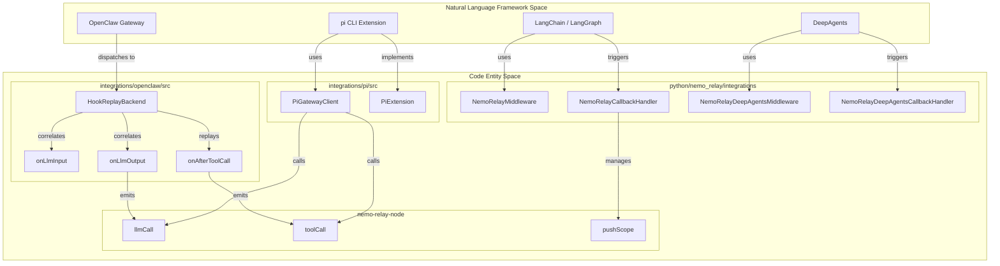
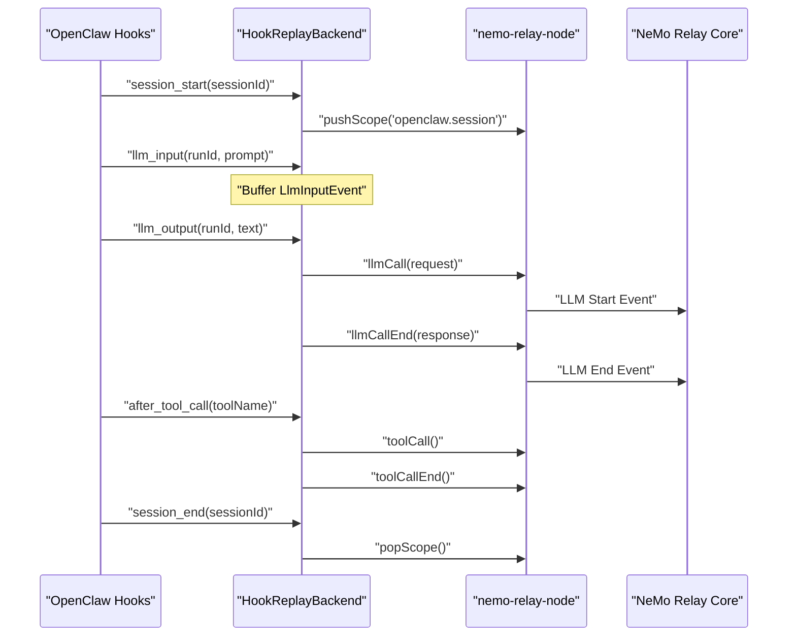

<!-- source: DeepWiki mcp.deepwiki.com · repo NVIDIA/NeMo-Relay · page 7 Integrations · fetched 2026-10-26 -->

# Integrations

Relevant source files

The following files were used as context for generating this wiki page:

- [README.md](README.md)
- [crates/cli/README.md](crates/cli/README.md)
- [docs/about-nemo-relay/agent-runtime-primer.mdx](docs/about-nemo-relay/agent-runtime-primer.mdx)
- [docs/about-nemo-relay/architecture.mdx](docs/about-nemo-relay/architecture.mdx)
- [docs/about-nemo-relay/concepts/index.mdx](docs/about-nemo-relay/concepts/index.mdx)
- [docs/about-nemo-relay/ecosystem.mdx](docs/about-nemo-relay/ecosystem.mdx)
- [docs/about-nemo-relay/overview.mdx](docs/about-nemo-relay/overview.mdx)
- [docs/contribute/runtime-contract-docs.mdx](docs/contribute/runtime-contract-docs.mdx)
- [docs/getting-started/quick-start/index.mdx](docs/getting-started/quick-start/index.mdx)
- [docs/integrate-into-frameworks/about.mdx](docs/integrate-into-frameworks/about.mdx)
- [docs/nemo-relay-cli/about.mdx](docs/nemo-relay-cli/about.mdx)
- [docs/supported-integrations/about.mdx](docs/supported-integrations/about.mdx)
- [integrations/openclaw/README.md](integrations/openclaw/README.md)
- [integrations/openclaw/openclaw.plugin.json](integrations/openclaw/openclaw.plugin.json)
- [integrations/openclaw/src/modules.ts](integrations/openclaw/src/modules.ts)
- [integrations/openclaw/src/openclaw-hook-types.ts](integrations/openclaw/src/openclaw-hook-types.ts)
- [integrations/openclaw/src/runtime-state.ts](integrations/openclaw/src/runtime-state.ts)
- [integrations/openclaw/test/config.test.ts](integrations/openclaw/test/config.test.ts)
- [integrations/openclaw/test/failure-model.test.ts](integrations/openclaw/test/failure-model.test.ts)
- [integrations/openclaw/test/live-smoke.test.ts](integrations/openclaw/test/live-smoke.test.ts)

NeMo Relay provides a framework-neutral substrate for agent execution, allowing developers to maintain their orchestration models while standardizing runtime behavior. This section covers the supported framework integrations and specialized plugins that bridge NeMo Relay with the broader agent ecosystem.

## Overview

Integrations in NeMo Relay are designed to sit below the choices an application already makes, such as the model provider, orchestration framework, or policy layer [docs/about-nemo-relay/ecosystem.mdx:111-113](). By instrumenting at the framework boundary, NeMo Relay preserves parent-child event relationships and ensures consistent middleware execution without requiring a full framework migration [docs/about-nemo-relay/ecosystem.mdx:119-127]().

### Integration Strategy

The codebase supports several integration patterns depending on who owns the call boundary [docs/integrate-into-frameworks/about.mdx:29-36]():

1.  **Managed Execution Wrappers**: Preferred for frameworks with stable callback boundaries. These wrap the real tool or LLM callback, handling lifecycle pairing, the complete middleware pipeline, timing, and event parentage [docs/integrate-into-frameworks/about.mdx:38-42]().
2.  **Explicit Lifecycle Calls**: Used when a framework provides reliable lifecycle hooks but owns callback execution. The integration must explicitly emit start and end events and retain the returned handle [docs/integrate-into-frameworks/about.mdx:45-54]().
3.  **Hook Forwarding and Replay**: Specialized for gateway-level environments such as OpenClaw, where the plugin uses a `HookReplayBackend` to reconstruct agent spans and execution trees from a stream of asynchronous hooks [integrations/openclaw/src/runtime-state.ts:22-24]().

Sources: [docs/about-nemo-relay/ecosystem.mdx:111-113](), [docs/about-nemo-relay/ecosystem.mdx:119-127](), [docs/integrate-into-frameworks/about.mdx:29-36](), [docs/integrate-into-frameworks/about.mdx:38-42](), [docs/integrate-into-frameworks/about.mdx:45-54](), [integrations/openclaw/src/runtime-state.ts:22-24]()

### Integration Landscape

The following diagram maps the relationship between natural language framework concepts and their corresponding code entities in NeMo Relay.

**Framework to Code Entity Mapping**

Sources: [docs/about-nemo-relay/ecosystem.mdx:111-113](), [docs/integrate-into-frameworks/about.mdx:29-36](), [integrations/openclaw/src/runtime-state.ts:22-24]()

---

## Python Framework Integrations

The Python binding includes first-class support for popular agent orchestration frameworks leveraging the `nemo_relay.scope` module for tracking scopes and managing middleware execution.

*   **LangChain**: Provides `NemoRelayMiddleware` and `NemoRelayCallbackHandler` to instrument LLM and tool calls within a managed execution scope, ensuring tracking of request lifecycles and tool invocations.
*   **LangGraph**: Implements `NemoRelayCallbackHandler` to trace graph node execution, managing lifecycle callbacks and correctly propagating callback handlers through nested LangChain agents inside workflows. It also includes `create_tool_node` for managed tool execution.
*   **DeepAgents**: Builds on LangChain and LangGraph support by adding `NemoRelayDeepAgentsCallbackHandler`, which emits human-in-the-loop (HITL) lifecycle marks, skill loading events, and subagent summaries to enrich observability data.

For full details, see [Python Framework Integrations (LangChain, LangGraph, DeepAgents)](#7.1).

Sources: [docs/supported-integrations/about.mdx:20-41]()

---

## OpenClaw Plugin

The `nemo-relay-openclaw` plugin is a Node.js package designed to integrate with the OpenClaw gateway, providing deep observability by replaying hooks [integrations/openclaw/README.md:7-12]().

*   **Hook Replay Backend**: The `HookReplayBackend` receives OpenClaw lifecycle events such as `llm_input`, `llm_output`, and tool call notifications, reconstructing correlated sessions and scopes to emit standard NeMo Relay events [integrations/openclaw/src/runtime-state.ts:171-176]().
*   **Correlation Logic**: Due to asynchronous and potentially out-of-order hook delivery, the backend buffers `llm_output` events within a configurable grace window (`llmOutputGraceMs`) to reliably correlate outputs with their inputs [integrations/openclaw/README.md:135-139](), [integrations/openclaw/test/config.test.ts:42-44]().
*   **PII Protection Options**: Options like `stripToolArgs` and `stripToolResults` allow sanitizing tool call data during replay to prevent leaking sensitive information [integrations/openclaw/README.md:129-134](), [integrations/openclaw/test/config.test.ts:37-40]().
*   **Gateway Status Method**: Exposes a scoped admin RPC method `nemoRelay.status()` which reports integration health and replay statistics [integrations/openclaw/README.md:40-41]().

For full details, see [OpenClaw Plugin](#7.2).

Sources: [integrations/openclaw/README.md:7-41](), [integrations/openclaw/src/runtime-state.ts:171-176]()

---

## pi Integration

The `integrations/pi` npm package and the `pi-extension` CLI provide integration with the `pi` coding agent. This integration focuses on enabling NeMo Relay's observability and adaptive features within the `pi` environment.

*   **Gateway Client**: The `PiGatewayClient` facilitates communication with the NeMo Relay gateway, allowing `pi` to leverage NeMo Relay's LLM and tool call management.
*   **Provider Redirect and Argument Transform**: This handles redirecting LLM calls to NeMo Relay and transforming arguments to align with NeMo Relay's expected formats.
*   **Tool Result Handling**: Manages the processing and reporting of tool execution results back through NeMo Relay.
*   **Lifecycle Tests and `pi doctor` Checks**: Includes specific tests to ensure the integration's lifecycle is correctly managed and `pi doctor` checks for diagnostic purposes.

For full details, see [pi Integration](#7.3).

Sources: [docs/nemo-relay-cli/about.mdx:57-61]()

---

## NeMo Guardrails Plugin (Deprecated)

NeMo Relay previously included a built-in component for integrating with NeMo Guardrails, demonstrating how to implement input/output rails around LLM and tool calls.

*   **Local Python Worker**: The integration utilized a local Python worker to execute guardrails.
*   **Remote Mode**: Supported a remote mode for guardrail execution.
*   **Input/Output Rails**: Enabled the configuration of input and output rails to enforce safety and content policies.
*   **Configuration**: Guardrails were configured through the NeMo Relay plugin system.

This component was deprecated in version 0.9 and has a removal plan.

For full details, see [NeMo Guardrails Plugin (Deprecated)](#7.4).

Sources: [docs/about-nemo-relay/ecosystem.mdx:37-37]()

---

## System Integration Flow

The following sequence diagram illustrates how the OpenClaw plugin reconstructs agent trajectories by consuming a stream of disconnected hooks and replaying them into NeMo Relay’s core runtime.

**OpenClaw Hook Correlation and Replay Flow**

Sources: [integrations/openclaw/src/modules.ts:14-26](), [integrations/openclaw/src/runtime-state.ts:171-176]()

---

## Integration Summary Table

| Integration | Mechanism | Code Entity | Purpose |
| :--- | :--- | :--- | :--- |
| **LangChain** | Middleware & Callbacks | `NemoRelayMiddleware` | Managed execution and observability |
| **LangGraph** | Callback Handler | `NemoRelayCallbackHandler` | Graph lifecycle and state tracking |
| **DeepAgents** | Middleware & Callbacks | `NemoRelayDeepAgentsCallbackHandler` | HITL marks and skill summaries |
| **OpenClaw** | Hook Backend | `HookReplayBackend` | Span reconstruction from gateway hooks [integrations/openclaw/src/runtime-state.ts:171-176]() |
| **pi** | Gateway Client & Extension | `PiGatewayClient`, `PiExtension` | Coding agent integration for observability and adaptive features |
| **NeMo Guardrails** (Deprecated) | Built-in Component | (Removed) | Input/output rails for policy enforcement |

Sources: [integrations/openclaw/src/runtime-state.ts:171-176](), [docs/supported-integrations/about.mdx:20-41]()

---

