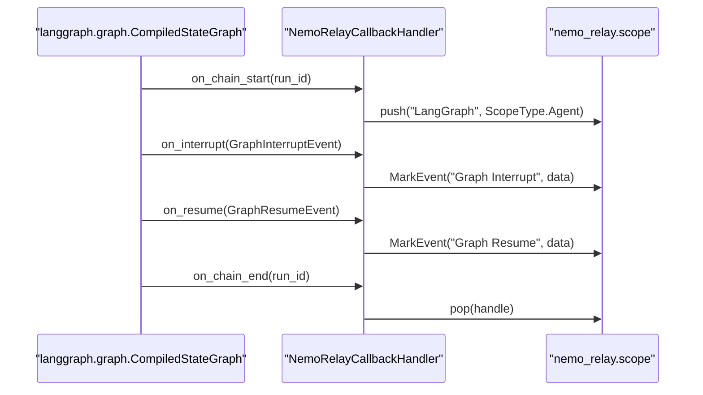

<!-- source: DeepWiki mcp.deepwiki.com · repo NVIDIA/NeMo-Relay · page 7.1 Python Framework Integrations (LangChain, LangGraph, DeepAgents) · fetched 2026-10-26 -->

# Python Framework Integrations (LangChain, LangGraph, DeepAgents)

<details>
<summary>Relevant source files</summary>

The following files were used as context for generating this wiki page:

- [docs/getting-started/quick-start/nodejs.mdx](docs/getting-started/quick-start/nodejs.mdx)
- [docs/supported-integrations/deepagents.mdx](docs/supported-integrations/deepagents.mdx)
- [docs/supported-integrations/langchain.mdx](docs/supported-integrations/langchain.mdx)
- [docs/supported-integrations/langgraph.mdx](docs/supported-integrations/langgraph.mdx)
- [python/nemo_relay/integrations/deepagents/callbacks.py](python/nemo_relay/integrations/deepagents/callbacks.py)
- [python/nemo_relay/integrations/langchain/_serialization.py](python/nemo_relay/integrations/langchain/_serialization.py)
- [python/nemo_relay/integrations/langchain/callbacks.py](python/nemo_relay/integrations/langchain/callbacks.py)
- [python/nemo_relay/integrations/langgraph/__init__.py](python/nemo_relay/integrations/langgraph/__init__.py)
- [python/nemo_relay/integrations/langgraph/callbacks.py](python/nemo_relay/integrations/langgraph/callbacks.py)
- [python/nemo_relay/integrations/langgraph/tool_node.py](python/nemo_relay/integrations/langgraph/tool_node.py)
- [python/tests/integrations/deepagents_tests/test_deepagents_integration.py](python/tests/integrations/deepagents_tests/test_deepagents_integration.py)
- [python/tests/integrations/langchain_tests/test_callbacks.py](python/tests/integrations/langchain_tests/test_callbacks.py)
- [python/tests/integrations/langchain_tests/test_callbacks_scope_stack.py](python/tests/integrations/langchain_tests/test_callbacks_scope_stack.py)
- [python/tests/integrations/langchain_tests/test_middleware.py](python/tests/integrations/langchain_tests/test_middleware.py)
- [python/tests/integrations/langgraph_tests/test_langgraph_integration.py](python/tests/integrations/langgraph_tests/test_langgraph_integration.py)

</details>


This leaf page details the implementation, data flow, key classes, and integration test suites for the NeMo Relay Python framework integrations. These components allow developers to bridge LangChain [python/nemo_relay/integrations/langchain/callbacks.py:73-74](), LangGraph [python/nemo_relay/integrations/langgraph/callbacks.py:7-7](), and DeepAgents [python/nemo_relay/integrations/deepagents/callbacks.py:18-19]() application lifecycles directly into NeMo Relay's managed execution pipeline, telemetry, and observability stream [python/tests/integrations/langchain_tests/test_middleware.py:112-115]().

Sources:
[python/nemo_relay/integrations/langchain/callbacks.py:73-74](),
[python/nemo_relay/integrations/langgraph/callbacks.py:7-7](),
[python/nemo_relay/integrations/deepagents/callbacks.py:18-19](),
[python/tests/integrations/langchain_tests/test_middleware.py:112-115]()

---

## Overview of Integrations

The Python integration layer maps framework-specific callbacks and middleware hooks into NeMo Relay's core scope stack and execution primitives (`nemo_relay.llm.execute` and `nemo_relay.tools.execute`).

### Data Flow: Framework to Relay

The following diagram bridges natural language framework concepts to specific code entities in the NeMo Relay codebase.

**Framework Integration Data Flow**
```mermaid
graph TD
    subgraph NaturalLanguageSpace["Natural Language Concepts"]
        LC_Agent[""LangChain Agent Runs""]
        LG_Graph[""LangGraph State Workflows""]
        DA_Agent[""DeepAgents Orchestrators""]
    end

    subgraph CodeEntitySpace["Code Entity Space"]
        NRM[""NemoRelayMiddleware"""]
        LCCB[""NemoRelayCallbackHandler"""]
        DAMW[""NemoRelayDeepAgentsMiddleware"""]
        DACB[""NemoRelayDeepAgentsCallbackHandler"""]
        TOOL_NODE[""create_tool_node() / wrap_tool_call()"""]
        CORE_LLM[""nemo_relay.llm.execute()"""]
        CORE_TOOL[""nemo_relay.typed.tool_execute()"""]
        CORE_SCOPE[""nemo_relay.scope.push() / pop()"""]
        CORE_STREAM[""nemo_relay._native.EventStream""]
    end

    LC_Agent --> NRM
    LC_Agent --> LCCB
    LG_Graph --> LCCB
    LG_Graph --> TOOL_NODE
    DA_Agent --> DAMW
    DA_Agent --> DACB

    NRM --> CORE_LLM
    TOOL_NODE --> CORE_TOOL
    LCCB --> CORE_SCOPE
    DACB --> CORE_SCOPE
    DAMW --> CORE_SCOPE

    CORE_LLM --> CORE_STREAM
    CORE_TOOL --> CORE_STREAM
    CORE_SCOPE --> CORE_STREAM
```

Sources:
[python/nemo_relay/integrations/langchain/callbacks.py:73-74](),
[python/nemo_relay/integrations/langgraph/callbacks.py:7-7](),
[python/nemo_relay/integrations/deepagents/callbacks.py:18-19](),
[python/nemo_relay/integrations/langchain/_serialization.py:58-59](),
[python/nemo_relay/integrations/langgraph/tool_node.py:19-21]()

---

## LangChain Integration

The LangChain integration package (`nemo_relay.integrations.langchain`) provides model/tool interception and run correlation [python/tests/integrations/langchain_tests/test_middleware.py:112-115](), [python/nemo_relay/integrations/langchain/callbacks.py:73-74]().

### NemoRelayMiddleware: Agent Middleware

`NemoRelayMiddleware` implements LangChain's agent middleware specification, intercepting requests before they reach chat models or tools [python/tests/integrations/langchain_tests/test_middleware.py:112-115]().
- **Model Interception**: `wrap_model_call` and `awrap_model_call` transform LangChain `ModelRequest` payloads using `LangChainCodec`, invoking `nemo_relay.llm.execute` under the hood [python/tests/integrations/langchain_tests/test_middleware.py:187-200]().
- **Tool Interception**: Delegates tool execution to Relay's tool validation pipeline [python/tests/integrations/langchain_tests/test_middleware.py:82-88]().

### LangChainCodec: Serialization

`LangChainCodec` subclasses `LlmCodec` to convert framework message objects (`HumanMessage`, `AIMessage`, `SystemMessage`, `ToolMessage`) into normalized `AnnotatedLLMRequest` structures [python/nemo_relay/integrations/langchain/_serialization.py:58-59]().
- **Content Blocks**: Normalizes text and tool call parts across different provider schemas [python/nemo_relay/integrations/langchain/_serialization.py:60-168]().

### NemoRelayCallbackHandler: Scope Management

`NemoRelayCallbackHandler` inherits from `BaseCallbackHandler` to bind LangChain run IDs to NeMo Relay `Agent` scopes [python/nemo_relay/integrations/langchain/callbacks.py:73-74]().
- **Stack Ordering**: Maintains a `_completed` dictionary and thread lock (`threading.RLock`) to safely handle sibling runs completing out of strict LIFO order [python/nemo_relay/integrations/langchain/callbacks.py:25-86]().

Sources:
[python/nemo_relay/integrations/langchain/callbacks.py:25-86](),
[python/nemo_relay/integrations/langchain/_serialization.py:58-168](),
[python/tests/integrations/langchain_tests/test_middleware.py:82-200]()

---

## LangGraph Integration

LangGraph integration (`nemo_relay.integrations.langgraph`) extends LangChain primitives to handle state graph flows and tool node execution [python/nemo_relay/integrations/langgraph/callbacks.py:7-7](), [python/nemo_relay/integrations/langgraph/tool_node.py:4-8]().

### NemoRelayCallbackHandler for LangGraph

Inheriting from the LangChain handler, this component maps graph transitions, interrupts, and resumes into NeMo Relay scopes and mark events [python/nemo_relay/integrations/langgraph/callbacks.py:7-7]().

### Managed ToolNode Execution

`create_tool_node`, `wrap_tool_call`, and `awrap_tool_call` inject NeMo Relay's managed execution pipeline into LangGraph `ToolNode` instances [python/nemo_relay/integrations/langgraph/tool_node.py:8-19]().
- **Graph Bubble Preservation**: Catches `GraphBubbleUp` exceptions during tool execution, saves them locally, and re-raises them after managed execution completes [python/nemo_relay/integrations/langgraph/tool_node.py:112-139]().
- **Result Codec**: `_ToolNodeResultCodec` restores `ToolMessage` objects nested inside LangGraph `Command` updates [python/nemo_relay/integrations/langgraph/tool_node.py:24-49]().

**LangGraph Integration Sequence Diagram**


Sources:
[python/nemo_relay/integrations/langgraph/callbacks.py:7-7](),
[python/nemo_relay/integrations/langgraph/tool_node.py:24-139]()

---

## DeepAgents Integration

The DeepAgents integration (`nemo_relay.integrations.deepagents`) adds semantic agent naming, skill configuration hooks, and Human-In-The-Loop (HITL) detection [python/nemo_relay/integrations/deepagents/callbacks.py:18-19]().

### NemoRelayDeepAgentsMiddleware

Emits a configuration `MarkEvent` upon agent initialization containing active skills, subagent definitions, and state backend identifiers [python/tests/integrations/deepagents_tests/test_deepagents_integration.py:189-198]().

### NemoRelayDeepAgentsCallbackHandler

Extends the LangGraph callback handler to normalize agent scopes and parse HITL interrupt payloads [python/nemo_relay/integrations/deepagents/callbacks.py:18-19]().
- **Semantic Naming**: Derives roles (`orchestrator` vs `subagent`) from metadata dictionaries such as `lc_agent_name` and `ls_integration` [python/nemo_relay/integrations/deepagents/callbacks.py:37-89]().
- **HITL Detection**: Identifies interrupt phases by validating `action_requests` and `review_configs` within graph interrupt payloads [python/nemo_relay/integrations/deepagents/callbacks.py:130-157]().

Sources:
[python/nemo_relay/integrations/deepagents/callbacks.py:18-157](),
[python/tests/integrations/deepagents_tests/test_deepagents_integration.py:189-198]()

---

## Integration Test Suites

The test suite validates integration behavior across asynchronous boundaries, exception handling, and serialization correctness:
- `python/tests/integrations/langchain_tests/test_middleware.py`: Verifies `NemoRelayMiddleware` execution routing and sync/async model request handlers [python/tests/integrations/langchain_tests/test_middleware.py:43-116]().
- `python/tests/integrations/langgraph_tests/test_langgraph_integration.py`: Validates `create_tool_node` argument rewriting and standalone tool execution tracking [python/tests/integrations/langgraph_tests/test_langgraph_integration.py:95-160]().
- `python/tests/integrations/deepagents_tests/test_deepagents_integration.py`: Asserts configuration mark emission and OpenTelemetry span attribute mapping [python/tests/integrations/deepagents_tests/test_deepagents_integration.py:111-206]().

Sources:
[python/tests/integrations/langchain_tests/test_middleware.py:43-200](),
[python/tests/integrations/langgraph_tests/test_langgraph_integration.py:95-160](),
[python/tests/integrations/deepagents_tests/test_deepagents_integration.py:111-206]()

---

## Summary of Integration Classes

| Framework | Integration Class | Primary Role | Source Location |
| :--- | :--- | :--- | :--- |
| **LangChain** | `NemoRelayMiddleware` | Intercepts model/tool calls via `AgentMiddleware`. | [python/tests/integrations/langchain_tests/test_middleware.py:112-115]() |
| **LangChain** | `LangChainCodec` | Translates LC messages to NeMo Relay requests. | [python/nemo_relay/integrations/langchain/_serialization.py:58-59]() |
| **LangChain** | `NemoRelayCallbackHandler` | Maps chain runs to NeMo Relay Agent scopes. | [python/nemo_relay/integrations/langchain/callbacks.py:73-74]() |
| **LangGraph** | `NemoRelayCallbackHandler` | Captures graph lifecycle and HITL interrupts/resumes. | [python/nemo_relay/integrations/langgraph/callbacks.py:7-7]() |
| **LangGraph** | `create_tool_node` | Factory for managed `ToolNode` instances. | [python/nemo_relay/integrations/langgraph/tool_node.py:19-21]() |
| **DeepAgents** | `NemoRelayDeepAgentsMiddleware` | Emits configuration marks for skills and subagents. | [python/tests/integrations/deepagents_tests/test_deepagents_integration.py:189-198]() |
| **DeepAgents** | `NemoRelayDeepAgentsCallbackHandler` | Bridges semantic agent runs and HITL events. | [python/nemo_relay/integrations/deepagents/callbacks.py:18-19]() |

Sources:
[python/nemo_relay/integrations/langchain/_serialization.py:58-59](),
[python/nemo_relay/integrations/langchain/callbacks.py:73-74](),
[python/nemo_relay/integrations/langgraph/tool_node.py:19-21](),
[python/nemo_relay/integrations/deepagents/callbacks.py:18-19]()

---

