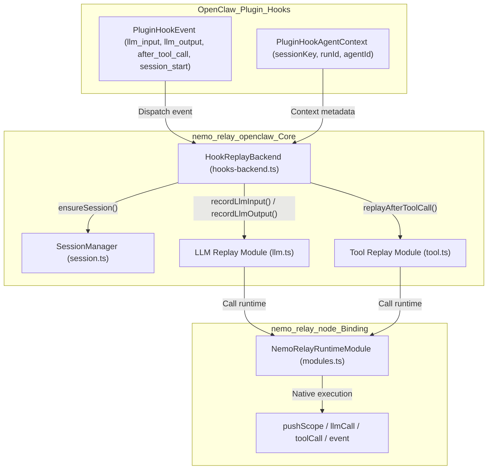
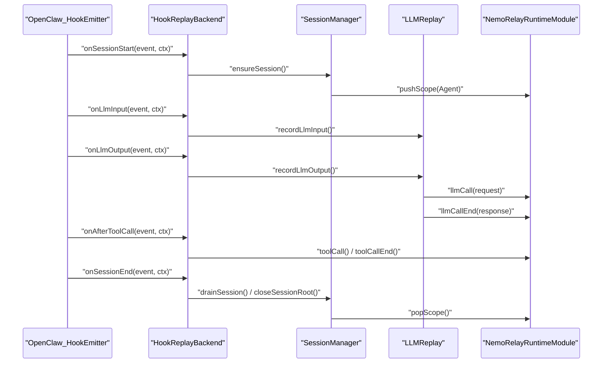

<!-- source: DeepWiki mcp.deepwiki.com · repo NVIDIA/NeMo-Relay · page 7.2 OpenClaw Plugin · fetched 2026-10-26 -->

# OpenClaw Plugin

Relevant source files

The following files were used as context for generating this wiki page:

- [integrations/openclaw/README.md](integrations/openclaw/README.md)
- [integrations/openclaw/openclaw.plugin.json](integrations/openclaw/openclaw.plugin.json)
- [integrations/openclaw/src/hook-replay/llm.ts](integrations/openclaw/src/hook-replay/llm.ts)
- [integrations/openclaw/src/hook-replay/marks.ts](integrations/openclaw/src/hook-replay/marks.ts)
- [integrations/openclaw/src/hook-replay/session.ts](integrations/openclaw/src/hook-replay/session.ts)
- [integrations/openclaw/src/hook-replay/tool.ts](integrations/openclaw/src/hook-replay/tool.ts)
- [integrations/openclaw/src/hooks-backend.ts](integrations/openclaw/src/hooks-backend.ts)
- [integrations/openclaw/src/modules.ts](integrations/openclaw/src/modules.ts)
- [integrations/openclaw/src/openclaw-hook-types.ts](integrations/openclaw/src/openclaw-hook-types.ts)
- [integrations/openclaw/src/runtime-state.ts](integrations/openclaw/src/runtime-state.ts)
- [integrations/openclaw/test/config.test.ts](integrations/openclaw/test/config.test.ts)
- [integrations/openclaw/test/failure-model.test.ts](integrations/openclaw/test/failure-model.test.ts)
- [integrations/openclaw/test/hooks-backend.test.ts](integrations/openclaw/test/hooks-backend.test.ts)
- [integrations/openclaw/test/live-smoke.test.ts](integrations/openclaw/test/live-smoke.test.ts)
- [integrations/openclaw/test/llm-replay.test.ts](integrations/openclaw/test/llm-replay.test.ts)
- [integrations/openclaw/test/tool-replay.test.ts](integrations/openclaw/test/tool-replay.test.ts)

The `nemo-relay-openclaw` package provides observability and adaptive telemetry integration for the OpenClaw agent framework using NeMo Relay [integrations/openclaw/README.md:6-14](). It intercepts public OpenClaw hook events—such as LLM requests, responses, tool executions, message writes, and session lifecycles—and replays them into the NeMo Relay runtime as structured sessions, LLM spans, tool spans, and lifecycle marks [integrations/openclaw/src/hooks-backend.ts:79-185](), [integrations/openclaw/README.md:8-13](). Downstream NeMo Relay observability components then export this telemetry as ATIF JSON and OpenTelemetry OTLP traces, including OpenInference projections [integrations/openclaw/README.md:8-14]().

---

## Architecture and Data Flow

The integration bridges OpenClaw's hook system and the NeMo Relay core via its Node.js native bindings (`nemo-relay-node`) [integrations/openclaw/src/modules.ts:10-26](). Asynchronous and out-of-order OpenClaw events are buffered, correlated, and transformed through a dedicated replay backend before reaching the core runtime [integrations/openclaw/src/hooks-backend.ts:5-10]().

### Key Code Entities

- **`HookReplayBackend`**: Central dispatcher receiving hook events and coordinating dispatch to sub-modules [integrations/openclaw/src/hooks-backend.ts:80-95]().
- **`SessionManager`**: Manages session identity, aliases, bounded replay queues, and root scope lifecycles [integrations/openclaw/src/hook-replay/session.ts:25-37]().
- **`recordLlmInput` / `recordLlmOutput`**: Correlates and reconstructs NeMo Relay LLM spans from fragmented OpenClaw hooks [integrations/openclaw/src/hook-replay/llm.ts:44-157]().
- **`guardBeforeToolCall` / `replayAfterToolCall`**: Executes adaptive conditional guardrails and replays tool execution spans [integrations/openclaw/src/hook-replay/tool.ts:20-136]().
- **`NemoRelayRuntimeModule`**: Dynamic module interface wrapping native bindings (`pushScope`, `popScope`, `llmCall`, `toolCall`) [integrations/openclaw/src/modules.ts:39-46]().

### Diagram: OpenClaw Plugin Entity Mapping

Sources:
[integrations/openclaw/src/hooks-backend.ts:79-95](), [integrations/openclaw/src/hook-replay/session.ts:25-37](), [integrations/openclaw/src/hook-replay/llm.ts:44-157](), [integrations/openclaw/src/hook-replay/tool.ts:20-136](), [integrations/openclaw/src/modules.ts:39-46]()

---

## Hook Types and Replay Logic

The plugin subscribes to public OpenClaw hooks, transforming them into NeMo Relay operational primitives [integrations/openclaw/README.md:15-39]().

| OpenClaw Hook | Replay Function | Description |
|---|---|---|
| `llm_input` | `recordLlmInput` | Buffers prompt snapshots and matches with pending outputs [integrations/openclaw/src/hook-replay/llm.ts:44-96](). |
| `llm_output` | `recordLlmOutput` | Replays LLM outputs immediately or buffers within grace window [integrations/openclaw/src/hook-replay/llm.ts:104-157](). |
| `before_message_write` | `recordBeforeMessageWrite` | Captures assistant message persistence for higher-fidelity text/tool reconstruction [integrations/openclaw/src/hook-replay/llm.ts:165-215](). |
| `before_tool_call` | `guardBeforeToolCall` | Runs conditional-execution adaptive guardrails before tool invocation [integrations/openclaw/src/hook-replay/tool.ts:20-47](). |
| `after_tool_call` | `replayAfterToolCall` | Replays tool execution spans or emits `openclaw.tool_blocked` marks [integrations/openclaw/src/hook-replay/tool.ts:50-136](). |
| `session_start` | `onSessionStart` | Opens root session scope and records session aliases [integrations/openclaw/src/hooks-backend.ts:109-123](). |
| `session_end` | `onSessionEnd` | Drains replay buffers and closes session root scope [integrations/openclaw/src/hooks-backend.ts:126-149](). |
| `model_call_started` | `recordModelCallStarted` | Tracks provider-call start timing for correlation [integrations/openclaw/src/hook-replay/llm.ts:200-225](). |
| `model_call_ended` | `recordModelCallEnded` | Tracks provider-call completion timing [integrations/openclaw/src/hook-replay/llm.ts:226-265](). |

Sources:
[integrations/openclaw/src/hooks-backend.ts:109-170](), [integrations/openclaw/src/hook-replay/llm.ts:44-265](), [integrations/openclaw/src/hook-replay/tool.ts:20-136]()

---

### Correlation and Grace Window

Because OpenClaw hook emissions can arrive asynchronously or out of order (for instance, `llm_output` arriving prior to `llm_input`), the plugin relies on bounded in-memory correlation mechanisms [integrations/openclaw/src/hook-replay/llm.ts:5-13]():

- **Grace Window Delay**: When an `llm_output` arrives without a preceding `llm_input`, `recordLlmOutput` holds the record for `llmOutputGraceMs` (default `250ms`) to allow late inputs to arrive [integrations/openclaw/README.md:136](), [integrations/openclaw/src/hook-replay/llm.ts:141-157]().
- **Record TTL and Bounded Queues**: Correlation items expire after `recordTtlMs` (default `600,000ms`), and individual hash keys retain a maximum of `maxRecordsPerKey` entries (default `32`) to prevent memory exhaustion [integrations/openclaw/README.md:137-138](), [integrations/openclaw/src/hook-replay/correlation.ts:38-60]().
- **Token Accounting Normalization**: Token counts across diverse provider schemas are normalized into standard prompt, completion, and cached token fields [integrations/openclaw/test/llm-replay.test.ts:76-205]().

Sources:
[integrations/openclaw/README.md:135-140](), [integrations/openclaw/src/hook-replay/llm.ts:141-157](), [integrations/openclaw/src/hook-replay/correlation.ts:38-60](), [integrations/openclaw/test/llm-replay.test.ts:76-205]()

---

## Implementation Detail: `HookReplayBackend`

The `HookReplayBackend` class in `integrations/openclaw/src/hooks-backend.ts` serves as the primary coordination engine [integrations/openclaw/src/hooks-backend.ts:80-95](). It maintains fail-open error semantics so that telemetry exceptions never abort the host agent process [integrations/openclaw/src/hooks-backend.ts:5-10]().

### Diagram: Hook Replay Sequence

Sources:
[integrations/openclaw/src/hooks-backend.ts:80-185](), [integrations/openclaw/src/hook-replay/session.ts:25-68](), [integrations/openclaw/src/hook-replay/llm.ts:44-157](), [integrations/openclaw/src/hook-replay/tool.ts:50-136]()

---

## Session Replay and Correlation Logic

Session tracking and correlation are managed within `integrations/openclaw/src/hook-replay/session.ts` and `integrations/openclaw/src/hook-replay/correlation.ts` [integrations/openclaw/src/hook-replay/session.ts:5-10](), [integrations/openclaw/src/hook-replay/correlation.ts:4-13]().

- `ensureSession()`: Resolves session identifiers (`sessionId`, `sessionKey`, `runId`), provisions a `SessionState` structure, and opens the root session scope via `NemoRelayRuntimeModule` [integrations/openclaw/src/hook-replay/session.ts:34-68]().
- `lookupSessionKeys()`: Aggregates alternative lookup strings to associate fragmented hook callbacks with their parent session [integrations/openclaw/src/hook-replay/session.ts:189-192]().
- Bounded FIFO queues (`insertBoundedRecord`, `shiftOldest`) manage pending input/output mappings and model call durations [integrations/openclaw/src/hook-replay/session.ts:180-220]().

Sources:
[integrations/openclaw/src/hook-replay/session.ts:25-68](), [integrations/openclaw/src/hook-replay/correlation.ts:38-60]()

---

## Plugin Lifecycle, Configuration, and Packaging Checks

### Initialization and Module Loading
The plugin package dynamically loads native NeMo Relay bindings through `defaultNemoRelayModuleLoader` in `integrations/openclaw/src/modules.ts` [integrations/openclaw/src/modules.ts:69-81](). If native binaries are absent, registration degrades gracefully without crashing the gateway [integrations/openclaw/src/modules.ts:5-9]().

### Configuration Schema
OpenClaw configures the plugin under `plugins.entries["nemo-relay"].config` [integrations/openclaw/README.md:63-75](). Supported schema properties include:
- `backend`: Must be set to `"hooks"` [integrations/openclaw/README.md:158]().
- `capture`: Controls PII redaction and argument stripping (`includePrompts`, `includeResponses`, `stripToolArgs`, `stripToolResults`) [integrations/openclaw/README.md:129-134]().
- `plugins`: Generic NeMo Relay component configuration (e.g., `observability` with ATIF/OTLP endpoints, and `adaptive` learners) [integrations/openclaw/README.md:78-128]().
- `correlation`: Tuning parameters for `llmOutputGraceMs`, `recordTtlMs`, and `maxRecordsPerKey` [integrations/openclaw/README.md:135-139]().

### Packaging Checks
The packaging validation script (`integrations/openclaw/scripts/check-pack-payload.mjs`) verifies npm distribution integrity by ensuring that:
- Production source files and compiled bundles in `dist/` are packaged while test files and sourcemaps are excluded.
- Metadata fields in `package.json` and OpenClaw extension manifests align with peer dependencies [integrations/openclaw/scripts/check-pack-payload.mjs:98-158]().

### Gateway Status API
The plugin registers a health inspection endpoint (`nemoRelay.status`) providing operational counters for replayed LLM spans, tool spans, active session counts, and replay error rates [integrations/openclaw/README.md:40]().

Sources:
[integrations/openclaw/src/modules.ts:5-81](), [integrations/openclaw/README.md:63-140](), [integrations/openclaw/scripts/check-pack-payload.mjs:98-158]()

---

