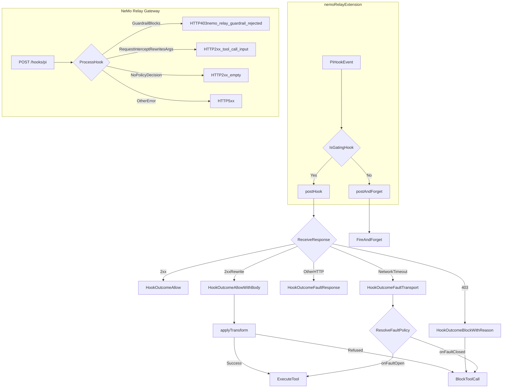
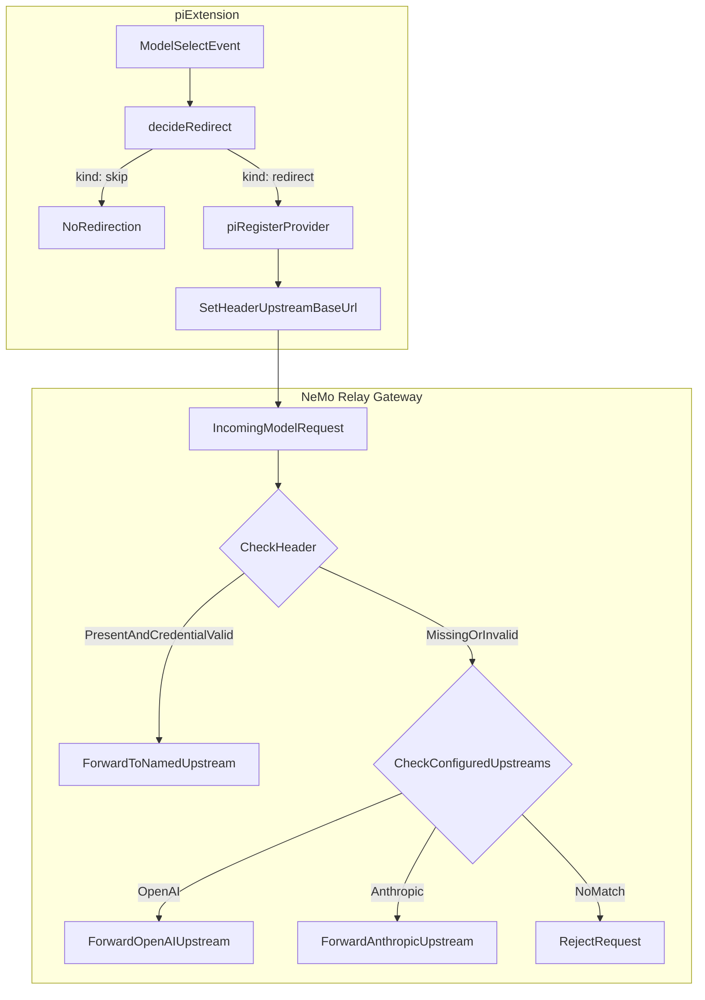
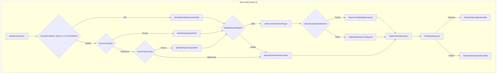

<!-- source: DeepWiki mcp.deepwiki.com · repo NVIDIA/NeMo-Relay · page 7.3 pi Integration · fetched 2026-10-26 -->

# pi Integration

<details>
<summary>Relevant source files</summary>

The following files were used as context for generating this wiki page:

- [.config/nextest.toml](.config/nextest.toml)
- [crates/cli/assets/pi-extension/index.ts](crates/cli/assets/pi-extension/index.ts)
- [crates/cli/assets/pi-extension/src/argument-transform.ts](crates/cli/assets/pi-extension/src/argument-transform.ts)
- [crates/cli/assets/pi-extension/src/gateway-client.ts](crates/cli/assets/pi-extension/src/gateway-client.ts)
- [crates/cli/assets/pi-extension/src/provider-redirect.ts](crates/cli/assets/pi-extension/src/provider-redirect.ts)
- [crates/cli/src/agents/pi/doctor.rs](crates/cli/src/agents/pi/doctor.rs)
- [crates/cli/src/agents/pi/launch.rs](crates/cli/src/agents/pi/launch.rs)
- [crates/cli/src/agents/pi/mod.rs](crates/cli/src/agents/pi/mod.rs)
- [crates/node/tests/index_loader_tests.mjs](crates/node/tests/index_loader_tests.mjs)
- [docs/nemo-relay-cli/pi.mdx](docs/nemo-relay-cli/pi.mdx)
- [integrations/pi/README.md](integrations/pi/README.md)
- [integrations/pi/test/gateway-client.test.mjs](integrations/pi/test/gateway-client.test.mjs)
- [integrations/pi/test/lifecycle.test.mjs](integrations/pi/test/lifecycle.test.mjs)
- [integrations/pi/test/provider-redirect.test.mjs](integrations/pi/test/provider-redirect.test.mjs)
- [integrations/pi/test/tool-result.test.mjs](integrations/pi/test/tool-result.test.mjs)

</details>


This page details the integration of NeMo Relay with the `pi` coding agent. It covers the `integrations/pi` npm package, which provides the `pi-extension`, and its role in facilitating communication between `pi` and the NeMo Relay CLI gateway (`crates/cli/assets/pi-extension/index.ts` [crates/cli/assets/pi-extension/index.ts:1-10]()). Key aspects include the gateway client (`gateway-client.ts`), provider redirection (`provider-redirect.ts`), argument transformation (`argument-transform.ts`), handling of tool results, lifecycle event mapping, and diagnostic checks provided by `nemo-relay doctor` (`crates/cli/src/agents/pi/doctor.rs` [crates/cli/src/agents/pi/doctor.rs:4-10]()).

The `pi` integration is a proof of concept (`integrations/pi/README.md` [integrations/pi/README.md:17-19]()). Tool and turn activity reach Relay when the gateway is reachable and no other `pi` extension preempts the hook first (`docs/nemo-relay-cli/pi.mdx:10-18` [docs/nemo-relay-cli/pi.mdx:10-18]()). The extension defaults to failing **open**, meaning an unavailable gateway allows `pi` to continue unrecorded (`integrations/pi/README.md` [integrations/pi/README.md:138]()). `pi` runs every extension's handler for a hook, so an extension registered ahead of the NeMo Relay one can decide a tool call before Relay's gate ever sees it (`docs/nemo-relay-cli/pi.mdx:10-18` [docs/nemo-relay-cli/pi.mdx:10-18]()).

Model traffic reaches Relay when the gateway forwards to the endpoint the selected model would otherwise call, as explained in the Model Redirection section (`docs/nemo-relay-cli/pi.mdx:19-22` [docs/nemo-relay-cli/pi.mdx:19-22]()).

`pi` has no native hook-configuration file, and its external event stream is observation-only, so hook calls cannot be injected from outside the process (`docs/nemo-relay-cli/pi.mdx:23-25` [docs/nemo-relay-cli/pi.mdx:23-25]()). They originate inside a `pi` *extension*, which NeMo Relay ships in this repository (`docs/nemo-relay-cli/pi.mdx:23-25` [docs/nemo-relay-cli/pi.mdx:23-25]()). The extension is a thin HTTP client: it forwards `pi`'s lifecycle to `POST /hooks/pi` and gates tool calls on the gateway's verdict (`docs/nemo-relay-cli/pi.mdx:26-29` [docs/nemo-relay-cli/pi.mdx:26-29]()). All policy and all span construction stay in the gateway (`docs/nemo-relay-cli/pi.mdx:26-29` [docs/nemo-relay-cli/pi.mdx:26-29]()).

<Warning>
`pi` ships breaking changes through *minor* releases and has no major-release channel (`docs/nemo-relay-cli/pi.mdx:30-35` [docs/nemo-relay-cli/pi.mdx:30-35]()). The integration is verified against `pi v0.84.0` (`docs/nemo-relay-cli/pi.mdx:30-35` [docs/nemo-relay-cli/pi.mdx:30-35]()). Re-verify hook signatures after a `pi` upgrade; a silent shape change appears as missing spans, not as an error (`docs/nemo-relay-cli/pi.mdx:30-35` [docs/nemo-relay-cli/pi.mdx:30-35]()).
</Warning>

Sources:
- [docs/nemo-relay-cli/pi.mdx:1-35]()
- [integrations/pi/README.md:1-16]()
- [crates/cli/assets/pi-extension/index.ts:1-10]()
- [crates/cli/src/agents/pi/doctor.rs:4-10]()

## Requirements

Install `pi 0.84.x` (`docs/nemo-relay-cli/pi.mdx:37-39` [docs/nemo-relay-cli/pi.mdx:37-39]()). Anything below `0.84.0` is rejected; anything above `0.84.x` is accepted but reported as **unverified**, because `pi` can change a hook shape in a minor release and the symptom is missing spans rather than an error (`docs/nemo-relay-cli/pi.mdx:37-45` [docs/nemo-relay-cli/pi.mdx:37-45]()). `nemo-relay doctor pi` reports this in its output; the launcher records it as a warning-level log line, so `nemo-relay pi` shows it only at `--log-level warn` or lower (`docs/nemo-relay-cli/pi.mdx:37-45` [docs/nemo-relay-cli/pi.mdx:37-45]()).

```bash
nemo-relay doctor pi
```

This command reports two things nothing else can: which path the extension will load from and whether `pi` will trust it, and whether the gateway is answering at the URL the extension posts to (`docs/nemo-relay-cli/pi.mdx:46-54` [docs/nemo-relay-cli/pi.mdx:46-54]()). Run it first whenever Relay does not seem to be doing anything (`docs/nemo-relay-cli/pi.mdx:46-54` [docs/nemo-relay-cli/pi.mdx:46-54]()).

Sources:
- [docs/nemo-relay-cli/pi.mdx:37-53]()

## Install The Extension

Install the extension once. The install is **persistent**: `pi` loads the extension on every later run, and both `nemo-relay pi` and `nemo-relay run --agent pi` find it without any variable being set (`docs/nemo-relay-cli/pi.mdx:55-60` [docs/nemo-relay-cli/pi.mdx:55-60]()).

```bash
nemo-relay install pi
```

This writes the extension into `~/.pi/agent/extensions/nemo-relay`, which `pi` auto-discovers (`docs/nemo-relay-cli/pi.mdx:61-68` [docs/nemo-relay-cli/pi.mdx:61-68]()). The `nemo-relay` binary carries the extension, so no repository checkout is needed (`docs/nemo-relay-cli/pi.mdx:61-68` [docs/nemo-relay-cli/pi.mdx:61-68]()). `pi` does not have to be on `PATH` either — the install writes a directory rather than driving `pi` (`docs/nemo-relay-cli/pi.mdx:61-68` [docs/nemo-relay-cli/pi.mdx:61-68]()).

You may not need to run it explicitly (`docs/nemo-relay-cli/pi.mdx:69-75` [docs/nemo-relay-cli/pi.mdx:69-75]()). When `nemo-relay pi` or `nemo-relay config` runs the first-time setup wizard and `pi` is among the selected agents, setup offers this install if `pi` has no copy of the extension (`docs/nemo-relay-cli/pi.mdx:69-75` [docs/nemo-relay-cli/pi.mdx:69-75]()). The wizard only runs when no Relay configuration exists yet, so on a machine already configured for another agent, run the command above (`docs/nemo-relay-cli/pi.mdx:69-75` [docs/nemo-relay-cli/pi.mdx:69-75]()).

`pi` has no plugin marketplace — no marketplace manifest, no `pi plugin` verb, and no MCP client for a plugin-owned server to serve — so this is not a marketplace install like the Claude Code and Codex ones (`docs/nemo-relay-cli/pi.mdx:76-81` [docs/nemo-relay-cli/pi.mdx:76-81]()). `--install-dir` therefore does not apply: `pi` decides where its extensions live (`docs/nemo-relay-cli/pi.mdx:76-81` [docs/nemo-relay-cli/pi.mdx:76-81]()). Set `PI_CODING_AGENT_DIR` to move `pi`'s whole configuration (`docs/nemo-relay-cli/pi.mdx:76-81` [docs/nemo-relay-cli/pi.mdx:76-81]()).

Remove it with:

```bash
nemo-relay uninstall pi
```

Uninstall removes only the files the install recorded, and only while they still match what was written (`docs/nemo-relay-cli/pi.mdx:82-87` [docs/nemo-relay-cli/pi.mdx:82-87]()). A file you edited is kept, and so is the directory holding it (`docs/nemo-relay-cli/pi.mdx:82-90` [docs/nemo-relay-cli/pi.mdx:82-90]()).

Sources:
- [docs/nemo-relay-cli/pi.mdx:55-87]()
- [integrations/pi/README.md:48-60]()

### Install It Yourself Instead

Two manual routes, both untrusted-project-proof, if you would rather manage the extension yourself (`docs/nemo-relay-cli/pi.mdx:92-103` [docs/nemo-relay-cli/pi.mdx:92-103]()):

```bash
# 1 · file drop
cp -r crates/cli/assets/pi-extension ~/.pi/agent/extensions/nemo-relay

# 2 · pi install, from a LOCAL PATH -- never with --local
pi install /path/to/NeMo-Relay/crates/cli/assets/pi-extension
```

Both copy from `crates/cli/assets/pi-extension`, which is where the extension's source lives and the only self-contained copy of it (`docs/nemo-relay-cli/pi.mdx:104-108` [docs/nemo-relay-cli/pi.mdx:104-108]()). `integrations/pi` holds the extension's README, TypeScript configuration and test suite, and reaches the source through symlinks that a copy may or may not follow (`docs/nemo-relay-cli/pi.mdx:104-108` [docs/nemo-relay-cli/pi.mdx:104-108]()).

Relay resolves either route too — or `NEMO_RELAY_PI_EXTENSION`, if you set it — and passes what it finds to `-e`, which loads first and is never trust-gated (`docs/nemo-relay-cli/pi.mdx:109-112` [docs/nemo-relay-cli/pi.mdx:109-112]()). It needs one of them: it never promotes a project-scoped install to `-e` (`docs/nemo-relay-cli/pi.mdx:109-112` [docs/nemo-relay-cli/pi.mdx:109-112]()).

<Warning>
**Do not install a second copy.** `pi` de-duplicates its extension set by path rather than by package, so a copy in one place and a copy in another are two packages: both register hooks, every turn, tool and inline-shell event is reported twice, each turn closes as superseded by its own duplicate, and the inline-shell gate decides one command twice (`docs/nemo-relay-cli/pi.mdx:114-122` [docs/nemo-relay-cli/pi.mdx:114-122]()). `nemo-relay install pi` refuses when another copy would load beside it, and the launcher refuses to start (`docs/nemo-relay-cli/pi.mdx:114-122` [docs/nemo-relay-cli/pi.mdx:114-122]()). Keep one copy (`docs/nemo-relay-cli/pi.mdx:114-122` [docs/nemo-relay-cli/pi.mdx:114-122]()).

**Project scope is the exception, and the two commands treat it differently.** `nemo-relay install pi` refuses when the current directory holds a project-scoped copy, because installing would be the act that creates the second one (`docs/nemo-relay-cli/pi.mdx:123-132` [docs/nemo-relay-cli/pi.mdx:123-132]()). The launcher does *not* refuse over it — it launches and prints a note — because a project copy loads only in a trusted project, and refusing would block every launch in an untrusted one over a copy that will not run (`docs/nemo-relay-cli/pi.mdx:123-132` [docs/nemo-relay-cli/pi.mdx:123-132]()).

Both checks read only the current directory, `nemo-relay doctor pi` included (`docs/nemo-relay-cli/pi.mdx:123-132` [docs/nemo-relay-cli/pi.mdx:123-132]()). Run from outside the project, none of the three sees the copy (`docs/nemo-relay-cli/pi.mdx:123-132` [docs/nemo-relay-cli/pi.mdx:123-132]()).
</Warning>

Because the manual routes look exactly like the managed one, `nemo-relay install pi` never overwrites a directory it did not write, `--force` included, and `nemo-relay uninstall pi` never removes one (`docs/nemo-relay-cli/pi.mdx:133-141` [docs/nemo-relay-cli/pi.mdx:133-141]()). Every managed install records what it wrote, and anything without that record is left alone — whether it is a package with its own `package.json`, a bare `index.ts` (which `pi` loads too), or leftovers `pi` would not load at all (`docs/nemo-relay-cli/pi.mdx:133-141` [docs/nemo-relay-cli/pi.mdx:133-141]()). The recovery in every case is to remove the directory yourself (`docs/nemo-relay-cli/pi.mdx:133-141` [docs/nemo-relay-cli/pi.mdx:133-141]()).

<Warning>
**Do not install from a git URL.** `pi` has no subdirectory syntax for a git source: it clones the repository root and looks there for a `pi` manifest key or a top-level `extensions/` directory (`docs/nemo-relay-cli/pi.mdx:142-150` [docs/nemo-relay-cli/pi.mdx:142-150]()). This extension lives further down the tree, so the install reports success and loads nothing — while the clone's root `skills/` directory *is* picked up, giving you NeMo Relay's skills in `pi` and none of the gating (`docs/nemo-relay-cli/pi.mdx:142-150` [docs/nemo-relay-cli/pi.mdx:142-150]()).
</Warning>

The extension is **not published to npm**, deliberately: `nemo-relay install pi` and the two manual routes already cover user scope, and publishing would add a build step, a `files` allowlist and release wiring for one more route to the same files (`docs/nemo-relay-cli/pi.mdx:151-152` [docs/nemo-relay-cli/pi.mdx:151-152]()). It is `private: true` for that reason, not by oversight — and it carries a `pi.extensions` manifest key so both working routes resolve explicitly rather than relying on `pi`'s directory fallback (`integrations/pi/README.md` [integrations/pi/README.md:105-113]()).

Sources:
- [docs/nemo-relay-cli/pi.mdx:92-152]()
- [integrations/pi/README.md:61-113]()

## Environment Variables

The `pi` extension uses several environment variables for configuration:

| Variable | Default | Meaning |
|---|---|---|
| `NEMO_RELAY_PI_EXTENSION` | unset | The first place the launcher looks for this extension. A path that exists **and** whose `package.json` names `nemo-relay-pi` is used; anything else is ignored and resolution falls through to a user-scope install. Set by the launcher from what it resolved (`docs/nemo-relay-cli/pi.mdx:131-135` [docs/nemo-relay-cli/pi.mdx:131-135]()). |
| `NEMO_RELAY_PI_GATEWAY_URL` | `http://127.0.0.1:4040` | Gateway base URL (`docs/nemo-relay-cli/pi.mdx:136` [docs/nemo-relay-cli/pi.mdx:136]()). |
| `NEMO_RELAY_PI_TIMEOUT_MS` | `5000` | Per-request timeout. Posts are serialized, so a gating hook also waits out everything queued ahead of it — an unresponsive gateway costs this once per queued post, not once (`docs/nemo-relay-cli/pi.mdx:137` [docs/nemo-relay-cli/pi.mdx:137]()). |
| `NEMO_RELAY_PI_FAIL` | `open` | `closed` blocks tool calls and inline shell commands when the gateway is unreachable (`docs/nemo-relay-cli/pi.mdx:138` [docs/nemo-relay-cli/pi.mdx:138]()). |
| `NEMO_RELAY_PI_REDIRECT` | `match` | `force` redirects without checking the upstream; `off` disables redirection (`docs/nemo-relay-cli/pi.mdx:139` [docs/nemo-relay-cli/pi.mdx:139]()). |
| `NEMO_RELAY_PI_OPENAI_UPSTREAM` | unset | What the gateway forwards OpenAI-compatible traffic to. Set by the launcher (`docs/nemo-relay-cli/pi.mdx:140` [docs/nemo-relay-cli/pi.mdx:140]()). |
| `NEMO_RELAY_PI_ANTHROPIC_UPSTREAM` | unset | What the gateway forwards Anthropic traffic to. Set by the launcher (`integrations/pi/README.md` [integrations/pi/README.md:141-143]()). |

Sources:
- [docs/nemo-relay-cli/pi.mdx:131-140]()
- [integrations/pi/README.md:132-140]()
- [crates/cli/assets/pi-extension/index.ts:50-57]()
- [crates/cli/src/agents/pi/launch.rs:27-36]()
- [crates/cli/src/agents/pi/doctor.rs:24]()

## Gateway Client

The `pi` extension acts as an HTTP client for the NeMo Relay CLI gateway's `/hooks/pi` endpoint (`crates/cli/assets/pi-extension/src/gateway-client.ts:5-6` [crates/cli/assets/pi-extension/src/gateway-client.ts:5-6]()). This client handles the wire contract for communication between `pi` and the gateway (`crates/cli/assets/pi-extension/src/gateway-client.ts:7-25` [crates/cli/assets/pi-extension/src/gateway-client.ts:7-25]()).

The `postHook` function (`crates/cli/assets/pi-extension/src/gateway-client.ts:99-102` [crates/cli/assets/pi-extension/src/gateway-client.ts:99-102]()) is used for gating hooks (like `tool_call`), where `pi` awaits the extension handler (`crates/cli/assets/pi-extension/src/gateway-client.ts:22-25` [crates/cli/assets/pi-extension/src/gateway-client.ts:22-25]()). For observability-only hooks, `postAndForget` (`crates/cli/assets/pi-extension/src/gateway-client.ts:151-155` [crates/cli/assets/pi-extension/src/gateway-client.ts:151-155]()) is used to avoid blocking `pi`'s critical path (`crates/cli/assets/pi-extension/src/gateway-client.ts:22-25` [crates/cli/assets/pi-extension/src/gateway-client.ts:22-25]()).

### Wire Contract

-   **Allow**: Any `2xx` HTTP status code (`crates/cli/assets/pi-extension/src/gateway-client.ts:9` [crates/cli/assets/pi-extension/src/gateway-client.ts:9]()). The body is `{}` unless a request intercept rewrote the arguments, in which case it carries `{"tool_call": {"tool_call_id": "...", "input": {...}}}` (`crates/cli/assets/pi-extension/src/gateway-client.ts:9-12` [crates/cli/assets/pi-extension/src/gateway-client.ts:9-12]()). The caller is expected to execute these rewritten arguments (`crates/cli/assets/pi-extension/src/gateway-client.ts:9-12` [crates/cli/assets/pi-extension/src/gateway-client.ts:9-12]()).
-   **Block**: `403` HTTP status code with `{"error": {"type": "nemo_relay_guardrail_rejected", "reason": "<why>"}}` (`crates/cli/assets/pi-extension/src/gateway-client.ts:13-18` [crates/cli/assets/pi-extension/src/gateway-client.ts:13-18]()). The rejection originates from the tool conditional-execution guardrail chain in the gateway (`crates/cli/assets/pi-extension/src/gateway-client.ts:13-18` [crates/cli/assets/pi-extension/src/gateway-client.ts:13-18]()). `error.reason` contains the guardrail's message, which `pi` passes verbatim to the model as an error tool result (`crates/cli/assets/pi-extension/src/gateway-client.ts:13-18` [crates/cli/assets/pi-extension/src/gateway-client.ts:13-18]()).
-   **Fault**: Anything else (e.g., `5xx` errors, network issues, timeouts, malformed responses) is considered a transport or gateway fault (`crates/cli/assets/pi-extension/src/gateway-client.ts:19-21` [crates/cli/assets/pi-extension/src/gateway-client.ts:19-21]()). This is resolved by the configured failure policy (`onFault`) rather than being reported as a policy decision (`crates/cli/assets/pi-extension/src/gateway-client.ts:19-21` [crates/cli/assets/pi-extension/src/gateway-client.ts:19-21]()).

The `HookOutcome` type (`crates/cli/assets/pi-extension/src/gateway-client.ts:28-40` [crates/cli/assets/pi-extension/src/gateway-client.ts:28-40]()) defines the possible results of posting a hook. `FaultOrigin` (`crates/cli/assets/pi-extension/src/gateway-client.ts:42-51` [crates/cli/assets/pi-extension/src/gateway-client.ts:42-51]()) specifies where a fault occurred, aiding in debugging.

Title for Diagram: "pi Extension Gateway Client Interaction"


Sources:
- [crates/cli/assets/pi-extension/src/gateway-client.ts:5-25]()
- [crates/cli/assets/pi-extension/src/gateway-client.ts:28-51]()
- [crates/cli/assets/pi-extension/src/gateway-client.ts:99-128]()
- [crates/cli/assets/pi-extension/src/gateway-client.ts:151-155]()
- [integrations/pi/test/gateway-client.test.mjs:4-14]()

## Provider Redirection

`pi` has no base-URL flag and no generic environment override; it resolves a base URL per model from a generated catalog (`crates/cli/assets/pi-extension/src/provider-redirect.ts:4-9` [crates/cli/assets/pi-extension/src/provider-redirect.ts:4-9]()). Therefore, redirection must happen inside the extension (`crates/cli/assets/pi-extension/src/provider-redirect.ts:4-9` [crates/cli/assets/pi-extension/src/provider-redirect.ts:4-9]()). The mechanism involves `pi.registerProvider(providerId, { baseUrl: gatewayUrl })` (`crates/cli/assets/pi-extension/src/provider-redirect.ts:10-13` [crates/cli/assets/pi-extension/src/provider-redirect.ts:10-13]()).

With `baseUrl` and no `models`, `pi` rewrites the URL of every existing model for that provider (`crates/cli/assets/pi-extension/src/provider-redirect.ts:14-20` [crates/cli/assets/pi-extension/src/provider-redirect.ts:14-20]()). This is cheaper than `pi`'s own `custom-provider-*` examples, which re-implement a provider protocol (`crates/cli/assets/pi-extension/src/provider-redirect.ts:14-20` [crates/cli/assets/pi-extension/src/provider-redirect.ts:14-20]()).

The gateway needs to know where to forward requests (`crates/cli/assets/pi-extension/src/provider-redirect.ts:21-26` [crates/cli/assets/pi-extension/src/provider-redirect.ts:21-26]()). This can happen in two ways (`crates/cli/assets/pi-extension/src/provider-redirect.ts:27-35` [crates/cli/assets/pi-extension/src/provider-redirect.ts:27-35]()):
1.  **The endpoint already matches**: The launcher passes the gateway's own upstreams (`NEMO_RELAY_PI_OPENAI_UPSTREAM`, `NEMO_RELAY_PI_ANTHROPIC_UPSTREAM`) (`crates/cli/assets/pi-extension/src/provider-redirect.ts:27-32` [crates/cli/assets/pi-extension/src/provider-redirect.ts:27-32]()). A model already targeting one of these is redirected as is (`crates/cli/assets/pi-extension/src/provider-redirect.ts:27-32` [crates/cli/assets/pi-extension/src/provider-redirect.ts:27-32]()).
2.  **The endpoint is named**: If the current run holds the launcher's proxy credential, the redirect carries `x-nemo-relay-upstream-base-url`, and the gateway forwards there instead (`crates/cli/assets/pi-extension/src/provider-redirect.ts:33-35` [crates/cli/assets/pi-extension/src/provider-redirect.ts:33-35]()). This allows `pi`'s arbitrary providers to be reachable (`crates/cli/assets/pi-extension/src/provider-redirect.ts:33-35` [crates/cli/assets/pi-extension/src/provider-redirect.ts:33-35]()). Without this credential, the header is ignored, and a standalone daemon redirects only on a match (`crates/cli/assets/pi-extension/src/provider-redirect.ts:36-40` [crates/cli/assets/pi-extension/src/provider-redirect.ts:36-40]()).

The `RedirectConfig` type (`crates/cli/assets/pi-extension/src/provider-redirect.ts:59-87` [crates/cli/assets/pi-extension/src/provider-redirect.ts:59-87]()) defines the configuration for redirection, including the gateway URL, upstream URLs, redirection mode, and proxy token. The `decideRedirect` function (`crates/cli/assets/pi-extension/src/provider-redirect.ts:200-399` [crates/cli/assets/pi-extension/src/provider-redirect.ts:200-399]()) determines whether a model should be redirected and how.

Title for Diagram: "Model Redirection Flow"


Sources:
- [crates/cli/assets/pi-extension/src/provider-redirect.ts:5-39]()
- [crates/cli/assets/pi-extension/src/provider-redirect.ts:59-87]()
- [crates/cli/assets/pi-extension/src/provider-redirect.ts:200-399]()
- [integrations/pi/test/provider-redirect.test.mjs]()

## Argument Transformation

A NeMo Relay request intercept can rewrite a tool's arguments (`crates/cli/assets/pi-extension/src/argument-transform.ts:5-9` [crates/cli/assets/pi-extension/src/argument-transform.ts:5-9]()). The gateway never runs the tool, so the rewrite comes back in the hook response, and the `argument-transform.ts` module applies it to `event.input` (`crates/cli/assets/pi-extension/src/argument-transform.ts:7-10` [crates/cli/assets/pi-extension/src/argument-transform.ts:7-10]()).

The `pi` agent has specific behaviors that influence this (`crates/cli/assets/pi-extension/src/argument-transform.ts:11-26` [crates/cli/assets/pi-extension/src/argument-transform.ts:11-26]()):
1.  `pi` validates arguments before the hook and never re-validates (`crates/cli/assets/pi-extension/src/argument-transform.ts:12-17` [crates/cli/assets/pi-extension/src/argument-transform.ts:12-17]()). `validateToolArguments` returns a `structuredClone`, which is what `tool_call` receives (`crates/cli/assets/pi-extension/src/argument-transform.ts:12-17` [crates/cli/assets/pi-extension/src/argument-transform.ts:12-17]()). `pi`'s types state that "later `tool_call` handlers see earlier mutations. No re-validation is performed after mutation." This means arguments violating the tool's schema will execute (`crates/cli/assets/pi-extension/src/argument-transform.ts:12-17` [crates/cli/assets/pi-extension/src/argument-transform.ts:12-17]()).
2.  The tool's schema is reachable via `pi.getAllTools()`, but it is deliberately not used for validation (`crates/cli/assets/pi-extension/src/argument-transform.ts:18-25` [crates/cli/assets/pi-extension/src/argument-transform.ts:18-25]()). The tool set is per-session mutable (`setActiveTools`, `registerTool`), so a forwarded schema can go stale mid-session (`crates/cli/assets/pi-extension/src/argument-transform.ts:18-25` [crates/cli/assets/pi-extension/src/argument-transform.ts:18-25]()).

Therefore, the transform is **constrained rather than validated**: it may only rewrite the values of existing keys, preserving each value's JSON type, recursively (`crates/cli/assets/pi-extension/src/argument-transform.ts:27-31` [crates/cli/assets/pi-extension/src/argument-transform.ts:27-31]()). Adding a key, removing a key, changing a type, or changing an array's length is refused (`crates/cli/assets/pi-extension/src/argument-transform.ts:27-31` [crates/cli/assets/pi-extension/src/argument-transform.ts:27-31]()). An object that satisfied the schema before will still have the required keys of the required types afterward (`crates/cli/assets/pi-extension/src/argument-transform.ts:27-31` [crates/cli/assets/pi-extension/src/argument-transform.ts:27-31]()). Value-level constraints (e.g., `pattern`, `enum`, `minimum`, `format`) are not checked (`crates/cli/assets/pi-extension/src/argument-transform.ts:32-37` [crates/cli/assets/pi-extension/src/argument-transform.ts:32-37]()).

A refused transform **blocks the call** (`crates/cli/assets/pi-extension/src/argument-transform.ts:38-43` [crates/cli/assets/pi-extension/src/argument-transform.ts:38-43]()). Running the original arguments would silently discard a policy decision (`crates/cli/assets/pi-extension/src/argument-transform.ts:38-43` [crates/cli/assets/pi-extension/src/argument-transform.ts:38-43]()).

The `decideTransform` function (`crates/cli/assets/pi-extension/src/argument-transform.ts:118-148` [crates/cli/assets/pi-extension/src/argument-transform.ts:118-148]()) determines whether to apply a transform, refuse it, or do nothing. The `shapeViolation` function (`crates/cli/assets/pi-extension/src/argument-transform.ts:69-78` [crates/cli/assets/pi-extension/src/argument-transform.ts:69-78]()) checks if the transformed arguments maintain the original shape.

Sources:
- [crates/cli/assets/pi-extension/src/argument-transform.ts:5-43]()
- [crates/cli/assets/pi-extension/src/argument-transform.ts:69-78]()
- [crates/cli/assets/pi-extension/src/argument-transform.ts:118-148]()

## Tool Result Handling

The `pi` extension projects `pi`'s structured tool results into Relay hooks (`integrations/pi/test/tool-result.test.mjs:4` [integrations/pi/test/tool-result.test.mjs:4]()). The `project` function in `integrations/pi/test/tool-result.test.mjs` simulates this process (`integrations/pi/test/tool-result.test.mjs:30-40` [integrations/pi/test/tool-result.test.mjs:30-40]()).

Key behaviors:
-   **Text Preservation**: Text content from `pi`'s `Read` results is preserved (`integrations/pi/test/tool-result.test.mjs:42-51` [integrations/pi/test/tool-result.test.mjs:42-51]()). For example, `content: [{ type: 'text', text: 'line one\nline two\n' }]` becomes `post.result.content = 'line one\nline two\n'` (`integrations/pi/test/tool-result.test.mjs:42-51` [integrations/pi/test/tool-result.test.mjs:42-51]()).
-   **Diagnostic Preservation**: Diagnostic messages from failed `pi` `Bash` results are preserved (`integrations/pi/test/tool-result.test.mjs:53-64` [integrations/pi/test/tool-result.test.mjs:53-64]()). For example, an error message like `Command exited with code 42` is retained (`integrations/pi/test/tool-result.test.mjs:53-64` [integrations/pi/test/tool-result.test.mjs:53-64]()).
-   **Unsupported Result Types**: If `pi` returns an unsupported result type, the extension reports a generic error message like `Tool failed with an unsupported result type.` (`integrations/pi/test/tool-result.test.mjs:66-71` [integrations/pi/test/tool-result.test.mjs:66-71]()).
-   **Content Aggregation and Truncation**: The extension joins text content in order, omits images, and bounds the aggregate result (`integrations/pi/test/tool-result.test.mjs:73-86` [integrations/pi/test/tool-result.test.mjs:73-86]()). It also handles Unicode surrogate pairs correctly at truncation boundaries (`integrations/pi/test/tool-result.test.mjs:88-97` [integrations/pi/test/tool-result.test.mjs:88-97]()).

Sources:
- [integrations/pi/test/tool-result.test.mjs:4-97]()

## Lifecycle Tests

The `pi` extension maps `pi`'s lifecycle events to NeMo Relay hooks (`crates/cli/assets/pi-extension/index.ts:7-10` [crates/cli/assets/pi-extension/index.ts:7-10]()). This involves handling `pi`'s re-entry behavior and concurrent tool execution (`crates/cli/assets/pi-extension/index.ts:25-42` [crates/cli/assets/pi-extension/index.ts:25-42]()).

-   **Agent-run re-entry**: `pi` can re-enter an agent run multiple times within one prompt, resetting `turnIndex` to 0 (`crates/cli/assets/pi-extension/index.ts:25-38` [crates/cli/assets/pi-extension/index.ts:25-38]()). The extension addresses this by carrying an `attemptIndex` and a `turnSeq` (session-monotonic turn counter) in the payload (`crates/cli/assets/pi-extension/index.ts:109-112` [crates/cli/assets/pi-extension/index.ts:109-112]()). These are promoted to event metadata by the gateway to ensure correct correlation across spans (`crates/cli/assets/pi-extension/index.ts:34-38` [crates/cli/assets/pi-extension/index.ts:34-38]()).
-   **Concurrent tools**: `pi` preflights sibling calls sequentially but executes them concurrently, leading to `tool_execution_end` events arriving out of submission order (`crates/cli/assets/pi-extension/index.ts:39-42` [crates/cli/assets/pi-extension/index.ts:39-42]()). The extension uses `toolCallId` for correlation, as it's the only identifier `pi` provides (`crates/cli/assets/pi-extension/index.ts:41-42` [crates/cli/assets/pi-extension/index.ts:41-42]()).
-   **Serialization**: All posts to the gateway are serialized using a `chain` promise (`crates/cli/assets/pi-extension/index.ts:140-155` [crates/cli/assets/pi-extension/index.ts:140-155]()) to ensure hook order is preserved (`crates/cli/assets/pi-extension/index.ts:126-139` [crates/cli/assets/pi-extension/index.ts:126-139]()). This is crucial because the gateway derives session and turn boundaries from arrival order (`crates/cli/assets/pi-extension/index.ts:126-139` [crates/cli/assets/pi-extension/index.ts:126-139]()).

The `lifecycle.test.mjs` file (`integrations/pi/test/lifecycle.test.mjs` [integrations/pi/test/lifecycle.test.mjs]()) contains tests that verify the correct mapping and handling of these lifecycle events.

Sources:
- [crates/cli/assets/pi-extension/index.ts:25-40]()
- [crates/cli/assets/pi-extension/index.ts:140-155]()
- [integrations/pi/test/lifecycle.test.mjs]()

## pi Doctor Checks

The `nemo-relay doctor pi` command provides diagnostics for the `pi` integration (`crates/cli/src/agents/pi/doctor.rs:4-10` [crates/cli/src/agents/pi/doctor.rs:4-10]()). This is crucial because `pi`'s extension loading mechanism can lead to silent failures (`crates/cli/src/agents/pi/doctor.rs:11-20` [crates/cli/src/agents/pi/doctor.rs:11-20]()).

The `doctor` command checks:
-   **Extension Location and Scope**: Where the NeMo Relay `pi` extension is located and how `pi` would reach it (e.g., `Explicit`, `User`, `Project` scope) (`crates/cli/src/agents/pi/doctor.rs:48-56` [crates/cli/src/agents/pi/doctor.rs:48-56]()).
    -   `Explicit`: Passed with `-e`, loads first, never trust-gated (`crates/cli/src/agents/pi/doctor.rs:49-51` [crates/cli/src/agents/pi/doctor.rs:49-51]()).
    -   `User`: Auto-discovered under `~/.pi/agent/extensions/`, not trust-gated (`crates/cli/src/agents/pi/doctor.rs:52-53` [crates/cli/src/agents/pi/doctor.rs:52-53]()).
    -   `Project`: Auto-discovered under `.pi/extensions/` within a project (`crates/cli/src/agents/pi/doctor.rs:54-56` [crates/cli/src/agents/pi/doctor.rs:54-56]()). **Trust-gated**, meaning it's silently skipped in non-interactive modes if the project is not trusted (`crates/cli/src/agents/pi/doctor.rs:54-56` [crates/cli/src/agents/pi/doctor.rs:54-56]()).
-   **Gateway Reachability**: Whether the gateway is answering at the URL the extension posts to (`crates/cli/src/agents/pi/doctor.rs:136-146` [crates/cli/src/agents/pi/doctor.rs:136-146]()). The `gateway_url` function (`crates/cli/src/agents/pi/doctor.rs:147-153` [crates/cli/src/agents/pi/doctor.rs:147-153]()) determines the URL based on environment variables and configured bind addresses.
-   **Duplicate Extensions**: Warns if multiple copies of the NeMo Relay `pi` extension would load, as this can lead to duplicated events and incorrect behavior (`crates/cli/src/agents/pi/launch.rs:72-87` [crates/cli/src/agents/pi/launch.rs:72-87]()).

The `hook_status` function (`crates/cli/src/agents/pi/doctor.rs:99-112` [crates/cli/src/agents/pi/doctor.rs:99-112]()) provides a human-readable status report.

Title for Diagram: "nemo-relay doctor pi Flow"


Sources:
- [crates/cli/src/agents/pi/doctor.rs:11-20]()
- [crates/cli/src/agents/pi/doctor.rs:48-56]()
- [crates/cli/src/agents/pi/doctor.rs:99-112]()
- [crates/cli/src/agents/pi/doctor.rs:147-153]()
- [crates/cli/src/agents/pi/launch.rs:72-87]()

---

