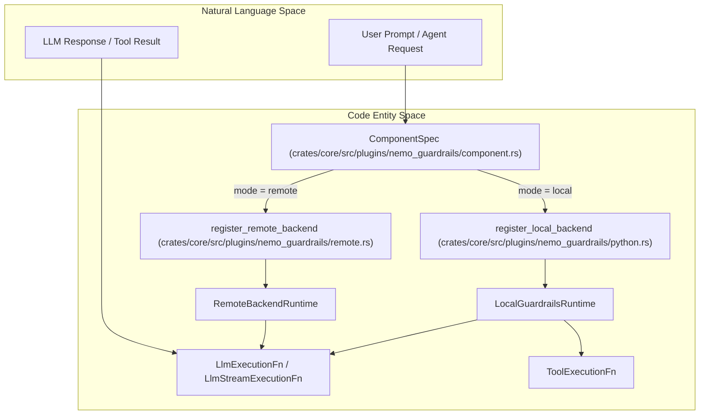
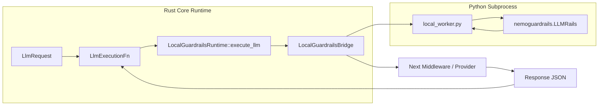
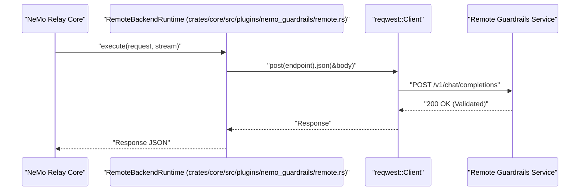

<!-- source: DeepWiki mcp.deepwiki.com · repo NVIDIA/NeMo-Relay · page 7.4 NeMo Guardrails Plugin (Deprecated) · fetched 2026-10-26 -->

# NeMo Guardrails Plugin (Deprecated)

Relevant source files

The following files were used as context for generating this wiki page:

- [crates/core/src/plugins/nemo_guardrails/component.rs](crates/core/src/plugins/nemo_guardrails/component.rs)
- [crates/core/src/plugins/nemo_guardrails/mod.rs](crates/core/src/plugins/nemo_guardrails/mod.rs)
- [crates/core/src/plugins/nemo_guardrails/python.rs](crates/core/src/plugins/nemo_guardrails/python.rs)
- [crates/core/src/plugins/nemo_guardrails/remote.rs](crates/core/src/plugins/nemo_guardrails/remote.rs)
- [crates/core/tests/unit/plugins/nemo_guardrails/component_tests.rs](crates/core/tests/unit/plugins/nemo_guardrails/component_tests.rs)
- [crates/pii-redaction/src/overlay.rs](crates/pii-redaction/src/overlay.rs)
- [docs/about-nemo-relay/release-notes/index.mdx](docs/about-nemo-relay/release-notes/index.mdx)
- [docs/instrument-applications/instrument-tool-call.mdx](docs/instrument-applications/instrument-tool-call.mdx)
- [docs/integrate-into-frameworks/wrap-tool-calls.mdx](docs/integrate-into-frameworks/wrap-tool-calls.mdx)
- [docs/reference/migration-guides.mdx](docs/reference/migration-guides.mdx)
- [docs/reference/tool-execution-intercept-outcomes.mdx](docs/reference/tool-execution-intercept-outcomes.mdx)
- [fern/docs.yml](fern/docs.yml)

## Purpose and Scope

This page documents the built-in `nemo_guardrails` plugin component within NeMo Relay, which integrated the [NeMo Guardrails](https://github.com/NVIDIA/NeMo-Guardrails) framework into the core execution pipeline. It details the component architecture, local Python worker mode (`LocalGuardrailsRuntime`), remote HTTP mode (`RemoteBackendRuntime`), input/output rail registration, configuration structs, and the 0.9 deprecation and removal plan.

> [!WARNING]
> The built-in `nemo_guardrails` plugin is deprecated as of NeMo Relay 0.8.0 and is scheduled for removal in version 0.9.0. No replacement is included. Until removal, the remote backend inherits its configured service's availability, latency, and policy behavior, and the local backend requires Python 3.11 or later and `nemoguardrails==0.22.0`. Removal will include the built-in component kind, the public `nemo_relay::plugins::nemo_guardrails` Rust module, its CLI editor entry, and the `guardrails-remote` Cargo feature. [docs/about-nemo-relay/release-notes/index.mdx:54-62]()

Sources: [docs/about-nemo-relay/release-notes/index.mdx:54-62]()

---

## Implementation Overview

The plugin was structured around the `nemo_guardrails` component kind defined in `crates/core/src/plugins/nemo_guardrails/component.rs` [crates/core/src/plugins/nemo_guardrails/component.rs:35-40](). It registered execution intercepts into NeMo Relay's middleware engine to enforce safety policies around LLM requests, streams, and tool executions [crates/core/src/plugins/nemo_guardrails/python.rs:57-117]().

The component configuration is represented by `NeMoGuardrailsConfig`, supporting `local` and `remote` backend modes [crates/core/src/plugins/nemo_guardrails/component.rs:105-112]().

### Natural Language to Code Entity Mapping

Diagram title: "Natural Language Space to Code Entity Space: Guardrails Intercept Pipeline"

Sources: [crates/core/src/plugins/nemo_guardrails/component.rs:35-112](), [crates/core/src/plugins/nemo_guardrails/python.rs:57-117](), [crates/core/src/plugins/nemo_guardrails/remote.rs:25-34]().

---

## Local Backend (Python Worker) Details

The local backend was orchestrated by `LocalGuardrailsRuntime`, which spawned and managed a Python subprocess executing `local_worker.py` [crates/core/src/plugins/nemo_guardrails/python.rs:45-133](). 

### Architecture and Execution Flow

The runtime registered sync LLM execution intercepts, streaming LLM execution intercepts, and tool execution intercepts with the registration context `PluginRegistrationContext` [crates/core/src/plugins/nemo_guardrails/python.rs:57-117]().

Diagram title: "Local Guardrails Worker Data Flow"

Sources: [crates/core/src/plugins/nemo_guardrails/python.rs:45-143]().

---

## Remote Backend Implementation

The `RemoteBackendRuntime` communicated directly with a hosted Guardrails HTTP service using `reqwest::Client` [crates/core/src/plugins/nemo_guardrails/remote.rs:25-34]().

### Request and Response Validation

1. **Input Rails**: Outbound chat completions requests were posted to check input policies [crates/core/src/plugins/nemo_guardrails/remote.rs:116-122]().
2. **Output Rails**: Completed responses were evaluated via remote checks before returning to the caller [crates/core/src/plugins/nemo_guardrails/remote.rs:124-126]().

Diagram title: "Remote Guardrails Sequence and Code Entities"

Sources: [crates/core/src/plugins/nemo_guardrails/remote.rs:25-34](), [crates/core/src/plugins/nemo_guardrails/remote.rs:116-139]().

---

## Configuration and Editor Support

Configuration is defined by `NeMoGuardrailsConfig` [crates/core/src/plugins/nemo_guardrails/component.rs:105-156]().

| Field | Type | Description |
| --- | --- | --- |
| `version` | `u32` | Schema version [crates/core/src/plugins/nemo_guardrails/component.rs:107-108](). |
| `mode` | `String` | Backend mode (`local` or `remote`) [crates/core/src/plugins/nemo_guardrails/component.rs:110-112](). |
| `config_path` | `Option<String>` | Path to native configuration directory [crates/core/src/plugins/nemo_guardrails/component.rs:113-115](). |
| `codec` | `Option<String>` | LLM request/response codec [crates/core/src/plugins/nemo_guardrails/component.rs:123-125](). |
| `input` / `output` | `bool` | Toggle LLM input/output rails [crates/core/src/plugins/nemo_guardrails/component.rs:126-131](). |
| `tool_input` / `tool_output` | `bool` | Toggle tool input/output rails [crates/core/src/plugins/nemo_guardrails/component.rs:132-137](). |
| `priority` | `i32` | Middleware execution priority [crates/core/src/plugins/nemo_guardrails/component.rs:138-140](). |
| `remote` | `Option<RemoteBackendConfig>` | Remote backend endpoints and headers [crates/core/src/plugins/nemo_guardrails/component.rs:141-143](). |
| `local` | `Option<LocalBackendConfig>` | Local execution settings [crates/core/src/plugins/nemo_guardrails/component.rs:144-146](). |

Sources: [crates/core/src/plugins/nemo_guardrails/component.rs:105-156]().

---

## Test Harness Overview

Unit tests validate configuration schemas, mock HTTP responders, and event emissions.

- **Mock HTTP Server**: Spawns a `TcpListener` to capture `CapturedHttpRequest` instances for remote verification [crates/core/tests/unit/plugins/nemo_guardrails/component_tests.rs:98-116]().
- **Event Capture**: Registers test subscribers via `register_subscriber` to assert guardrail mark emission [crates/core/tests/unit/plugins/nemo_guardrails/component_tests.rs:202-211]().
- **Static Validation**: Uses `test_validate_static_plugin_config` to ensure schema constraints are enforced [crates/core/tests/unit/plugins/nemo_guardrails/component_tests.rs:36]().

Sources: [crates/core/tests/unit/plugins/nemo_guardrails/component_tests.rs:36](), [crates/core/tests/unit/plugins/nemo_guardrails/component_tests.rs:98-116](), [crates/core/tests/unit/plugins/nemo_guardrails/component_tests.rs:202-211]().

---

## Deprecation and Removal Plan (0.9)

The built-in `nemo_guardrails` component is scheduled for complete removal in NeMo Relay 0.9 [docs/about-nemo-relay/release-notes/index.mdx:54-62](). 

Removal scope includes:
- The component kind string `nemo_guardrails` [crates/core/src/plugins/nemo_guardrails/component.rs:35-39]().
- The `nemo_relay::plugins::nemo_guardrails` public Rust module.
- Associated CLI editor entries and validation logic.
- The `guardrails-remote` Cargo feature flag.

Sources: [docs/about-nemo-relay/release-notes/index.mdx:54-62](), [crates/core/src/plugins/nemo_guardrails/component.rs:35-39]().

---

