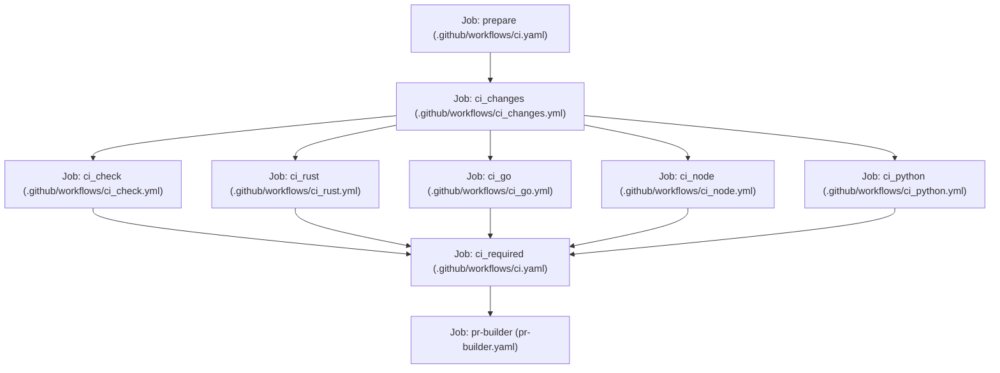
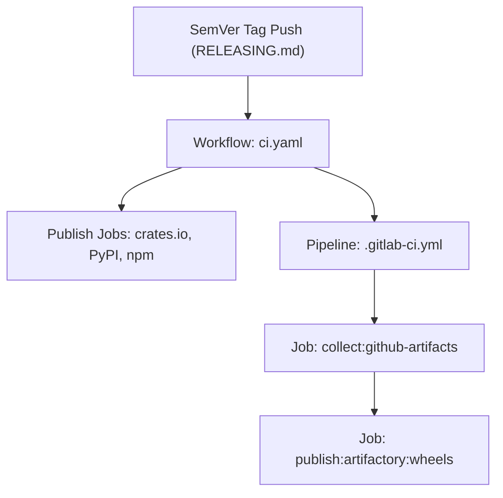

<!-- source: DeepWiki mcp.deepwiki.com · repo NVIDIA/NeMo-Relay · page 8 CI/CD, Build System, and Release · fetched 2026-10-26 -->

# CI/CD, Build System, and Release

Relevant source files

The following files were used as context for generating this wiki page:

- [.coderabbit.yaml](.coderabbit.yaml)
- [.github/ci-path-filters.yml](.github/ci-path-filters.yml)
- [.github/workflows/ci.yaml](.github/workflows/ci.yaml)
- [.gitlab-ci.yml](.gitlab-ci.yml)
- [RELEASING.md](RELEASING.md)
- [justfile](justfile)

This page provides a high-level overview of the polyglot build, test, and release automation for the NeMo Relay codebase. It introduces the core components and processes involved in developing, testing, and releasing the project across Rust, Python, Node.js, and Go ecosystems. Detailed information on each topic is provided in linked child pages.

## Task Orchestration with Justfile

The `justfile` serves as the central command runner for the NeMo Relay project, defining recipes that encapsulate common development and CI/CD tasks [justfile:1-8](). It provides a unified interface for building, testing, packaging, and managing workspace versions across different language runtimes. Helper functions such as `export_uv_python_runtime` and `prepend_ziglang_to_path` establish consistent environments for Python execution and cross-compilation [justfile:24-59](), [justfile:113-135]().

Key `justfile` recipes include:
*   `build-all`: Compiles workspace targets.
*   `test-*`: Executes ecosystem-specific test suites (e.g., `test-rust`, `test-python`, `test-node`, `test-go`) [justfile:89](), [justfile:116](), [justfile:125](), [justfile:159]().
*   `package-*`: Generates distribution artifacts.
*   `set-version`: Synchronizes version identifiers across workspace manifests [RELEASING.md:118-121]().
*   `coverage`: Collects and aggregates code coverage metrics.
*   `docs`: Validates and builds documentation artifacts [justfile:191-197]().

For a detailed breakdown of `justfile` recipes and the helper environment, see [Justfile and Build Recipes](#8.1).

Sources: [justfile:1-216](), [RELEASING.md:118-121]()

## GitHub Actions CI Pipeline

Continuous integration is orchestrated via GitHub Actions through `[ .github/workflows/ci.yaml ]()`, executing validation checks, tests, and packaging tasks on every push and pull request [.github/workflows/ci.yaml:4-14](). The workflow is structured as a Directed Acyclic Graph (DAG) of jobs designed for selective change detection and parallel execution.

**CI Workflow Execution Graph (`ci.yaml`)**

The pipeline stages encompass:
*   **`prepare`**: Evaluates workflow policies, determines full CI invocation versus conditional runs, and validates release tag formats [.github/workflows/ci.yaml:39-97]().
*   **`ci_changes`**: Computes changed file paths using `[ .github/ci-path-filters.yml ]()` to optimize downstream job execution [.github/workflows/ci.yaml:99-112](), [.github/ci-path-filters.yml:1-224]().
*   **`ci_check`**: Executes static analysis, linting, and installer verification [.github/workflows/ci.yaml:114-125]().
*   **`ci_license_diff`**: Audits dependency license alterations against reference baselines [.github/workflows/ci.yaml:127-141]().
*   **Per-language jobs (`ci_rust`, `ci_go`, `ci_node`, `ci_python`)**: Run ecosystem unit tests, integration suites, and report coverage data via Codecov [.github/workflows/ci.yaml:143-194]().
*   **`ci_required` & `pr-builder`**: Enforce merge gatekeeper requirements and aggregate status reporting [.github/workflows/ci.yaml:22-38](), [.github/workflows/ci.yaml:196-197]().

For an in-depth look at the CI workflow, including path filters and job matrices, see [GitHub Actions CI Pipeline](#8.2).

Sources: [.github/workflows/ci.yaml:1-197](), [.github/ci-path-filters.yml:1-224]()

## Release Process, Versioning, and Packaging

Releases are driven by semantic versioning principles anchored on the root `Cargo.toml` workspace version and published across `crates.io`, PyPI, and npm [RELEASING.md:33-35](), [RELEASING.md:49-51]().

**Release & Packaging Pipeline (`RELEASING.md`, `gitlab-ci.yml`)**

Key aspects of the release lifecycle include:
*   **Versioning Alignment**: Workspace crates, Python packages (PEP 440 compliant), and Node.js manifests are kept synchronized using `just set-version` [RELEASING.md:49-72]().
*   **Release Tags**: Tags must follow raw SemVer format (e.g., `0.1.0` or `0.1.0-rc.1`) without any leading `v` prefix [.github/workflows/ci.yaml:52-64](), [RELEASING.md:81-86]().
*   **Code Freeze & Branching**: Release branches (`release/*`) isolate stabilization lines while `main` receives subsequent development [RELEASING.md:94-128]().
*   **Trusted Publishing**: Public package registries utilize OpenID Connect (OIDC) token exchange via GitHub Actions `id-token: write` permissions [RELEASING.md:139-154]().
*   **Artifact Mirroring**: The mirrored GitLab pipeline (`[.gitlab-ci.yml]()`) collects published GitHub Actions artifacts and syncs them to NVIDIA Artifactory [.gitlab-ci.yml:51-175](), [RELEASING.md:45-46]().

For a comprehensive guide to version synchronization, publishing credentials, and packaging manifests, see [Release Process, Versioning, and Packaging](#8.3).

Sources: [.github/workflows/ci.yaml:52-64](), [.gitlab-ci.yml:51-175](), [RELEASING.md:27-154]()

## Code Quality, Licensing, and Scripts

Ensuring code health, static correctness, and legal compliance across polyglot components is managed through integrated automated gates:

*   **Pre-commit Hooks**: Enforce style consistency and localized sanity checks before changes enter the repository tree [.github/workflows/ci.yaml:1-197]().
*   **Rust Tooling**: `clippy` performs strict linting and `nextest` accelerates test execution across crates [.coderabbit.yaml:99-119]().
*   **Dependency Auditing**: `cargo-deny` checks security advisories and license compliance, while `cargo-about` compiles dependency attributions.
*   **Helper Utilities & Benchmarks**: The `scripts/` directory houses documentation generators, packaging helpers, and latency benchmark harnesses [justfile:191-197]().

For more details on code quality tools, auditing practices, and repository helper scripts, see [Code Quality, Licensing, and Scripts](#8.4).

Sources: [.coderabbit.yaml:1-143](), [justfile:191-197]()

---

