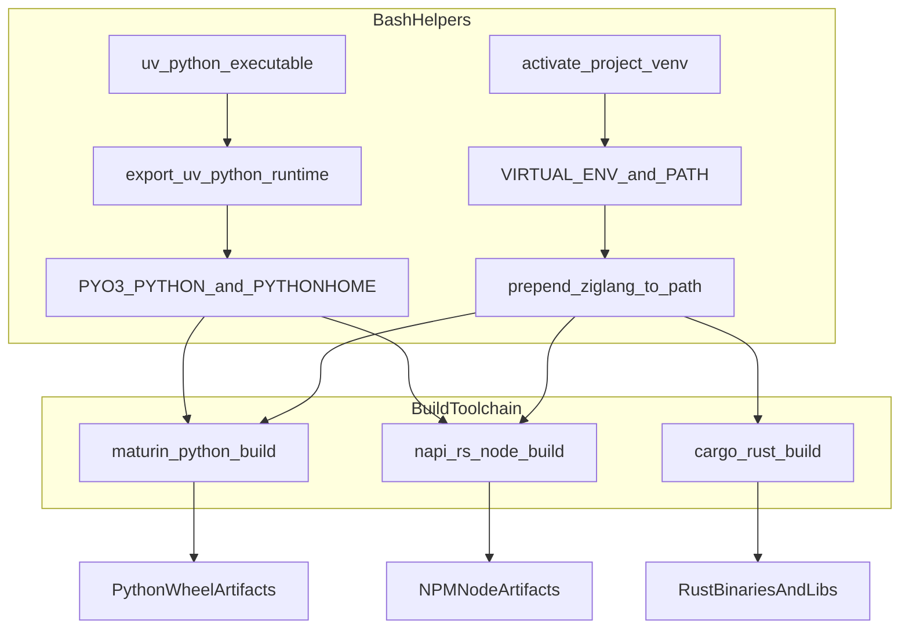
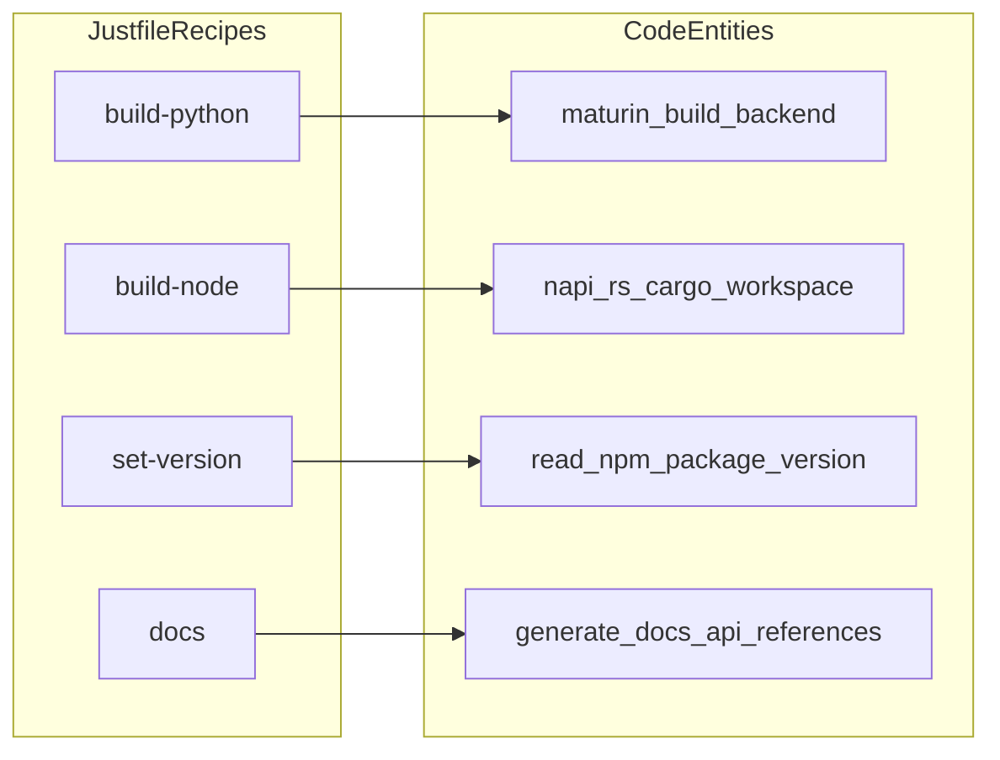

<!-- source: DeepWiki mcp.deepwiki.com · repo NVIDIA/NeMo-Relay · page 8.1 Justfile and Build Recipes · fetched 2026-10-26 -->

# Justfile and Build Recipes

Relevant source files

The following files were used as context for generating this wiki page:

- [.coderabbit.yaml](.coderabbit.yaml)
- [.github/ci-path-filters.yml](.github/ci-path-filters.yml)
- [.github/workflows/ci.yaml](.github/workflows/ci.yaml)
- [.gitlab-ci.yml](.gitlab-ci.yml)
- [.pre-commit-config.yaml](.pre-commit-config.yaml)
- [ATTRIBUTIONS-Node.md](ATTRIBUTIONS-Node.md)
- [ATTRIBUTIONS-Python.md](ATTRIBUTIONS-Python.md)
- [RELEASING.md](RELEASING.md)
- [fern/fern.config.json](fern/fern.config.json)
- [integrations/openclaw/package.json](integrations/openclaw/package.json)
- [integrations/openclaw/scripts/check-pack-payload.mjs](integrations/openclaw/scripts/check-pack-payload.mjs)
- [justfile](justfile)
- [package-lock.json](package-lock.json)
- [package.json](package.json)
- [pyproject.toml](pyproject.toml)
- [python/plugin/pyproject.toml](python/plugin/pyproject.toml)
- [uv.lock](uv.lock)

This page details the polyglot build system of NeMo Relay, which uses `just` as the task runner to orchestrate Rust, Python, Node.js, WebAssembly, and Go toolchains [justfile:1-20](). The `justfile` provides a unified developer interface while managing environment requirements such as `uv` runtime discovery, `zig` cross-compilation, and PyO3 environment variables.

---

## Bash Helpers and Environment Setup

The `justfile` defines a `bash_helpers` block that standardizes environment variables and tool execution across recipes [justfile:21-22](). This guarantees that build backends locate correct headers and binaries.

### Key Environment Functions
*   **`export_uv_python_runtime`**: Discovers the Python executable via `uv_python_executable` [justfile:61-70]() and exports `PYO3_PYTHON`, `PYTHON_EXE_DIR`, `PYTHONHOME`, `PYTHON_PATHSEP`, `PYTHON_STDLIB`, `PYTHON_PLATSTDLIB`, `PYTHON_LIBDIR`, and updates `PATH`, `PYTHONPATH`, `LD_LIBRARY_PATH`, and `DYLD_LIBRARY_PATH` [justfile:24-59]().
*   **`activate_project_venv`**: Sources the virtual environment under `.venv` to add its `bin` or `Scripts` directory to the `PATH` [justfile:72-93]().
*   **`prepend_ziglang_to_path`**: Locates the `zig` binary bundled within the `ziglang` Python package and prepends its parent directory to the `PATH` [justfile:113-135](). This allows `maturin` and `napi-rs` to leverage Zig for glibc-compatible cross-compilation.
*   **`use_project_python_source`**: Prepends the local `python` source directory to `PYTHONPATH` [justfile:137-151]().

**Environment Preparation Flow**

Sources: [justfile:21-151]()

---

## Core Build and Test Recipes

The `justfile` includes tasks for building and testing individual components or the entire workspace. CI pipelines invoke these targets [ci-path-filters.yml:4-199]() to execute verification steps.

| Recipe | Description | Implementation Target |
| :--- | :--- | :--- |
| `build-all` | Builds all language bindings and the CLI. | Sequentially executes workspace build workflows. |
| `test-all` | Runs the full test suite for all language bindings. | Executes Rust, Python, Node.js, and Go test runners. |
| `test-rust` | Tests the Rust core, adaptive, and FFI crates. | Invokes `cargo nextest` or `cargo test` [.github/workflows/ci_rust.yml:157](). |
| `test-python` | Tests the Python bindings and optional modules. | Invokes `uv run pytest` targeting `python/tests` [.github/workflows/ci_python.yml:114](). |
| `test-node` | Tests the Node.js NAPI bindings. | Invokes `npm test --workspace=nemo-relay-node` [.github/workflows/ci_node.yml:118](). |
| `test-go` | Tests the experimental Go C FFI bindings. | Invokes `go test` with `CGO_ENABLED=1` [.github/workflows/ci_go.yml:87](). |

Sources: [justfile:4-20](), [.github/workflows/ci_rust.yml:136-157](), [.github/workflows/ci_python.yml:112-114](), [.github/workflows/ci_node.yml:116-118](), [.github/workflows/ci_go.yml:83-87](), [.github/ci-path-filters.yml:4-198]()

---

## Language-Specific Packaging

Packaging recipes assemble compiled binaries, native extensions, and metadata into redistributable artifacts.

### Python Packaging
*   **`package-python`**: Uses `maturin` as the build backend for `crates/python/Cargo.toml` [pyproject.toml:101-105]() to generate wheels and source distributions.
*   **Compatibility**: Respects `linux_glibc_version` (default `2.17`) [justfile:15]() during cross-compilation.
*   **Version Dynamic Injection**: `pyproject.toml` retains a dynamic version field [pyproject.toml:10](), which packaging scripts populate at build time [RELEASING.md:68-72]().

### Node.js Packaging
*   **`package-node`**: Packages `napi-rs` binaries built under `crates/node` into native npm targets across supported platforms [RELEASING.md:150-154]().

Sources: [RELEASING.md:31-72](), [RELEASING.md:150-154](), [justfile:15](), [pyproject.toml:10](), [pyproject.toml:101-105]()

---

## Versioning and Metadata Targets

The `set-version` recipe maintains version synchronization across the polyglot workspace.

### Implementation Details
*   **Workspace SemVer**: Updates the root `Cargo.toml` `workspace.package.version` and all internal workspace crate dependencies [RELEASING.md:54-60]().
*   **PEP 440 Normalization**: Converts SemVer prerelease tags (e.g., `0.2.0-rc.1`) into PEP 440-compatible strings (`0.2.0rc1`) for Python packages [RELEASING.md:76-78]().
*   **Validation**: CI workflows reject tags that include a leading `v` or violate strict SemVer formatting rules [.github/workflows/ci.yaml:52-64]().

Sources: [RELEASING.md:49-80](), [.github/workflows/ci.yaml:52-64]()

---

## Documentation and Coverage Targets

The build harness provides routines to compile documentation sites and collect code coverage metrics across runtimes.

### Documentation Targets
*   **`docs`**: Builds documentation via `ensure_docs_dependencies` [justfile:164-172](), which triggers `uv sync` and `npm install`.
*   **`ensure_node_docs_declarations`**: Compiles TypeScript type definitions in `crates/node/index.d.ts` if source files are newer [justfile:174-189]().
*   **`generate_docs_api_references`**: Executes Python scripts such as `generate_python_library_reference.py`, `generate_node_library_reference.py`, and `generate_rust_library_reference.py` [justfile:191-197]().

### Coverage Targets
*   **Rust**: Uses `cargo-llvm-cov` for workspace code coverage reports [.github/workflows/ci_rust.yml:157]().
*   **Python**: Configured via `tool.coverage.run` in `pyproject.toml` to omit integration test paths [pyproject.toml:128-133]().
*   **Node.js**: Utilizes `c8` as a development coverage dependency for `nemo-relay-node` [package-lock.json:175]().
*   **Artifact Standardization**: Helper functions `artifact_path` and `prepare_artifact` normalize output directories to `target/coverage` [justfile:203-214]().

**Build System to Implementation Code Mapping**

Sources: [justfile:164-214](), [.github/workflows/ci_rust.yml:136-157](), [pyproject.toml:128-133](), [package-lock.json:175]()

---

