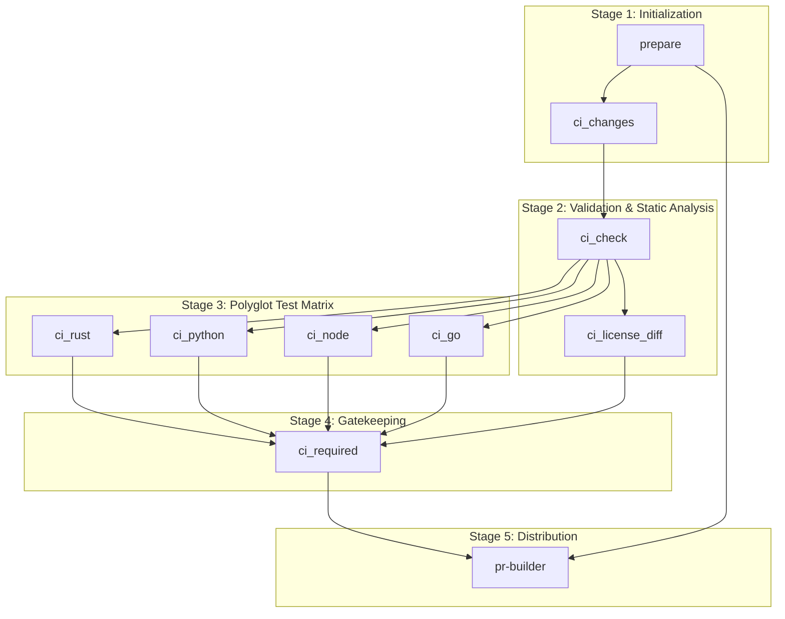
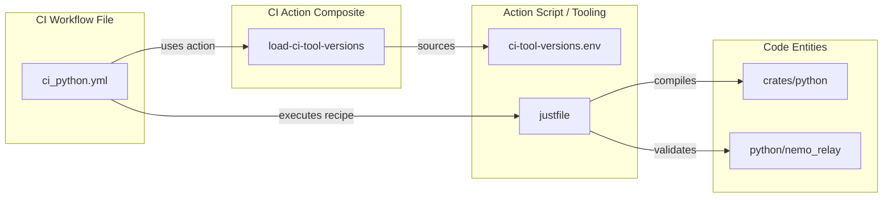
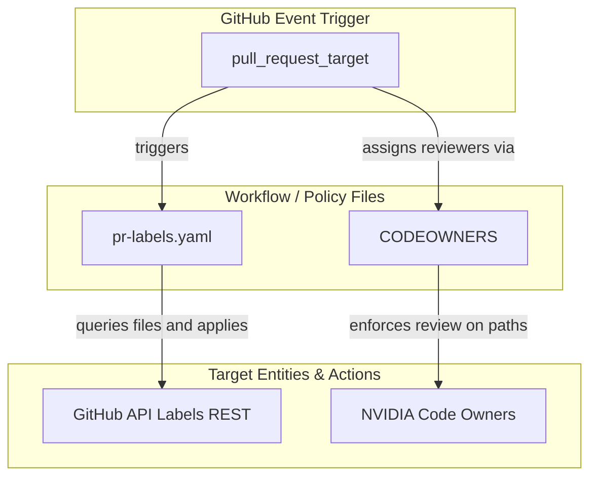
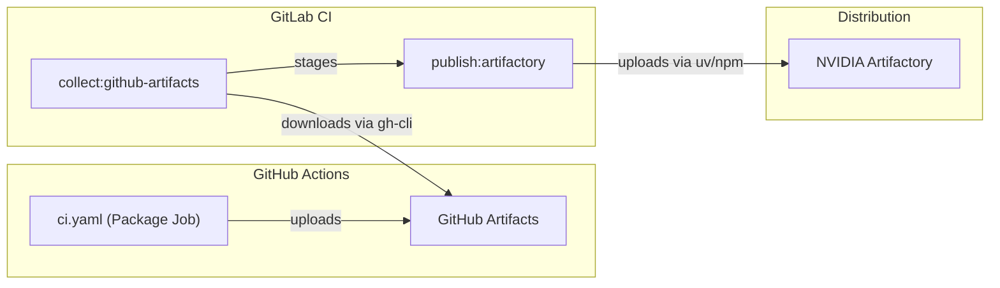

<!-- source: DeepWiki mcp.deepwiki.com · repo NVIDIA/NeMo-Relay · page 8.2 GitHub Actions CI Pipeline · fetched 2026-10-26 -->

# GitHub Actions CI Pipeline

Relevant source files

The following files were used as context for generating this wiki page:

- [.github/CODEOWNERS](.github/CODEOWNERS)
- [.github/actions/load-ci-tool-versions/action.yml](.github/actions/load-ci-tool-versions/action.yml)
- [.github/ci-tool-versions.env](.github/ci-tool-versions.env)
- [.github/release.yml](.github/release.yml)
- [.github/workflows/ci_changes.yml](.github/workflows/ci_changes.yml)
- [.github/workflows/ci_check.yml](.github/workflows/ci_check.yml)
- [.github/workflows/ci_go.yml](.github/workflows/ci_go.yml)
- [.github/workflows/ci_license_diff.yml](.github/workflows/ci_license_diff.yml)
- [.github/workflows/ci_node.yml](.github/workflows/ci_node.yml)
- [.github/workflows/ci_python.yml](.github/workflows/ci_python.yml)
- [.github/workflows/ci_rust.yml](.github/workflows/ci_rust.yml)
- [.github/workflows/fern-docs.yml](.github/workflows/fern-docs.yml)
- [.github/workflows/pr-labels.yaml](.github/workflows/pr-labels.yaml)
- [codecov.yml](codecov.yml)
- [crates/cli/src/filesystem/atomic.rs](crates/cli/src/filesystem/atomic.rs)
- [crates/cli/src/hooks/config.rs](crates/cli/src/hooks/config.rs)
- [docs/contribute/development-setup.mdx](docs/contribute/development-setup.mdx)
- [scripts/docs/sync_fern_docs_branch.py](scripts/docs/sync_fern_docs_branch.py)
- [scripts/generate_attributions.sh](scripts/generate_attributions.sh)

The NeMo Relay CI pipeline is a sophisticated Directed Acyclic Graph (DAG) designed to validate a polyglot codebase across multiple operating systems and CPU architectures. It utilizes path-based filtering to optimize execution time, ensuring that only relevant language bindings and integration tests are run based on the specific files modified in a Pull Request.

## Pipeline Architecture

The pipeline is defined in `.github/workflows/ci.yaml` and orchestrates several specialized sub-workflows. It follows a staged execution model: preparation, change detection, linting/static analysis, language-specific testing, and finally a gatekeeper check before any publishing occurs [.github/workflows/ci.yaml:20-210]().

### CI Workflow DAG
The following diagram illustrates the job dependencies and data flow within the `ci.yaml` workflow.

**CI Job Dependency Graph**

**Sources:** [.github/workflows/ci.yaml:20-210](), [.github/workflows/ci_check.yml:4-23]()

---

## Change Detection and Path Filtering

To minimize resource consumption, NeMo Relay uses path-based filtering logic in the `ci_changes` job [.github/workflows/ci_changes.yml:71-92](). This job maps modified file paths to specific CI flags [.github/workflows/ci_changes.yml:78-91]().

### Path Mapping Logic
The mapping is defined in `.github/ci-path-filters.yml`. Key filters include:
*   **`shared`**: Changes to `crates/core`, `crates/adaptive`, or `crates/types` trigger tests for ALL language bindings.
*   **`python`**: Changes to `python/nemo_relay/**` or `crates/python/**` trigger Python-specific jobs.
*   **`node`**: Changes to `crates/node/**` trigger Node.js jobs.
*   **`rust`**: Changes to any `.rs` files or Cargo manifests trigger Rust jobs.
*   **`docs`**: Changes to documentation, `fern/**`, or source code comments trigger documentation-related workflows.

The `ci_changes` job outputs booleans like `run_rust`, `run_python`, and `run_node_package` which are used as `if` conditionals for subsequent jobs in the main pipeline [.github/workflows/ci_changes.yml:26-69]().

**Sources:** [.github/workflows/ci_changes.yml:1-132](), [.github/workflows/ci_changes.yml:78-91]()

---

## Language-Specific Test Matrices and Containers

Each language binding (`ci_rust.yml`, `ci_python.yml`, `ci_node.yml`, etc.) implements a cross-platform matrix covering:
*   **Linux**: `ubuntu-latest` (amd64) and `ubuntu-24.04-arm` (arm64) [.github/workflows/ci_rust.yml:61-68]().
*   **macOS**: `macos-15` (Apple Silicon) [.github/workflows/ci_rust.yml:73-75]().
*   **Windows**: `windows-2022` (amd64) and `windows-11-arm` (arm64) [.github/workflows/ci_rust.yml:79-90]().

Container images are utilized for specific packaging targets, such as `musllinux` images (`quay.io/pypa/musllinux_1_2_x86_64`) for Python musl wheels [.github/workflows/ci_python.yml:166-172]() and Alpine containers (`node:24-alpine3.22`) for Node.js musl bindings [.github/workflows/ci_node.yml:170-178]().

### Execution Flow within Language Jobs
Every language job follows a standard sequence:
1.  **Tooling Setup**: Uses `.github/actions/load-ci-tool-versions` to ensure consistent versions of `rust`, `uv`, `node`, and `go` across the entire pipeline [.github/workflows/ci_rust.yml:106-109](). Versions are sourced from `.github/ci-tool-versions.env` [.github/ci-tool-versions.env:1-14]().
2.  **Environment Setup**: Configures language-specific caches (e.g., `Swatinem/rust-cache` for Cargo, `astral-sh/setup-uv` for Python) [.github/workflows/ci_rust.yml:115-127]().
3.  **Testing**: Executes tests via `just` recipes (e.g., `just test-rust`, `just test-python`) [.github/workflows/ci_python.yml:114-116](), [.github/workflows/ci_rust.yml:140-161]().
4.  **Coverage**: Collects coverage data and uploads to Codecov using `codecov/codecov-action`. Codecov is configured to receive files such as `rust-workspace.xml` or `python-coverage.xml` [.github/workflows/ci_rust.yml:163-173](), [.github/workflows/ci_python.yml:131-139]().
5.  **Packaging**: If the `run_package` input is true, builds distribution artifacts (Wheels, NPM tarballs, or Rust binaries) [.github/workflows/ci_node.yml:147-149]().

**Binding-to-Code Mapping**

**Sources:** [.github/workflows/ci_python.yml:43-190](), [.github/workflows/ci_rust.yml:140-161](), [.github/ci-tool-versions.env:1-14]()

---

## Integration and Specialized Checks

### Python Integration Tests
The `ci_python` job includes optional steps for heavyweight integration tests with LangChain, LangGraph, and DeepAgents. These are triggered if `run_integration_langchain` is true [.github/workflows/ci_python.yml:126-129]().

### License and Dependency Auditing
The `ci_check` job runs `cargo-deny` and `cargo-about` to ensure all dependencies comply with the project's license policy [.github/workflows/ci_check.yml:173-181](). It also executes `pre-commit` hooks across the workspace [.github/workflows/ci_check.yml:183-189](). The `ci_license_diff` workflow also performs a license diff against the base branch using `scripts/licensing/license_diff.py` and comments on the PR if changes are detected [.github/workflows/ci_license_diff.yml:66-156]().

### Installer Validation
The `ci_check` job includes specific stages for validating the `install.sh` and `install.ps1` scripts across Linux, macOS, and Windows [.github/workflows/ci_check.yml:42-120]().

### S3 and Redis Integration
The Rust CI job (`ci_rust.yml`) spins up `redis` and `adobe/s3mock` services for `linux-amd64` runners to validate adaptive state backends and ATIF storage exporters [.github/workflows/ci_rust.yml:37-57]().

### PR Labeling and CODEOWNERS
The `pr-labels.yaml` workflow automatically applies labels to Pull Requests based on changed files, lines, commit message prefixes (e.g., `feat:`, `fix:`), and affected languages (e.g., `lang:python`, `lang:rust`) [.github/workflows/pr-labels.yaml:31-191](). This helps categorize PRs and drives automation.
Additionally, `.github/CODEOWNERS` defines file-level ownership for code reviews, enforcing that attribution changes (`ATTRIBUTIONS-*.md`) require `@nvidia/nemo-relay-dep-approvers` and documentation requires `@nvidia/nemo-relay-docs-reviewers` [.github/CODEOWNERS:1-15]().

**Governance and Labeling Mapping**

**Sources:** [.github/workflows/pr-labels.yaml:31-191](), [.github/CODEOWNERS:1-15](), [.github/workflows/ci_check.yml:173-189](), [.github/workflows/ci_license_diff.yml:66-156]()

---

## Artifact Lifecycle, Codecov, and Publishing

The pipeline distinguishes between "Internal CI" and "Release" runs. Versioning is handled automatically based on the context of the run.

### Codecov Integration
Codecov is configured via `codecov.yml` to require 17 separate build uploads before reporting a final status [.codecov.yml:15](). It defines specific coverage targets for components like `rust_runtime` (95%) and `cli` (90%) [.codecov.yml:45-75]().

### Documentation Previews
The `fern-docs.yml` workflow generates previews for Fern-based documentation. It syncs the layout using `scripts/docs/sync_fern_docs_branch.py` and posts a preview URL back to the Pull Request [.github/workflows/fern-docs.yml:144-180]().

**Pipeline Artifact Flow**

**Sources:** [.github/workflows/ci.yaml:52-64](), [.codecov.yml:4-121](), [.github/release.yml:41](), [.github/workflows/fern-docs.yml:144-180]()

---

