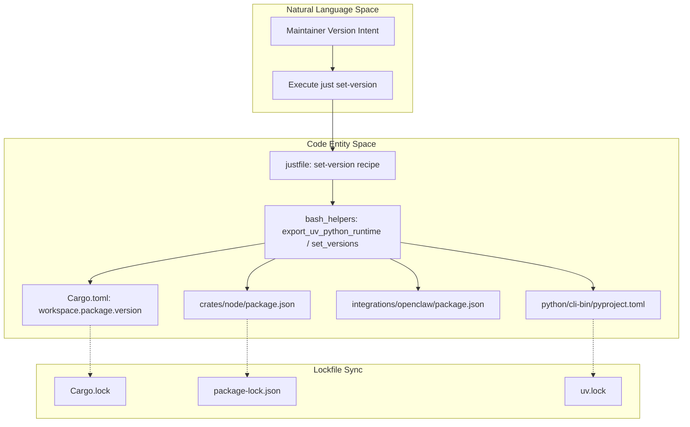
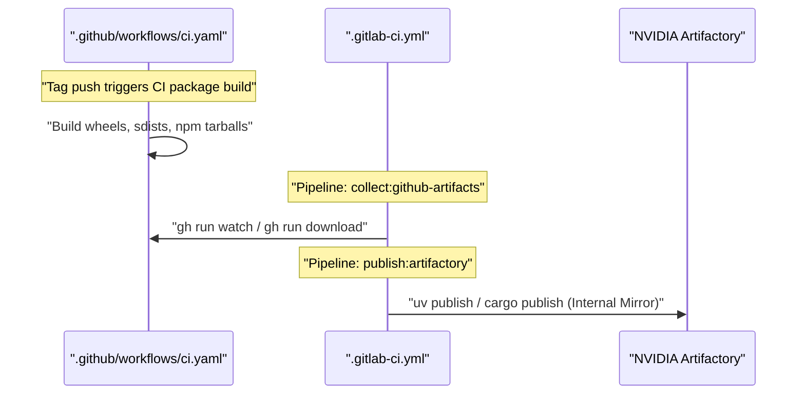

<!-- source: DeepWiki mcp.deepwiki.com · repo NVIDIA/NeMo-Relay · page 8.3 Release Process, Versioning, and Packaging · fetched 2026-10-26 -->

# Release Process, Versioning, and Packaging

Relevant source files

The following files were used as context for generating this wiki page:

- [.agents/skills/README.md](.agents/skills/README.md)
- [.agents/skills/add-binding-feature/SKILL.md](.agents/skills/add-binding-feature/SKILL.md)
- [.agents/skills/add-middleware/SKILL.md](.agents/skills/add-middleware/SKILL.md)
- [.agents/skills/contribute-integration/SKILL.md](.agents/skills/contribute-integration/SKILL.md)
- [.agents/skills/draft-release-notes/SKILL.md](.agents/skills/draft-release-notes/SKILL.md)
- [.agents/skills/maintain-observability/SKILL.md](.agents/skills/maintain-observability/SKILL.md)
- [.agents/skills/maintain-optimizer/SKILL.md](.agents/skills/maintain-optimizer/SKILL.md)
- [.agents/skills/prepare-code-freeze/SKILL.md](.agents/skills/prepare-code-freeze/SKILL.md)
- [.agents/skills/rename-surfaces/SKILL.md](.agents/skills/rename-surfaces/SKILL.md)
- [.agents/skills/update-project-version/SKILL.md](.agents/skills/update-project-version/SKILL.md)
- [.coderabbit.yaml](.coderabbit.yaml)
- [.github/ci-path-filters.yml](.github/ci-path-filters.yml)
- [.github/nightly-alpha-branches.yaml](.github/nightly-alpha-branches.yaml)
- [.github/workflows/ci.yaml](.github/workflows/ci.yaml)
- [.github/workflows/nightly-alpha-tag.yaml](.github/workflows/nightly-alpha-tag.yaml)
- [.gitlab-ci.yml](.gitlab-ci.yml)
- [.pre-commit-config.yaml](.pre-commit-config.yaml)
- [ATTRIBUTIONS-Node.md](ATTRIBUTIONS-Node.md)
- [ATTRIBUTIONS-Python.md](ATTRIBUTIONS-Python.md)
- [Cargo.toml](Cargo.toml)
- [RELEASING.md](RELEASING.md)
- [crates/node/package.json](crates/node/package.json)
- [docs/getting-started/installation.mdx](docs/getting-started/installation.mdx)
- [docs/getting-started/quick-start/python.mdx](docs/getting-started/quick-start/python.mdx)
- [docs/getting-started/quick-start/rust.mdx](docs/getting-started/quick-start/rust.mdx)
- [docs/reference/support-matrix.mdx](docs/reference/support-matrix.mdx)
- [docs/supported-integrations/openclaw-plugin.mdx](docs/supported-integrations/openclaw-plugin.mdx)
- [fern/fern.config.json](fern/fern.config.json)
- [integrations/coding-agents/claude-code/.claude-plugin/plugin.json](integrations/coding-agents/claude-code/.claude-plugin/plugin.json)
- [integrations/coding-agents/codex/.codex-plugin/plugin.json](integrations/coding-agents/codex/.codex-plugin/plugin.json)
- [integrations/openclaw/package.json](integrations/openclaw/package.json)
- [integrations/openclaw/scripts/check-pack-payload.mjs](integrations/openclaw/scripts/check-pack-payload.mjs)
- [justfile](justfile)
- [package-lock.json](package-lock.json)
- [package.json](package.json)
- [pyproject.toml](pyproject.toml)
- [python/plugin/pyproject.toml](python/plugin/pyproject.toml)
- [uv.lock](uv.lock)

This page documents the release lifecycle for NeMo Relay, covering version synchronization across polyglot workspaces, automated nightly tagging, the code freeze procedure, packaging manifests, lockfiles, and the multi-stage publishing pipeline to upstream registries and internal mirrors.

Sources: [RELEASING.md:1-48](), [.github/workflows/ci.yaml:1-97]()

## Versioning Model

NeMo Relay uses Semantic Versioning (SemVer) anchored by the Rust workspace. The source of truth for the project version is the `workspace.package.version` field in the repository-root `Cargo.toml`.

### Synchronized Versioning across Workspaces
The project maintains strict version alignment across multiple ecosystem manifests and configuration surfaces:

| Ecosystem | Manifest File | Version Binding Mechanism |
| :--- | :--- | :--- |
| **Rust** | `Cargo.toml` | `workspace.package.version` (canonical source) [RELEASING.md:54-55]() |
| **Node.js** | `crates/node/package.json` | Explicitly aligned with workspace version [RELEASING.md:62-64]() |
| **OpenClaw** | `integrations/openclaw/package.json` | Explicitly aligned with workspace version [RELEASING.md:65-67]() |
| **Python Core** | `pyproject.toml` | Dynamic versioning; written during packaging [RELEASING.md:68-72]() |
| **Python CLI Bin** | `python/cli-bin/pyproject.toml` | PEP 440 spelling of release version [RELEASING.md:67-68]() |

### PEP 440 and Prerelease Mapping
For non-tag CI builds and prereleases, versions are dynamically adapted to comply with ecosystem-specific standards:
*   **Python (PEP 440):** Prerelease labels like `0.2.0-rc.1` are converted to PEP 440 form (`0.2.0rc1`). Development builds append `+<short_sha>` [RELEASING.md:76-78]().
*   **Node.js:** Development builds append `-<short_sha>` [RELEASING.md:75-76]().

Sources: [RELEASING.md:49-79](), [pyproject.toml:1-120]()

## The `set-version` Workflow

The primary mechanism for updating project versions across the polyglot codebase is the `just set-version <version>` task runner recipe.

Sources: [justfile:1-216](), [RELEASING.md:54-72]()

## Release Lifecycle and Code Freeze

NeMo Relay follows a structured release lifecycle involving branch isolation for stabilization.

### Nightly Alpha Tagging
Nightly builds create automated tags to facilitate testing of the latest changes on active branches.
*   **Target Branches:** Controlled by `.github/nightly-alpha-branches.yaml`, which lists active branches like `main` receiving automated alpha releases [RELEASING.md:114-116]().
*   **Validation:** The CI `prepare` job in `.github/workflows/ci.yaml` validates that release tags do not start with `v` and match the strict SemVer pattern `^[0-9]+\.[0-9]+\.[0-9]+(-((alpha|beta|rc)\.[0-9]+))?$` [.github/workflows/ci.yaml:52-64]().

### Code Freeze Procedure
When a release cycle enters code freeze:
1.  **Branch Creation:** A branch `release/X.Y` is branched from `main` [RELEASING.md:97-109]().
2.  **Nightly Tracking:** The new release branch is added to `.github/nightly-alpha-branches.yaml` [.github/nightly-alpha-branches.yaml:1-5]().
3.  **Main Bump:** The `main` branch version is incremented to the next development version using `just set-version <next-version>` [RELEASING.md:117-121]().

Sources: [RELEASING.md:94-129](), [.github/workflows/ci.yaml:39-97](), [.github/nightly-alpha-branches.yaml:1-5]()

## Packaging Manifests and Lockfiles

The repository relies on explicit manifests and lockfiles to ensure reproducible builds across disparate language ecosystems.

### Python Packaging
*   `pyproject.toml`: Defines Python project metadata and build system requirements via `maturin` [pyproject.toml:4-10]() with `dynamic = ["version"]`.
*   `uv.lock`: Locks Python dependency trees and pinning hashes [uv.lock:1-57]().

### Node.js Packaging
*   `crates/node/package.json`: Defines the `nemo-relay-node` napi-rs package configuration and dependencies [crates/node/package.json:1-44]().
*   `integrations/openclaw/package.json`: Defines the OpenClaw integration package metadata [integrations/openclaw/package.json:1-73]().
*   `package-lock.json`: Lockfile for npm workspace dependencies [package-lock.json:1-21]().

### Attribution Generation
Third-party software attributions for regulatory compliance are generated via automated scripts into `ATTRIBUTIONS-Node.md` and `ATTRIBUTIONS-Python.md` [ATTRIBUTIONS-Node.md:1-13](), [ATTRIBUTIONS-Python.md:1-13]().

Sources: [pyproject.toml:4-120](), [uv.lock:1-57](), [integrations/openclaw/package.json:1-73](), [package-lock.json:1-21](), [ATTRIBUTIONS-Node.md:1-13](), [ATTRIBUTIONS-Python.md:1-13]()

## Publishing Pipeline and Artifact Mirroring

Publishing is triggered by pushing a valid Git tag (e.g., `0.8.0`) matching the SemVer format [.github/workflows/ci.yaml:52-83]().

Sources: [.github/workflows/ci.yaml:66-97](), [.gitlab-ci.yml:51-174](), [RELEASING.md:27-48]()

### Multi-Registry Publication Surfaces
The top-level release pipeline publishes artifacts to:
*   **crates.io:** Core crates (`nemo-relay-types`, `nemo-relay-plugin`, `nemo-relay`, `nemo-relay-cli`, etc.) using OIDC trusted publishing [RELEASING.md:33-33]().
*   **PyPI:** `nemo-relay` wheels/sdists and plugin/CLI binaries [RELEASING.md:34-34]().
*   **npm:** `nemo-relay-node` platform packages and `nemo-relay-openclaw` [RELEASING.md:35-35]().
*   **GitLab Artifactory Mirror:** Mirrored via `.gitlab-ci.yml` collecting GitHub Actions outputs [.gitlab-ci.yml:51-174]().

Sources: [RELEASING.md:27-48](), [.gitlab-ci.yml:51-174]()

---

