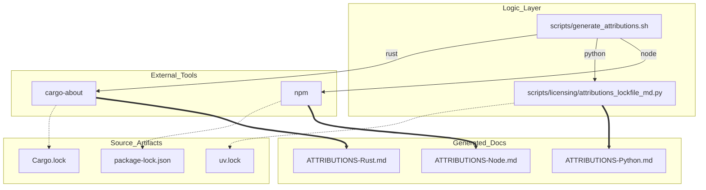
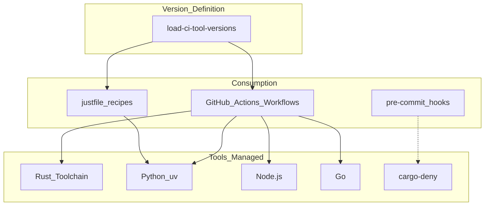

<!-- source: DeepWiki mcp.deepwiki.com · repo NVIDIA/NeMo-Relay · page 8.4 Code Quality, Licensing, and Scripts · fetched 2026-10-26 -->

# Code Quality, Licensing, and Scripts

Relevant source files

The following files were used as context for generating this wiki page:

- [.gitignore](.gitignore)
- [.pre-commit-config.yaml](.pre-commit-config.yaml)
- [ATTRIBUTIONS-Node.md](ATTRIBUTIONS-Node.md)
- [ATTRIBUTIONS-Python.md](ATTRIBUTIONS-Python.md)
- [ATTRIBUTIONS-Rust.md](ATTRIBUTIONS-Rust.md)
- [Cargo.lock](Cargo.lock)
- [about.toml](about.toml)
- [crates/cli/Cargo.toml](crates/cli/Cargo.toml)
- [crates/core/Cargo.toml](crates/core/Cargo.toml)
- [crates/core/src/plugin/dynamic.rs](crates/core/src/plugin/dynamic.rs)
- [deny.toml](deny.toml)
- [fern/fern.config.json](fern/fern.config.json)
- [integrations/openclaw/package.json](integrations/openclaw/package.json)
- [integrations/openclaw/scripts/check-pack-payload.mjs](integrations/openclaw/scripts/check-pack-payload.mjs)
- [package-lock.json](package-lock.json)
- [package.json](package.json)
- [pyproject.toml](pyproject.toml)
- [python/plugin/pyproject.toml](python/plugin/pyproject.toml)
- [scripts/latency_benchmark/src/report/report.js](scripts/latency_benchmark/src/report/report.js)
- [scripts/latency_benchmark/src/servers.py](scripts/latency_benchmark/src/servers.py)
- [scripts/test-support/codex_mock_provider.py](scripts/test-support/codex_mock_provider.py)
- [uv.lock](uv.lock)

This page documents the tooling and processes used to maintain code quality, manage third-party licenses, and automate maintenance tasks across the NeMo Relay polyglot codebase. It covers the pre-commit infrastructure, the license auditing pipeline, attributions generation, helper scripts, the latency benchmark harness, and test-support mocks.

## Pre-commit Hooks and Linting

NeMo Relay uses `pre-commit` to enforce consistency across Rust, Python, Node.js, and Go. The configuration is centralized in `.pre-commit-config.yaml` and includes both standard community hooks and project-specific local hooks [.pre-commit-config.yaml:7-13]().

### Core Quality Checks
*   **Copyright Headers**: A local Python script `scripts/lint/check_copyright.py` ensures every source file contains the required SPDX copyright notice [.pre-commit-config.yaml:11-13](). It targets a wide range of extensions including `.rs`, `.go`, `.py`, `.toml`, and `.ts`, while excluding generated artifacts like `node_modules/` or `target/` [.pre-commit-config.yaml:15-16]().
*   **Rust**: Standard `cargo fmt` and `cargo clippy` (configured to deny warnings) are run on every commit [.pre-commit-config.yaml:141-153](). A specific hook `ffi-header-sync` ensures the C FFI header `nemo_relay.h` is synchronized with Rust definitions by checking the `nemo-relay-ffi` package [.pre-commit-config.yaml:134-139]().
*   **Python**: Uses `ruff` for both linting and formatting [.pre-commit-config.yaml:46-52](), along with custom `uv run ty check` commands for static type checking across the workspace and specific plugin examples [.pre-commit-config.yaml:54-67]().
*   **Node.js**: Employs a lockfile check to ensure `package-lock.json` remains fresh by running `npm install --package-lock-only` [.pre-commit-config.yaml:124-129]().
*   **GitHub Actions**: Uses `actionlint` to validate workflow semantics in `.github/workflows/` [.pre-commit-config.yaml:38-43]().
*   **Documentation**: Uses `lychee` to validate external markdown links, excluding local dev endpoints and specific project URLs [.pre-commit-config.yaml:70-98]().

### Lockfile Integrity
To prevent unexpected dependency modifications, the pre-commit pipeline validates that all lockfiles are synchronized with their respective manifests:
*   **Rust**: `cargo-lockfile-check` runs `cargo metadata` to ensure `Cargo.lock` is up to date [.pre-commit-config.yaml:103-108]().
*   **Python**: `uv-lockfile-check` runs `uv lock` [.pre-commit-config.yaml:110-115]().
*   **Node.js**: `node-lockfile-check` ensures the npm lockfile matches `package.json` [.pre-commit-config.yaml:124-129]().
*   **Protobuf**: `python-worker-proto-check` ensures Python worker bindings are compatible with the core `.proto` definitions via `just check-python-worker-proto` [.pre-commit-config.yaml:117-122]().

Sources: [.pre-commit-config.yaml:7-160]()

## License Auditing and Attributions

NeMo Relay automates the generation of third-party attribution files (`ATTRIBUTIONS-*.md`) to comply with open-source licensing requirements.

### License Policies
Rust dependencies are audited using `cargo-deny`. The configuration in `deny.toml` defines allowed licenses—including `Apache-2.0`, `MIT`, `BSD-3-Clause`, and `MPL-2.0`—and manages explicit bans or skips for duplicate internal dependencies [deny.toml:30-43](). The `cargo-deny` pre-commit hook ensures this check is performed [.pre-commit-config.yaml:162-167]().

### Attribution Generation
The script `scripts/generate_attributions.sh` acts as a dispatcher for generating attribution documents for each language ecosystem [.pre-commit-config.yaml:169-188](). The Python script `scripts/licensing/attributions_lockfile_md.py` is responsible for parsing lockfiles and generating the markdown content for Python and Node.js [scripts/licensing/attributions_lockfile_md.py:1-203]().

| Target | Input Lockfile | Tooling Used | Output File |
| :--- | :--- | :--- | :--- |
| **Rust** | `Cargo.lock` | `cargo-about` | `ATTRIBUTIONS-Rust.md` |
| **Python** | `uv.lock` | `scripts/licensing/attributions_lockfile_md.py` | `ATTRIBUTIONS-Python.md` |
| **Node.js** | `package-lock.json` | `scripts/generate_attributions.sh` | `ATTRIBUTIONS-Node.md` |

The generated `ATTRIBUTIONS-Rust.md` includes the package name, version, repository URL, and the full text of the license associated with each dependency [ATTRIBUTIONS-Rust.md:1-135]().

### License Diff CI Job
For every Pull Request, the `ci_license_diff.yml` workflow runs `scripts/licensing/license_diff.py` to compare dependency license changes against the base branch [.github/workflows/ci_license_diff.yml:91-92](). This job captures license additions or removals and posts them as a PR comment using `marocchino/sticky-pull-request-comment` [.github/workflows/ci_license_diff.yml:148-155]().

Sources: [.pre-commit-config.yaml:162-188](), [deny.toml:30-43](), [scripts/licensing/attributions_lockfile_md.py:1-203](), [ATTRIBUTIONS-Rust.md:1-135](), [.github/workflows/ci_license_diff.yml:1-155]()

### Attribution Logic Entity Map
This diagram shows how the attribution scripts interact with package managers and the file system.

Sources: [.pre-commit-config.yaml:169-188]()

## Third-Party Patch and Version Management

NeMo Relay manages a complex set of dependencies across multiple languages, often requiring specific versions or internal compatibility checks.

*   **Rust Dependencies**: The CI pipeline uses a matrix strategy to test across `linux-amd64`, `linux-arm64`, `macos-arm64`, and `windows` platforms [.github/workflows/ci_rust.yml:60-91]().
*   **Dependency Auditing**: `cargo-deny` is run during pre-commit to ensure all Rust crates meet project license and security standards [.pre-commit-config.yaml:162-167]().
*   **Lockfile Freshness**: Pre-commit hooks specifically monitor `Cargo.lock`, `uv.lock`, and `package-lock.json` to ensure they are never out of sync with their manifests [.pre-commit-config.yaml:101-130]().

Sources: [.github/workflows/ci_rust.yml:60-91](), [.pre-commit-config.yaml:101-167]()

## Versioning and Release Scripts

### Version Management
The codebase uses a "source of truth" model where `Cargo.toml` dictates the project version. Maintenance tasks are defined as "Agent Skills" in the `.agents/skills/` directory.

*   **Update Project Version**: The `update-project-version` skill provides a standardized way to bump versions across `Cargo.toml`, `pyproject.toml`, and `package.json` [.agents/skills/update-project-version/SKILL.md:1-25]().
*   **Nightly Tags**: A GitHub Action `nightly-alpha-tag.yaml` automates the creation of alpha tags (e.g., `0.8.0-alpha.20260101`) for nightly builds by reading the version from `Cargo.toml` [.github/workflows/nightly-alpha-tag.yaml:67-78]().
*   **Change Detection**: The `ci_changes.yml` workflow uses `dorny/paths-filter` to determine which language-specific CI jobs (Rust, Python, Node, Go) need to run based on modified files [.github/workflows/ci_changes.yml:122-129]().

Sources: [.github/workflows/nightly-alpha-tag.yaml:67-78](), [.github/workflows/ci_changes.yml:122-129](), [.agents/skills/update-project-version/SKILL.md:1-25]()

### Task Flow: CI Tool Versions and Pre-commit
This diagram maps how tool versions are centralized for consistency across local development and CI environments.

Sources: [.github/workflows/ci_check.yml:135-182](), [.github/workflows/ci_rust.yml:106-137]()

## Latency Benchmark Harness

The `scripts/latency_benchmark` directory contains a harness for measuring the performance of NeMo Relay components, particularly focusing on the impact of observability features.

### Architecture
The benchmark harness is primarily written in Rust and JavaScript.
*   **Rust Core**: The `latency_benchmark` crate executes the benchmark scenarios [scripts/latency_benchmark/src/main.rs]().
*   **Python Servers**: `scripts/latency_benchmark/src/servers.py` defines mock HTTP servers for various LLM providers (e.g., OpenAI, Anthropic) to simulate external API calls without actual network latency [scripts/latency_benchmark/src/servers.py]().
*   **Report Generation**: `scripts/latency_benchmark/src/report/report.js` processes the benchmark results and renders an interactive HTML report [scripts/latency_benchmark/src/report/report.js:1-199]().

### Key Components
*   **`benchmark-data`**: An embedded JSON object in the HTML report that contains the raw benchmark results, including environment details, parameters, and test outcomes [scripts/latency_benchmark/src/report/report.js:8]().
*   **`labelName(value)`**: A JavaScript function in `report.js` that normalizes and humanizes scenario names for display in the report [scripts/latency_benchmark/src/report/report.js:40-70]().
*   **`formatMs(value)`**: Formats millisecond values for readability [scripts/latency_benchmark/src/report/report.js:72-84]().
*   **`formatBytes(value)`**: Formats byte values into human-readable units [scripts/latency_benchmark/src/report/report.js:86-99]().
*   **`renderTable` / `renderKeyValueTable`**: Functions to dynamically generate HTML tables for displaying benchmark data [scripts/latency_benchmark/src/report/report.js:124-137]().
*   **`drawLineChart`**: Renders SVG line charts to visualize performance trends [scripts/latency_benchmark/src/report/report.js:186-199]().

### Benchmark Scenarios
The benchmark can compare different Relay configurations, such as:
*   `direct`: Baseline without Relay.
*   `relay-minimal`: Relay with minimal overhead.
*   `relay-file`: Relay with ATOF file exporter enabled.
*   `relay-otlp`: Relay with OTLP exporter enabled.

The report also calculates deltas between these scenarios (e.g., `relay-minimal_vs_direct`) to highlight performance impacts [scripts/latency_benchmark/src/report/report.js:40-70]().

Sources: [scripts/latency_benchmark/src/report/report.js:1-199](), [scripts/latency_benchmark/src/servers.py]()

## Test-Support Mocks

The `scripts/test-support` directory provides mock implementations of external services to facilitate testing without relying on live external APIs.

### `codex_mock_provider.py`
This Python script implements a local HTTP server that mimics the behavior of OpenAI and Anthropic LLM providers, specifically designed for coding-agent plugin end-to-end tests [scripts/test-support/codex_mock_provider.py:1-5]().

*   **`response_events(request)`**: Generates a sequence of mock streaming events for a text-based LLM response, simulating creation, updates, and completion [scripts/test-support/codex_mock_provider.py:19-126]().
*   **`response_tool_events(request)`**: Generates mock streaming events for a tool call response, including the function call ID, name, and arguments [scripts/test-support/codex_mock_provider.py:129-206]().
*   **`MockHandler`**: An `http.server.BaseHTTPRequestHandler` subclass that processes incoming requests and dispatches them to the appropriate mock response generator based on the request path [scripts/test-support/codex_mock_provider.py:208-573]().
*   **`run_server(port)`**: Starts the `ThreadingHTTPServer` on a specified port, making the mock provider accessible for tests [scripts/test-support/codex_mock_provider.py:559-573]().

This mock provider ensures consistent and reproducible test results for components that interact with LLMs and tools without incurring rate limits or costs from actual API calls.

Sources: [scripts/test-support/codex_mock_provider.py:1-573]()

---

