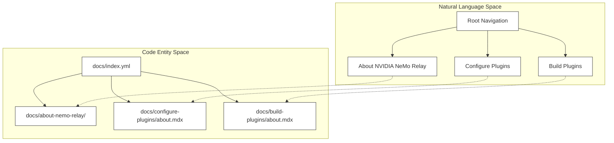
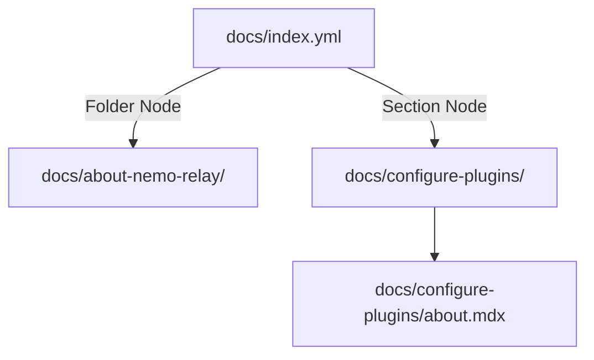
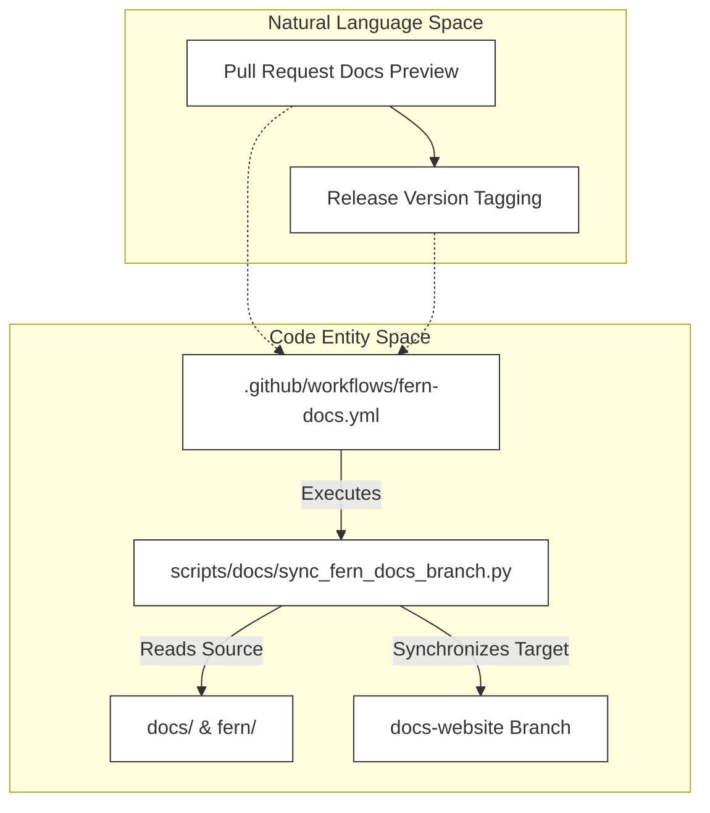
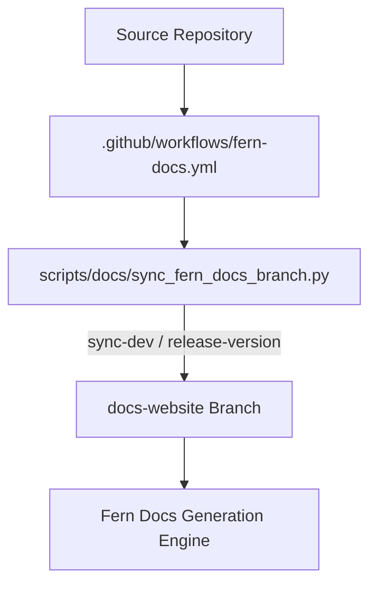
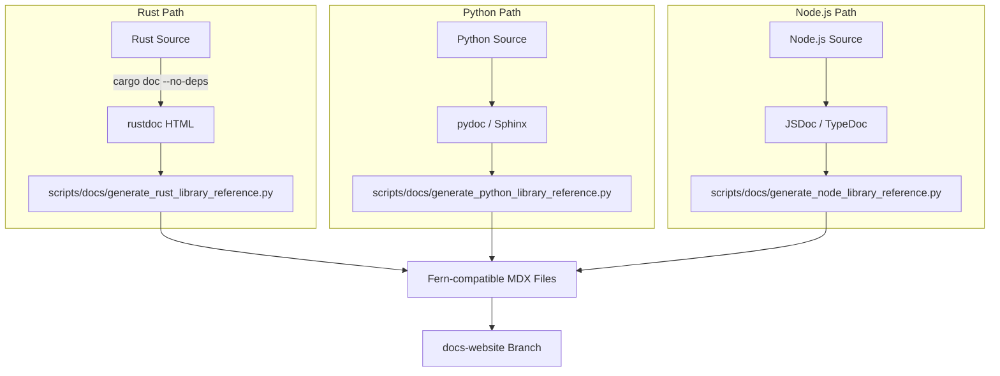

<!-- source: DeepWiki mcp.deepwiki.com · repo NVIDIA/NeMo-Relay · page 9.1 Fern Docs Site and API Reference Generation · fetched 2026-10-26 -->

# Fern Docs Site and API Reference Generation

<details>
<summary>Relevant source files</summary>

The following files were used as context for generating this wiki page:

- [.github/workflows/ci_changes.yml](.github/workflows/ci_changes.yml)
- [.github/workflows/ci_check.yml](.github/workflows/ci_check.yml)
- [.github/workflows/ci_go.yml](.github/workflows/ci_go.yml)
- [.github/workflows/ci_license_diff.yml](.github/workflows/ci_license_diff.yml)
- [.github/workflows/ci_node.yml](.github/workflows/ci_node.yml)
- [.github/workflows/ci_python.yml](.github/workflows/ci_python.yml)
- [.github/workflows/ci_rust.yml](.github/workflows/ci_rust.yml)
- [.github/workflows/fern-docs.yml](.github/workflows/fern-docs.yml)
- [crates/core/src/plugins/nemo_guardrails/local_worker.py](crates/core/src/plugins/nemo_guardrails/local_worker.py)
- [docs/about-nemo-relay/concepts/plugins.mdx](docs/about-nemo-relay/concepts/plugins.mdx)
- [docs/build-plugins/about.mdx](docs/build-plugins/about.mdx)
- [docs/configure-plugins/about.mdx](docs/configure-plugins/about.mdx)
- [docs/configure-plugins/nemo-guardrails/about.mdx](docs/configure-plugins/nemo-guardrails/about.mdx)
- [docs/configure-plugins/nemo-guardrails/configuration.mdx](docs/configure-plugins/nemo-guardrails/configuration.mdx)
- [docs/getting-started/configuration.mdx](docs/getting-started/configuration.mdx)
- [docs/index.yml](docs/index.yml)
- [docs/resources/glossary.mdx](docs/resources/glossary.mdx)
- [docs/resources/troubleshooting/index.mdx](docs/resources/troubleshooting/index.mdx)
- [scripts/docs/fern_cleanup.py](scripts/docs/fern_cleanup.py)
- [scripts/docs/generate_node_library_reference.py](scripts/docs/generate_node_library_reference.py)
- [scripts/docs/generate_python_library_reference.py](scripts/docs/generate_python_library_reference.py)
- [scripts/docs/generate_rust_library_reference.py](scripts/docs/generate_rust_library_reference.py)
- [scripts/docs/sync_fern_docs_branch.py](scripts/docs/sync_fern_docs_branch.py)
- [scripts/licensing/attributions_lockfile_md.py](scripts/licensing/attributions_lockfile_md.py)

</details>


## Purpose and Scope

This page details the implementation and automation of the NVIDIA NeMo Relay documentation site and its corresponding API references. It covers the Fern configuration (`docs/index.yml`), the structure and layout of MDX documentation pages (`docs/about-nemo-relay/concepts/plugins.mdx`), the branch synchronization engine (`scripts/docs/sync_fern_docs_branch.py`), and the automated code generators responsible for transforming raw language-specific documentation tools into Fern-compatible Markdown (.mdx) files.

Sources:
- [docs/index.yml]()
- [scripts/docs/sync_fern_docs_branch.py]()

## Fern Configuration and Navigation

The NeMo Relay documentation site structure is defined declaratively using Fern configuration manifests. The top-level navigation, grouping, and ordering are maintained in `docs/index.yml` [docs/index.yml:4-24](). This file establishes whether a navigation node evaluates as a directory `folder` or an explicit `section` with nested entries.

- **`folder`**: Maps to a physical documentation directory. Titles and slugs are resolved automatically from frontmatter or explicit properties [docs/index.yml:5-8]().
- **`section`**: Groups heterogeneous pages under a common sidebar heading with a custom `contents` array [docs/index.yml:25-27]().

The following diagram maps the high-level documentation navigation structure to the underlying file system configuration and code entities:

<div style={{ textAlign: "center" }}>



</div>

**Navigation Mapping**


Sources:
- [docs/index.yml:4-52]()

## Docs MDX Layout and Content Model

Documentation pages utilize MDX (Markdown with JSX extensions), enabling rich interactivity and embedded styling via components such as `<MermaidStyles />` [docs/about-nemo-relay/concepts/plugins.mdx:6](). Every document starts with a frontmatter block defining metadata such as `title`, `description`, and sidebar `position` [docs/about-nemo-relay/concepts/plugins.mdx:1-5]().

The structure of a conceptual documentation document is demonstrated by the plugin configuration page:

```mdx
---
title: "Plugins"
description: "Understand NeMo Relay plugin configuration, lifecycle, ownership, and built-in components."
position: 4
---
```

Sources:
- [docs/about-nemo-relay/concepts/plugins.mdx:1-5]()

## Branch Synchronization: `sync_fern_docs_branch.py`

The script `scripts/docs/sync_fern_docs_branch.py` manages the propagation of documentation artifacts from the source repository checkout to the dedicated `docs-website` publishing branch. It operates in distinct execution modes to support pull request previews and release tagging.

### `sync-dev` Mode

In `sync-dev` mode, the script copies the documentation root, `fern/` configurations, supporting `README.md` files, and `uv.lock` from the source workspace to the target workspace. This is invoked automatically in `.github/workflows/fern-docs.yml` during pull request validation [.github/workflows/fern-docs.yml:141-146]().

### `release-version` Mode

In `release-version` mode, the script mirrors documentation assets while injecting or updating version markers inside `docs/index.yml`, enabling multi-version documentation hosting on the publishing target.

The synchronization pipeline correlates workflow triggers with code entities as illustrated below:

<div style={{ textAlign: "center" }}>



</div>

**Documentation Synchronization Workflow**


Sources:
- [scripts/docs/sync_fern_docs_branch.py]()
- [.github/workflows/fern-docs.yml:141-146]()

## Generated Rust/Python/Node Library Reference Scripts

NeMo Relay automates API documentation generation across polyglot boundaries by invoking native doc tools and post-processing their outputs into Fern-compliant MDX format.

### Rust Library Reference Generation

The script `scripts/docs/generate_rust_library_reference.py` discovers and parses HTML documentation produced by `cargo doc`.

1. **`_run_cargo_doc`**: Invokes `cargo doc --no-deps` with `RUSTDOCFLAGS` configured via `--cap-lints allow` [scripts/docs/generate_rust_library_reference.py:154-169]().
2. **`CRATES`**: Defines the target crate tuple (`nemo-relay`, `nemo-relay-adaptive`, `nemo-relay-pii-redaction`, `nemo-relay-ffi`, `nemo-relay-types`, `nemo-relay-plugin`, `nemo-relay-worker-proto`, `nemo-relay-worker`) [scripts/docs/generate_rust_library_reference.py:23-35]().
3. **Parsing & Formatting**: Utilizes `BeautifulSoup` to clean HTML entities and maps signatures using helper functions such as `_escape_text`, `_clean_text`, `_clean_code`, `_mdx_safe_code`, `_inline_code`, and `_rust_fence` [scripts/docs/generate_rust_library_reference.py:90-127]().

### Python and Node.js Reference Scripts

Companion generators (`scripts/docs/generate_python_library_reference.py` and `scripts/docs/generate_node_library_reference.py`) ingest docstrings or JSDoc comments from Python and Node.js bindings respectively, normalizing them into structured MDX pages mapped under `/reference/api/`.

**API Reference Generation Pipeline**


Sources:
- [scripts/docs/generate_rust_library_reference.py:23-35]()
- [scripts/docs/generate_rust_library_reference.py:90-169]()
- [scripts/docs/generate_python_library_reference.py]()
- [scripts/docs/generate_node_library_reference.py]()

---

