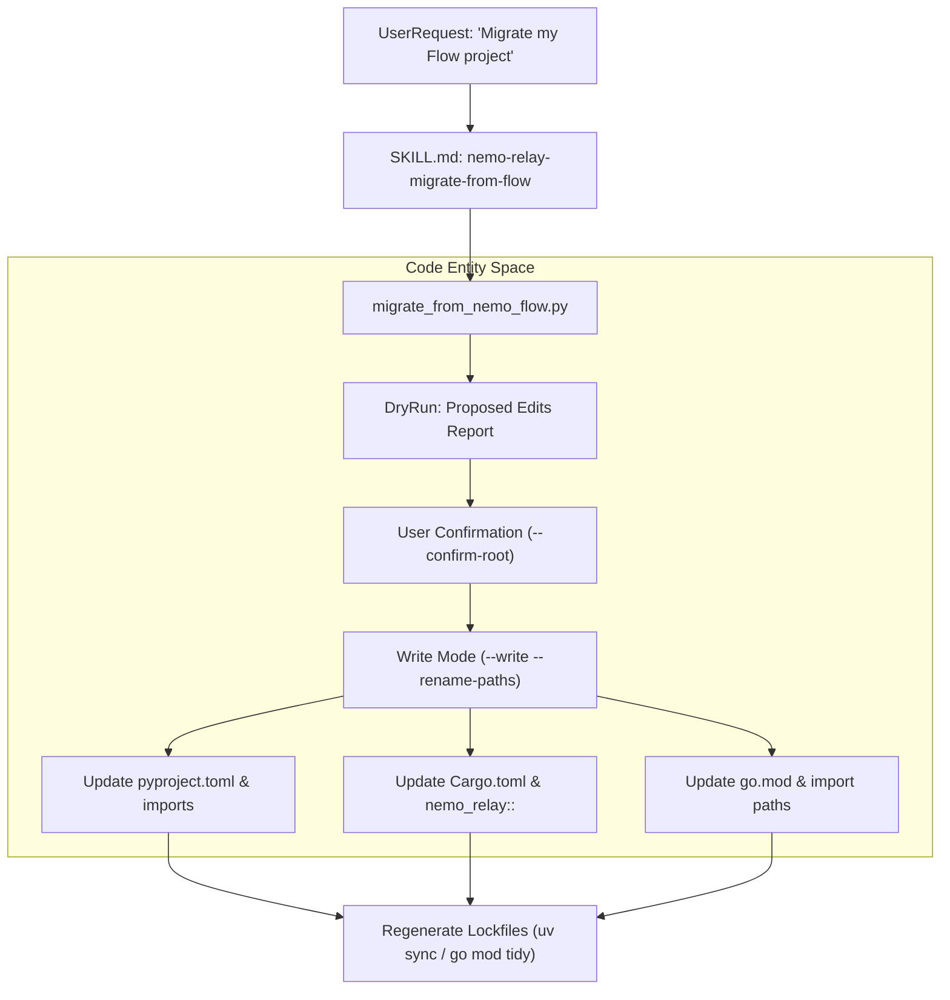
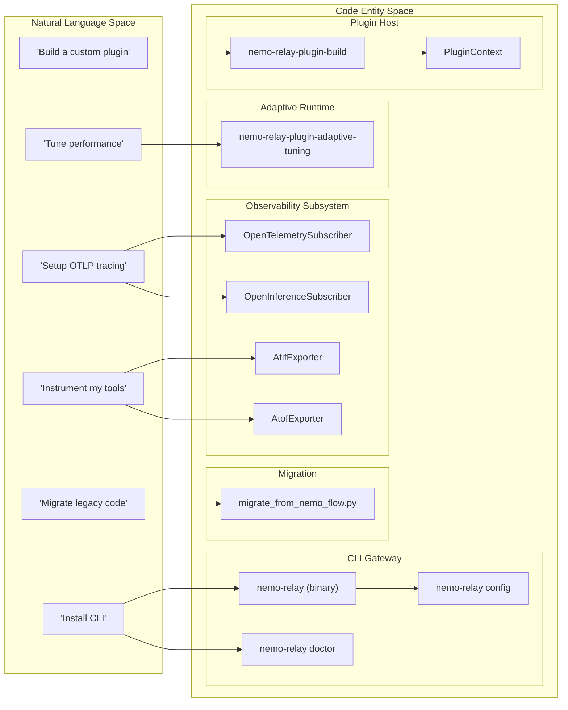

<!-- source: DeepWiki mcp.deepwiki.com · repo NVIDIA/NeMo-Relay · page 9.2 Consumer Skills (skills/) · fetched 2026-10-26 -->

# Consumer Skills (skills/)

Relevant source files

The following files were used as context for generating this wiki page:

- [docs/configure-plugins/observability/openinference.mdx](docs/configure-plugins/observability/openinference.mdx)
- [skills/README.md](skills/README.md)
- [skills/nemo-relay-debug-runtime-integration/BENCHMARK.md](skills/nemo-relay-debug-runtime-integration/BENCHMARK.md)
- [skills/nemo-relay-debug-runtime-integration/SKILL.md](skills/nemo-relay-debug-runtime-integration/SKILL.md)
- [skills/nemo-relay-debug-runtime-integration/skill-card.md](skills/nemo-relay-debug-runtime-integration/skill-card.md)
- [skills/nemo-relay-debug-runtime-integration/skill.oms.sig](skills/nemo-relay-debug-runtime-integration/skill.oms.sig)
- [skills/nemo-relay-get-started/BENCHMARK.md](skills/nemo-relay-get-started/BENCHMARK.md)
- [skills/nemo-relay-get-started/SKILL.md](skills/nemo-relay-get-started/SKILL.md)
- [skills/nemo-relay-get-started/evals/evals.json](skills/nemo-relay-get-started/evals/evals.json)
- [skills/nemo-relay-get-started/references/cli-try-now.md](skills/nemo-relay-get-started/references/cli-try-now.md)
- [skills/nemo-relay-get-started/skill-card.md](skills/nemo-relay-get-started/skill-card.md)
- [skills/nemo-relay-get-started/skill.oms.sig](skills/nemo-relay-get-started/skill.oms.sig)
- [skills/nemo-relay-migrate-from-flow/BENCHMARK.md](skills/nemo-relay-migrate-from-flow/BENCHMARK.md)
- [skills/nemo-relay-migrate-from-flow/SKILL.md](skills/nemo-relay-migrate-from-flow/SKILL.md)
- [skills/nemo-relay-migrate-from-flow/evals/evals.json](skills/nemo-relay-migrate-from-flow/evals/evals.json)
- [skills/nemo-relay-migrate-from-flow/scripts/migrate_from_nemo_flow.py](skills/nemo-relay-migrate-from-flow/scripts/migrate_from_nemo_flow.py)
- [skills/nemo-relay-migrate-from-flow/skill-card.md](skills/nemo-relay-migrate-from-flow/skill-card.md)
- [skills/nemo-relay-migrate-from-flow/skill.oms.sig](skills/nemo-relay-migrate-from-flow/skill.oms.sig)
- [skills/nemo-relay-plugin-adaptive-tuning/BENCHMARK.md](skills/nemo-relay-plugin-adaptive-tuning/BENCHMARK.md)
- [skills/nemo-relay-plugin-adaptive-tuning/SKILL.md](skills/nemo-relay-plugin-adaptive-tuning/SKILL.md)
- [skills/nemo-relay-plugin-adaptive-tuning/evals/evals.json](skills/nemo-relay-plugin-adaptive-tuning/evals/evals.json)
- [skills/nemo-relay-plugin-adaptive-tuning/skill-card.md](skills/nemo-relay-plugin-adaptive-tuning/skill-card.md)
- [skills/nemo-relay-plugin-adaptive-tuning/skill.oms.sig](skills/nemo-relay-plugin-adaptive-tuning/skill.oms.sig)
- [skills/nemo-relay-plugin-build/BENCHMARK.md](skills/nemo-relay-plugin-build/BENCHMARK.md)
- [skills/nemo-relay-plugin-build/SKILL.md](skills/nemo-relay-plugin-build/SKILL.md)
- [skills/nemo-relay-plugin-build/evals/evals.json](skills/nemo-relay-plugin-build/evals/evals.json)
- [skills/nemo-relay-plugin-build/skill-card.md](skills/nemo-relay-plugin-build/skill-card.md)
- [skills/nemo-relay-plugin-build/skill.oms.sig](skills/nemo-relay-plugin-build/skill.oms.sig)
- [skills/nemo-relay-plugin-observability/BENCHMARK.md](skills/nemo-relay-plugin-observability/BENCHMARK.md)
- [skills/nemo-relay-plugin-observability/SKILL.md](skills/nemo-relay-plugin-observability/SKILL.md)
- [skills/nemo-relay-plugin-observability/evals/evals.json](skills/nemo-relay-plugin-observability/evals/evals.json)
- [skills/nemo-relay-plugin-observability/references/atof.md](skills/nemo-relay-plugin-observability/references/atof.md)
- [skills/nemo-relay-plugin-observability/references/openinference.md](skills/nemo-relay-plugin-observability/references/openinference.md)
- [skills/nemo-relay-plugin-observability/references/opentelemetry.md](skills/nemo-relay-plugin-observability/references/opentelemetry.md)
- [skills/nemo-relay-plugin-observability/skill-card.md](skills/nemo-relay-plugin-observability/skill-card.md)
- [skills/nemo-relay-plugin-observability/skill.oms.sig](skills/nemo-relay-plugin-observability/skill.oms.sig)

Consumer skills are self-contained, task-oriented guides and automation scripts located in the `skills/` directory. They are designed for application developers, framework integrators, operators, and end users to facilitate the adoption, installation, instrumentation, configuration, and optimization of NeMo Relay [skills/README.md:8-11]().

Sources: [skills/README.md:8-11]()

## Directory Overview and Conventions

The `skills/` directory follows structural conventions to ensure portability, discoverability, and safety:
*   **Naming Conventions**: Public skill directories use a `nemo-relay-` prefix to remain recognizable and collision-resistant when exported outside the repository [skills/nemo-relay-migrate-from-flow/SKILL.md:2]().
*   **Self-Containment**: Each skill is autonomous. While skills may reference shared concepts or external documentation, they embed critical workflow instructions directly within their `SKILL.md` or associated `references/` directories [skills/nemo-relay-get-started/SKILL.md:20-38]().
*   **Skill Card Structure**: Each skill includes a `skill-card.md` file detailing its description, owner, license, use case, requirements, known risks, references, output format, evaluation metrics, and benchmark results [skills/nemo-relay-get-started/skill-card.md:1-86]().
*   **Benchmarking**: Skills maintain a `BENCHMARK.md` file recording evaluation metadata, execution provenance, and comparative agent scores across dimensions such as Security, Correctness, Discoverability, Effectiveness, and Efficiency [skills/nemo-relay-get-started/BENCHMARK.md:1-111]().
*   **Eager Skill Loading**: When an agent reads a complete `SKILL.md`, the runtime automatically emits `skill.load` marks under the active tool span. The payload records only the `skill_name`, while metadata tracks the load source and tool name [skills/nemo-relay-plugin-observability/SKILL.md:86-89]().

Sources: [skills/nemo-relay-migrate-from-flow/SKILL.md:2](), [skills/nemo-relay-get-started/SKILL.md:20-38](), [skills/nemo-relay-get-started/skill-card.md:1-86](), [skills/nemo-relay-get-started/BENCHMARK.md:1-111](), [skills/nemo-relay-plugin-observability/SKILL.md:86-89]()

## Available Consumer Skills

The `skills/` directory includes nine core consumer skills covering onboarding, instrumentation, plugins, migration, and debugging:

| Skill Directory | Primary Purpose |
|:---|:---|
| `nemo-relay-get-started` | Initial trial selection, coding-agent CLI try-now guidance (Codex, Claude Code), and first-run verification [skills/nemo-relay-get-started/SKILL.md:15-39](). |
| `nemo-relay-install` | Installation management for the `nemo-relay` CLI, language packages, and maintained framework integrations [skills/README.md:53](). |
| `nemo-relay-instrument-calls` | Guidance for wrapping application-owned tool and LLM calls with scopes and managed execution APIs [skills/README.md:61-62](). |
| `nemo-relay-plugin-observability` | Configuring canonical event subscribers and exporters (ATOF, ATIF, OpenTelemetry, OpenInference) [skills/README.md:71-72](). |
| `nemo-relay-plugin-adaptive-tuning` | Configuration of adaptive runtime behavior, hints, parallelism, and caching [skills/README.md:74-75](). |
| `nemo-relay-plugin-build` | Packaging reusable runtime behavior as a configuration-driven plugin [skills/README.md:75](). |
| `nemo-relay-integrate-upstream` | Assessing, implementing, and qualifying Relay integrations in unsupported agent frameworks or harnesses [skills/README.md:64-65](). |
| `nemo-relay-debug-runtime-integration` | Diagnosing loading failures, inactive scopes, missing events, and plugin wiring problems [skills/README.md:84](). |
| `nemo-relay-migrate-from-flow` | Mechanical renaming and automation script for converting NeMo Flow codebases to NeMo Relay [skills/nemo-relay-migrate-from-flow/SKILL.md:11-13](). |

Sources: [skills/README.md:53-84](), [skills/nemo-relay-get-started/SKILL.md:15-39](), [skills/nemo-relay-migrate-from-flow/SKILL.md:11-13]()

## Observability and Exporters

The `nemo-relay-plugin-observability` skill manages event consumption, distinguishing between NeMo Relay 0.6 and 0.7 configuration models [skills/nemo-relay-plugin-observability/SKILL.md:20-33]().

### Version-Specific Configuration Models
*   **Relay 0.6**: Uses observability configuration version 2. OpenTelemetry and OpenInference are distinct exporters initialized via separate classes (`OpenTelemetryConfig`, `OpenInferenceConfig`) [skills/nemo-relay-plugin-observability/SKILL.md:27-30]().
*   **Relay 0.7**: Uses observability configuration version 3. A unified `OpenTelemetrySubscriber` supports typed projections: `full`, `gen_ai`, and `openinference` [skills/nemo-relay-plugin-observability/SKILL.md:31-32]().

### Exporter Types
*   **ATOF**: Raw JSONL lifecycle events for local debugging and offline audit [skills/nemo-relay-plugin-observability/SKILL.md:40-41]().
*   **ATIF**: Portable execution trajectories capturing agent roots and turns [skills/nemo-relay-plugin-observability/SKILL.md:42-43]().
*   **OpenTelemetry**: OTLP tracing for distributed backends via `http_binary` or `grpc` transports [skills/nemo-relay-plugin-observability/references/opentelemetry.md:56-60]().
*   **OpenInference**: Model-centric tracing projections compatible with Arize Phoenix and related backends [docs/configure-plugins/observability/openinference.mdx:9-11]().

Sources: [skills/nemo-relay-plugin-observability/SKILL.md:20-55](), [skills/nemo-relay-plugin-observability/references/opentelemetry.md:56-60](), [docs/configure-plugins/observability/openinference.mdx:9-11]()

## Migration from NeMo Flow (`migrate_from_nemo_flow.py`)

The `nemo-relay-migrate-from-flow` skill provides a mechanical rename map and an automation script to convert legacy codebases [skills/nemo-relay-migrate-from-flow/SKILL.md:11-13]().

### Mechanical Rename Map
*   **Brand and Repository**: `NeMo Flow` → `NeMo Relay`, `NeMo-Flow` → `NeMo-Relay` [skills/nemo-relay-migrate-from-flow/SKILL.md:37-38]()
*   **Python Package**: `nemo-flow` → `nemo-relay`, `nemo_flow` → `nemo_relay` [skills/nemo-relay-migrate-from-flow/SKILL.md:39-40]()
*   **Rust Crates**: `nemo-flow` → `nemo-relay`, `nemo-flow-adaptive` → `nemo-relay-adaptive` [skills/nemo-relay-migrate-from-flow/SKILL.md:41-42]()
*   **C FFI Header**: `nemo_flow.h` → `nemo_relay.h`, `nemo_flow_*` → `nemo_relay_*` [skills/nemo-relay-migrate-from-flow/SKILL.md:49-51]()

### Automation Script Implementation
The script located at `skills/nemo-relay-migrate-from-flow/scripts/migrate_from_nemo_flow.py` executes dry runs and writes updates under strict safety constraints:
*   **Directory Anchoring**: Uses low-level directory descriptors (`os.O_DIRECTORY`, `os.O_NOFOLLOW`) to prevent symbolic-link substitution attacks [skills/nemo-relay-migrate-from-flow/SKILL.md:94-96]().
*   **Exclusions**: Skips standard vendor, build, cache, and hidden directories [skills/nemo-relay-migrate-from-flow/SKILL.md:86]().
*   **Legacy Configuration Handling**: Detects project-local `.nemo-flow/config.toml` and `.nemo-flow/plugins.toml`, leaves them untouched, and reports that they require manual migration to supported user paths [skills/nemo-relay-migrate-from-flow/SKILL.md:89-91]().

Sources: [skills/nemo-relay-migrate-from-flow/SKILL.md:11-96]()

## Data Flow: Migration Execution

The following diagram bridges the natural language migration request to the underlying script execution and code entity space.

Title: "Migration Skill Execution Flow"

Sources: [skills/nemo-relay-migrate-from-flow/SKILL.md:16-30](), [skills/nemo-relay-migrate-from-flow/evals/evals.json:1-46]()

## Natural Language to Code Entity Mapping

The following diagram bridges natural language consumer intents to specific code entities and components in the repository.

Title: "Consumer Task to Code Entity Mapping"

Sources: [skills/nemo-relay-migrate-from-flow/SKILL.md:2-3](), [skills/nemo-relay-plugin-observability/SKILL.md:104-112](), [skills/nemo-relay-get-started/references/cli-try-now.md:98-101](), [skills/README.md:74-75](), [skills/nemo-relay-get-started/references/cli-try-now.md:164-167](), [skills/nemo-relay-plugin-build/SKILL.md:1-107]()

---

