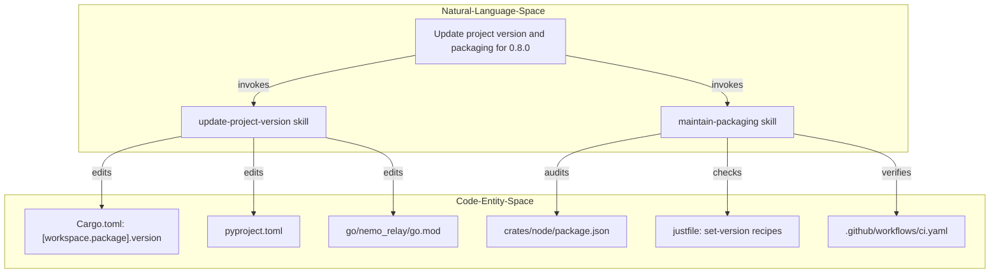
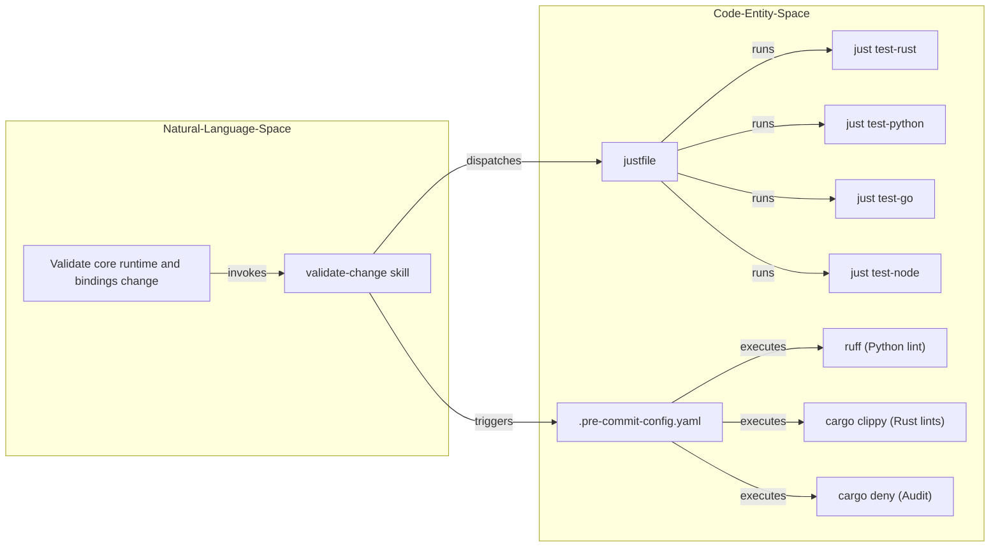

<!-- source: DeepWiki mcp.deepwiki.com · repo NVIDIA/NeMo-Relay · page 9.3 Maintainer Skills and Contribution Workflow · fetched 2026-10-26 -->

# Maintainer Skills and Contribution Workflow

<details>
<summary>Relevant source files</summary>

The following files were used as context for generating this wiki page:

- [.agents/skills/README.md](.agents/skills/README.md)
- [.agents/skills/add-binding-feature/SKILL.md](.agents/skills/add-binding-feature/SKILL.md)
- [.agents/skills/add-middleware/SKILL.md](.agents/skills/add-middleware/SKILL.md)
- [.agents/skills/contribute-docs/SKILL.md](.agents/skills/contribute-docs/SKILL.md)
- [.agents/skills/contribute-integration/SKILL.md](.agents/skills/contribute-integration/SKILL.md)
- [.agents/skills/draft-release-notes/SKILL.md](.agents/skills/draft-release-notes/SKILL.md)
- [.agents/skills/maintain-ci/SKILL.md](.agents/skills/maintain-ci/SKILL.md)
- [.agents/skills/maintain-dynamic-plugins/SKILL.md](.agents/skills/maintain-dynamic-plugins/SKILL.md)
- [.agents/skills/maintain-observability/SKILL.md](.agents/skills/maintain-observability/SKILL.md)
- [.agents/skills/maintain-optimizer/SKILL.md](.agents/skills/maintain-optimizer/SKILL.md)
- [.agents/skills/maintain-packaging/SKILL.md](.agents/skills/maintain-packaging/SKILL.md)
- [.agents/skills/prepare-code-freeze/SKILL.md](.agents/skills/prepare-code-freeze/SKILL.md)
- [.agents/skills/prepare-pr/SKILL.md](.agents/skills/prepare-pr/SKILL.md)
- [.agents/skills/rename-surfaces/SKILL.md](.agents/skills/rename-surfaces/SKILL.md)
- [.agents/skills/update-project-version/SKILL.md](.agents/skills/update-project-version/SKILL.md)
- [.github/workflows/nightly-alpha-tag.yaml](.github/workflows/nightly-alpha-tag.yaml)
- [AGENTS.md](AGENTS.md)
- [CONTRIBUTING.md](CONTRIBUTING.md)
- [docs/contribute/testing-and-docs.mdx](docs/contribute/testing-and-docs.mdx)
- [docs/contribute/workflow-and-reviews.mdx](docs/contribute/workflow-and-reviews.mdx)
- [docs/resources/support-and-faqs.mdx](docs/resources/support-and-faqs.mdx)

</details>


The `.agents/skills/` directory contains machine-readable and human-navigable guidance designed for AI agents (such as Claude Code, Cursor, or Codex) and repository maintainers to ensure strict consistency across the polyglot NeMo Relay codebase. These skills define operational workflows for project versioning, code freezes, pull request preparation, packaging audits, CI maintenance, and cross-binding validation.

## Purpose and Scope

As a multi-language project coordinating a Rust core runtime (`crates/core`), Python wrappers (`python/nemo_relay`), Node.js native extensions (`crates/node`), Go bindings (`go/nemo_relay`), and dynamic plugin architectures, NeMo Relay requires adherence to strict synchronization and testing rules. The agent skills act as executable documentation bridging natural language tasks to concrete shell commands, configuration files, and validation matrices.

- **Project Operations**: Automate version updates (`update-project-version`) and release branching (`prepare-code-freeze`) [ [.agents/skills/update-project-version/SKILL.md:1-5](), [.agents/skills/prepare-code-freeze/SKILL.md:1-5]() ].
- **Maintainer Skills**: Manage CI/CD security (`maintain-ci`), packaging metadata (`maintain-packaging`), and dynamic plugin ABIs (`maintain-dynamic-plugins`) [ [.agents/skills/maintain-ci/SKILL.md:1-10](), [.agents/skills/maintain-packaging/SKILL.md:1-10](), [.agents/skills/maintain-dynamic-plugins/SKILL.md:1-10]() ].
- **Validation and Review**: Define testing matrices (`validate-change`), Python binding test rules (`test-python-binding`), documentation standards (`contribute-docs`), and pull request hygiene (`prepare-pr`) [ [.agents/skills/validate-change/SKILL.md:1-10](), [.agents/skills/contribute-docs/SKILL.md:1-10](), [.agents/skills/prepare-pr/SKILL.md:1-10]() ].

Sources: [AGENTS.md:36-37](), [.agents/skills/update-project-version/SKILL.md:1-15](), [.agents/skills/prepare-code-freeze/SKILL.md:1-15]()

---

## Development Setup and Environment

Contributor and maintainer environments rely on standardized toolchains for Rust, Python, Node.js, and Go. The repository uses `just` as the unified command runner for all build, test, and release recipes.

### Prerequisites and Tooling
Before building or testing NeMo Relay from source, ensure the following tools are installed [ [CONTRIBUTING.md:28-38]() ]:
- **Rust**: Stable toolchain installed via `rustup` [ [CONTRIBUTING.md:30-30]() ].
- **Python**: Python >= 3.11 managed via `uv` [ [CONTRIBUTING.md:31-31]() ].
- **just**: Task runner installed via `cargo install just --locked` [ [CONTRIBUTING.md:32-32]() ].
- **Go**: Go >= 1.21 [ [CONTRIBUTING.md:33-33]() ].
- **Node.js**: LTS release [ [CONTRIBUTING.md:34-34]() ].
- **Testing & Auditing**: `cargo-nextest` 0.9.133, `cargo-deny`, and `cargo-about` 0.9.1 [ [CONTRIBUTING.md:35-37]() ].

### Initial Workspace Bootstrap
Clone the repository and initialize the development workspace using the workspace sync and build recipes [ [CONTRIBUTING.md:42-55]() ]:

```bash
git clone https://github.com/NVIDIA/NeMo-Relay.git && cd NeMo-Relay
uv sync
cargo install just --locked
cargo install cargo-nextest --version 0.9.133 --locked
uv run pre-commit install
just build-rust
just build-python
just build-node
```

Sources: [CONTRIBUTING.md:10-68](), [docs/contribute/testing-and-docs.mdx:9-50]()

---

## Project Versioning and Code Freeze

Releasing new versions across the polyglot workspace requires strict adherence to version automation rules and branch lifecycles.

### Project Versioning (`update-project-version`)
The `update-project-version` skill governs version synchronization across the workspace [ [.agents/skills/update-project-version/SKILL.md:1-5]() ]:
- **Source of Truth**: `Cargo.toml` `[workspace.package].version` acts as the single Rust and project-level version source [ [.agents/skills/update-project-version/SKILL.md:14-14]() ].
- **Single Entrypoint**: `just set-version <version>` is the sole repository command for updating normal project-version surfaces across manifests, lockfiles, and plugins [ [.agents/skills/update-project-version/SKILL.md:15-17]() ].
- **Translation Rules**: Python packages translate workspace SemVer to valid PEP 440 forms where required, while Cargo, npm, and plugin manifests retain SemVer [ [.agents/skills/update-project-version/SKILL.md:21-23]() ].

### Code Freeze Execution (`prepare-code-freeze`)
The `prepare-code-freeze` skill coordinates cutting release branches and preparing `main` for the next development cycle [ [.agents/skills/prepare-code-freeze/SKILL.md:1-5]() ]:
1. **Derive Release Branch**: Cut `release/<major>.<minor>` from `upstream/main` [ [.agents/skills/prepare-code-freeze/SKILL.md:17-27]() ].
2. **Configure Nightly Alphas**: Update `.github/nightly-alpha-branches.yaml` to include the new release branch for automated nightly builds managed by `.github/workflows/nightly-alpha-tag.yaml` [ [.agents/skills/prepare-code-freeze/SKILL.md:31-34](), [.github/workflows/nightly-alpha-tag.yaml:17-45]() ].
3. **Bump Main Version**: Run `just set-version <next-version>` on `main` and regenerate lockfiles for fixtures such as `crates/core/tests/fixtures/worker_plugin/Cargo.toml` [ [.agents/skills/prepare-code-freeze/SKILL.md:35-43]() ].
4. **Documentation Updates**: Update version references across `README.md`, `docs/`, and `fern/` [ [.agents/skills/prepare-code-freeze/SKILL.md:44-54]() ].

Sources: [.agents/skills/update-project-version/SKILL.md:1-65](), [.agents/skills/prepare-code-freeze/SKILL.md:1-76](), [.github/workflows/nightly-alpha-tag.yaml:1-102]()

---

## Core Maintainer Skills

### CI/CD Maintenance (`maintain-ci`)
The `maintain-ci` skill ensures the security, integrity, and determinism of GitHub Actions workflows.
- **Permission Model**: Every workflow job must declare an explicit `permissions:` block. `contents: read` is the baseline minimum for checkout-based jobs [ [.agents/skills/maintain-ci/SKILL.md:23-25]() ].
- **Action Pinning**: Third-party GitHub Actions must be pinned to immutable commit SHAs accompanied by readable version comments [ [.agents/skills/maintain-ci/SKILL.md:26-27]() ].
- **Tagging & Labels**: Release tags must use raw SemVer without a leading `v`, aligning with Cargo and registry expectations [ [.agents/skills/maintain-ci/SKILL.md:35-36]() ].

### Packaging Maintenance (`maintain-packaging`)
The `maintain-packaging` skill audits how NeMo Relay packages are defined, named, and built outside the source tree [ [.agents/skills/maintain-packaging/SKILL.md:1-12]() ].
- **Audit Scope**: Covers root `Cargo.toml`, `pyproject.toml`, `python/plugin/pyproject.toml`, `go/nemo_relay/go.mod`, workspace `package.json`, `package-lock.json`, and FFI header outputs [ [.agents/skills/maintain-packaging/SKILL.md:15-24]() ].
- **Unified Release**: New packages or plugins must explicitly integrate with `set_project_version` in the `justfile` to ensure version pins remain synchronized [ [.agents/skills/maintain-packaging/SKILL.md:29-38]() ].

### Dynamic Plugin Maintenance (`maintain-dynamic-plugins`)
Governs the ABI and protocol boundaries for native (`rust_dynamic`) and worker (`worker`) plugins [ [.agents/skills/maintain-dynamic-plugins/SKILL.md:1-11]() ]:
- **Stable Boundaries**: Native plugins cross a C ABI (ABI v4 with append-only host tables); worker plugins communicate over `grpc-v1` (`nemo.relay.worker.v1`) [ [.agents/skills/maintain-dynamic-plugins/SKILL.md:15-16](), [.agents/skills/maintain-dynamic-plugins/SKILL.md:33-35]() ].
- **Compatibility Declarations**: Plugins must declare a `compat.relay` range (e.g., `>=0.8.0,<1.0`) excluding pre-0.8 versions [ [.agents/skills/maintain-dynamic-plugins/SKILL.md:27-30]() ].

**Data Flow: Version and Packaging Synchronization**
The following diagram maps high-level maintainer requests to the concrete configuration files and build recipes audited during packaging and version updates.


Sources: [.agents/skills/maintain-packaging/SKILL.md:1-58](), [.agents/skills/update-project-version/SKILL.md:1-65](), [.agents/skills/maintain-dynamic-plugins/SKILL.md:1-45]()

---

## Validation and Testing Matrix

Changes to the codebase must be validated using the narrowest focused test suite possible before handoff, followed by canonical surface suites when public contracts are affected [ [AGENTS.md:39-50](), [CONTRIBUTING.md:170-177]() ].

### Validation Dispatcher (`validate-change`)
The `validate-change` skill determines the required verification steps based on the shape of the change [ [.agents/skills/validate-change/SKILL.md:1-19]() ]:

| Change Shape | Mandatory Command / Skill | Execution Surface & Scope |
| :--- | :--- | :--- |
| Core Runtime / Adaptive | `just test-rust` | Full Rust test suite via `cargo-nextest` [ [CONTRIBUTING.md:181-182]() ]. |
| Python Binding & Wrapper | `just test-python` | `uv run pytest` across `python/nemo_relay` and `crates/python` [ [docs/contribute/testing-and-docs.mdx:28-28]() ]. |
| Node.js Binding | `just test-node` | `npm test --workspace=nemo-relay-node` and NAPI tests [ [CONTRIBUTING.md:185-185](), [docs/contribute/testing-and-docs.mdx:98-98]() ]. |
| Go Binding & FFI | `just test-go` | CGo binding tests against `crates/ffi` [ [CONTRIBUTING.md:60-63](), [CONTRIBUTING.md:184-184]() ]. |
| Dynamic Plugins | `just build-test-plugin-fixtures` + test | Compiles test fixtures before running plugin integration suites [ [docs/contribute/testing-and-docs.mdx:37-43]() ]. |

### Pre-commit Hooks and Quality Checks
Pre-commit hooks configured in `.pre-commit-config.yaml` run automatically on `git commit` or manually via `uv run pre-commit run` [ [CONTRIBUTING.md:143-163]() ]:
- **General**: Trailing whitespace, YAML/TOML validity, 500 KB large file checks [ [CONTRIBUTING.md:153-153]() ].
- **Rust**: `cargo fmt`, `cargo clippy -- -D warnings`, FFI header sync for `crates/ffi/nemo_relay.h`, and `cargo deny check` [ [CONTRIBUTING.md:156-156]() ].
- **Python**: Ruff linting/formatting and `ty` type checking [ [CONTRIBUTING.md:155-155]() ].
- **Documentation**: Fern validation and `lychee` link checking [ [CONTRIBUTING.md:154-154]() ].

**System Interaction: Validation Flow**
The diagram below maps validation intent to repository build tools, test runners, and static analysis hooks.


Sources: [AGENTS.md:39-54](), [CONTRIBUTING.md:143-187](), [docs/contribute/testing-and-docs.mdx:9-65]()

---

## Documentation and Pull Request Workflow

Contributions must follow rigorous formatting, documentation hygiene, and pull request structure guidelines.

### Documentation Contributions (`contribute-docs`)
When authoring or updating docs in `docs/` or `fern/`, maintainers must adhere to the `contribute-docs` skill [ [.agents/skills/contribute-docs/SKILL.md:1-12]() ]:
- **Public API**: Prefer documented public APIs over internal implementation shortcuts [ [.agents/skills/contribute-docs/SKILL.md:14-14]() ].
- **MDX Hygiene**: Top-of-file comments in MDX files must use JSX comment delimiters (`{/* ... */}`) rather than HTML comments for SPDX headers [ [.agents/skills/contribute-docs/SKILL.md:29-31]() ].
- **Docs Validation**: Run `just docs` to validate the Fern documentation site and regenerate API references [ [docs/contribute/testing-and-docs.mdx:116-124]() ].

### Pull Request Preparation (`prepare-pr`)
The `prepare-pr` skill governs the creation and formatting of pull requests [ [.agents/skills/prepare-pr/SKILL.md:1-12]() ]:
- **Conventional Commits**: PR titles must follow Conventional Commit format (`<type>: <concise imperative summary>`) [ [.agents/skills/prepare-pr/SKILL.md:30-34]() ]. The `fix` type is strictly reserved for user-facing or runtime product bug fixes [ [.agents/skills/prepare-pr/SKILL.md:37-40]() ].
- **Template Source of Truth**: Pull request bodies must use `.github/pull_request_template.md`, preserving required sections for Overview, Details, Reviewer starting points, and Related Issues [ [.agents/skills/prepare-pr/SKILL.md:54-84]() ].

Sources: [.agents/skills/contribute-docs/SKILL.md:1-50](), [.agents/skills/prepare-pr/SKILL.md:1-92](), [docs/contribute/testing-and-docs.mdx:102-124]()

---

