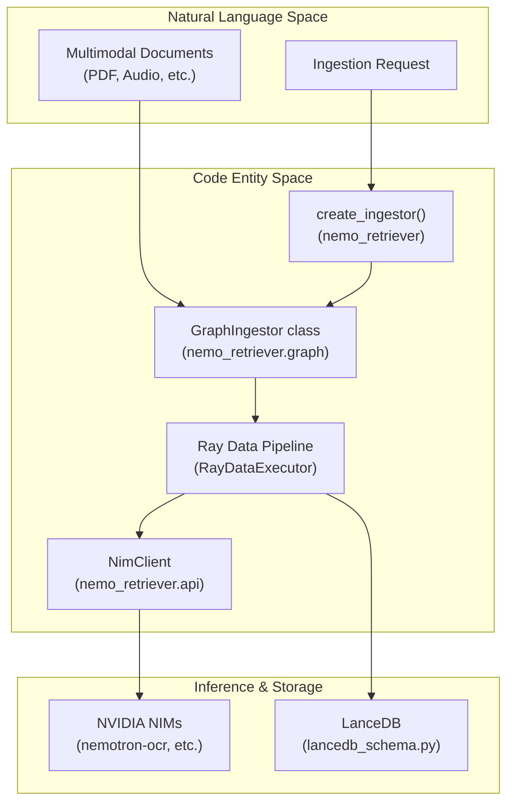
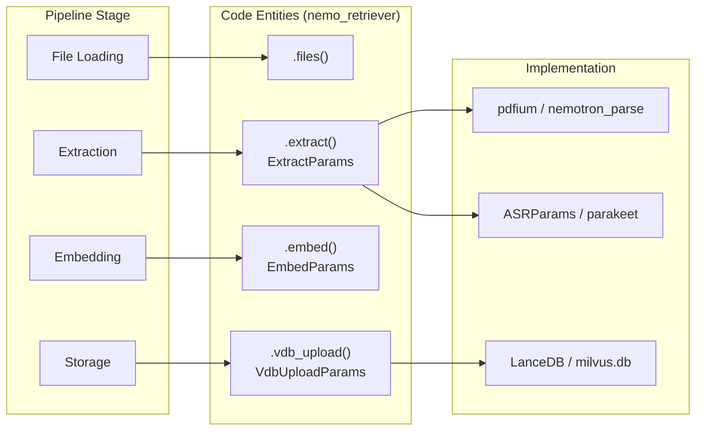

<!-- source: DeepWiki mcp.deepwiki.com · repo NVIDIA/NeMo-Retriever · page 1 Overview · fetched 2026-10-26 -->

# Overview

Relevant source files

The following files were used as context for generating this wiki page:

- [README.md](README.md)
- [docs/docs/extraction/audio-video.md](docs/docs/extraction/audio-video.md)
- [docs/docs/extraction/concepts.md](docs/docs/extraction/concepts.md)
- [docs/docs/extraction/getting-started-about.md](docs/docs/extraction/getting-started-about.md)
- [docs/docs/extraction/overview.md](docs/docs/extraction/overview.md)
- [docs/docs/index.md](docs/docs/index.md)
- [docs/mkdocs.yml](docs/mkdocs.yml)
- [nemo_retriever/README.md](nemo_retriever/README.md)
- [nemo_retriever/docs/cli/README.md](nemo_retriever/docs/cli/README.md)

This page introduces the **NeMo Retriever Library** (also referred to as **NVIDIA Ingest**), a scalable, performance-oriented framework for document content and metadata extraction. It is designed to find, contextualize, and extract text, tables, charts, and infographics for use in downstream generative and retrieval-augmented generation (RAG) applications. [README.md:13-18](), [docs/docs/extraction/overview.md:1-4]().

For detailed information on the system's inner workings, see:
- **[System Architecture](#1.1)** — Deep dive into the graph-based execution model, Ray Data integration, and deployment orchestration.
- **[Package Structure](#1.2)** — Documentation of the Python packages (`nemo-retriever`, `nemo-retriever-api`, etc.) and their relationships.

---

## Purpose and Scope

NeMo Retriever Library enables the parallelization of document processing by splitting files into pages where artifacts are classified, extracted, and contextualized through optical character recognition (OCR) into a well-defined JSON schema. [README.md:20-21]().

**Key Capabilities:**
- **Multimodal Extraction:** Supports PDFs, HTML, Word docs, Powerpoint, audio, video, and images. [docs/docs/extraction/overview.md:3-4]().
- **Flexible Inference:** Supports both NVIDIA NIM microservices (hosted or self-hosted) and local GPU inference using Hugging Face models. [nemo_retriever/README.md:5-7]().
- **Chainable Task Pipeline:** Uses a fluent Python API to chain tasks like `.files()`, `.extract()`, `.embed()`, and `.vdb_upload()`. [README.md:46-57]().
- **Vector Database Integration:** Manages embedding computation and storage in LanceDB. [README.md:20-21]().

**Sources:** [README.md:13-57](), [docs/docs/extraction/overview.md:1-21](), [nemo_retriever/README.md:1-7]().

---

## High-Level Architecture

The system bridges high-level user requests to low-level GPU-accelerated microservices and distributed processing frameworks.

### System Context Diagram
This diagram illustrates how the system components interact, mapping Natural Language concepts to the underlying code entities.

**Sources:** [README.md:38-43](), [nemo_retriever/README.md:100-116](), [docs/docs/extraction/concepts.md:7-11]().

---

## Typical Use and Workflow

NeMo Retriever Library does not run a single static pipeline. Instead, users configure **tasks** such as parsing, chunking, and embedding per job. [docs/docs/extraction/concepts.md:9-11]().

### Workflow to Code Mapping
This diagram shows the relationship between pipeline stages and the code-level parameters/classes that control them.

**Sources:** [README.md:46-57](), [docs/docs/extraction/concepts.md:21-30](), [docs/docs/extraction/audio-video.md:81-96]().

---

## Deployment Modes

NeMo Retriever Library supports three primary deployment modes to accommodate different scales and environments: [docs/docs/extraction/concepts.md:35-41]().

| Mode | Description | Primary Use Case |
| :--- | :--- | :--- |
| **Library Mode** | Runs within local Python processes without containers. Supports local GPU (Hugging Face) or remote NIMs. | Development and small-scale workloads (<100 PDFs). |
| **Docker Compose** | Standalone service-image builds and local containerized runs. | Testing and standalone server deployments. |
| **Helm / Kubernetes** | Orchestrates the retriever service and NIM workloads using the NIM Operator. | Production-level performance and scalability. |

**Sources:** [README.md:26-34](), [nemo_retriever/README.md:5-16](), [docs/docs/extraction/concepts.md:35-41]().

---

## Supported File Types

The library supports a wide array of media types for extraction: [docs/docs/extraction/overview.md:24-45]().

*   **Documents:** `pdf`, `docx`, `pptx`, `html`, `txt`, `md`.
*   **Images:** `png`, `jpeg`, `tiff`, `bmp`, `svg`.
*   **Audio/Video:** `mp3`, `wav`, `mp4`, `mov`, `mkv`, `avi`.
*   **Structured/Code:** `json`, `sh`.

**Sources:** [docs/docs/extraction/overview.md:24-45](), [docs/docs/extraction/audio-video.md:16-20]().

---

